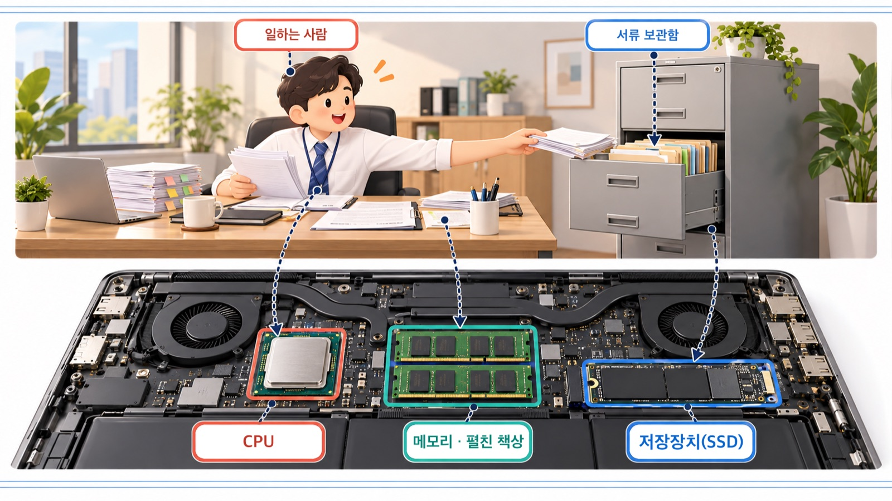
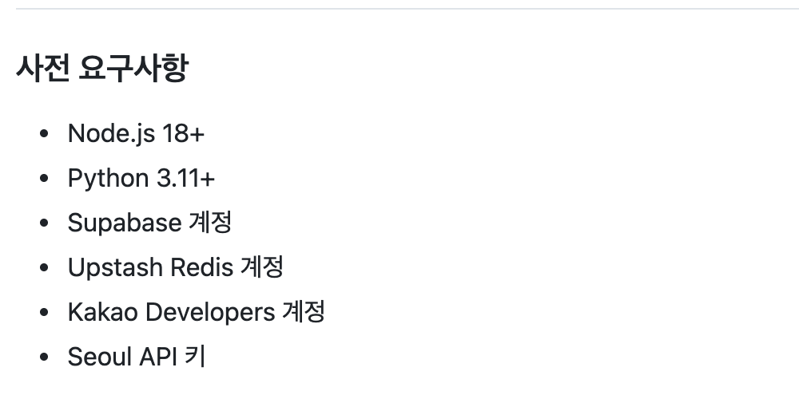
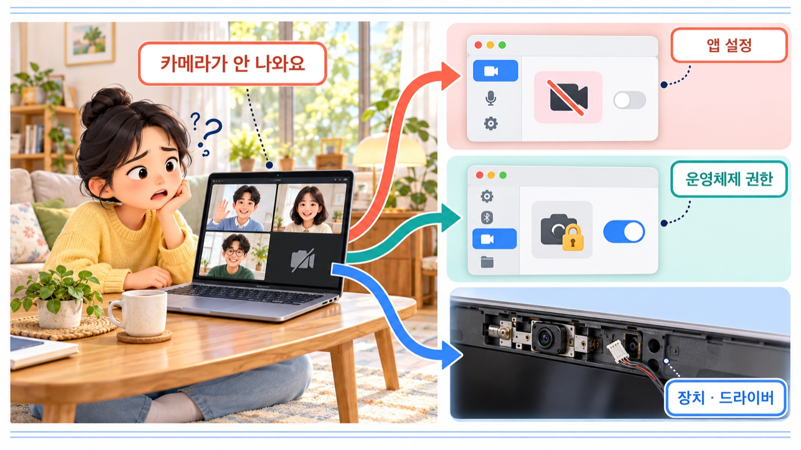
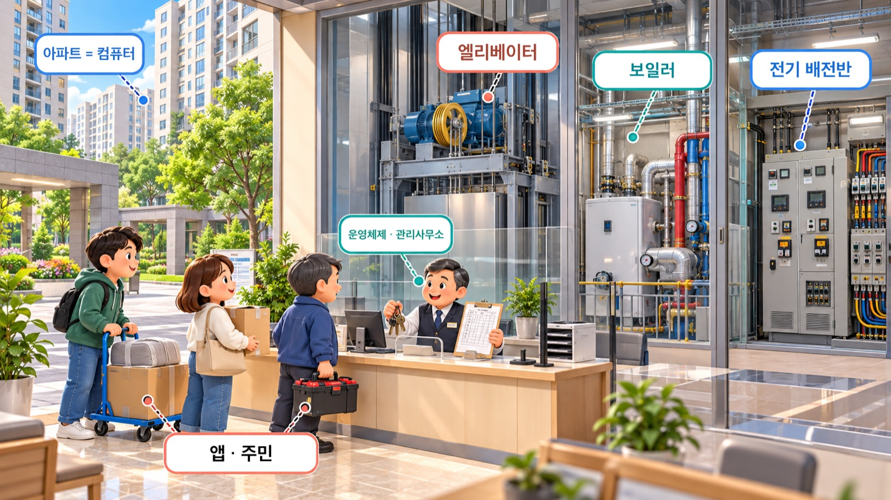

# IT 기본지식 Part1-1 강의 자료 — 하드웨어 vs 소프트웨어

> 바이브코딩 기초 : IT 기본지식 · Part 1 컴퓨터와 인터넷의 정체 · 1장

## 강의 소개

하드웨어는 일을 할 수 있는 본체이고, 소프트웨어는 그 본체에게 무엇을 할지 알려 주는 방법입니다. 둘은 싸우는 상대가 아니라 함께 움직이는 한 팀입니다.

**핵심 질문** AI가 “Python이 필요합니다”, “메모리가 부족합니다”라고 말할 때, 문제는 컴퓨터의 본체 쪽에 있을까요, 일하는 방법 쪽에 있을까요?

| 항목 | 주소 |
| --- | --- |
| 강의 영상 | 바이브코딩 기초 : IT 기본지식 Part1-1 (유튜브 공개 후 주소를 넣습니다) |
| 예제 저장소 | [github.com/daehyub71/seoul-location-services-app](https://github.com/daehyub71/seoul-location-services-app) — 서울시 위치 기반 공공서비스 앱 |
| 움직이는 개념 노트 | [움직이는 그림 4개](https://daehyub71.github.io/vibecoding-it-basics/notes/part1-1.html) — 단계 넘기기 · 재생 · 직접 해 보기 |
| 강의 목차 | [39편 전체 목차](https://daehyub71.github.io/vibecoding-it-basics/) |
| 앞 영상 | [강의 소개](https://youtu.be/mNR5tlX0ODs) |

**예제 저장소를 고른 이유** 화면 쪽은 React 18과 TypeScript(빌드 도구 Vite), 서버 쪽은 FastAPI(Python)로 만든 실제 앱입니다. README의 「사전 요구사항」을 읽으며 “이 가운데 하드웨어는 무엇인가”를 따져 봅니다. 확인 기준은 커밋 `10b1fdb`(2026-10-18)입니다.

**공부하는 순서** 생활 속 장면을 읽고 → 그림과 움직이는 그림으로 두 세계를 나눠 보고 → 실제 저장소의 실행 조건을 읽고 → AI에게 무엇을 알려 줄지 연습합니다.

## 1부. 본체와 일하는 방법

바뀐 것은 전화기의 본체가 아니라 본체 속에서 실행되는 **프로그램**입니다. 화면이 꺼진 휴대전화는 검은 유리지만, 지도 앱을 누르면 길잡이가 되고 카메라 앱을 열면 사진기가 됩니다.

- **하드웨어(hardware)** — 손에 잡히는 기기와 부품
- **소프트웨어(software)** — 그 안에서 무슨 일을 할지 정해 둔 명령의 집합. 프로그램은 그 대표 형태


### 빵집 비유: 장비와 작업 절차

오븐 · 계산대 · 진열장은 장비이고, 몇 도에서 몇 분 굽고 언제 영수증을 줄지는 **작업 절차**가 정합니다. 장비가 완벽해도 절차가 틀리면 빵이 타고, 절차가 훌륭해도 오븐이 없으면 굽지 못합니다.


비유의 한계도 있습니다. 실제 소프트웨어는 레시피보다 적극적이라, 부품을 직접 제어하고 입력을 받아 판단하며 결과를 다시 화면에 내놓습니다.

| 구분 | 하드웨어 | 소프트웨어 |
| --- | --- | --- |
| 손으로 만질 수 있나? | 기기와 부품은 만질 수 있다 | 프로그램 자체는 물건처럼 만질 수 없다 |
| 대표 예 | CPU, 메모리, 저장장치, 화면, 키보드 | 운영체제, 브라우저, 게임, 지도 앱 |
| 주로 하는 일 | 계산 · 기억 · 입력 · 출력의 물리적 기반 | 어떤 계산을 하고 무엇을 보여 줄지 지시 |
| 문제가 생기는 예 | 배터리 고장, 저장장치 불량, 메모리 부족 | 잘못된 계산, 화면 오류, 프로그램 충돌 |
| 바꾸는 방법 | 장치 수리 · 교체 · 확장 | 설치 · 업데이트 · 설정 · 코드 수정 |

본체가 크고 무거울 필요는 없습니다. 세탁기에서 ‘울 코스’를 고를 때 기계를 바꾸지 않고, 같은 모터와 센서를 소프트웨어가 다른 순서로 움직입니다.

### 두 세계의 경계 (움직이는 그림 1-A)

앱이 “여기에 글자를 그려 줘”라고 부탁하면, 그 부탁은 **운영체제**를 거쳐 화면 장치까지 내려갔다가 결과가 다시 화면에 나타납니다. 앱은 대개 화면의 전기 신호를 직접 조절하지 않습니다. 윈도우 · macOS · 리눅스 · 안드로이드 · iOS가 그 중간 관리자입니다. → [움직이는 개념 노트에서 단계별로 보기](https://daehyub71.github.io/vibecoding-it-basics/notes/part1-1.html)

## 2부. 컴퓨터 속 세 장소

CPU · RAM · 저장장치는 모두 ‘기억하는 곳’이 아닙니다. 한 문장으로는 ‘일하는 사람, 펼쳐 놓은 책상, 서류 보관함’입니다.

| 장소 | 비유 | 하는 일 | 전원을 끄면 |
| --- | --- | --- | --- |
| CPU(중앙처리장치) | 일하는 사람 | 계산과 명령 실행 | 하던 일이 멈춤 |
| RAM(주기억장치) | 펼친 책상 | 지금 실행하는 프로그램의 작업 자료를 둠 | 일반적으로 내용이 사라짐 |
| SSD · HDD(저장장치) | 서류 보관함 | 프로그램 파일 · 사진 · 문서를 보관 | 남아 있음 |



**움직이는 그림 1-B** 앱을 실행하면 프로그램이 저장장치에서 메모리로 올라오고 CPU가 처리합니다. 개념 노트의 ‘직접 해 보기’에서 탭을 여러 개 열어 메모리를 채워 볼 수 있습니다.

책상 비유의 한계: CPU에는 여러 코어가 있고, 프로그램은 파일 전체가 아니라 필요한 부분부터 메모리에 올라갑니다.

### 생활 속 사건 셋

1. **파일을 많이 지웠는데 왜 여전히 느릴까?** 영화를 지우면 SSD 공간은 늘지만, 탭 40개로 RAM이 꽉 찼다면 빨라지지 않습니다. 비운 위치가 달랐기 때문입니다. 메모리가 모자라면 운영체제가 내용을 느린 저장장치로 잠시 옮겨 전체가 굼떠집니다.
2. **저장 안 하고 닫은 문서는 왜 사라졌을까?** 메모리에만 있던 내용을 저장장치에 쓰지 않았기 때문입니다. 자동 저장은 그 일을 대신합니다.
3. **새 노트북인데 인터넷이 느릴까?** CPU와 RAM이 좋아도 공유기 · 통신망 · 서버 상태에 따라 달라집니다. 3장에서 다시 만납니다.

## 3부. 실제 저장소 읽기

[서울시 위치 기반 공공서비스 앱](https://github.com/daehyub71/seoul-location-services-app) README의 「사전 요구사항」 여섯 줄 가운데 하드웨어는 **하나도 없습니다.** 그래도 앱은 노트북의 CPU · 메모리 · 저장장치 위에서 돕니다.



| README 줄 | 종류 | 쓰이는 곳 |
| --- | --- | --- |
| Node.js 18+ | 내 컴퓨터에 설치하는 실행 환경(소프트웨어) | 화면 쪽 코드 `frontend/` 개발 · 빌드 |
| Python 3.11+ | 내 컴퓨터에 설치하는 실행 환경(소프트웨어) | 서버 쪽 코드 `backend/` 실행 |
| Supabase 계정 | 인터넷 서비스 계정 | — |
| Upstash Redis 계정 | 인터넷 서비스 계정 | — |
| Kakao Developers 계정 | 인터넷 서비스 계정 | — |
| Seoul API 키 | 인터넷 서비스를 쓰는 열쇠 | — (열쇠 다루는 법은 28장) |

README가 하드웨어를 적지 않은 것은 웬만한 노트북이면 충분하다고 보았기 때문이지, 필요 없어서가 아닙니다.

### 저장소 안의 증거 두 파일

- [`backend/requirements.txt`](https://github.com/daehyub71/seoul-location-services-app/blob/main/backend/requirements.txt) — 서버 쪽 Python 부품(패키지) 목록. 첫 줄 가까이에 `fastapi`, `uvicorn`.
- [`frontend/package.json`](https://github.com/daehyub71/seoul-location-services-app/blob/main/frontend/package.json) — 화면 쪽 부품과 실행 명령. `"react": "^18.2.0"`, `"vite": "^5.0.11"`, 개발 서버 명령 `"dev": "vite"`.

두 파일 모두 소프트웨어의 목록이고, 그 목록을 실행하는 것은 내 컴퓨터의 하드웨어입니다. 다만 이름이 보인다고 앱이 지금 정상 동작한다는 뜻은 아닙니다. **README의 설계**, **소스 파일의 구현**, **실행 중인 서비스의 상태**는 서로 다른 증거입니다.

### 확인한 것을 세 칸으로 나누기

| GitHub에서 확인한 사실 | 배우기 위해 단순화한 설명 | 아직 확인하지 못한 가정 |
| --- | --- | --- |
| README가 Python 3.11 이상을 요구한다 | 프로그램은 저장장치에서 메모리로 올라와 CPU가 실행한다 | 내 노트북 메모리로 이 앱이 충분히 빠르게 돌 것이다 |

### AI에게 이렇게 물어 보세요

```text
아래 저장소의 README에 있는 「사전 요구사항」을 기준으로 답해 줘.
https://github.com/daehyub71/seoul-location-services-app

내 컴퓨터: macOS, Apple 칩(arm64), 메모리 16GB.
Python과 Node.js가 설치돼 있는지는 아직 모름.

1) 이 앱을 내 노트북에서 실행하는 데 필요한 것을
   ① 하드웨어 ② 내 컴퓨터에 설치할 소프트웨어 ③ 인터넷 서비스 계정으로 나눠 표로 정리해 줘.
2) 표의 각 줄마다 근거가 된 README 문장을 적어 줘. README에 없는 내용은 "추측"이라고 표시해 줘.
3) 설치는 내가 직접 할 테니, 이미 설치돼 있는지 확인하는 명령만 알려 줘.
```

AI가 만든 표는 정답지가 아니라 **검토할 초안**입니다. 이 README에는 메모리 · CPU 사양이 없으므로, AI가 “메모리 8GB 이상 필요”처럼 단정하면 근거를 다시 묻습니다. 계정 정보와 API 키는 대화에 붙여 넣지 않습니다.

## 4부. 소프트웨어의 층과 운영체제

증상 하나에 원인은 서로 다른 층에 있을 수 있습니다. 소프트웨어 안에도 **응용 프로그램(앱)**, 기기를 나눠 쓰게 해 주는 **운영체제**, 운영체제가 기기와 대화할 때 쓰는 **드라이버**가 있습니다.

### 화상회의에서 카메라가 안 나올 때

- 앱: ‘카메라 켜기’ 설정이 꺼져 있다
- 운영체제: 카메라 접근 권한이 차단됐다
- 장치 · 드라이버: 카메라 장치나 드라이버에 문제가 있다



### 설치와 실행 (움직이는 그림 1-C)

**설치**(install)는 프로그램 파일과 구성요소를 저장장치에 준비하는 과정이고, **실행**(run)은 그 프로그램이 실제로 작동하는 순간입니다. 실행된 프로그램에 운영체제가 자원을 나눠 주고 관리하는 단위가 **프로세스**(process)입니다(자세히는 19장).

| AI · 화면이 하는 말 | 뜻 |
| --- | --- |
| “프로그램이 설치되지 않았습니다” | 필요한 파일이나 설정이 준비되지 않았다 |
| “프로그램이 실행되지 않습니다” | 설치와 별개로 실행 단계에서 막혔다 |
| “실행은 되는데 화면이 비어 있습니다” | 시작은 했으나 데이터나 화면 처리에 문제가 있을 수 있다 |

### 운영체제는 아파트 관리사무소

여러 프로그램이 같은 하드웨어를 안전하고 질서 있게 쓰도록 소리 장치 · 파일 접근 · 메모리를 조정합니다. 다만 사람처럼 임의로 판단하지 않고 설계된 규칙대로 동작합니다.



윈도우용 프로그램이 맥에서 그대로 돌지 않는 이유는 운영체제의 기능과 프로그램 형식이 다르기 때문입니다. 칩도 영향을 줍니다. Apple Silicon과 인텔 칩은 알아듣는 명령이 달라 설치 파일이 둘로 나뉘기도 합니다.

### AI에게 내 컴퓨터를 먼저 소개하기

“Python이 필요합니다”는 Python 코드를 **실행할 소프트웨어 환경**을 준비하라는 뜻입니다. “왜 코드를 못 짜?”보다 “지금 설치할 것은 앱인가, 실행 환경인가, 개발 도구인가?”로 묻습니다.


```text
코드를 실행하기 전에 내 환경을 먼저 알려 줄게.
- 운영체제: macOS / 칩: Apple Silicon(arm64) / 메모리: 16GB
- Python과 Node.js는 설치했는지 모르겠어.
- 회사 노트북이라 관리자 권한이 없어.

이 환경에서 네가 제안한 코드를 실행하려면
① 새로 설치해야 하는 실행 환경 ② 추가로 설치할 패키지
③ 이미 있는지 확인만 하면 되는 것을 나눠서 알려 줘.
네가 가정한 것이 있으면 따로 적어 줘.
```

### 고장 탐정의 다섯 질문

“앱이 안 돼요” 한 문장으로는 아무것도 고칠 수 없습니다. 아래로 갈수록 실제 기능에 가까워집니다.

1. 전원이 켜지는가? (본체)
2. 운영체제에 로그인할 수 있는가? (운영체제)
3. 앱이 시작되는가?
4. 앱의 화면이 보이는가?
5. 버튼을 누르면 원하는 결과가 나오는가? (앱과 데이터)

“앱은 시작되는데, 검색 버튼을 누르면 목록이 비어 있어요”라고 말할 수 있으면 질문의 절반은 푼 셈입니다.

### 사양 읽기: 배달 주문과 우리 집 부엌

**AI를 사용한다는 말과 AI 모델을 직접 실행한다는 말은 다릅니다.** 온라인 AI 서비스는 계산이 제공자 컴퓨터에서 일어나고(배달 주문), 내 컴퓨터에서 모델을 돌리면 GPU · 메모리가 중요해집니다(우리 집 부엌, 31장). 간단한 텍스트 처리 · HTML 수정 · 작은 파이썬 프로그램에는 최고가 GPU가 필요 없습니다.


### 손가락 한 번의 여행 (움직이는 그림 1-D)

지도 앱의 ‘주변 문화공간’ 버튼을 누르면 하드웨어와 소프트웨어가 번갈아 등장합니다.

1. 터치 센서(하드웨어)가 손가락 위치를 전기 신호로 바꿉니다.
2. 운영체제가 그 신호를 ‘이 위치를 눌렀다’는 사건으로 만들어 지도 앱에 전합니다.
3. 앱이 무엇을 할지 정하고, CPU가 그 판단을 실행하며 필요한 값은 메모리에 있습니다.
4. 앱이 ‘여기에 목록을 그려 줘’라고 부탁하면 운영체제가 화면 장치를 움직입니다.

인터넷에 묻는 단계를 뺀 최소 모형입니다. 서버로 가는 길은 3장과 6장에서 따라갑니다.

## 직접 확인하기

설치나 삭제는 하지 않고, 확인만 합니다.

| 실습 | 시간 | 할 일 |
| --- | --- | --- |
| A. 물리적인 것과 프로그램인 것 | 3분 | 화면 · 배터리 · 저장장치 · 브라우저 · 운영체제 · 카메라 앱을 하드웨어/소프트웨어로 나누기. 카메라 센서는 하드웨어, 카메라 앱은 소프트웨어 |
| B. 같은 기기, 다른 소프트웨어 | 3분 | 같은 웹페이지에서 창 크기를 줄였다 늘려 배치가 바뀌는지 보기(반응형은 11장) |
| C. 설치와 실행 구별하기 | 5분 | 앱을 실행하고 작업 관리자(윈도우) · 활동 모니터(맥) 검색 칸에 앱 이름을 넣어 목록에 나타나는지, 종료하면 사라지는지 보기 |
| D. README 조건과 내 컴퓨터 맞춰 보기 | 5분 | 터미널에서 아래 세 명령 실행 |

### 실습 D 명령

맥은 Command+스페이스로 ‘터미널’을, 윈도우는 PowerShell을 엽니다. 아래 출력은 예시이며 컴퓨터마다 다릅니다.

```text
$ uname -m
arm64
$ python3 --version
Python 3.13.14
$ node --version
v22.20.0
```

- `uname -m` — 맥 · 리눅스에서 칩 종류. `arm64`면 애플 칩, `x86_64`면 인텔 칩
- 윈도우 PowerShell은 `python --version`(또는 `py --version`)과 `node --version`만 확인
- “command not found”나 “인식할 수 없는 명령”이 나오면 아직 없거나 터미널이 찾지 못한다는 뜻. 맥에서 개발자 도구 설치 창이 뜨면 지금은 취소해도 됩니다
- 확인한 버전을 README의 「Node.js 18+」「Python 3.11+」와 비교

보안 설정을 무턱대고 해제하거나 낯선 설치 파일을 실행하지 마세요. 회사 컴퓨터는 설치 정책부터 확인합니다.

## 오해 바로잡기

| 오해 | 바로잡기 |
| --- | --- |
| 소프트웨어는 인터넷에 있다 | 기기에 설치된 프로그램도 소프트웨어다. 인터넷이 끊겨도 계산기는 돈다 |
| 저장 공간이 크면 무조건 빨라진다 | 용량과 속도는 다른 성질이다. RAM · CPU · 네트워크도 영향을 준다 |
| AI가 코드를 만들면 환경은 신경 쓰지 않아도 된다 | 실행할 기기 · 운영체제 · 브라우저 · 권한은 여전히 있다 |
| 브라우저에서 도는 것은 모두 웹 서버가 한다 | 브라우저가 직접 처리하는 일도, 서버에 요청하는 일도 있다 |

## 한 장 요약

| 기억할 질문 | 한 문장 답 |
| --- | --- |
| 하드웨어는? | 계산 · 저장 · 입출력을 가능하게 하는 물리적 장치 |
| 소프트웨어는? | 하드웨어에서 수행되는 작업과 동작을 정의하는 프로그램과 관련 구성요소 |
| CPU · RAM · SSD 차이는? | 실행 담당 · 현재 작업 공간 · 계속 보관하는 저장장치 |
| 운영체제는? | 앱과 하드웨어 사이에서 자원과 권한을 관리하는 핵심 소프트웨어 |
| 설치 vs 실행? | 준비해 두는 과정 vs 실제로 작동시키는 과정 |
| 바이브코더의 할 일은? | 어디서 실행되는지 구별하고, AI에게 내 환경을 먼저 알리기 |

## 확인 문제

1. AI가 만든 HTML 파일을 휴대전화에서 볼 때, 화면과 브라우저는 각각 어느 편에 속할까?
2. 저장 공간은 넉넉한데 브라우저 탭을 많이 열면 느려진다. 어느 자원을 먼저 의심하겠는가?
3. “앱이 설치는 됐는데 시작하지 않아요”에서 설치와 실행은 어떻게 다른가?
4. AI가 “이 코드를 실행하려면 Python이 필요합니다”라고 했다. Python은 기기의 물리적 부품일까?
5. 공공서비스 앱 README의 사전 요구사항 여섯 줄 가운데 하드웨어는 몇 개일까?

<details>
<summary>풀이 보기</summary>

1. 화면은 하드웨어, 브라우저는 소프트웨어다. 브라우저를 실행하는 운영체제와 하드웨어가 함께 필요하다.
2. RAM 사용량과 실행 중인 프로그램을 먼저 본다. CPU 등 다른 원인도 가능하므로 사용량을 확인한다.
3. 파일 · 설정은 준비했지만 실제 실행이 막힌 상황이다. 설치 성공과 정상 실행은 다르다.
4. 아니다. Python 코드를 실행하기 위한 소프트웨어 환경이다.
5. 하나도 없다. Node.js와 Python은 실행 환경(소프트웨어), 나머지 넷은 인터넷 서비스의 계정과 키다. 그래도 앱은 노트북의 CPU · 메모리 · 저장장치 위에서 돈다.

</details>

## 다음 시간

Part1-2 파일 · 폴더 · 경로. AI가 “`frontend/src/components/ui/button.tsx`를 수정했습니다”라고 할 때 그 주소를 읽는 법을 배웁니다.

## 출처

- [daehyub71/seoul-location-services-app](https://github.com/daehyub71/seoul-location-services-app) 커밋 `10b1fdb`(2026-10-18 확인) — `README.md`의 「사전 요구사항」 · 「기술 스택」, `backend/requirements.txt`, `frontend/package.json`
- 학습용 단순화: CPU · 메모리 · 저장장치 비유와 움직이는 그림은 캐시 · 가상 메모리 · 부분 불러오기를 생략했습니다.
