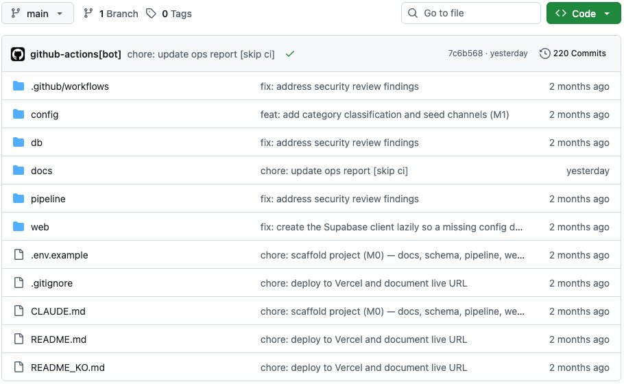
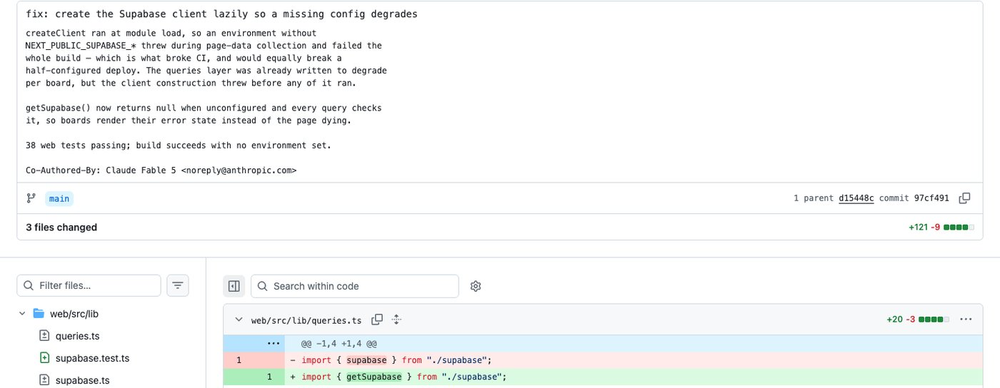

# IT 기본지식 Part1-2 강의 자료 — 파일 · 폴더 · 경로의 정체

> 바이브코딩 기초 : IT 기본지식 · Part 1 컴퓨터와 인터넷의 정체 · 2장

## 강의 소개

파일은 내용을 담은 물건이고, 폴더는 그 물건을 분류하는 공간이며, 경로는 컴퓨터가 그 물건을 찾아가는 주소입니다.

**핵심 질문** AI가 “`web/src/lib/supabase.ts`를 고쳤습니다”라고 할 때 그 파일은 정확히 어디에 있을까요? 같은 명령이 어떤 폴더에서는 되고, 어떤 폴더에서는 “그런 파일이 없습니다”라고 하는 까닭은 무엇일까요?

| 항목 | 주소 |
| --- | --- |
| 강의 영상 | (유튜브 공개 후 추가) |
| 예제 저장소 | [github.com/daehyub71/utube-trend-tracer](https://github.com/daehyub71/utube-trend-tracer) — 관심 분야에서 지금 뜨는 유튜브 영상과 유튜버를 보여 주는 서비스 |
| 움직이는 개념 노트 | [움직이는 그림 4개](https://daehyub71.github.io/vibecoding-it-basics/notes/part1-2.html) — 단계 넘기기 · 재생 · 직접 해 보기 |
| 강의 목차 | [39편 전체 목차](https://daehyub71.github.io/vibecoding-it-basics/) |
| 앞 영상 | [Part1-1 하드웨어 vs 소프트웨어](https://youtu.be/HSNrBiDYb4k) |

**예제 저장소를 고른 이유** 이번 장부터 새 예제입니다. 유튜브 지표를 모으는 Python 코드는 `pipeline/`에, 화면을 만드는 Next.js 코드는 `web/`에, 카테고리 설정은 `config/`에, 데이터베이스 정의는 `db/`에, 문서는 `docs/`에 나뉘어 있어 폴더와 경로를 읽기에 알맞습니다. 파일은 105개입니다. 확인 기준은 커밋 `7c6b568`(2026-10-19)입니다.

**공부하는 순서** 서랍장에서 물건을 찾는 장면으로 시작해 → 실제 저장소의 폴더 트리를 읽고 → 절대경로와 상대경로를 구별한 뒤 → 명령을 실행하는 위치가 결과를 바꾸는 이유를 보고 → AI에게 경로를 정확히 말하는 연습을 합니다.

## 1부. 파일 · 폴더 · 경로

여행 중인 가족에게서 전화가 옵니다. “여권 좀 찾아서 사진 찍어 보내 줘.” 어디 있느냐고 물으면 이렇게 답하죠. “안방 서랍장 둘째 칸, 파란 상자 안에.”

이 한 문장에는 순서가 있습니다. 큰 곳(안방)에서 작은 곳(서랍장, 둘째 칸, 파란 상자)으로 좁혀 가다가 마지막에 찾는 물건(여권)이 나옵니다. 그리고 이 설명은 듣는 사람이 집 안 어디에 서 있든 통합니다. 반대로 “거기 옆 칸에 있어”는 서랍장 앞에 서 있는 사람에게만 통합니다. 이 두 말하기 방식은 3부에서 다시 만납니다.


| 집에서 | 컴퓨터에서 |
| --- | --- |
| 집 전체 | 저장장치 |
| 방 · 서랍장 · 칸 · 상자 | **폴더(folder)** — 물건을 분류하는 공간. 폴더 안에 폴더가 들어간다 |
| 여권 | **파일(file)** — 내용을 담은 물건 한 개 |
| “안방 → 서랍장 → 둘째 칸 → 파란 상자 → 여권”이라고 적은 쪽지 | **경로(path)** — 찾아가는 주소 |

예제 저장소의 `web/src/components/BoardCard.tsx`도 이렇게 읽습니다. `web` 폴더 안의 `src` 폴더, 그 안의 `components` 폴더에 든 `BoardCard.tsx` 파일입니다. **빗금(`/`) 하나가 ‘한 칸 안으로 들어간다’는 뜻**입니다.

### 서랍장에서 폴더 트리로 (움직이는 그림 2-A)

집 → 방 → 서랍장 → 칸 → 상자로 좁혀 가던 그림이 폴더 트리로 바뀌고, 한 칸 들어갈 때마다 경로가 한 마디씩 길어집니다. 윈도우에서는 드라이브 이름 `C:`가 출발점이고 마디 사이를 역빗금(`\`)으로 나눕니다. 마지막 마디가 파일 이름, 점 뒤의 `tsx`가 확장자입니다. 맥에서는 맨 앞의 `/`가 출발점이고 빗금 방향이 반대(`/`)입니다. → [움직이는 개념 노트에서 폴더를 눌러 경로 만들어 보기](https://daehyub71.github.io/vibecoding-it-basics/notes/part1-2.html)

### 파일은 이름과 확장자를 가진다

`report.pdf`에서 `report`는 사람이 붙인 이름이고, 점 뒤의 `pdf`는 파일의 종류를 알려 주는 꼬리표, **확장자(extension)**입니다. 운영체제는 이 꼬리표를 보고 파일을 열 프로그램과 아이콘을 정합니다. 윈도우 파일 탐색기와 맥 Finder는 처음 설정에서 확장자를 숨기기도 해서, 화면에 보이는 이름이 전부가 아닐 수 있습니다.

다만 **확장자만 바꾼다고 실제 형식이 바뀌지는 않습니다.** 영수증 봉투에 카메라 스티커를 붙여도 봉투 안에는 여전히 영수증이 들어 있습니다. 사진 파일 `photo.jpg`의 이름을 `photo.pdf`로 바꿔도 PDF 문서가 되지 않습니다.


윈도우에는 이름표가 아니라 내용물을 읽고 답하는 명령이 기본으로 들어 있지 않습니다. 맥과 리눅스에는 `file` 명령이 있어 이렇게 답합니다(출력의 세부는 사진마다 다릅니다).

```text
$ file photo.pdf
photo.pdf: JPEG image data, JFIF standard 1.01, … 1200x800
```

| 파일 이름 예 | 무엇이 들어 있나 | 이 저장소에서 |
| --- | --- | --- |
| `index.html` | 웹페이지의 내용과 구조 | 없음. 화면은 Next.js가 `web/src/app/page.tsx`에서 만든다 |
| `style.css` | 글자 · 색 · 배치 규칙 | `web/src/app/globals.css` |
| `main.py` | 파이썬 코드 | 없음. 파이썬 코드는 `pipeline/app/youtube.py` 등 |
| `package.json` | JavaScript 프로젝트 설정과 부품 목록 | `web/package.json` |
| `config.yaml` | 설정 자료 | `config/categories.yaml` (카테고리 정의) |
| `.env` | 비밀 값이 담길 수 있는 파일 | 견본 `.env.example`만 올라가 있다(진짜는 올리지 않음) |
| `README.md` | 사람이 읽는 설명서 | 세 개 — 루트 `README.md` · `README_KO.md` · `web/README.md` |

파일 이름에는 확장자가 없는 것도, `.gitignore`처럼 점으로 시작하는 것도, `.env.example`처럼 점이 두 개인 것도 있습니다. ‘점 뒤에 있으면 무조건 확장자’라고 외우면 오해하기 쉽습니다. 윈도우는 이름이 아니라 ‘숨김’ 속성으로 파일을 숨기고, 맥과 리눅스에서는 점으로 시작하는 이름이 **숨김 파일**이라 Finder에 기본으로 보이지 않습니다.

- 윈도우 파일 탐색기 — 「보기」 메뉴에서 「숨긴 항목」을 켜면 보임
- 맥 Finder — Command, Shift, 마침표(`⌘⇧.`)를 함께 누르면 나타남

이름 규칙도 **사람의 약속**입니다. “최종”, “최종2”, “정말최종”처럼 이름을 짓기 시작하면 사람도 AI도 엉뚱한 파일을 집을 수 있습니다. 이 저장소의 `pipeline/scripts/`는 `run_collect.py`, `run_scoring.py`, `sync_config.py`, `sync_seeds.py`처럼 ‘동작_대상’ 규칙으로 이름을 붙여, 열어 보지 않고도 무슨 일을 하는지 짐작할 수 있습니다.

### 폴더는 단순한 정리함이 아니다

학교에서 출석부를 교무실 정해진 칸에 두기로 약속했다고 해 봅시다. 선생님은 늘 그 칸에서 출석부를 찾습니다. 출석부가 멀쩡해도 교실 책상에 두면 찾지 못합니다. 프로그램도 **특정 폴더에 특정 파일이 있다고 가정**하고 움직입니다. 파일이 멀쩡해도 기대하는 폴더에 없으면 “찾을 수 없습니다”라는 오류가 납니다.


| 폴더 | 이 저장소에서 하는 일 |
| --- | --- |
| `web/public/` | 그림 · 아이콘 같은 정적 파일. 화면 쪽 도구(Next.js)가 손대지 않고 그대로 내보낸다 |
| `web/src/` | 화면 코드. 도구가 묶고 변환해서 내보낸다 |
| `pipeline/app/` | 유튜브 지표를 모으는 Python 코드 |
| `config/` | 카테고리 설정 `categories.yaml` 등 |

그래서 AI가 새 파일을 만들었을 때 먼저 물을 것은 “**어떤 파일을 어느 폴더에 만들었어?**”입니다. 다만 폴더 이름은 프로그램마다 달라서, `src`나 `public` 같은 이름을 법칙처럼 외우지는 않습니다.

## 2부. 실제 저장소 읽기

[유튜브 트렌드 트레이서](https://github.com/daehyub71/utube-trend-tracer) 첫 화면의 파일 목록입니다. 폴더 여섯 개(`.github/workflows` · `config` · `db` · `docs` · `pipeline` · `web`)와 루트의 파일들(`.env.example` · `.gitignore` · `README.md` · `README_KO.md` 등)이 보입니다.



### 실전 A. 설정 하나 빠졌는데 빌드가 통째로 실패했다

설정 값 하나가 빠진 채 배포했더니, 화면 하나가 아니라 **사이트 빌드가 통째로 실패**했다고 해 봅시다. 화면을 만드는 페이지 파일부터 열고 싶어집니다. 틀린 출발은 아니지만, 화면에서 데이터가 오는 길을 거슬러 올라가면 후보가 셋입니다.

```text
utube-trend-tracer/
└── web/src/
    ├── app/page.tsx          ① 첫 화면을 그린다
    ├── lib/queries.ts        ② 데이터베이스에 랭킹을 묻는다
    └── lib/supabase.ts       ③ 데이터베이스 연결을 만든다
```

### 증거: 이 증상을 고친 커밋

이 저장소의 커밋 기록에는 바로 이 증상을 고친 기록이 있습니다. 커밋 [`97cf491`](https://github.com/daehyub71/utube-trend-tracer/commit/97cf491)(2026-08-08)의 메시지는, 데이터베이스 설정(`NEXT_PUBLIC_SUPABASE_*`)이 없는 환경에서 연결을 만드는 코드가 예외를 던져 “빌드 전체가 실패”(“failed the whole build”)하던 문제를 고쳤다고 적습니다. 고친 뒤에는 연결을 미리 만들지 않고 필요할 때 만들어, 설정이 없으면 해당 보드만 비어 보입니다.



바뀐 파일은 세 개이고, 모두 `web/src/lib/` 폴더에 있습니다.

| 바뀐 파일 | 무엇이 바뀌었나 |
| --- | --- |
| `web/src/lib/supabase.ts` | 연결을 필요할 때 만드는 `getSupabase()`로 바꿈 (③) |
| `web/src/lib/queries.ts` | 모든 조회가 연결이 없을 때를 확인하게 바꿈 (②) |
| `web/src/lib/supabase.test.ts` | 새로 만든 시험 파일 |

화면을 그리는 `web/src/app/page.tsx`(①)는 바뀌지 않았습니다. **증상이 보이는 곳과 원인이 있는 폴더는 다를 수 있습니다.** 경로를 읽을 줄 알면 ①에서 ②, ③으로 거슬러 올라가며 AI에게 “이 경로의 이 파일을 봐 줘”라고 정확히 말할 수 있습니다. 이 커밋 메시지 끝에는 AI 코딩 도구와 함께 만들었다는 표시도 있습니다.

### 관찰 연습

GitHub 저장소 페이지에서 키보드의 `t`를 누르면 파일 찾기 칸이 열립니다(「Go to file」 칸과 같습니다). `supabase`를 입력해 `web/src/lib/supabase.ts`의 전체 경로를 확인하고, 루트와 `web` 폴더를 차례로 열어 아래쪽에 펼쳐지는 `README.md`가 서로 다른 파일이라는 것도 확인합니다. 그리고 세 칸으로 나눠 적습니다.

| GitHub에서 확인한 사실 | 배우기 위해 단순화한 설명 | 아직 확인하지 못한 가정 |
| --- | --- | --- |
| 커밋 `97cf491`은 `web/src/lib/` 의 세 파일을 바꿨다 | 화면 → 데이터를 묻는 코드 → 연결을 만드는 코드 순서로 거슬러 올라간다 | 다음 빌드 실패도 같은 폴더에 원인이 있을 것이다 |

### 실전 B. 고치기 전에 경로부터 확인하게 하기

“빌드 좀 고쳐 줘”라고만 말하면 AI는 흔한 프로젝트 모양을 떠올려 `src/components/Map.jsx` 같은, **이 저장소에 없는** 그럴듯한 파일을 고치겠다고 나설 수 있습니다. 고치기 전에 경로부터 확인하게 하는 요청을 연습합니다.

```text
아래 저장소에서 "설정 값 하나가 빠진 환경에서 web 빌드가 통째로 실패한다"는 문제를 조사하려고 해.
https://github.com/daehyub71/utube-trend-tracer

1) 이 증상과 관련 있을 만한 파일을 저장소 루트 기준 전체 경로로 적어 줘.
   (예: web/src/app/page.tsx)
2) 파일마다 '화면' '데이터 받기' '서버 · 연결' 중 어디에 속하는지, 왜 의심하는지 한 줄씩 적어 줘.
3) 실제로 열어 보지 못한 파일은 "추측"이라고 표시해 줘.
4) 그 파일이 정말 있는지 내가 확인할 방법을 알려 주고, 명령이라면 어느 폴더에서 실행하는지도 적어 줘.
5) 아직 코드는 고치지 마.
```

AI가 돌려준 목록은 **경로마다 실제로 있는지** 맞춰 봅니다. GitHub에서 `t`를 누르고 경로를 붙여 넣으면 금방 확인됩니다. 목록에 없는 경로가 섞여 있으면 그 줄의 설명은 추측으로 읽습니다. 확인 방법에 `cd`가 들어간 명령이 있으면 어디서 출발하는 명령인지 봅니다. 4부에서 보듯, 출발점이 다르면 같은 명령도 실패합니다.

## 3부. 절대경로와 상대경로

이번 장의 핵심 비교입니다. 택배 상자에 적는 전체 주소는 어디서 출발하든 같은 곳에 닿습니다. 이것이 **절대경로(absolute path)**입니다. “복도 끝까지 가서 오른쪽”이라는 길 안내는 지금 서 있는 곳에 따라 가리키는 곳이 달라집니다. 이것이 **상대경로(relative path)**입니다. 1부의 “안방 서랍장 둘째 칸”과 “거기 옆 칸”이 바로 이 두 방식입니다.


저장소를 내 컴퓨터의 `projects` 폴더에 받아 두었다면 첫 화면 파일 `page.tsx`의 절대경로는 이렇습니다(`사용자이름`은 예).

```text
윈도우: C:\Users\사용자이름\projects\utube-trend-tracer\web\src\app\page.tsx
맥:     /Users/사용자이름/projects/utube-trend-tracer/web/src/app/page.tsx
```

윈도우의 절대경로는 `C:` 같은 드라이브 이름에서, 맥과 리눅스는 파일 시스템 전체의 출발점인 `/`(루트)에서 시작합니다. 상대경로는 출발점이 필요합니다.

| 지금 서 있는 곳 | 같은 파일의 상대경로 |
| --- | --- |
| 저장소 가장 바깥(`utube-trend-tracer/`) | `web/src/app/page.tsx` |
| `web/src/` | `./app/page.tsx` |

`.`은 ‘지금 있는 곳’, `..`은 ‘한 칸 바깥(부모 폴더)’입니다.

### 지금 서 있는 곳이 바뀌면 (움직이는 그림 2-B)

‘현재 위치’ 깃발을 옮길 때마다 같은 파일의 절대경로는 그대로이고 상대경로만 달라집니다. 이 저장소에도 그대로 있습니다.

- `web/src/components/BoardCard.test.tsx`의 `import { BoardCard } from "./BoardCard";` — `.`은 같은 폴더. 바로 옆의 `BoardCard.tsx`를 부른다(확장자는 빼도 도구가 찾아 준다)
- README의 웹 단계 `cp ../.env.example .env.local` — `web` 안에 서서, 한 칸 바깥 루트의 견본 파일을 복사한다
- `page.tsx`의 `import { BoardCard } from "@/components/BoardCard";` — `@`는 경로 기호가 아니라 이 프로젝트가 `src` 폴더에 붙인 별명이다(`web/tsconfig.json`의 `"@/*": ["./src/*"]`)
- 같은 `../.env.example`도 서 있는 곳이 엉뚱하면 아무것도 찾지 못한다

→ [움직이는 개념 노트에서 상대경로를 입력해 도착 지점 확인하기](https://daehyub71.github.io/vibecoding-it-basics/notes/part1-2.html)

**상대경로의 출발점은 누가 읽느냐에 따라 다릅니다.** 코드 안의 `import`는 그 코드 파일이 있는 폴더에서, 터미널 명령과 파이썬의 `open("data.csv")` 같은 줄은 명령을 실행한 위치(4부의 현재 작업 디렉터리)에서 출발합니다.

| 질문 | 절대경로 | 상대경로 |
| --- | --- | --- |
| 어디서 시작하나? | 파일 시스템의 기준 위치(`C:` 또는 `/`) | 현재 작업 · 해석 기준 위치 |
| 다른 컴퓨터로 옮기면? | 기존 주소가 맞지 않을 수 있음 | 폴더 구조를 유지하면 그대로 쓸 수 있음 |
| 장점 | 시작 위치와 관계없이 명확함 | 프로젝트를 통째로 옮겨도 재사용 |
| 주의 | 내 PC의 사용자 폴더에 묶임 | 기준 위치를 잘못 알면 엉뚱한 파일을 찾음 |

이 저장소의 「시작하기」 안내는 절대경로 없이 상대경로만 써서, 누구의 컴퓨터에서든 같은 줄로 따라 할 수 있습니다. 반대로 AI가 만든 코드에 `C:\Users\…`나 `/Users/…`로 시작하는 경로가 박혀 있으면 **내 컴퓨터에서만 도는 코드**일 가능성이 큽니다.

### 경로 구분자 `/`와 `\`

윈도우 파일 경로에서는 `\`를, 웹 주소와 맥에서는 `/`를 봅니다. 윈도우의 많은 도구가 `/`도 알아듣기 때문에 코드 안에서는 `/`로 적는 편이 안전한 경우가 많습니다. 코드 문자열에서 역빗금은 특별한 뜻을 가지기 때문입니다. 탐색기에서 복사한 윈도우 경로를 파이썬 따옴표 안에 그대로 붙이면 실행도 하기 전에 멈춥니다.

```python
# 의도한 오류: 윈도우 경로를 따옴표 안에 그대로 붙여 넣었다
path = "C:\Users\사용자이름\data.csv"
```

```text
SyntaxError: (unicode error) 'unicodeescape' codec can't decode bytes in position 2-3: truncated \UXXXXXXXX escape
```

파이썬이 `\U`를 ‘유니코드 글자 번호의 시작’으로 읽었기 때문입니다. 오류 없이 다른 글자로 바뀌는 경우가 더 고약합니다.

```python
print("C:\new\table")      # \n은 줄바꿈, \t는 탭으로 바뀐다
print(r"C:\new\table")     # 따옴표 앞에 r을 붙이면 글자 그대로
print("C:/new/table")      # /로 적어도 된다
```

첫 줄은 `C:`와 `ew`(탭)`able` 두 줄로 찍히고, 나머지 두 줄은 적은 그대로 나옵니다. AI에게 윈도우용 코드를 부탁할 때 “**경로는 `/`로 쓰거나 `pathlib`을 써 줘**”라고 덧붙이면 이런 사고가 줄어듭니다.

**파일 경로와 웹 주소(URL)는 다릅니다.** 브라우저 주소창의 `file:///C:/Users/사용자이름/…/index.html`(맥은 `file:///Users/사용자이름/…/index.html`)을 친구에게 보내면, 친구 컴퓨터에는 그 파일이 없어서 열리지 않습니다. 파일 경로는 컴퓨터 안의 파일을, URL은 네트워크로 접근할 자원의 위치를 가리킵니다. HTML 파일을 더블클릭해 열었을 때 일부 기능이 안 되는 것도 브라우저의 보안 규칙 때문일 수 있습니다. 이 차이는 5장의 `localhost`에서 이어집니다.

## 4부. 명령은 어디서 출발하나

**프로젝트 루트(project root)**는 프로젝트의 가장 바깥 폴더입니다. 이 저장소라면 `utube-trend-tracer/`입니다. 설치 안내의 명령은 대개 ‘루트에서 출발한다’는 약속을 깔고 있습니다. `README_KO.md`의 「시작하기」에서 3 · 4단계를 옮깁니다(주석 일부는 줄였습니다).

```bash
# 3. 파이프라인  (루트에서 출발)
python3 -m venv venv && source venv/bin/activate
pip install -r pipeline/requirements-dev.txt
cd pipeline
python -m scripts.sync_config      # 카테고리 → DB
python -m scripts.sync_seeds       # 시드 채널 → DB
python -m scripts.run_collect      # 수집 한 주기
python -m scripts.run_scoring      # 랭킹 산출

# 4. 웹
cd ../web
cp ../.env.example .env.local      # NEXT_PUBLIC_ anon 값만 남긴다
npm install && npm run dev
```

윈도우 PowerShell이라면 `source venv/bin/activate` 줄은 `venv\Scripts\Activate.ps1`로, `cp ../.env.example .env.local` 줄은 `copy ..\.env.example .env.local`로 바꿔 읽습니다.

> 이 앱은 데이터베이스(Supabase)와 유튜브 API 키가 있어야 실제로 돌아갑니다. 오늘은 따라 하지 말고 **각 줄이 어느 폴더를 기준으로 하는지**만 읽습니다.

- `pip install -r pipeline/requirements-dev.txt` — 루트에 서서 `pipeline` 안의 부품 목록을 읽는다
- `cd pipeline` 뒤의 줄은 모두 `pipeline` 안에서 읽힌다. `python -m scripts.run_collect`는 그 자리의 `scripts` 폴더에서 `run_collect.py`를 찾는다
- `cd ../web` — 한 칸 나갔다가 옆의 `web`으로 들어간다. `web`은 `pipeline` 안이 아니라 **옆**에 있기 때문이다
- `npm install`은 그 자리의 `package.json`, 곧 `web/package.json`을 읽는다

### 같은 명령, 다른 출발점 (움직이는 그림 2-C)

터미널은 언제나 어떤 폴더 안에 서 있고, `pwd`가 그 위치를 알려 줍니다. `pipeline` 안에서 바로 `cd web`을 치면 실패합니다(`사용자이름`은 예).

**윈도우 · PowerShell**

```text
PS C:\Users\사용자이름\projects\utube-trend-tracer\pipeline> pwd

Path
----
C:\Users\사용자이름\projects\utube-trend-tracer\pipeline

PS C:\Users\사용자이름\projects\utube-trend-tracer\pipeline> cd web
(빨간 오류 — 그 경로를 찾을 수 없다는 뜻. 문구는 버전 · 언어마다 다름)
PS C:\Users\사용자이름\projects\utube-trend-tracer\pipeline> cd ..\web
PS C:\Users\사용자이름\projects\utube-trend-tracer\web>
```

**맥 · 터미널** (오류 문구는 맥 기본 셸 zsh 기준)

```text
$ pwd
/Users/사용자이름/projects/utube-trend-tracer/pipeline
$ cd web
cd: no such file or directory: web
$ cd ../web
$ pwd
/Users/사용자이름/projects/utube-trend-tracer/web
```

거꾸로 루트에 선 채 `npm run dev`부터 치면 `Could not read package.json`이 들어간 오류가 납니다. 이 저장소의 `package.json`은 `web/` 안에만 있기 때문입니다. 오류 문구는 버전마다 다르지만, **오류 문장 속 경로를 읽으면 프로그램이 어디서 파일을 찾았는지** 알 수 있습니다. 개념 노트에서는 출발 폴더와 명령을 골라 결과를 확인할 수 있습니다. → [움직이는 개념 노트](https://daehyub71.github.io/vibecoding-it-basics/notes/part1-2.html)

사람으로 치면 이렇습니다. ‘우리 집 거실에서 왼쪽 문을 열라’는 안내문은 우리 집에서는 침실로 안내하지만, 옆집 거실에서 따라 하면 창고 문이 열립니다. **명령이 맞아도 출발점이 틀리면 결과가 달라집니다.**


### 현재 작업 디렉터리

터미널이 지금 서 있는 폴더를 **현재 작업 디렉터리(current working directory)**라고 합니다. 디렉터리는 폴더와 같은 말입니다. 많은 명령이 이 위치를 기준으로 상대경로를 계산합니다. 그래서 명령을 실행하기 전에 `pwd`로 위치를 확인하는 습관이 큰 사고를 막습니다.

AI에게는 “**명령을 실행해야 하는 기준 폴더와 확인 방법을 함께 적어 줘**”라고 요청합니다. 윈도우 PowerShell인지 맥 터미널인지도 알려 주면 이동 명령이 내 환경에 맞게 나옵니다.

## 5부. 내용 형식 · 같은 이름 · 옮기기

### 확장자보다 중요한 ‘내용 형식’

**파일 형식(format)**은 내용을 어떻게 기록하고 읽을지에 관한 약속입니다. 이 저장소의 `config/categories.yaml`에는 음식 · 여행 · IT테크 같은 분야가 정의돼 있습니다. 그중 ‘음식’ 하나를 세 형식으로 적어 보면 이렇습니다(실제 파일에서 키워드 몇 개만 옮겼습니다).

```markdown
# 음식 (food)
- 가중치: 1.0
- 키워드: 먹방, 맛집, 요리 …
```

```json
{"id": "food", "name": "음식", "weight": 1.0, "keywords": ["먹방", "맛집", "요리"]}
```

```csv
id,name,weight
food,음식,1.0
```

| 형식 | 누구를 위한 약속인가 |
| --- | --- |
| Markdown | 사람이 읽기 좋게 — `#` 제목과 `-` 목록 |
| JSON | 프로그램이 `"name"` 같은 이름표로 값을 찾게 — 중괄호와 따옴표 |
| CSV | 쉼표로 칸을 나눈 표 — 표 계산 프로그램이 행과 열로 읽는다 |

실제 설정 파일은 네 번째 형식인 **YAML**입니다. ‘확장자가 달라요’라는 말은 종종 ‘내용을 해석하는 약속이 달라요’라는 뜻입니다. JSON과 YAML은 12장에서 자세히 봅니다.

### 이름이 같은 파일이 여러 개일 때

한 단지에 101동 101호와 102동 101호가 따로 있습니다. 택배 기사는 몇 동인지까지 알아야 배달할 수 있습니다. 파일도 마찬가지입니다. ‘파일 이름’이 곧 ‘파일의 전체 주소’는 아닙니다. 같은 이름이라도 폴더가 다르면 완전히 다른 파일이고, AI가 엉뚱한 쪽을 고치면 코드가 아무리 좋아도 눈에 보이는 결과는 그대로입니다.


| 같은 이름 | 이 저장소에서 있는 곳 |
| --- | --- |
| `README.md` | 루트 · `web/` 두 곳. GitHub 첫 화면에 펼쳐지는 것은 루트의 것 |
| `page.tsx` | `web/src/app/` · `web/src/app/about/` · `web/src/app/channel/[id]/` 세 곳 |
| `app/` 폴더 | `pipeline/app/`(Python 수집 코드) · `web/src/app/`(화면) 두 곳 |
| `.gitignore` | 루트 · `web/` 두 곳. `web/` 안의 것은 그 폴더에만 적용 |

**사례 — README가 둘인 저장소.** “README를 고쳐 줘”라고만 했더니 AI가 `web/README.md`를 고쳤다. 증상: GitHub 첫 화면이 그대로다. 해결 방향: 고칠 파일을 루트 기준 전체 경로(`README.md` 또는 `README_KO.md`)로 지정한다.

**사례 — `.gitignore`가 둘(예로 든 상황).** 루트의 `.gitignore`만 고쳤는데 `web` 쪽 결과가 기대와 다르다. 증상: 한쪽만 고치면 다른 쪽은 그대로다. 해결 방향: 어느 폴더의 규칙이 적용되는지부터 확인한다.

그래서 AI에게 수정을 요청할 때는 **프로젝트 루트 기준 전체 경로**로 말합니다.

### 옮기기와 복사하기 (움직이는 그림 2-D)

화면은 코드에 적힌 경로를 따라가 로고를 찾습니다(예로 든 상황).

- **옮기기(move)** — 원래 자리가 빈다. 파일은 멀쩡한데 코드는 아직 옛 주소를 찾고 있어서 그림이 깨진다. 옮길 때는 그 파일을 부르는 경로도 함께 고쳐야 한다
- **복사하기(copy)** — 원본은 남고 사본이 생긴다. 사본을 고쳤는데 화면이 그대로라면, 화면이 쓰는 것은 다른 쪽 파일이다
- 같은 저장장치 안에서 옮기면 주소 장부만 바뀌어 큰 파일도 순식간이고, 다른 장치로 옮기면 복사한 뒤 원본을 지운다. 파일 탐색기와 Finder가 다른 저장장치로 끌어다 놓은 파일을 기본으로 ‘복사’하는 것도 그래서다

→ [움직이는 개념 노트에서 이동 · 복사 · 경로 고치기 단추 눌러 보기](https://daehyub71.github.io/vibecoding-it-basics/notes/part1-2.html)

AI에게 파일 정리를 맡길 때는 이렇게 말합니다.

| 할 일 | AI에게 하는 말 |
| --- | --- |
| 옮길 때 | “파일을 옮기고, 그 파일을 부르는 경로도 모두 고친 뒤 화면에서 확인해 줘” |
| 지울 때 | “지우기 전에 사용 여부를 조사해서 목록으로 보여 줘” |

안 쓰는 것처럼 보이는 파일도 다른 설정이나 빌드 과정에서 참조될 수 있습니다. 되돌리기를 쉽게 해 주는 Git은 22장에서 배웁니다.

## 6부. 바이브코딩 현장: AI와 폴더 지도를 먼저 그리기

AI가 만든 코드는 거의 언제나 파일 여러 개로 나오고, 경로가 섞인 말을 합니다.

| AI의 말 · 오류 | 먼저 확인할 것 |
| --- | --- |
| “`src/components/Header.jsx`를 만드세요” | 어느 폴더 안의 `src`인지. 이 저장소라면 `web/src/…` |
| “프로젝트 루트에 `.env`를 만드세요” | 어느 쪽의 루트인지. 이 저장소는 파이썬 쪽이 루트의 `.env`를, 화면 쪽은 `web/.env.local`을 쓴다. 점으로 시작해 만든 뒤 맥 Finder에는 안 보일 수도 있다 |
| `FileNotFoundError: [Errno 2] No such file or directory: 'data.csv'` | 파일이 아예 없다는 뜻이 아니라 **지금 서 있는 곳 기준으로** 없다는 뜻인 경우가 많다 |

```python
# 의도한 오류: 지금 서 있는 폴더에 data.csv가 없다
with open("data.csv", encoding="utf-8") as f:
    print(f.read())
```

이럴 때는 경로를 코드 파일의 위치에서 출발하게 만들면, 어디서 실행해도 같은 파일을 가리킵니다.

```python
from pathlib import Path

here = Path(__file__).resolve().parent   # 이 코드 파일이 있는 폴더
print(here / "data.csv")                 # 어디서 실행해도 같은 파일을 가리킨다
```

이 저장소의 파이썬 설정 코드 [`pipeline/app/config.py`](https://github.com/daehyub71/utube-trend-tracer/blob/main/pipeline/app/config.py) 16행도 같은 방법을 씁니다.

```python
PROJECT_ROOT = Path(__file__).resolve().parent.parent.parent
```

자기 파일 위치(`pipeline/app/`)에서 세 칸 위가 프로젝트 루트입니다. 그래서 어느 폴더에서 실행해도 루트의 `.env`와 `config/categories.yaml`을 찾습니다.


### AI에게 이렇게 말해 보세요

```text
현재 프로젝트의 폴더 구조를 트리 모양으로 보여 줘.
파일마다 '화면', '스타일', '동작', '설정', '이미지', '데이터' 중
어떤 역할인지 한 줄씩 설명해 줘.
경로는 모두 프로젝트 루트 기준 상대경로로 적어 줘.
실제 화면에 사용되지 않는 것으로 의심되는 파일은 바로 삭제하지 말고
먼저 후보 목록으로만 표시해 줘.
```

코드를 고치기 전에 지도부터 받는 요청입니다. 받은 지도의 경로 두세 개를 실제 파일 목록과 맞춰 본 뒤에 “이 경로의 이 파일을 고쳐 줘”라고 말합니다. “**경로는 루트 기준 상대경로로**”라는 한 줄은 내 컴퓨터의 절대경로가 코드에 박히는 일을 줄여 줍니다.

## 직접 확인하기

연습용 폴더에서만 합니다. 중요한 원본 파일은 쓰지 않습니다.

| 실습 | 시간 | 할 일 |
| --- | --- | --- |
| A. 연습용 폴더 만들기 | 5분 | 홈 폴더에 아래 폴더와 빈 텍스트 파일 만들기(이름은 예) |
| B. 지금 서 있는 곳 확인하기 | 5분 | PowerShell(맥은 터미널)에서 `pwd` · `cd` · `ls` 실행 |
| C. 이름표만 바꿔 보기 | 5분 | CSV 두 줄을 적은 파일의 이름을 `.json`으로 바꾸고 확인 |
| D. 절대경로 복사해 보기 | 2분 | 파일의 전체 주소를 복사해 메모장에 붙여 보기 |

```text
path-practice/
├── data/
│   └── practice.txt
└── notes/
    └── todo.txt
```

윈도우는 시작 단추에서 ‘PowerShell’을 검색해 엽니다. 맥은 Command+스페이스로 ‘터미널’을 검색해 엽니다. 아래 출력은 예시이며 컴퓨터마다 다릅니다.

### 실습 A 명령 (파일 탐색기 · Finder로 만들어도 됩니다)

**윈도우 · PowerShell**

```text
PS C:\Users\사용자이름> mkdir path-practice\data, path-practice\notes
(출력은 줄임)
PS C:\Users\사용자이름> ni path-practice\data\practice.txt, path-practice\notes\todo.txt
(출력은 줄임)
```

**맥 · 터미널**

```text
$ mkdir -p path-practice/data path-practice/notes
$ touch path-practice/data/practice.txt path-practice/notes/todo.txt
```

### 실습 B 명령

`pwd`는 지금 서 있는 곳의 절대경로, `ls`는 이 폴더에 든 것, `cd`는 다른 폴더로 들어가기입니다. 세 명령은 PowerShell과 맥 터미널에서 똑같이 통합니다.

**윈도우 · PowerShell** (출력은 표 모양이라 이름 열만 남기고 줄였습니다)

```text
PS C:\Users\사용자이름> pwd
Path
----
C:\Users\사용자이름
PS C:\Users\사용자이름> cd path-practice
PS C:\Users\사용자이름\path-practice> ls
Mode   ...   Name
d----        data
d----        notes
PS C:\Users\사용자이름\path-practice> cd notes
PS C:\Users\사용자이름\path-practice\notes> ls ..
d----        data
d----        notes
PS C:\Users\사용자이름\path-practice\notes> cd ..
PS C:\Users\사용자이름\path-practice> ls -Force
d----        data
d----        notes
```

**맥 · 터미널**

```text
$ pwd
/Users/사용자이름
$ cd path-practice
$ ls
data    notes
$ cd notes
$ ls ..
data    notes
$ cd ..
$ ls -a
.       ..      data    notes
```

- `ls ..`은 한 칸 바깥의 목록입니다
- 숨김 파일까지 보려면 윈도우는 `ls -Force`, 맥은 `ls -a`. 맥에 보이는 `.`과 `..`이 ‘지금 있는 곳’과 ‘한 칸 바깥’입니다(PowerShell은 이 둘을 목록에 보여 주지 않습니다)

### 실습 C 명령

`data/practice.txt`에 5부의 CSV 두 줄(`id,name,weight` / `food,음식,1.0`)을 적어 저장하고, 이름을 `practice.json`으로 바꿉니다. 윈도우는 탐색기 「보기」에서 「파일 확장명」을 켜야 확장자까지 바꿀 수 있습니다. 그다음 `data` 폴더에서 확인합니다.

**윈도우 · PowerShell**

```text
PS C:\Users\사용자이름> cd ~\path-practice\data
PS C:\Users\사용자이름\path-practice\data> python -m json.tool practice.json
Expecting value: line 1 column 1 (char 0)
```

**맥 · 터미널**

```text
$ cd ~/path-practice/data
$ python3 -m json.tool practice.json
Expecting value: line 1 column 1 (char 0)
$ file practice.json
practice.json: Unicode text, UTF-8 text
```

- JSON 도구는 첫 글자부터 JSON이 아니라고 알립니다. 윈도우에는 `file` 명령이 없으니 이것만 확인합니다
- 맥 · 리눅스는 `file`로도 확인합니다. `file`은 이름표와 상관없이 그냥 글자라고 답합니다
- 윈도우에서 `python`이 안 되면 `py -m json.tool practice.json`도 해 보기. 파이썬이 아직 없으면 이 실습은 건너뛰어도 됩니다

### 실습 D

| 운영체제 | 절대경로 복사 |
| --- | --- |
| 윈도우 파일 탐색기 | `todo.txt`를 오른쪽 클릭 → 「경로로 복사」(윈도우 10은 Shift를 누른 채 오른쪽 클릭) |
| 맥 Finder | `todo.txt`를 고르고 Option, Command, C(`⌥⌘C`) |

메모장에 붙여 넣은 절대경로를 AI에게 그대로 보내면 **내 사용자 이름도 함께 간다**는 점을 기억합니다.

## 오해 바로잡기

| 오해 | 바로잡기 |
| --- | --- |
| 파일 이름이 같으면 같은 파일이다 | 폴더가 다르면 완전히 다른 파일이다. 전체 경로로 구별한다 |
| 확장자를 바꾸면 형식이 바뀐다 | 이름표만 바뀔 뿐 내용은 그대로다. 형식 변환은 따로 해야 한다 |
| 내 컴퓨터에서 열리면 다른 컴퓨터에서도 열린다 | 내 컴퓨터의 절대경로를 썼다면 다른 컴퓨터에는 그 위치가 없다 |
| 프로젝트 루트는 항상 `src`다 | 루트는 가장 바깥 폴더다. 이 저장소처럼 `src`가 `web/` 안에 한 번 더 들어가 있기도 하다 |
| 안 쓰는 것 같은 파일은 지워도 된다 | 다른 코드나 도구가 간접적으로 부를 수 있다. 먼저 참조를 확인한다 |

## 한 장 요약

| 기억할 말 | 한 문장 답 |
| --- | --- |
| 파일 · 폴더 · 경로 | 내용을 담은 물건 · 그 물건을 분류하는 공간 · 찾아가는 주소 |
| 확장자 | 종류를 알리는 이름표. 내용을 바꾸지는 않는다 |
| 절대경로 | `C:` 또는 `/`부터 적는 전체 주소 |
| 상대경로 | 지금 자리에서의 길 안내. `.`은 여기, `..`은 한 칸 바깥 |
| 프로젝트 루트 | 프로젝트의 가장 바깥 폴더 |
| 현재 작업 디렉터리 | 명령이 파일을 찾는 출발점. 실행 전에 `pwd` |

## 확인 문제

1. `src/logo.png`와 `public/logo.png`는 반드시 같은 파일일까?
2. 파일을 옮긴 뒤 화면에서 사라졌다. 무엇을 먼저 비교할까?
3. AI가 “프로젝트 루트에서 실행하세요”라고 한다. 확인할 것은?
4. `jpg` 이름표를 `png`로 바꾸면 그림 형식도 바뀔까?
5. `pipeline` 안에서 `cd web`이 실패했다. 이유와 고친 명령은?
6. 빌드 실패를 고친 커밋 `97cf491`이 바꾼 파일은 화면 `page.tsx`였을까?

<details>
<summary>풀이 보기</summary>

1. 아니다. 이름은 같지만 경로가 다르다. 폴더가 다르면 다른 파일이다.
2. 실제 파일 위치와, 코드가 그 파일을 부르는 경로다.
3. 지금 명령을 입력하는 작업 디렉터리가 프로젝트 루트인지 `pwd`로 확인한다.
4. 아니다. 이름표만 바뀐다. 실제 형식을 바꾸려면 따로 변환해야 한다.
5. `web`은 `pipeline` 안이 아니라 옆에 있다. README처럼 `cd ../web`으로 한 칸 나갔다가 들어가거나, 새 PowerShell(맥은 터미널) 창을 루트에서 열고 `cd web`을 친다.
6. 아니다. 바뀐 파일은 `web/src/lib/supabase.ts`와 `web/src/lib/queries.ts`(그리고 새 시험 파일 `supabase.test.ts`)로, 화면을 그리는 `web/src/app/`이 아니라 데이터베이스 연결을 만드는 `lib` 폴더에 있었다.

</details>

## 다음 시간

Part1-3 네트워크 · 인터넷 · 웹. 오늘은 내 컴퓨터 안의 물건을 어디서 찾는지 배웠습니다. 그런데 GitHub에서 `supabase.ts`를 열면 주소창에도 `…/blob/main/web/src/lib/supabase.ts`처럼 폴더 경로를 닮은 글자가 붙습니다. 그 파일은 내 컴퓨터가 아니라 멀리 있는 컴퓨터에 있습니다. 다음 시간에는 그 길을 따라가 봅니다.

## 출처

- [daehyub71/utube-trend-tracer](https://github.com/daehyub71/utube-trend-tracer) 커밋 `7c6b568`(2026-10-19 확인) — `README_KO.md`의 「시작하기」 · 「구조」, 파일 목록(105개), 커밋 [`97cf491`](https://github.com/daehyub71/utube-trend-tracer/commit/97cf491)이 바꾼 파일과 메시지, `web/src/components/BoardCard.test.tsx` · `web/src/app/page.tsx`의 `import`, `web/tsconfig.json`의 `@` 별명, `config/categories.yaml`, `pipeline/app/config.py` 16행, 루트 · `web/`의 `README.md` · `.gitignore`
- 학습용 단순화: 서랍장 · 택배 · 옆집 거실 비유, `path-practice/` · `photo.pdf` · `data.csv` · 로고 옮기기 같은 예시 이름, 5부 카테고리 예시의 Markdown · JSON · CSV 표기(실제 파일은 YAML). 터미널 출력은 윈도우 PowerShell · 맥(zsh) · Python 3.13 기준 예이며 컴퓨터와 버전마다 문구가 다릅니다.
