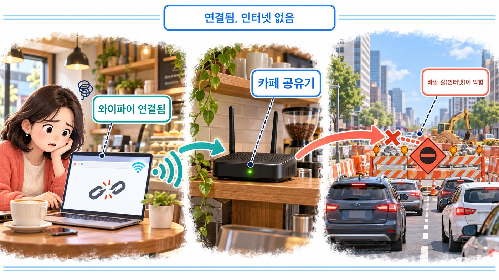
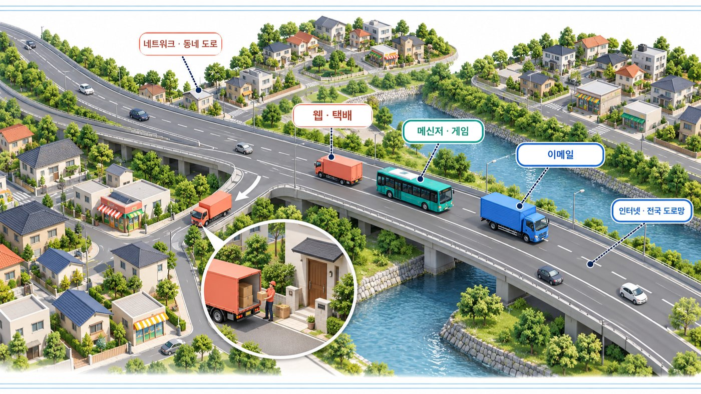
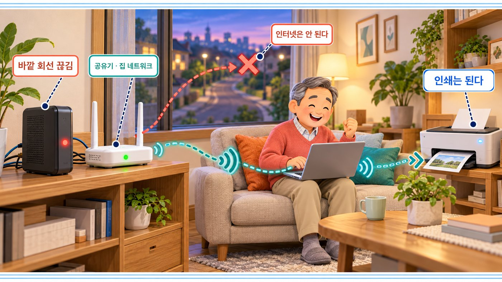
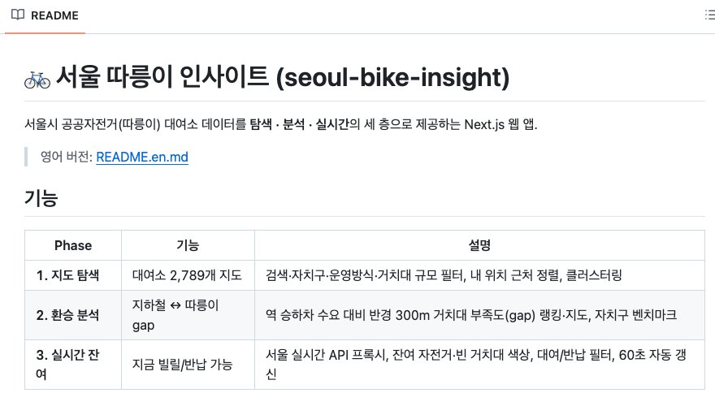
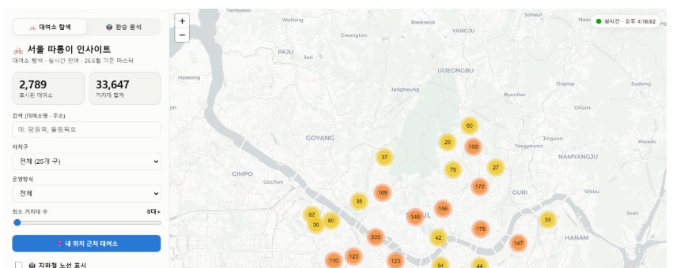
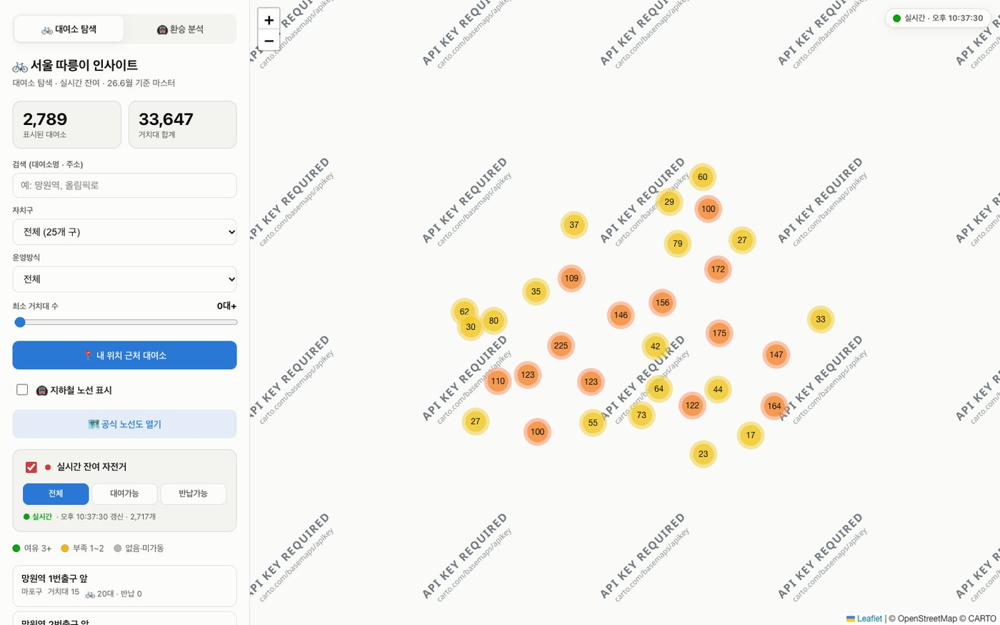
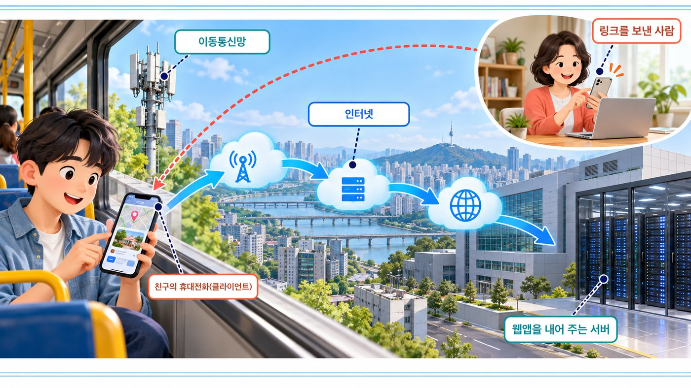
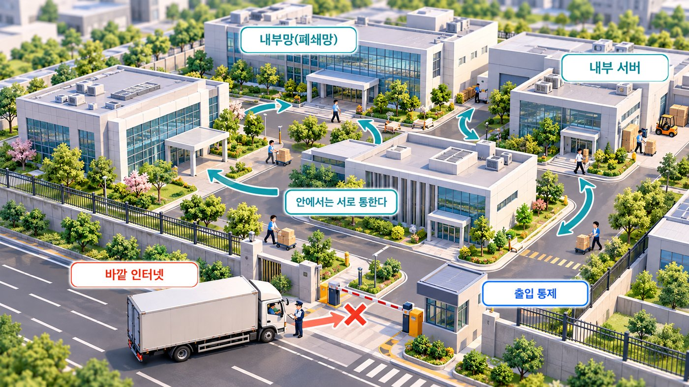
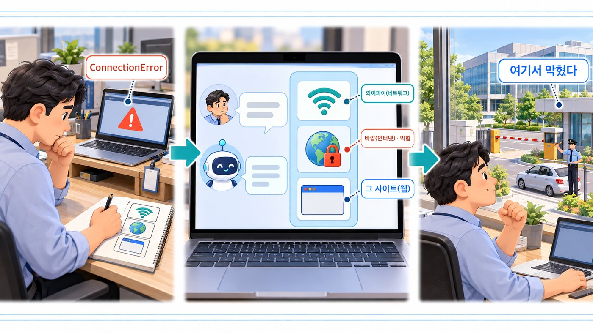

# IT 기본지식 Part1-3 강의 자료 — 네트워크 vs 인터넷 vs 웹

> 바이브코딩 기초 : IT 기본지식 · Part 1 컴퓨터와 인터넷의 정체 · 3장

## 강의 소개

네트워크는 기기들이 연결된 관계이고, 인터넷은 수많은 네트워크가 이어진 거대한 연결망이며, 웹은 그 인터넷 위에서 이용하는 여러 서비스 가운데 하나입니다. 셋은 겨루는 사이가 아니라 차례로 쌓인 층입니다.

**핵심 질문** 와이파이 신호는 꽉 찼는데 사이트가 안 열립니다. 따릉이 지도는 뜨는데 실시간 잔여 색만 회색입니다. 끊긴 곳은 내 기기와 공유기 사이일까요, 바깥 인터넷일까요, 특정 웹 서비스일까요?

| 항목 | 주소 |
| --- | --- |
| 강의 영상 | 바이브코딩 기초 : IT 기본지식 Part1-3 (유튜브 공개 후 추가) |
| 예제 저장소 | [github.com/daehyub71/seoul-bike-insight](https://github.com/daehyub71/seoul-bike-insight) — 서울 따릉이 인사이트 · 배포본 [seoul-bike-insight.vercel.app](https://seoul-bike-insight.vercel.app) |
| 움직이는 개념 노트 | [움직이는 그림 4개](https://daehyub71.github.io/vibecoding-it-basics/notes/part1-3.html) — 단계 넘기기 · 재생 · 직접 해 보기 |
| 강의 목차 | [39편 전체 목차](https://daehyub71.github.io/vibecoding-it-basics/) |
| 앞 영상 | Part1-2 파일 · 폴더 · 경로 (유튜브 공개 후 추가) |

**예제 저장소를 고른 이유** 서울시 공공자전거(따릉이) 대여소를 지도로 보여 주고, 지금 빌릴 수 있는 자전거 수를 실시간으로 알려 주는 Next.js 웹 앱입니다. 화면 하나가 **네 곳에서 온 것**으로 이루어져 있어서, 네트워크 · 인터넷 · 웹의 층을 실제 요청으로 나눠 보기에 알맞습니다. 확인 기준은 커밋 `1938ddd`(2026-07-27)이고, 배포본의 요청과 응답 시간은 2026-10-20에 측정했습니다.

**공부하는 순서** 생활 속 장면으로 세 단어를 나누고 → 데이터가 지나가는 길과 속도를 그림과 움직이는 그림으로 따라가고 → 실제 앱에서 지도와 실시간 정보가 서로 다른 길로 온다는 것을 확인하고 → 막힌 층을 나눠 AI에게 설명하는 연습을 합니다.

## 1부. 세 단어를 나누기

### 와이파이는 잡혔는데 인터넷이 안 된다

카페에서 노트북을 켰습니다. 와이파이 신호 막대는 꽉 찼는데 사이트가 안 열리고, 와이파이 목록에는 ‘연결됨’과 함께 ‘인터넷 없음’ 같은 표시가 뜹니다(문구는 운영체제마다 조금씩 다릅니다).

두 말은 모순이 아닙니다. **노트북이 카페 공유기와 연결된 것**과 **카페 공유기가 바깥 인터넷까지 연결된 것**은 다른 문제입니다. 집 안 복도는 멀쩡해도 건물 밖 큰길이 공사 중일 수 있는 것과 같습니다.



평소에는 모두 “온라인”으로 뭉뚱그려 부르지만, AI와 앱을 만들기 시작하면 셋을 나눠야 합니다. 그래야 문제가 내 기기와 공유기 사이에 있는지, 인터넷 연결에 있는지, 특정 웹 서비스에 있는지 추측할 수 있습니다.

### 도로 비유: 골목 · 전국 도로망 · 택배

동네 안의 집과 가게를 잇는 골목길이 **네트워크**, 그런 동네들을 큰 도로가 이어 만든 전국 도로망이 **인터넷**, 그 도로망 위를 달리는 택배 서비스가 **웹**입니다. 같은 도로 위로 버스와 이삿짐 트럭도 다니듯, 이메일과 메신저도 같은 인터넷을 씁니다.



| 구분 | 네트워크 | 인터넷 | 웹 |
| --- | --- | --- | --- |
| 생활 속 | 동네 도로 | 전국 도로망 | 그 위를 달리는 택배 서비스 |
| 정체 | 서로 연결된 기기들의 묶음 | 전 세계 네트워크를 이은 네트워크 | 인터넷 위에서 돌아가는 서비스 하나 |
| 예 | 집 와이파이에 붙은 휴대전화 · 노트북 · 프린터 | 집 네트워크 + 통신사 + 해외망 | 브라우저로 여는 웹사이트 |

동네 도로가 있다고 전국 도로에 다 이어진 것은 아니고, 전국 도로망이 있다고 택배 서비스가 도로 그 자체인 것도 아닙니다. 네트워크가 모여 인터넷이 되고, 인터넷 위에 웹이 올라갑니다.

## 2부. 네트워크와 인터넷

### 두 기기가 이야기하면 네트워크다

무전기 두 대가 이야기하면 그 둘 사이에 통신 관계가 있습니다. 기기 몇 대가 정해진 규칙으로 데이터를 주고받으면 그것이 **네트워크**입니다. 반드시 인터넷을 거쳐야 하는 것은 아닙니다.

집이나 사무실처럼 가까운 범위의 네트워크를 **LAN(로컬 네트워크)**이라고 부릅니다. 우리가 매일 잡는 **와이파이가 바로 이런 네트워크**입니다. 공유기를 중심으로 휴대전화 · 노트북 · 프린터를 선 없이 묶은 무선 LAN이죠. 와이파이에 연결됐다는 건, 이 집 안 네트워크에 들어왔다는 뜻입니다(인터넷까지 연결됐다는 뜻은 아닙니다 — 아래 「와이파이 vs 인터넷」).

모뎀에 빨간 불이 들어와 바깥 회선이 끊겼다고 해 봅시다. 그래도 노트북에서 집 공유기를 거쳐 무선 프린터로 인쇄 명령을 보내면 인쇄가 될 수 있습니다. 인터넷은 안 되지만 집 안 네트워크는 살아 있는 것입니다. 다만 제조사의 서버를 꼭 거치는 기기라면 안 될 수도 있어, 실제 결과는 제품 구조에 따라 다릅니다.



이때 “와이파이는 된다”는 말은 노트북에서 공유기까지의 무선 연결만 설명합니다. “인터넷도 된다”고 하려면 공유기 바깥 경로까지 정상이어야 합니다.

### 인터넷은 연결망들을 이어 붙인 연결망

집 · 카페 · 학교 · 통신회사 · 데이터센터마다 네트워크가 있습니다. 이 수많은 네트워크가 서로 통하도록 이어진 세계적 체계가 **인터넷**입니다. 컴퓨터 한 대가 지구 전체를 관리하는 것이 아니라, 여러 조직이 자기 네트워크를 운영하면서 공통 규칙으로 서로 이어집니다. 단지 도로 · 시내 도로 · 고속도로의 관리 주체가 달라도 같은 교통 규칙 덕분에 차가 먼 곳까지 가는 것과 비슷합니다.

데이터가 가는 길은 한 줄짜리 직선이 아닙니다. 네트워크 사이에서 데이터를 어디로 보낼지 판단하는 장비를 **라우터(router)**라고 하며, 집 공유기에도 이 기능이 들어 있습니다. 내 데이터가 지나는 정거장 목록은 직접 볼 수 있습니다(일부 정거장은 답하지 않아 `*`로 나옵니다).

| 윈도우 · PowerShell | 맥 · 터미널 |
| --- | --- |
| `tracert google.com` | `traceroute google.com` |

### 동네 도로에서 전국 도로망으로 (움직이는 그림 3-A)

카페 노트북의 데이터가 공유기와 통신사를 지나 여러 네트워크를 건너 먼 서버에 닿고, 갈 때와 올 때 길이 꼭 같지는 않다는 것을 보여 줍니다. 공유기 바깥 선이 끊기면 와이파이와 카페 안 프린터는 살아 있어도 인터넷은 안 되고, 다른 동네의 친구는 이동통신망으로 들어와 다른 길로 같은 서버에 닿습니다. 직접 해 보기에서는 끊을 구간을 골라 무엇이 되고 무엇이 안 되는지 볼 수 있습니다. → [움직이는 개념 노트에서 단계별로 보기](https://daehyub71.github.io/vibecoding-it-basics/notes/part1-3.html)

그림의 정거장 수는 실제 구조가 아닙니다. 기억할 것은 **집 공유기를 넘어도 여러 네트워크를 차례로 건너야 먼 서버에 닿는다**는 사실입니다.

## 3부. 실제 앱 읽기 — 한 화면이 네 곳에서 온다

[서울 따릉이 인사이트](https://github.com/daehyub71/seoul-bike-insight)는 대여소 2,789곳을 지도에 묶어 보여 주고, 실시간 잔여 자전거 수를 색으로 표시합니다(여유 · 부족 · 없음). README 첫머리는 이 앱을 “탐색 · 분석 · 실시간의 세 층으로 제공하는 Next.js 웹 앱”이라고 소개합니다.



### 화면의 부분과 출처

| 화면의 부분 | 어디서 오나 | 저장소의 근거 |
| --- | --- | --- |
| 화면 파일(HTML · JavaScript) · 지도 프로그램(Leaflet) | 앱을 배포한 Vercel | `web/package.json` · `web/components/BikeMap.tsx` — Leaflet은 앱에 묶여 함께 배포됨 |
| 지도 바탕 그림(타일) | CARTO 지도 서버 `basemaps.cartocdn.com` | `web/lib/palette.ts`의 `basemap()` |
| 대여소 2,789곳 목록 | 배포할 때 함께 올린 데이터 파일 | `web/public/data/stations.json` → 주소 `/data/stations.json` |
| 실시간 잔여 수 | 앱의 `/api/bike` → 서울시 실시간 API | `web/app/api/bike/route.ts` |

마지막 줄이 중요합니다. 브라우저는 서울시에 직접 묻지 않습니다. 브라우저가 앱의 `/api/bike` 창구에 요청하면, 앱 서버가 서울시 실시간 API에 대신 물어 결과를 돌려줍니다. 서울시 API를 쓰는 열쇠(인증키)는 서버의 환경변수 `BIKE_API_KEY`에만 있고 화면 코드에는 없습니다. README도 “API가 HTTP 전용이라 HTTPS 페이지의 직접 호출은 불가 → 프록시가 필수”라고 적어 두었습니다.

### 지도가 새로 그려졌다면 이미 통과한 층

여기서 핵심 질문이 풀립니다. **지도가 새로 그려졌다면**(브라우저가 예전에 받아 둔 것을 다시 보여 줄 수도 있으니 지도를 움직여 새 부분이 그려지는지 봅니다) 내 기기와 공유기 사이(네트워크), 공유기 바깥(인터넷), 화면 파일과 지도 그림(웹)은 이미 통과했습니다. 지도도 같은 와이파이와 같은 인터넷을 타고 왔기 때문입니다.

실시간 색만 회색이라면 의심할 곳은 그다음 고리입니다.

1. `/api/bike` 요청이 앱 서버까지 갔는가
2. 앱 서버가 서울시 API에 닿았는가
3. 받은 데이터가 화면에서 걸러지지는 않았는가(예: ‘대여가능’ 필터를 켜 둔 상태)

이 앱은 서울시에 닿지 못해도 화면이 비지 않게, 배포에 함께 넣어 둔 연습용 데이터로 대신 보여 줍니다. `route.ts`를 보면 응답의 `source` 칸이 `live`(서울시에서 지금 받은 것), `mock`(키가 없어 연습용 데이터), `stale`(서울시 요청이 실패해 연습용 데이터로 대신함) 셋 중 하나입니다. 화면 배지도 ‘실시간’ · ‘샘플’ · ‘지연(폴백)’으로 나뉩니다. **연결은 멀쩡해도 데이터가 진짜가 아닌 경우**를 이 칸으로 가려냅니다.

### 문서의 상태 ≠ 지금의 상태

README 「아키텍처」에는 지도가 “vanilla Leaflet + markercluster (OSM 타일, API 키 불필요)”라고 적혀 있고, README 속 화면에도 지도가 깨끗하게 나옵니다.



그런데 2026-10-20에 실제 사이트를 열어 보니, 지도 바탕 전체에 「API KEY REQUIRED」라는 글자가 깔려 있었습니다. 지도 그림을 내주는 CARTO가 2026-09-25부터 키 없는 요청에는 지도 그림을 주지 않도록 정책을 바꿨기 때문입니다. 대여소 묶음 숫자와 오른쪽 위 ‘실시간’ 배지(2,717개)는 정상으로 떴습니다.



앱의 코드도, 인터넷도 멀쩡한데 **한 서버의 정책이 바뀌면서 README 설명과 현실이 달라진** 실제 사례입니다. 한 화면이 여러 곳에서 오기 때문에 그중 한 곳만 바뀌어도 이런 일이 생깁니다. 문서와 현실은 언제든 달라질 수 있고, 지금의 상태는 직접 열어 봐야 압니다. 이 상황에서 와이파이나 공유기를 다시 켜는 것은 아무 도움이 되지 않습니다. 막힌 층이 ‘지도 그림을 주는 웹 서비스’이기 때문입니다.

### 브라우저가 실제로 받아 온 것

크롬이나 엣지에서 [seoul-bike-insight.vercel.app](https://seoul-bike-insight.vercel.app)을 엽니다. F12(맥은 Option+Command+I)로 개발자 도구를 열고 **Network** 탭을 고른 뒤 새로 고침합니다. 위치 권한을 물으면 ‘차단’을 골라도 됩니다. 아래는 2026-10-20에 배포본을 열었을 때 10초 동안 받은 요청 38건 가운데 일부입니다.

| 종류 | 상태 | 주소 | 무엇인가 |
| --- | --- | --- | --- |
| document | 200 | `seoul-bike-insight.vercel.app/` | 화면 문서(Vercel) |
| fetch | 200 | `…vercel.app/data/stations.json` | 대여소 2,789곳 목록 |
| script | 200 | `…vercel.app/_next/static/chunks/…js` | Leaflet 지도 프로그램(앱에 묶여 배포) |
| image | 200 | `a.basemaps.cartocdn.com/light_all/…png` 등 | 지도 조각(이 10초 동안 20개, a · b · c 세 서버) |
| fetch | 200 | `…vercel.app/api/bike` | 실시간 잔여 창구 |

받은 주소의 서버 이름은 `seoul-bike-insight.vercel.app`과 `a · b · c.basemaps.cartocdn.com` 둘뿐입니다. 서울시 서버는 목록에 없습니다. 서울시에 묻는 일은 앱 서버 안에서 일어나기 때문입니다. `Fetch/XHR` 필터를 누르면 `stations.json`과 `api/bike`만 남습니다. 지도 조각의 상태가 `200`(잘 받음)인데도 그림에 「API KEY REQUIRED」가 찍혀 있다는 점도 눈여겨보세요. **연결이 성공했다는 것과 원하는 내용을 받았다는 것은 다릅니다.**

### 확인한 것을 세 칸으로 나누기

| GitHub에서 확인한 사실 | 배우기 위해 단순화한 설명 | 아직 확인하지 못한 가정 |
| --- | --- | --- |
| `page.tsx`가 `/api/bike`를, `route.ts`가 서울시 API를 부른다 | 지도와 실시간 정보는 서로 다른 길로 온다 | 실시간 색이 회색이면 서울시 API가 고장 난 것이다 |

### AI에게 이렇게 물어 보세요

“실시간이 안 나와, 고쳐 줘”라고만 하면 AI는 와이파이 재시작부터 코드 수정까지 흔한 해결책을 한꺼번에 늘어놓습니다. **어느 층까지 통과했는지 차례로 좁히는** 요청을 씁니다.

```text
아래 저장소의 앱을 브라우저로 열었더니 지도는 그려지는데 실시간 잔여 색이 모두 회색이야.
https://github.com/daehyub71/seoul-bike-insight

1) 와이파이 → 인터넷 → 화면 파일 → 지도 그림 → 실시간 창구(/api/bike) → 서울시 API 순서로
   어디까지 통과했는지 확인하는 점검표를 만들어 줘.
2) 단계마다 내가 브라우저나 터미널에서 직접 볼 것과, 통과했다고 판단할 기준을 적어 줘.
3) 실시간 창구의 주소와 동작은 web/app/api/bike/route.ts를 근거로 말해 줘.
   열어 보지 못한 파일에 대한 말은 "추측"이라고 표시해 줘.
4) 내 위치 좌표나 API 키는 보내 달라고 하지 마.
```

AI의 점검표에서 두 가지를 맞춰 봅니다. 첫째, “브라우저가 서울시 API를 직접 부른다”고 하면 근거를 묻습니다. 서울시 API는 보안 연결(HTTPS)이 아닌 `http://` 주소라, 이 앱에서는 서버의 `route.ts`가 대신 부릅니다. 둘째, 지도가 이미 새로 그려졌는데도 와이파이부터 다시 점검하라고 하면, 지도도 같은 길로 왔다는 사실을 알려 주고 점검 순서를 줄여 달라고 합니다.

## 4부. 웹 · 패킷 · 속도 · 프로토콜

### 웹은 인터넷 위의 한 서비스

인터넷이 도로망이라면 **웹**은 그 도로를 이용하는 서비스입니다. 브라우저로 문서를 찾고 링크를 따라 이동하는 체계이며, 주로 **HTTP** 또는 **HTTPS**라는 규칙을 씁니다.

인터넷의 모든 통신이 웹은 아닙니다. 이메일, 인터넷 전화, 온라인 게임은 다른 규칙을 쓸 수 있습니다. 거꾸로 웹으로 사람이 보는 페이지만 오가는 것도 아닙니다. 따릉이 앱의 `/api/bike`처럼 프로그램이 읽는 데이터(JSON)도 같은 HTTP 규칙으로 오갑니다. 이런 창구를 **API**라고 부르고, 10장에서 화면(UI)과 비교합니다.

### 관계를 겹쳐서 보기 (움직이는 그림 3-B)

기기 몇 대가 이어진 네트워크들이 큰 고리(인터넷)로 묶이고, 그 위에 웹 · 이메일 · 메신저 · 게임이 나란히 올라타며, 웹 안에서도 사람이 보는 페이지와 프로그램이 읽는 데이터가 함께 오가는 모습을 보여 줍니다. 인터넷과 떨어져 있어도 안에서 서로 통하는 사내망은 여전히 네트워크입니다. 직접 해 보기에서는 「인터넷 끊기」를 눌러 무엇이 남는지 볼 수 있습니다. → [개념 노트](https://daehyub71.github.io/vibecoding-it-basics/notes/part1-3.html)

### 와이파이 vs 인터넷: 가장 많이 하는 착각

와이파이는 기기를 무선으로 네트워크에 붙이는 기술이고, 인터넷은 그 네트워크가 세계와 통하는 더 큰 연결입니다. **와이파이 아이콘만으로 인터넷이 정상이라고 결론 낼 수는 없습니다.** 반대로 인터넷에 꼭 와이파이가 필요한 것도 아닙니다. 휴대전화 데이터나 유선 케이블로도 닿을 수 있습니다.

| 일상에서 보이는 장면 | 가능한 설명 | 먼저 확인할 것 |
| --- | --- | --- |
| 와이파이 아이콘이 켜짐, 사이트는 안 열림 | 로컬 연결은 되지만 바깥 연결이 안 될 수 있음 | 다른 사이트, 공유기 · 통신 장애 안내 |
| 휴대전화에서 와이파이를 꺼도 사이트가 열림 | 이동통신 데이터망을 쓰고 있을 수 있음 | 데이터 사용 여부 |
| 집 프린터는 작동, 외부 사이트는 안 열림 | 로컬 네트워크는 정상일 수 있음 | 인터넷 연결 경로 |
| 특정 웹사이트 하나만 안 열림 | 그 사이트의 서버 · 주소 · 서비스 오류일 수 있음 | 다른 사이트는 정상인지 |

### 데이터는 한 덩어리로 움직이지 않는다 (움직이는 그림 3-C)

큰 책장을 여러 상자로 나눠 보내듯, 데이터도 작은 묶음으로 나뉘어 갑니다. 이 묶음을 **패킷(packet)**이라고 부릅니다. 보통의 유선 · 와이파이 환경에서 한 묶음에 1,500바이트 안팎을 싣기 때문에, 3MB 사진 하나는 2천 개쯤의 묶음으로 나뉘어 갑니다.

움직이는 그림에서는 묶음마다 받는 곳 주소와 순서 번호가 붙고, 각자 다른 길로 가서 뒤섞여 도착한 묶음을 받는 쪽이 번호대로 다시 맞춥니다. 중간에 하나가 사라지면 받는 쪽이 받은 것을 알려 주고, 보내는 쪽은 소식이 없는 묶음을 다시 보냅니다. 직접 해 보기에서 조각 하나를 일부러 잃어버리거나 사진 크기를 바꿔 볼 수 있습니다.

실제로는 **TCP** 같은 전송 규칙이 순서를 맞추고 빠진 묶음을 다시 보내며, 그 위의 HTTP가 ‘무엇을 달라’와 ‘여기 있다’를 주고받습니다(8장). 묶음 크기와 길은 통신 규칙과 네트워크 조건에 따라 달라집니다.

### 속도는 하나의 숫자가 아니다: 대역폭과 지연시간

차로가 많은 넓은 길은 한 번에 많은 짐을 나릅니다. 이것이 **대역폭(bandwidth)**이고, 큰 파일을 내려받을 때 중요합니다. 탁구공이 한 번 오가는 시간은 다른 성질입니다. 이것이 **지연시간(latency)**이고, 버튼 반응과 화상회의에서 중요합니다.


**움직이는 그림 3-D** 길의 폭을 넓히면 큰 파일 내려받기는 빨라져도 버튼 신호의 왕복 시간은 거의 그대로이고, 서버가 멀거나 서버가 답을 만드는 시간이 늘면 기다림이 길어지는 모습을 보여 줍니다. 개념 노트의 ‘직접 해 보기’에서 세 막대를 움직여 시간이 어떻게 바뀌는지 계산해 볼 수 있습니다.

단위도 조심합니다. 속도의 `Mbps`는 초당 메가**비트**, 파일 크기의 `MB`는 메가**바이트**입니다. 1바이트가 8비트이므로 100Mbps는 이론상 초당 약 12.5MB입니다.

1장에서 남겨 둔 질문 ‘새 노트북인데 인터넷이 느릴까?’의 답도 여기 있습니다. CPU와 메모리는 **본체의 성능**이고, 공유기 · 통신망 · 서버는 **길의 성능**입니다.

| 따릉이 앱 `/api/bike` 요청(2026-10-20 · 3회 측정) | 걸린 시간 |
| --- | --- |
| 연결 맺기 | 0.01초 미만 |
| 첫 응답이 오기까지 — 처음 부를 때 | 약 4.5초 |
| 첫 응답이 오기까지 — 바로 다시 부를 때 | 0.2~0.6초 |

기다림의 대부분은 길 위가 아니라 서버가 깨어나 서울시에 물어보는 시간이었습니다. 다시 부를 때 빨라진 것은 `route.ts`가 받은 결과를 60초 동안 기억해 두기 때문으로 보입니다(서버 안을 직접 들여다보지는 못했으므로 코드에 근거한 추정입니다). 그러니 AI 서비스가 답을 늦게 준다고 반드시 내 와이파이가 나쁜 것은 아닙니다. 개발자 도구에서 요청 하나를 누르고 **Timing** 탭을 보면 서버 응답을 기다린 시간과 내려받은 시간을 나눠 볼 수 있습니다.

| 상황 | 먼저 의심할 수 있는 성질 |
| --- | --- |
| 사진 수백 장 다운로드가 오래 걸림 | 전송량, 서버 처리, 저장장치 등 |
| 버튼을 누를 때마다 잠깐 멈춤 | 왕복 지연, 서버 처리 시간 등 |
| 동영상이 중간에 자주 끊김 | 대역폭 · 변동 · 버퍼링 등 복합 원인 |
| 채팅 앱은 되는데 사진 전송만 실패 | 특정 서비스 · 전송 조건 · 크기 제한 등 |

### 서로 말하려면 약속이 필요하다: 프로토콜

많은 컴퓨터가 통신하려면 어떤 형식으로 보내고 어떻게 해석할지 정한 약속이 필요합니다. 이것을 **프로토콜(protocol)**이라고 부릅니다. 실제 통신에서는 약속들이 겹쳐 쓰입니다.

| 비유 | 약속 | 하는 일 |
| --- | --- | --- |
| 편지 | HTTP | 요청 · 응답의 형식(8장) |
| 봉투 | TCP | 묶음으로 나누고 순서 · 재전송 |
| 택배 상자 | IP | 주소를 붙여 배달(4장) |

그래서 “웹이 안 된다”고 해서 인터넷의 모든 기술이 고장 난 것은 아닙니다. 특정 프로토콜의 경로나 그 서비스를 점검해야 할 수 있습니다.

## 5부. 집 밖에서, 그리고 막힌 망에서

### 친구가 다른 동네에서 내 웹앱을 열 때

내가 만든 웹앱 링크를 친구에게 보냈습니다. 친구는 버스 안에서 휴대전화 데이터로 링크를 엽니다. 친구의 요청은 이동통신망을 지나 인터넷으로 나가 여러 네트워크를 건너고, 웹앱을 내어 주는 서버에 닿습니다. 따릉이 앱이라면 그 서버는 Vercel입니다. 친구의 휴대전화를 **클라이언트**, 서비스를 주는 쪽을 **서버**라고 부르며 자세한 역할은 6장에서 배웁니다.



아직 빈칸이 둘 있습니다. 주소를 실제 목적지로 바꾸는 과정(IP · 도메인 · DNS)은 4장에서, 내 컴퓨터에서만 켠 앱을 친구가 왜 못 여는지는 5장과 24장에서 채웁니다.

### 폐쇄망도 네트워크다

회사의 일부 시스템은 인터넷과 차단된 별도의 망에서 돌아갑니다. 안에서는 건물끼리 서로 통하지만 바깥으로 나가는 출입문은 엄격하게 관리됩니다. 이런 곳을 **폐쇄망**(외부 접근이 통제된 내부망)이라고 부릅니다. 인터넷이 없다고 네트워크가 없는 것은 아닙니다. 모든 폐쇄망이 물리적으로 완전히 끊긴 것은 아니며, 실제 접근 정책은 조직마다 다릅니다.



바이브코딩에서는 이렇게 만납니다.

| 장면 | 먼저 생각할 것 |
| --- | --- |
| AI가 만든 앱이 `ConnectionError`나 `timed out`을 낸다 | 코드 문제일까, 바깥 길이 막혔을까 — 다른 사이트부터 열어 본다 |
| `pip install` · `npm install`이 끝없이 멈춰 있다 | 설치 서버로 가는 길이 막혔는지 확인한다 |
| 회사 파일을 AI 서비스에 보내려 한다 | 문법이 아니라 보안 규정 — 어떤 네트워크로 무엇을 보내도 되는지의 문제 |

### 막힌 층을 AI에게 알려 주기

문제가 생기면 어느 층에서 막혔는지부터 생각합니다. 와이파이에 붙었나(네트워크), 바깥으로 나가나(인터넷), 그 사이트가 살아 있나(웹 서비스). 그리고 AI에게 막힌 층을 알려 줍니다. AI가 인터넷 연결을 당연하게 가정하고 답할 때는 그 전제를 고쳐 줘야 합니다.



```text
우리 앱은 인터넷 접속이 제한된 사내 네트워크에서 실행할 예정이야.
외부 웹사이트나 클라우드 API를 당연히 쓸 수 있다고 가정하지 말아 줘.
인터넷이 꼭 필요한 부분과 내부망만으로 가능한 부분을 나눠 주고,
회사 네트워크 정책 확인이 필요한 부분은 따로 표시해 줘.
```

## 직접 확인하기

설정은 바꾸지 않고, 확인만 합니다. 주변 기기의 네트워크 설정을 바꾸거나 다른 사람의 공유기를 끄지 않습니다.

| 실습 | 시간 | 할 일 |
| --- | --- | --- |
| A. 와이파이와 인터넷 구별하기 | 3분 | 집 프린터 · 미디어 장치 등에서 ‘집 안에서만 되는 기능’과 ‘인터넷 서비스가 필요한 기능’을 나눠 적기 |
| B. PowerShell(맥은 터미널)로 층마다 두드려 보기 | 5분 | 공유기 → 바깥 서버 → 웹 서비스 순서로 아래 명령 실행 |
| C. 한 화면의 네 출처 찾기 | 5분 | 따릉이 앱을 열고 Network 탭에서 문서 · `stations.json` · `basemaps.cartocdn.com` 조각 · `api/bike`를 찾기. `api/bike`를 눌러 응답의 `source`가 무엇인지 적기 |
| D. 느림의 종류 구분하기 | 3분 | 첫 화면이 늦게 뜨는 경우와 큰 파일만 느린 경우를 나눠 관찰하고, 실습 C의 `api/bike` Timing 탭에서 기다린 시간과 내려받은 시간 비교하기 |
| E. 웹 아닌 인터넷 서비스 찾기 | 2분 | 메신저 · 이메일 · 게임 · 영상통화 중 하나를 골라 브라우저가 꼭 필요한지 생각하기 |
| F. 종이에 네트워크 지도 그리기 | 3분 | 휴대전화 → 공유기 또는 이동통신망 → 통신사 → 인터넷 → 서비스 서버를 상자로 그리고, 장애가 날 수 있는 곳에 점을 찍어 어느 층의 문제인지 적기 |

### 실습 B 명령

윈도우는 시작 단추에서 ‘PowerShell’을 검색해 엽니다. 맥은 Command+스페이스로 ‘터미널’을 검색해 엽니다. 아래 출력은 예시이며 숫자 주소와 시간은 컴퓨터마다 다릅니다.

**윈도우 · PowerShell**

```text
# ① 공유기(동네 도로)
PS C:\Users\사용자이름> ping -n 2 192.168.0.1
192.168.0.1의 응답: 바이트=32 시간=2ms TTL=64
# ② 바깥 서버(인터넷)
PS C:\Users\사용자이름> ping -n 2 google.com
Ping google.com [203.0.113.10] 32바이트 데이터 사용:
203.0.113.10의 응답: 바이트=32 시간=35ms TTL=111
# ③ 웹 서비스 (curl 뒤에 .exe)
PS C:\Users\사용자이름> curl.exe -sI https://github.com/daehyub71/seoul-bike-insight
HTTP/1.1 200 OK
```

**맥 · 터미널**

```text
# ① 공유기(동네 도로)
$ ping -c 2 192.168.0.1
64 bytes from 192.168.0.1: icmp_seq=0 ttl=64 time=2.199 ms
64 bytes from 192.168.0.1: icmp_seq=1 ttl=64 time=2.533 ms
# ② 바깥 서버(인터넷)
$ ping -c 2 google.com
PING google.com (203.0.113.10): 56 data bytes
64 bytes from 203.0.113.10: icmp_seq=0 ttl=111 time=35.314 ms
64 bytes from 203.0.113.10: icmp_seq=1 ttl=111 time=38.568 ms
# ③ 웹 서비스
$ curl -sI https://github.com/daehyub71/seoul-bike-insight | head -1
HTTP/2 200
```

- `ping`은 상대에게 “들리나요?” 하고 짧은 묶음을 보내 답이 오는 데 걸린 시간을 잽니다. 윈도우는 줄 가운데의 `시간=`, 맥은 줄 끝의 `time=`이 바로 **지연시간**입니다.
- 내 공유기 주소 찾기 — 윈도우는 `ipconfig`의 「기본 게이트웨이」, 맥은 `route -n get default`의 `gateway:` 줄. 위의 `192.168.0.1`과 `203.0.113.10`은 예입니다(숫자 주소는 4장).
- 공유기는 답하는데 google.com이 답하지 않으면, 동네 도로는 멀쩡하고 바깥 길이 막힌 것입니다. 공유기까지는 몇 ms, 바깥 서버까지는 수십 ms가 걸리는 경우가 많습니다.
- 일부 서버는 보안 때문에 ping에 일부러 답하지 않으므로, ③처럼 웹 서비스에 직접 물어봅니다. 첫 줄의 `200`은 ‘잘 받았고, 여기 있다’는 웹의 대답입니다. 윈도우 PowerShell에서 `curl`만 치면 다른 명령이 실행될 수 있어 `curl.exe`로 칩니다.

## 오해 바로잡기

| 오해 | 바로잡기 |
| --- | --- |
| 와이파이 표시가 뜨면 인터넷도 된다 | 무선 연결과 바깥 연결은 서로 다른 상태다 |
| 인터넷과 웹은 같은 뜻이다 | 웹은 인터넷 위의 대표 서비스 가운데 하나다 |
| 인터넷에 연결돼야 컴퓨터끼리 통신한다 | 집 안 네트워크만으로도 많은 기기 간 통신이 된다 |
| 속도가 빠르면 모든 버튼 반응도 빠르다 | 대역폭 · 지연시간 · 서버 처리 시간은 따로 영향을 준다 |
| 폐쇄망에는 네트워크가 없다 | 바깥만 막고 안에서는 잘 통하는 경우가 많다 |
| README에 적혀 있으면 지금도 그렇다 | 한 화면이 여러 곳에서 오므로 한 곳만 바뀌어도 달라진다. 지도 타일 「API 키 불필요」가 그 예 |

## 한 장 요약

| 기억할 질문 | 한 문장 답 |
| --- | --- |
| 네트워크 · 인터넷 · 웹은? | 연결된 기기들 · 네트워크를 이은 연결망 · 그 위의 서비스 하나 |
| 와이파이는? | 기기를 무선으로 네트워크에 붙이는 기술(인터넷 그 자체가 아님) |
| 라우터 · 패킷은? | 네트워크 사이에서 길을 고르는 장비 · 데이터를 나눠 싣는 작은 묶음 |
| 프로토콜은? | 통신의 약속 — HTTP(편지) · TCP(봉투) · IP(택배 상자) |
| 대역폭 · 지연시간은? | 한 번에 보내는 양 · 한 번 오가는 시간 |
| 한 화면은 어디서 오나? | 따릉이 앱은 Vercel · CARTO · `stations.json` · `/api/bike`(→ 서울시) 네 곳 |
| 바이브코더의 할 일은? | 와이파이 → 인터넷 → 그 사이트, 막힌 층부터 나눠서 AI에게 알리기 |

## 확인 문제

1. 무선 프린터 인쇄는 되는데 웹페이지가 안 열린다. 어느 구간은 작동 중일까?
2. 와이파이 없이 휴대전화 데이터로 인터넷에 접속할 수 있을까?
3. 인터넷과 웹이 같은 뜻이 아닌 이유는?
4. 다운로드 속도가 높으면 화상회의와 버튼 반응도 반드시 빠를까?
5. 지도는 새로 그려지는데 실시간 색만 회색이다. 와이파이부터 의심할까?

<details>
<summary>풀이 보기</summary>

1. 집 안의 로컬 네트워크(기기 ↔ 공유기 ↔ 프린터)는 정상으로 동작하고 있을 가능성이 크다. 공유기 바깥으로 나가는 인터넷 경로는 별도 문제다.
2. 그렇다. 이동통신망으로도 인터넷에 닿는다. 유선 케이블도 또 다른 길이다.
3. 인터넷은 여러 네트워크가 연결된 기반이고, 웹은 그 기반을 이용하는 서비스 체계 가운데 하나다. 이메일 · 인터넷 전화 · 게임은 웹이 아니어도 인터넷을 쓴다.
4. 아니다. 다운로드 속도는 대역폭이고, 화상회의와 버튼 반응은 지연시간과 서버 처리 시간의 영향을 크게 받는다. 따릉이 앱 `/api/bike`도 연결은 0.01초 미만이었지만 처음 부를 때 첫 응답까지 약 4.5초가 걸렸다.
5. 그럴 가능성은 낮다. 지도도 같은 와이파이와 인터넷을 지나 Vercel과 CARTO에서 왔다. 실시간 창구(`/api/bike`) 요청이 앱 서버까지 갔는지, 응답의 `source`가 `live`인지 `mock` · `stale`인지, 화면에서 필터로 걸러지지 않았는지를 먼저 본다.

</details>

## 다음 시간

Part1-4 IP · 도메인 · DNS. 멀리 있는 친구 집에 택배를 보내려면 정확한 주소가 필요합니다. 실습 B에서 `google.com` 옆 괄호에 숫자가 붙어 나온 것을 기억하세요. 그 숫자 주소(IP)와 사람이 외우기 쉬운 이름(도메인), 그리고 둘을 이어 주는 DNS를 만납니다.

## 출처

- [daehyub71/seoul-bike-insight](https://github.com/daehyub71/seoul-bike-insight) 커밋 `1938ddd`(2026-07-27, 2026-10-23 확인) — `README.md`의 첫머리 · 「아키텍처」 · 「실시간 API 키」 · 「배포」, `web/app/page.tsx`, `web/app/api/bike/route.ts`, `web/lib/palette.ts`, `web/components/BikeMap.tsx`, `web/public/data/stations.json`
- 배포본 [seoul-bike-insight.vercel.app](https://seoul-bike-insight.vercel.app) — 2026-10-20에 연 화면과 브라우저 요청 기록(10초 동안 38건), `/api/bike` 응답 시간 3회 측정. 이후 바뀔 수 있습니다.
- 지도 바탕의 「API KEY REQUIRED」는 지도 그림을 내주는 CARTO가 2026-09-25부터 키 없는 요청에 지도 그림을 주지 않도록 정책을 바꾼 결과로, 2026-10-20 실제 사이트에서 확인했습니다.
- 학습용 단순화: 도로 · 택배 비유와 움직이는 그림은 경로 선택 · 재전송 · 암호화를 크게 줄였습니다. 묶음 크기 1,500바이트는 흔한 유선 · 와이파이 환경의 대략값이고, 터미널 출력의 숫자 주소는 예입니다.
