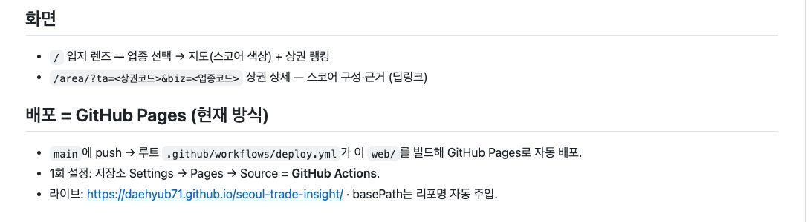
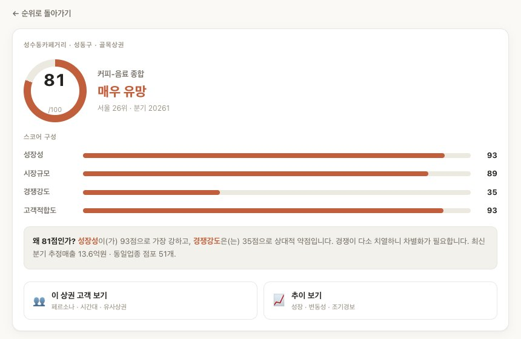

# IT 기본지식 Part1-4 강의 자료 — IP 주소 vs 도메인

> 바이브코딩 기초 : IT 기본지식 · Part 1 컴퓨터와 인터넷의 정체 · 4장

## 강의 소개

IP 주소는 네트워크에서 목적지를 찾아 데이터를 전달할 때 쓰는 주소이고, 도메인은 사람이 기억하고 관리하기 쉽게 붙인 이름입니다. DNS는 그 이름을 주소로 바꿔 알려 주는 안내 체계입니다. 사람은 이름을 기억하고, 길 찾기는 주소로 합니다.

**핵심 질문** 주소창에 이름만 입력했는데 브라우저는 그 사이트가 있는 컴퓨터를 어떻게 찾아갈까요? AI가 “DNS가 반영되려면 시간이 걸릴 수 있습니다”라고 할 때 우리는 무엇을 기다리는 걸까요?

| 항목 | 주소 |
| --- | --- |
| 강의 영상 | 바이브코딩 기초 : IT 기본지식 Part1-4 (유튜브 공개 후 추가) |
| 예제 저장소 | [github.com/daehyub71/seoul-trade-insight](https://github.com/daehyub71/seoul-trade-insight) — 서울 상권 인텔리전스 (라이브: [daehyub71.github.io/seoul-trade-insight](https://daehyub71.github.io/seoul-trade-insight/)) |
| 움직이는 개념 노트 | [움직이는 그림 4개](https://daehyub71.github.io/vibecoding-it-basics/notes/part1-4.html) — 단계 넘기기 · 재생 · 직접 해 보기 |
| 강의 목차 | [39편 전체 목차](https://daehyub71.github.io/vibecoding-it-basics/) |
| 앞 영상 | Part1-3 (유튜브 공개 후 추가) |

**예제 저장소를 고른 이유** 4장부터는 새 예제입니다. 서울 상권을 성장성 · 경쟁 · 고객 · 추이로 분석해 보여 주는 정적 웹사이트이고, GitHub Pages로 자동 배포됩니다. README 맨 위의 라이브 주소 한 줄과 상세 화면 주소 하나만으로 호스트 이름 · 경로 · 질의 문자열을 모두 만날 수 있습니다. 확인 기준은 커밋 `49bbf61`(2026-10-23 다시 확인)입니다.

**공부하는 순서** 가게 이름과 건물 주소의 차이로 시작해 → 이름이 주소로 바뀌는 길을 움직이는 그림으로 따라가고 → 실제 공개 사이트의 주소를 조각내 읽은 뒤 → 터미널에서 DNS에 직접 물어봅니다.

**표시 규칙** 이 자료와 영상에 나오는 IP 주소는 모두 문서 예제용으로 따로 떼어 둔 범위(`192.0.2.…` · `198.51.100.…` · `203.0.113.…` · `2001:db8::…`)이거나 집 안에서 쓰는 사설 범위입니다. 접속할 대상이 아닙니다.

## 1부. 이름과 주소

친구가 메시지를 보냅니다. “오늘 저녁은 ‘골목 끝 책방 카페’에서 보자.” 이름은 알지만 어디 있는지는 모릅니다. 지도 앱에 이름을 검색하면 지도가 실제 위치를 찾아 주고, 그제야 길을 따라가 가게 문을 열 수 있습니다. **이름과 위치는 서로 다른 정보**입니다.

컴퓨터도 같습니다. 사람은 `example.com`처럼 외우기 쉬운 이름을 입력하지만, 네트워크에서 목적지를 찾아 데이터를 전달할 때는 **IP 주소**가 필요합니다. 이름을 주소로 알아봐 주는 체계가 **DNS(Domain Name System)**입니다.


| 사람 쪽 | 안내 체계 | 네트워크 쪽 |
| --- | --- | --- |
| `example.com` — 도메인, 외우기 쉬운 이름 | DNS — 이름을 주소로 알아봐 준다 | `198.51.100.24` — IP 주소, 목적지를 찾는 주소(예) |

비유에 단서를 하나 답니다. ‘이름 하나 = 숫자 하나’는 첫 그림일 뿐입니다. 큰 서비스는 주소를 여러 개 쓰고(5부), 반대로 한 IP 주소에서 여러 웹사이트를 내주는 구성도 흔합니다.

### IP 주소는 주민등록번호일까

IP(Internet Protocol) 주소를 ‘컴퓨터의 주민등록번호’라고 부르기도 하지만, 평생 하나로 고정된 번호는 아닙니다. 네트워크에서 통신할 대상을 가리키고 데이터를 전달하는 데 쓰는 **논리적 주소**입니다.

행사장에 들어갈 때마다 새로 받는 **좌석 번호**가 더 가깝습니다. 오늘 카페 와이파이에서 노트북이 받은 주소가 내일 집에서도 같을 이유는 없습니다. 와이파이와 유선을 함께 쓰는 컴퓨터는 주소를 여러 개 가질 수도 있습니다.

| 형식 | 예(문서용) | 특징 |
| --- | --- | --- |
| IPv4 | `192.0.2.10` | 점으로 구분한 숫자 4개, 각각 0~255. 만들 수 있는 주소가 약 43억 개뿐 |
| IPv6 | `2001:db8::10` | 콜론으로 구분. 0이 이어지는 부분은 `::`로 줄여 쓴다 |

IPv4로는 인터넷에 연결된 기기를 다 담기에 모자라서 훨씬 긴 IPv6가 함께 쓰입니다. 그러니 ‘IP 주소는 반드시 숫자 네 덩어리’라고 외우지 않습니다.

### 도메인은 인터넷의 간판 — 오른쪽부터 큰 단위

가게 이름이 도로명 주소 전체보다 외우기 쉽듯, 도메인도 사람을 위한 이름입니다. 운영자가 도메인을 등록하고 DNS 설정을 관리하면, 사용자는 이름만 입력해 사이트에 들어갈 수 있습니다. 읽을 때는 **오른쪽부터** 큰 단위입니다.

| 이름 | 오른쪽 끝 | 그 왼쪽 | 맨 왼쪽 |
| --- | --- | --- | --- |
| `shop.example.com` | `com` 최상위 도메인 | `example` 등록한 이름 | `shop` 하위 도메인 |
| `example.co.kr` | `kr` 한국 | `co` 기업용 구역 | `example` 등록한 이름 |
| `daehyub71.github.io` | `io` 최상위 도메인 | `github` GitHub가 등록한 이름 | `daehyub71` 계정 이름 = 하위 도메인 |

`github.io`는 GitHub가 등록해 관리하고, 그 아래에 계정 이름을 붙인 하위 도메인을 사용자마다 내줍니다. `shop.example.com`과 `blog.example.com`은 서로 다른 서비스를 가리키도록 설정할 수 있습니다. `www`도 필수가 아닙니다. `www.example.com`은 `example.com` 아래의 이름 가운데 하나일 뿐이라, `www` 없이 열리는 사이트도 많습니다.

### 간판은 들고 이사한다

가게가 이사를 가도 주인은 간판을 그대로 들고 길을 건너 새 건물에 겁니다. 서비스가 다른 클라우드로 옮겨 IP 주소가 바뀌어도, 도메인 설정만 고치면 사용자는 같은 이름으로 찾아옵니다. 이것이 ‘이름’과 ‘주소’를 따로 관리하는 실용적인 이유입니다.


## 2부. 실제 사이트의 주소 읽기

### 실전 A. README 첫머리의 라이브 주소

[서울 상권 인텔리전스](https://github.com/daehyub71/seoul-trade-insight) README 맨 위에는 라이브 주소 한 줄과 「GitHub Pages 자동 배포」라는 말이 적혀 있습니다.

```text
🔗 라이브: https://daehyub71.github.io/seoul-trade-insight/ (GitHub Pages 자동 배포)
```


| 조각 | 무엇인가 | 저장소의 근거 |
| --- | --- | --- |
| `https` | 통신 방식. 포트를 적지 않았으므로 HTTPS의 기본 문(443번)으로 간다 | — (포트 이야기는 5장) |
| `daehyub71.github.io` | 호스트 이름. GitHub가 계정 이름으로 내준 하위 도메인 | README의 「GitHub Pages 자동 배포」 |
| `/seoul-trade-insight/` | 경로. 저장소 이름이 그대로 붙었다 | README의 「basePath는 리포명 자동 주입」 |

### 경로는 도메인의 일부가 아니다

GitHub Pages는 저장소로 만든 사이트를 `계정이름.github.io/저장소이름/` 아래에 열어 줍니다. 그리고 배포 설정 파일 [`.github/workflows/deploy.yml`](https://github.com/daehyub71/seoul-trade-insight/blob/main/.github/workflows/deploy.yml)이 같은 저장소 이름을 basePath로 넣어, 화면 안의 링크를 거기에 맞춥니다.

```text
# .github/workflows/deploy.yml
NEXT_PUBLIC_BASE_PATH: /${{ github.event.repository.name }}
# → 화면 안의 링크를 /seoul-trade-insight/ 에 맞춘다
```

같은 계정으로 다른 저장소를 공개하면 호스트 이름은 그대로이고 경로만 바뀝니다. 이름과 그 안의 위치가 따로 논다는 것을 주소 하나에서 보는 셈입니다.

### 상세 화면 주소 — 물음표 뒤의 쪽지

[`web/README.md`](https://github.com/daehyub71/seoul-trade-insight/blob/main/web/README.md)의 「화면」 목록에는 상권 하나를 자세히 보는 화면의 주소 형식이 적혀 있습니다.

```text
- `/area/?ta=<상권코드>&biz=<업종코드>` 상권 상세 — 스코어 구성·근거 (딥링크)
```



실제 값을 넣으면 이 주소가 됩니다.

```text
https://daehyub71.github.io/seoul-trade-insight/area/?ta=3110131&biz=CS100010
```

| 조각 | 뜻 | 근거 |
| --- | --- | --- |
| `ta=3110131` | 성수동카페거리 | `web/public/data/area_index.json` |
| `biz=CS100010` | 커피-음료 | `web/public/data/biz_index.json` |

[실제로 열어 보면](https://daehyub71.github.io/seoul-trade-insight/area/?ta=3110131&biz=CS100010) 성수동카페거리의 커피-음료 점수가 나옵니다.



점수와 순위는 캡처한 때의 값이며 데이터가 갱신되면 바뀔 수 있습니다. `?` 뒤의 `ta=…&biz=…`는 도메인도 경로도 아닌 **질의 문자열**입니다. 상세 화면(`area/`)에게 ‘어느 상권, 어느 업종’을 알려 주는 쪽지이고, 화면 코드 [`web/app/area/page.tsx`](https://github.com/daehyub71/seoul-trade-insight/blob/main/web/app/area/page.tsx)가 `sp.get("ta")`, `sp.get("biz")`로 이 값을 읽어 씁니다.

### 확인한 것을 세 칸으로 나누기

| GitHub에서 확인한 사실 | 배우기 위해 단순화한 설명 | 아직 확인하지 못한 가정 |
| --- | --- | --- |
| deploy.yml이 저장소 이름을 basePath로 넣는다 | 브라우저는 `daehyub71.github.io`를 IP 주소 하나로 바꿔 찾아간다 | 지금 이 순간 라이브 주소가 열린다 |

가운데 칸의 ‘IP 주소 하나’는 5부에서 고쳐 쓰게 되고, 오른쪽 칸은 「직접 확인하기」의 명령과 브라우저로 확인해야 채울 수 있습니다.

### 실전 B. AI에게 조각마다 근거를 붙이게 하기

AI에게 “이 사이트 주소 설명해 줘”처럼 넓게 물으면 URL의 일반론만 길게 돌아오고, 무엇이 이 저장소에 실제로 적힌 내용인지는 구분되지 않습니다. 조각마다 근거 파일을 붙이게 해 보세요.

```text
아래 공개 저장소의 README.md, web/README.md, .github/workflows/deploy.yml만 근거로 답해 줘.
https://github.com/daehyub71/seoul-trade-insight

1) 다음 주소를 방식 · 호스트 이름 · 경로 · 질의 문자열로 나누고, 각 조각이 무슨 역할인지 적어 줘.
   https://daehyub71.github.io/seoul-trade-insight/area/?ta=3110131&biz=CS100010
2) 조각마다 근거가 된 파일과 그 줄을 그대로 옮겨 줘. 파일에 없는 설명은 "일반 지식"이라고 따로 표시해 줘.
3) 이 사이트의 IP 주소는 적지 마. 내가 nslookup으로 직접 확인할 테니 그 명령만 알려 줘.
```

AI의 답은 **초안**입니다. 세 가지를 직접 맞춰 봅니다.

- 옮긴 줄이 파일에 정말 있나 — 특히 basePath 줄은 deploy.yml에서 찾아 글자 그대로 비교
- AI가 말하는 ‘도메인’이 `github.io`(GitHub가 등록한 이름)인가, `daehyub71.github.io`(이 사이트의 호스트 이름)인가
- 근거 없이 사용자 지정 도메인이나 특정 IP 주소를 단정하지 않나 — README가 안내하는 주소는 `github.io` 주소뿐이고, IP 주소는 때와 장소에 따라 달라진다

## 3부. DNS — 이름이 주소가 되는 길

브라우저가 도메인으로 접속하려면 먼저 그 이름의 IP 주소를 알아내야 합니다. 이 일을 **DNS 조회**라고 합니다. DNS는 한곳에 거대한 전화번호부를 둔 구조가 아니라, 이름의 오른쪽 끝부터 담당이 나뉜 **분산된 시스템**입니다.

### 이름이 주소가 되기까지 (움직이는 그림 4-A)

브라우저가 `www.example.com`의 주소가 필요할 때 일어나는 일입니다.

1. **가까운 기억부터 본다.** 브라우저와 운영체제는 최근 답을 잠시 기억해 둡니다. 이것이 **캐시(cache)**입니다. 운영체제는 hosts라는 작은 파일도 먼저 봅니다(`localhost`가 DNS 없이 풀리는 까닭, 5장).
2. **리졸버에게 묻는다.** 기억에 없으면 네트워크 설정에 정해진 DNS 서버에게 묻습니다. 대신 찾아 주는 이 서버가 **리졸버(resolver)**이고, 리졸버도 먼저 자기 캐시를 봅니다.
3. **루트 서버가 다음 창구를 알려 준다.** 루트 서버는 답 대신 “`.com`은 저 서버들이 담당한다”고 알려 줍니다.
4. **최상위 도메인 서버가 담당자를 알려 준다.** `.com` 담당 서버는 `example.com`을 책임지는 네임 서버를 알려 줍니다.
5. **권한 있는 네임 서버가 답한다.** “주소는 이것이고, 이 답은 예를 들어 300초 동안 기억해도 된다.”
6. **답을 기억해 두고 돌려준다.** 답은 돌아오는 길의 캐시에 남고, 브라우저는 받은 주소로 접속을 시작합니다.

같은 이름을 다시 물으면 대부분 1·2단계의 가까운 기억에서 바로 끝납니다. → [움직이는 개념 노트에서 단계별로 보기](https://daehyub71.github.io/vibecoding-it-basics/notes/part1-4.html)

**기억할 것 하나** 3~5단계는 브라우저가 아니라 리졸버가 대신 묻고 다니는 일이고, 대부분의 조회는 캐시에서 끝납니다. 단계를 외우기보다 **DNS는 웹페이지를 내려 주는 서버가 아니라 접속에 필요한 주소를 찾아 주는 과정**이라는 점을 기억합니다. 지도 앱 비유가 맞지 않는 곳도 여기입니다. DNS에는 모든 가게를 아는 안내소 한 곳이 없고, 구역별 안내소가 다음 안내소를 차례로 알려 줄 뿐입니다.

### 간판 · 안내 · 가게 — 서로를 대신하지 못한다

손님이 지도를 보고 가게를 찾아왔고 문 위에는 반짝이는 새 간판도 있는데, 유리창 너머 가게 안이 텅 비어 있습니다. 물건을 실은 트럭은 아직 오는 중입니다. 도메인을 등록했다고 웹사이트가 저절로 생기지는 않습니다.


| 요소 | 생활 속 | 상권 사이트에서 |
| --- | --- | --- |
| 도메인 | 간판 | `daehyub71.github.io` — GitHub가 내줌 |
| DNS | 간판을 건물 주소에 잇는 안내 | GitHub가 관리 |
| 웹 서버 | 실제로 손님을 맞는 가게 | GitHub Pages ← deploy.yml이 채움 |

가게 안을 채우는 일은 deploy.yml이 맡습니다. `main` 브랜치에 코드가 올라올 때마다 `web/`를 빌드해 미리 만든 정적 파일(`web/next.config.mjs`의 `output: 'export'`)을 `web/out` 폴더째 GitHub Pages에 올립니다. README가 「Settings → Pages → Source = GitHub Actions」를 한 번 지정하라고 적어 둔 것은 이 가게 문을 여는 설정입니다. 이 단계가 실패하면 새 내용이 올라가지 않고, 처음부터 실패했다면 **간판만 있는 빈 가게**가 됩니다.

나중에 직접 산 도메인을 배포 서비스에 연결할 때 AI가 자주 안내하는 두 가지입니다. 어느 쪽을 쓸지는 배포 서비스의 안내를 따릅니다(배포 전체는 24장).

| DNS 기록 | 뜻 |
| --- | --- |
| A 레코드 | 이 이름은 이 IPv4 주소 |
| CNAME 레코드 | 이 이름은 저 이름의 별칭 |

### TTL — 이 답을 몇 초 동안 기억해도 되는가

가게가 길 건너로 이사했습니다. 휴대전화에 남은 옛 정보를 본 사람은 셔터가 내려진 옛 자리로 오고, 방금 새로 찾아본 사람은 새 자리로 가서 문을 엽니다. 같은 가게를 찾는데 **언제 찾아봤느냐**에 따라 가는 곳이 달라집니다.


DNS의 답에는 **TTL(Time To Live)**이라는 숫자가 붙어 옵니다. ‘이 답을 몇 초 동안 기억해도 된다’는 뜻이고, 도메인을 관리하는 쪽이 정해 둡니다.

```text
www.example.com  →  192.0.2.10   TTL 300   # 300초 동안 기억해도 됨 (예)
```

- 주소를 바꾼 직후에는 옛 답을 기억한 곳과 새로 물어본 곳이 함께 있습니다.
- “TTL이 1시간이면 모두가 정확히 1시간 뒤에 바뀐다”는 뜻은 아닙니다. 여러 캐시와 서비스 구성이 영향을 줍니다.
- 주소를 바꿀 계획이 있으면 미리 TTL을 짧게 줄여 두는 것이 흔한 준비입니다.

**움직이는 그림 4-B** 세 사람이 서로 다른 때에 옛 주소를 기억해 둔 상태에서 운영자가 주소를 바꿉니다. TTL이 먼저 끝난 사람부터 다시 묻고 새 주소로 넘어가며, 그 사이에는 같은 이름인데도 사람마다 다른 서버를 봅니다. 새 주소가 퍼져 나가는 게 아니라 **기억이 만료돼 다시 묻는 것**입니다. 모든 캐시가 새 답을 받은 뒤에야 옛 서버를 닫아도 안전합니다. 개념 노트에서 TTL을 바꿔 넘어가는 속도를 비교해 볼 수 있습니다.

### 새 화면 · 옛 화면이 섞여 보일 때

앱을 옮긴 뒤 한 사람에게는 새 화면이, 다른 사람에게는 예전 화면이 보여도 곧바로 ‘코드가 둘로 갈라졌다’고 판단하지 않습니다. 어느 쪽 기억 때문인지부터 나눠 봅니다.

| 캐시 | 기억하는 것 |
| --- | --- |
| DNS 캐시 | 이름 → 주소로 바꾼 결과 |
| 브라우저의 페이지 캐시 | 이미 내려받은 화면 파일(HTML · 이미지 · 스크립트) |

## 4부. 공인 IP와 사설 IP

집 와이파이에 연결된 노트북에서 IP를 확인하면 `192.168.`로 시작하는 숫자가 나오는데, 외부 사이트에서 ‘내 IP’를 확인하면 전혀 다른 숫자가 보입니다. **둘 다 맞습니다.**

| 어디서 본 주소 | 예 | 종류 |
| --- | --- | --- |
| 집 안에서 본 내 IP | `192.168.0.23` | 사설 IP — 네트워크 안에서만 |
| 바깥 사이트가 본 내 IP | `203.0.113.5`(문서용 예) | 공인 IP — 공개 인터넷에서 |

사설 IP로 쓰도록 정해 둔 범위는 **세 덩어리**입니다. `10.`으로 시작하는 주소, `172.16.`부터 `172.31.`까지로 시작하는 주소, `192.168.`로 시작하는 주소. 집과 회사, 카페마다 이 범위를 나눠 쓰기 때문에 서로 다른 집이 같은 번호를 써도 문제가 없고, 바깥 인터넷은 이 번호로 길을 찾지 않습니다.

### 동 · 호수만 적힌 쪽지

배달 기사가 동과 호수만 적힌 쪽지를 들고 있습니다. 비슷한 단지가 여럿이라 어디로 가야 할지 모릅니다. 바깥에서는 단지의 도로명 주소(공인 IP)가 필요하고, 단지 안으로 들어오면 경비실(공유기)이 동과 호수를 보고 집까지 전해 줍니다.


### NAT — 공유기가 ‘보내는 사람’ 칸을 바꿔 적는다 (움직이는 그림 4-C)

| 단계 | 일어나는 일 |
| --- | --- |
| 노트북 → 공유기 | 보내는 사람 칸: `192.168.0.23` |
| 공유기 → 바깥 | 보내는 사람 칸을 공유기의 바깥 주소 `203.0.113.5`(예)로 바꿔 적고 기록표에 한 줄 |
| 답장 → 공유기 → 노트북 | 기록표를 보고 원래 기기로 돌려줌 |

이 방식을 **NAT(Network Address Translation)**라고 합니다. 태블릿이 보내도 바깥에서는 같은 주소이고, 둘을 구분하는 것은 공유기의 기록표입니다. 바깥에서 사설 주소로 곧장 찾아오려는 요청은 길을 찾지 못합니다. → [개념 노트에서 봉투가 오가는 모습 보기](https://daehyub71.github.io/vibecoding-it-basics/notes/part1-4.html)

그래서 조심할 두 가지가 있습니다.

1. **외부에서 보이는 IP = 내 노트북 전용 고정 주소라고 단정하지 않습니다.** 통신사나 구성에 따라 여러 가정이 함께 쓰거나 바뀔 수 있습니다.
2. **집 안 사설 주소를 안다고 친구가 인터넷에서 그 주소로 내 노트북에 들어올 수는 없습니다.** 이 차이는 5장에서 `localhost`와 포트를 배울 때 다시 중요해집니다.

## 5부. URL과 여러 서버

### URL — 도메인보다 더 긴 주소 (움직이는 그림 4-D)

주소창의 문자열 전체를 **URL(Uniform Resource Locator)**이라고 부릅니다. 도메인은 URL의 한 조각일 뿐입니다. 가게 이름과, ‘어느 문으로 들어가 어느 진열대에서 무엇을 달라고 할지 적은 안내문’의 차이입니다.

```text
https://shop.example.com:443/items?id=7#review
```

| 조각 | 이름 | 하는 일 |
| --- | --- | --- |
| `https` | 방식(스킴) | 어떤 규칙으로 통신할지 정한다 |
| `shop.example.com` | 호스트 이름 | 어느 컴퓨터를 찾아갈지 정한다. 오른쪽부터 읽는다. 도메인 대신 IP 주소가 올 수도 있다 |
| `:443` | 포트 | 그 컴퓨터의 어느 문으로 들어갈지. `https`의 기본값이라 보통 생략한다 |
| `/items` | 경로 | 그 서버 안의 어떤 자원인지 가리킨다 |
| `?id=7` | 질의 문자열 | 덧붙이는 조건. `이름=값`을 `&`로 이어 여러 개를 쓴다 |
| `#review` | 조각(fragment) | 페이지 안의 위치. 서버로 보내지 않고 브라우저가 쓴다 |

상권 사이트의 상세 화면 주소도 같은 틀에 그대로 들어갑니다. `/seoul-trade-insight/area/`가 경로, `ta=3110131&biz=CS100010`이 질의 문자열입니다. 개념 노트에서는 직접 입력한 주소도 그 자리에서 조각내 줍니다. → [URL 조각내기 해 보기](https://daehyub71.github.io/vibecoding-it-basics/notes/part1-4.html)

### 경로는 폴더가 아니고, 이름은 오른쪽부터

URL의 경로는 파일 경로(2장)와 닮았지만 서버의 폴더 구조와 꼭 같지는 않습니다. `/seoul-trade-insight/`도 저장소에 그런 폴더가 있어서가 아니라, GitHub Pages와 배포 설정이 만든 경로입니다.

사이트 이름만 훑어보면 위험할 때가 있습니다.

```text
https://example.com.fake-site.invalid/login
```

이 주소에서 실제로 등록된 도메인은 오른쪽 끝의 `fake-site.invalid`이고, 앞의 `example.com.`은 그 앞에 붙은 하위 이름일 뿐입니다. 익숙한 이름이 앞에 보여도 **진짜 주인은 오른쪽 끝**에서 확인합니다.

### 하나의 도메인, 여러 서버

대형 공연장에 손님이 몰리면, 간판은 하나여도 로비의 안내 직원이 줄을 여러 창구로 나눠 보냅니다. 웹 서비스도 이름 하나 뒤에 여러 서버와 여러 IP 주소가 놓일 수 있습니다.


구조를 다 외울 필요는 없습니다. **도메인 이름은 이용자에게 늘 같은 출입구를 보여 주고, 그 뒤의 실제 컴퓨터 구성은 바뀔 수 있다**는 원리 하나면 됩니다. 오늘 예제 사이트 이름도 직접 물어보면 주소가 여러 줄로 돌아옵니다.

```text
$ nslookup daehyub71.github.io
…
Address: 192.0.2.153
Address: 192.0.2.154
Address: 192.0.2.155      # 주소가 여러 줄 (숫자는 예)
```

다만 이 비유는 단순화한 것입니다. DNS가 요청 하나하나의 서버 부하를 판단해 나눠 준다는 뜻은 아니며, 실제로 요청을 나누는 일은 **로드 밸런서**라는 장치가 따로 맡는 경우가 많습니다.

### 바이브코딩 현장: 내 화면에선 열리는데 친구는 못 연다

AI가 “배포가 완료되었습니다”라며 주소를 보내 줬습니다. 내 노트북에서는 잘 열리는데, 친구 휴대전화에서는 “사이트에 연결할 수 없음”이 뜹니다.


순서대로 나눕니다. ① 공개 주소가 맞나 ② 이름이 IP로 풀리나 ③ 그 서버가 답하나 ④ 보안 경고나 네트워크 정책은 아닌가. **가장 먼저 볼 것은 ①**입니다. AI가 보낸 주소가 `localhost` · `127.0.0.1` · `192.168.…`처럼 내 컴퓨터나 우리 집 안의 주소라면, 친구 쪽에서는 처음부터 열릴 수 없습니다.

```text
네가 "배포가 완료되었다"며 보내 준 주소가 내 노트북에서는 열리는데,
친구 휴대전화(LTE)에서는 "사이트에 연결할 수 없음"이 뜬대.
- 보내 준 주소: (여기에 그대로 붙여 넣기)

원인을 하나로 정하지 말고, 아래 순서로 어느 단계에서 끊겼는지 먼저 같이 확인하자.
1) 이 주소가 공개 주소가 맞는지 (localhost, 127.0.0.1, 192.168.… 같은 주소는 아닌지)
2) 도메인 이름이 IP 주소로 풀리는지 — 내가 돌려 볼 nslookup 명령과 결과 읽는 법
3) 그 주소의 서버가 응답하는지 — 브라우저나 curl로 확인하는 방법
4) 친구 쪽 브라우저 경고나 네트워크 정책 때문일 가능성
단계마다 내가 직접 확인할 방법을 알려 주고, 원인을 찾기 전에는 DNS 설정을 바꾸지 마.
```

좋은 요청은 원인 하나를 미리 정하지 않습니다. DNS 설정 변경은 같은 도메인을 쓰는 다른 서비스에도 영향을 줄 수 있으니, 회사 도메인의 DNS는 관리자 승인 없이 바꾸지 않습니다.

## 직접 확인하기

설정은 바꾸지 않고, 묻고 확인만 합니다. 맥은 Command+스페이스로 ‘터미널’을, 윈도우는 시작 단추에서 ‘PowerShell’을 검색해 엽니다. 아래 출력은 **형식만 살리고 숫자를 문서용 예시로 바꾼 것**이며, 실제 숫자는 사람마다 · 때마다 다릅니다.

| 실습 | 시간 | 할 일 |
| --- | --- | --- |
| A. 주소의 조각 찾기 | 3분 | 지금 보는 사이트 주소(또는 상세 화면 주소)를 메모장에 붙여 넣고 방식 · 호스트 이름 · 경로 · 질의 문자열에 밑줄. 호스트 이름은 오른쪽부터 읽기 |
| B. DNS에 직접 묻기 | 5분 | `nslookup example.com`, 이어서 `nslookup daehyub71.github.io` — 주소가 몇 줄 나오나 |
| C. TTL이 줄어드는 것 보기 | 5분 | 맥 · 리눅스에서 `dig` 두 번 실행해 둘째 칸 비교 |
| D. 내 사설 IP 확인하기 | 3분 | 나온 숫자가 사설 범위 세 덩어리 가운데 어디인지 |

### 실습 B — nslookup (맥 · 윈도우 공통 명령)

**맥 · 터미널**

```text
$ nslookup example.com
Server:		192.0.2.53
Address:	192.0.2.53#53

Non-authoritative answer:
Name:	example.com
Address: 198.51.100.24
Name:	example.com
Address: 203.0.113.17
```

**윈도우 · PowerShell**

```text
> nslookup example.com
서버:    UnKnown
Address:  192.0.2.53

권한 없는 응답:
이름:    example.com
Addresses:  198.51.100.24
          203.0.113.17
```

- `Server`(서버)는 내가 물어본 리졸버입니다.
- `Non-authoritative answer`(권한 없는 응답)는 담당 네임 서버가 아니라 리졸버가 전해 준(캐시에 있던 것일 수도 있는) 답이라는 뜻입니다.
- 윈도우는 주소를 `Addresses:` 아래에 모아 보여 주는 등 모양이 조금 다릅니다.
- 같은 명령으로 `nslookup daehyub71.github.io`도 물어보고 주소가 몇 줄 나오는지 세어 봅니다.

### 실습 C — dig로 TTL 보기 (맥 · 리눅스)

`dig`는 맥 · 리눅스의 기본 명령이고 DNS의 답을 더 자세히 보여 줍니다.

```text
$ dig example.com +noall +answer
example.com.		223	IN	A	198.51.100.24
example.com.		223	IN	A	203.0.113.17
```

두 번째 칸(`223`)이 그 답을 캐시에 기억해 둘 남은 시간(TTL, 초)이고, `A`는 IPv4 주소라는 뜻입니다. 잠시 뒤 다시 실행하면 숫자가 줄어 있거나, 다른 캐시가 답해 다른 숫자가 나옵니다. 윈도우에는 `dig`가 기본으로 없으니 nslookup까지만 해도 충분합니다.

더 해 보기(맥 · 리눅스): `dig AAAA example.com +noall +answer`는 IPv6 주소를, `dig +trace example.com`은 루트 → `.com` 담당 → `example.com` 담당 → 최종 주소를 덩어리별로 찍어 줍니다. 움직이는 그림 4-A의 3~5단계를 실제 출력으로 보는 셈입니다.

### 실습 D — 내 사설 IP

**맥 · 터미널**

```text
$ ipconfig getifaddr en0
192.168.0.23
```

**윈도우 · PowerShell**

```text
> ipconfig
…
   IPv4 주소 . . . . . . . . . : 192.168.0.23
…
```

- 맥은 「시스템 설정 → 네트워크 → Wi-Fi → 세부사항」에서도 볼 수 있습니다. 와이파이 장치 이름이 `en0`이 아닌 컴퓨터도 있어, 아무것도 안 나오면 `en1`로 해 봅니다.
- 윈도우는 와이파이 어댑터 아래의 「IPv4 주소」 줄을 찾습니다(영문 윈도우는 `IPv4 Address`).
- 나온 숫자가 `10.` · `172.16.~172.31.` · `192.168.` 가운데 어디에 속하는지 확인합니다.

네트워크 설정은 바꾸지 않고, ‘내 IP 확인’ 사이트에 나오는 공인 주소는 남에게 공유하지 않습니다. 로그인 정보가 붙은 주소도 공유하지 않습니다.

## 오해 바로잡기

| 오해 | 바로잡기 |
| --- | --- |
| IP 주소는 평생 붙어 있는 주민등록번호다 | 연결한 네트워크와 설정에 따라 바뀌고, 한 기기가 여러 주소를 가질 수도 있다 |
| 도메인 하나는 IP 하나에만 연결된다 | 여러 주소를 가리키거나, 여러 사이트가 한 주소를 함께 쓰는 구성도 흔하다 |
| DNS가 웹페이지를 만들어 준다 | DNS는 이름을 주소로 바꿔 줄 뿐이고, 페이지는 웹 서버가 내준다 |
| 도메인을 샀으니 앱이 공개됐다 | 배포, 이름과 주소의 연결, 보안 설정이 남아 있을 수 있다 |
| `www`는 모든 주소의 필수 부분이다 | 이름 가운데 하나일 뿐이고, 없이 운영되는 도메인도 많다 |

## 한 장 요약

| 개념 | 가장 쉬운 그림 | 기억할 주의점 |
| --- | --- | --- |
| IP 주소 | 통신할 대상을 찾는 네트워크 주소 | 평생 고정된 기기 번호가 아니다 |
| 도메인 | 사람이 기억하는 가게 간판, 오른쪽부터 큰 단위 | 서버를 자동으로 만들어 주지 않는다 |
| DNS · TTL | 구역별 안내소를 거쳐 이름을 주소로 바꾸는 체계 | 답은 TTL 동안 캐시에 남는다 |
| IPv4 · IPv6 | IP 주소의 두 형식 | 모든 IP가 점으로 나뉜 숫자 네 개는 아니다 |
| 사설 IP · 공인 IP | 집 안에서만 통하는 번호 · 공개 인터넷의 주소 | NAT가 잇는다. 바깥에서 사설 번호로 찾아올 수 없다 |
| URL | 방식 · 호스트 · 포트 · 경로 · 질의 · 조각을 담은 전체 안내 | 도메인은 그중 한 조각이다 |

## 확인 문제

1. 도메인 등록과 웹앱 배포는 왜 별개의 일인가?
2. 집에서 확인한 IP와 외부 사이트에 보이는 IP가 다른 이유는?
3. `shop.example.com`과 `blog.example.com`은 반드시 같은 페이지일까?
4. DNS 정보를 바꾼 직후 모든 기기에서 곧바로 같은 결과가 나올까?
5. `https://daehyub71.github.io/seoul-trade-insight/`의 `/seoul-trade-insight/`는 도메인의 일부인가?

<details>
<summary>풀이 보기</summary>

1. 도메인 등록은 이름을 확보하는 일이고, 웹앱 배포는 요청을 처리할 실제 서비스를 준비하는 일이다. 둘을 잇는 DNS 설정도 따로 필요하다.
2. 집 안에서는 사설 주소를 쓰고, 바깥으로 나갈 때는 공유기가 NAT로 공인 주소를 대신 보여 주기 때문이다.
3. 아니다. 서로 다른 하위 도메인이므로 별개 서비스로 설정할 수 있다.
4. 아니다. 여러 캐시가 TTL 동안 옛 답을 기억할 수 있어 기기마다 시차가 생긴다.
5. 아니다. 호스트 이름은 `daehyub71.github.io`이고 `/seoul-trade-insight/`는 경로다. GitHub Pages가 저장소 이름 아래에 사이트를 열고, deploy.yml이 같은 이름을 basePath로 넣어 링크를 맞춘다(README의 「basePath는 리포명 자동 주입」).

</details>

## 다음 시간

Part1-5 localhost와 포트. 이름을 주소로 바꿔 건물을 찾았다면, 그 건물의 어느 문을 두드려야 할까요? AI가 “`localhost:8000`으로 접속하세요”라고 할 때 그 주소가 어디인지, URL 조각 가운데 아직 자세히 보지 않은 `:443` 같은 포트가 무엇인지 배웁니다.

## 출처

- [daehyub71/seoul-trade-insight](https://github.com/daehyub71/seoul-trade-insight) 커밋 `49bbf61`(2026-10-23 다시 확인) — `README.md`의 라이브 주소 줄, `web/README.md`의 「화면」 · 「배포 = GitHub Pages」, `.github/workflows/deploy.yml`의 `NEXT_PUBLIC_BASE_PATH`, `web/next.config.mjs`의 `output: 'export'`, `web/app/area/page.tsx`의 `sp.get("ta")` · `sp.get("biz")`, `web/public/data/area_index.json`(3110131 = 성수동카페거리) · `biz_index.json`(CS100010 = 커피-음료)
- 터미널 출력: `nslookup` · `dig`를 맥에서 실행해 형식을 확인했고, 주소는 문서용 예시 범위(RFC 5737 · RFC 3849)와 사설 범위로 바꿨습니다. 윈도우 출력은 같은 형식의 예입니다.
- 화면 4-3의 점수 · 순위는 캡처 시점의 값입니다. 라이브 주소가 지금 열린다고 단정하지 않습니다.
- 학습용 단순화: DNS 조회 여섯 단계는 보안 DNS · 전달 서버 · 위임 세부를, NAT 설명은 통신사 쪽 주소 공유를 생략했습니다.
