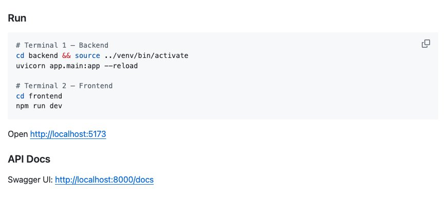
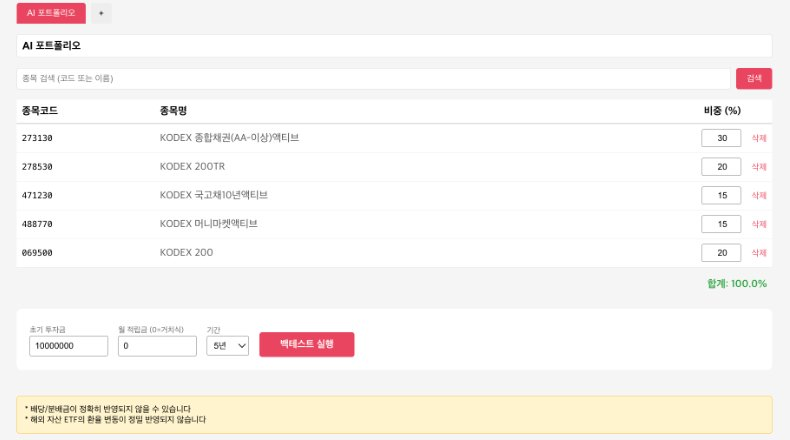

# IT 기본지식 Part1-5 강의 자료 — localhost와 포트

> 바이브코딩 기초 : IT 기본지식 · Part 1 컴퓨터와 인터넷의 정체 · 5장

## 강의 소개

`localhost`는 지금 내가 쓰는 컴퓨터 자신을 가리키는 이름이고, 포트 번호는 그 컴퓨터 안에서 어느 프로그램의 문을 두드릴지 정하는 번호입니다.

**핵심 질문** AI가 “서버를 실행했습니다. `http://localhost:8000`을 여세요”라고 할 때 그 주소는 어디를 가리킬까요? 같은 주소를 친구에게 보내면 왜 친구 화면에서는 열리지 않을까요?

| 항목 | 주소 |
| --- | --- |
| 강의 영상 | 바이브코딩 기초 : IT 기본지식 Part1-5 (유튜브 공개 후 추가) |
| 예제 저장소 | [github.com/daehyub71/etf-portfolio-lab](https://github.com/daehyub71/etf-portfolio-lab) — ETF 포트폴리오 랩 |
| 움직이는 개념 노트 | [움직이는 그림 4개](https://daehyub71.github.io/vibecoding-it-basics/notes/part1-5.html) — 단계 넘기기 · 재생 · 직접 해 보기 |
| 강의 목차 | [39편 전체 목차](https://daehyub71.github.io/vibecoding-it-basics/) |
| 앞 영상 | Part1-4 (유튜브 공개 후 추가) |

**예제 저장소를 고른 이유** 한국 상장 ETF로 포트폴리오를 짜고 과거 데이터로 성과를 시험해 보는(백테스트) 웹 앱입니다. 서버 쪽은 FastAPI(Python), 화면 쪽은 React와 TypeScript(빌드 도구 Vite)입니다. 노트북 한 대 안에서 프로그램 두 개가 **서로 다른 문(8000 · 5173)**을 쓰는 구성이라 이 장의 예제로 알맞습니다. 확인 기준은 커밋 `1c24c10`(2026-10-21 확인)입니다.

**공부하는 순서** 한 건물의 여러 출입문 비유로 시작해 → `localhost`가 밖으로 나가지 않는 길을 움직이는 그림으로 보고 → 예제 앱이 쓰는 두 문을 저장소에서 확인한 뒤 → 내 컴퓨터에 연습 서버를 켜고 끄며 직접 확인합니다.

## 1부. 한 건물, 여러 출입문

> “개발 서버를 실행했습니다. 브라우저에서 `http://localhost:8000`으로 접속해 화면을 확인해 주세요.”

동네 상가 건물 하나를 떠올려 봅시다. 주소는 하나인데 정문으로 들어가면 카페, 옆문으로 들어가면 꽃집, 뒷문으로 들어가면 세탁소입니다. 그래서 길을 알려 줄 때는 “그 건물 옆문으로 와”까지 말해야 합니다. 내 노트북도 이런 건물입니다.

- **`localhost`** — 내가 지금 서 있는 이 건물(이 컴퓨터)
- **포트 번호(port)** — 그 건물에서 요청을 받는 문. `8000`이 그 예


8000이라는 숫자는 개발 서버가 자주 고르는 예일 뿐, 프로그램마다 정해진 문 번호가 아닙니다. 같은 프로그램도 다른 포트로 켤 수 있습니다. 어느 문에서 어떤 프로그램이 기다리는지는 **실행 중인 서비스의 설정과 상태**를 봐야 압니다.

## 2부. localhost — 멀리 가지 않는 주소

웹사이트를 열 때는 대개 인터넷 너머의 서버에 요청을 보냅니다. 그러나 내 컴퓨터에서 실행 중인 프로그램에도 같은 방식으로 요청할 수 있고, 이때 쓰는 대표 이름이 `localhost`입니다.

| 항목 | 내용 |
| --- | --- |
| 가리키는 곳 | 언제나 지금 이 기기 자신 |
| 숫자 주소 | IPv4 `127.0.0.1`, IPv6 `::1` — 이런 주소를 **루프백(loopback)** 주소라 부른다 |
| 이름 풀이 | 4장의 DNS에 묻지 않는다. 윈도우는 운영체제가 스스로 처리하고, 맥은 hosts 파일(`/etc/hosts`)에 `127.0.0.1 localhost` 줄이 있다 |
| 와이파이가 끊기면 | 이미 내 기기에서 돌고 있는 서버에는 대개 그대로 닿는다 |

루프백은 데이터를 바깥 네트워크로 내보내지 않고 자기 안으로 돌려보내는 방식입니다. 편지 받는 사람을 ‘바로 나’라고 적고 집 안 우편함에 직접 넣는 것과 같습니다.

### 밖으로 나가지 않는 주소 (움직이는 그림 5-A)

웹사이트 주소로 보낸 요청은 공유기와 인터넷을 지나 멀리 가지만, `localhost`로 보낸 요청은 컴퓨터 안에서 되돌아옵니다. 와이파이를 꺼도 루프백은 그대로이고, 친구가 같은 주소를 입력하면 친구 자신의 컴퓨터로 갑니다. 내 컴퓨터라도 서버가 꺼져 있으면 아무도 답하지 않습니다. → [움직이는 개념 노트에서 단계별로 보기](https://daehyub71.github.io/vibecoding-it-basics/notes/part1-5.html)


두 가지를 함께 기억합니다.

1. **`localhost`는 각자의 자신입니다.** 전 세계가 함께 쓰는 컴퓨터 이름이 아닙니다. 친구가 내 앱을 보려면 같은 네트워크에서 접근하도록 서버를 설정하거나(7부), 공개 인터넷에 배포해야 합니다. ‘링크를 보냈다’는 사실만으로 길이 생기지는 않습니다.
2. **주소 ≠ 서비스.** 주소가 있다고 그 자리에 서비스가 저절로 생기지 않습니다. 그 컴퓨터에서 서버 프로그램이 실제로 돌고 있어야 합니다.

## 3부. 포트 — 한 컴퓨터 안의 여러 문

4장의 IP 주소가 네트워크에서 **기기**를 찾는 데 쓰인다면, 포트는 그 기기 안의 여러 **통신 상대(프로그램)**를 구분하는 번호입니다. 0부터 65535까지 있고, 1024보다 작은 번호는 운영체제가 특별히 다루는 경우가 많아 개발 서버는 보통 더 큰 번호를 씁니다.

| 포트 번호 예 | 자주 연결되는 것 | 외울 필요가 있을까? |
| --- | --- | --- |
| 80 · 443 | 웹(HTTP · HTTPS)의 기본 문 — 주소에 안 적는다 | 의미만 이해 |
| 3000 · 5173 | 화면 개발 도구가 자주 고르는 번호(5173 = Vite 기본값, 이 장 앱의 화면) | 도구마다 확인 |
| 8000 | 개발용 서버에서 흔한 번호(uvicorn 기본값, 이 장 앱의 서버) | 도구마다 확인 |
| 5432 | PostgreSQL 데이터베이스의 기본 문 | DB가 필요할 때 확인 |

브라우저에 `https://example.com`을 입력할 때 `:443`을 적지 않는 것은 HTTPS의 기본 문으로 해석되기 때문입니다. 개발 서버처럼 기본이 아닌 문을 쓰면 주소에 숫자를 적어야 합니다. 그리고 **포트 번호는 보안 장치가 아닙니다.** ‘낯선 번호를 쓰니 안전하다’고 믿으면 안 됩니다.

## 4부. 실제 저장소 읽기 — ETF 포트폴리오 랩의 두 문

[ETF 포트폴리오 랩](https://github.com/daehyub71/etf-portfolio-lab) README의 「Run」은 터미널 두 개를 엽니다.



```bash
# 실행하지 않음: 옮겨 적기만 한 README 「Run」 (가상환경 줄은 생략)
# 터미널 1 — 서버(backend)
cd backend
uvicorn app.main:app --reload
# 터미널 2 — 화면(frontend)
cd frontend
npm run dev
```

README는 이어서 화면은 `http://localhost:5173`에서, API 문서(Swagger UI)는 `http://localhost:8000/docs`에서 열라고 합니다. 그런데 **두 명령 어디에도 8000이나 5173이 적혀 있지 않습니다.**

| | 서버(FastAPI) | 화면(Vite 개발 서버) |
| --- | --- | --- |
| 켜는 명령 | `uvicorn app.main:app --reload` | `npm run dev` (`package.json`의 `"dev": "vite"`) |
| 확인 주소 | `localhost:8000/docs` → API 문서 | `localhost:5173` → ETF 포트폴리오 화면 |
| 문 번호의 근거 | 명령에 `--port`가 없음 → **uvicorn 기본값 8000** | `vite.config.ts`에 포트 설정이 없음 → **Vite 기본값 5173** |



### 두 프로그램은 서로를 주소로 찾는다

```text
# frontend/src/services/api.ts 11행 — 화면이 데이터를 달라고 두드리는 주소
baseURL: "http://localhost:8000/api",

# backend/app/main.py 29행 — 서버가 받아 주는 화면 주소(CORS 허용 목록)
allow_origins=["http://localhost:5173", "http://localhost:3000"],
```

- **화면 → 서버** 5173번 문에서 받아 온 화면이, 데이터를 달라고 8000번 문을 두드립니다. 주소가 코드에 직접 적혀(하드코딩) 있습니다.
- **서버 → 화면** 서버는 요청을 받아 줄 화면 주소 목록을 포트까지 적어 둡니다. 같은 `localhost`라도 포트가 다르면 브라우저는 다른 출처(origin)로 보기 때문입니다. 이 규칙(CORS)은 9장과 28장에서 다시 만납니다.
- **배포할 때 바꿔야 할 줄** 이 앱을 그대로 인터넷에 올리면, 친구의 브라우저는 `api.ts`의 주소대로 **친구 자신의** 8000번 문을 두드립니다. 화면 코드에 `localhost`가 박혀 있으면 배포 전에 꼭 바꿔야 하는 이유입니다.

같은 8000번 문 안에서도 경로마다 다른 것이 나옵니다. `/docs`는 FastAPI가 기본으로 만들어 주는 API 문서, `/api/health`(`main.py` 44행)는 서버 상태 확인입니다.

### 확인한 것을 세 칸으로 나누기

| GitHub에서 확인한 사실 | 배우기 위해 단순화한 설명 | 아직 확인하지 못한 가정 |
| --- | --- | --- |
| README가 화면을 `http://localhost:5173`에서 열라고 한다 | 포트 하나에는 프로그램 하나가 선다 | 내 노트북의 5173번 문이 지금 비어 있다 |

오른쪽 칸은 6부의 `netstat`(윈도우) · `lsof`(맥) 명령으로 직접 확인할 수 있습니다.

### AI에게 이렇게 물어 보세요

“이 앱 실행해 줘”라고만 하면 명령은 줄줄이 나오지만, 어느 프로그램이 어느 문에 서는지와 그 근거는 빠지기 쉽습니다. **포트마다 근거 줄을 붙여 달라**고 요청합니다.

```text
아래 저장소의 README.md, frontend/vite.config.ts,
frontend/src/services/api.ts, backend/app/main.py를 근거로 답해 줘.
https://github.com/daehyub71/etf-portfolio-lab

1) 켜지는 프로그램마다 켜는 명령 · 기다리는 포트 · 확인할 주소를 표로 정리해 줘.
   포트마다 근거 파일과 줄을 적고, 파일에 없으면 "도구 기본값"인지 "추측"인지 표시해 줘.
2) 화면이 서버를 찾아가는 주소와, 서버가 받아 주는 화면 주소가 어디에 적혀 있는지 알려 줘.
3) 화면이 5173이 아닌 다른 포트로 켜지면 함께 고쳐야 할 줄을 모두 찾아 줘.
설치하거나 지우는 명령은 실행하지 말고 보여 주기만 해.
```

AI의 표를 받으면 두 가지를 맞춰 봅니다.

1. **근거가 맞는가.** AI가 “README에 `--port 8000`이 있다”거나 “`vite.config.ts`에 `port: 5173`이 있다”고 하면 틀린 근거입니다. 둘 다 도구의 기본값입니다.
2. **README대로 하면 멈추는 줄.** README 「Setup」은 `backend` 폴더 안에서 `cp .env.example .env`를 하라고 하지만, 견본 파일 `.env.example`은 실제로는 **저장소 루트에만** 있습니다. 그런데 `backend/app/config.py`는 `env_file: ".env"`, 곧 **명령을 실행한 폴더**의 `.env`를 읽고, 서버는 `backend` 안에서 켭니다. 그래서 README 줄은 “파일이 없다”는 오류로 멈추고, 맞는 방향은 `backend` 안에서 루트의 견본을 복사해 오는 것(윈도우는 `copy ..\.env.example .env`, 맥은 `cp ../.env.example .env`)입니다. AI가 README대로 순서를 짜 주면 파일 목록과 대조합니다.

견본에는 변수 이름만 있습니다(`KIS_APP_KEY`, `KIS_APP_SECRET`, `OPENAI_API_KEY`, `DATABASE_URL`). 실제 키 값은 대화에 붙여 넣지 않습니다(열쇠 다루는 법은 28장).

## 5부. 주소의 네 조각과 ‘서버를 실행한다’

README가 열라고 한 주소를 조각내 봅시다.

```text
http://localhost:8000/docs
```

| 조각 | 이름 | 뜻 |
| --- | --- | --- |
| `http` | 방식 | 웹 통신 방식. 개발 서버는 보통 암호화 없는 `http`로 켠다 |
| `localhost` | 호스트 | 지금 이 컴퓨터(건물) |
| `8000` | 포트 | 들어갈 문. 기본 문(80 · 443)이 아니어서 꼭 적는다 |
| `/docs` | 경로 | 그 문 안에서 찾는 자원(진열대) |

### 주소의 네 조각과 문 찾기 (움직이는 그림 5-B)

호스트가 건물을, 포트가 문을, 경로가 문 안의 진열대를 고르는 과정을 봅니다. 같은 건물이라도 5173번 문에서는 화면을 만드는 다른 프로그램이 답하고, 아무도 없는 문을 두드리면 대답 자체가 없습니다. 개념 노트에서 주소를 직접 바꿔 넣어 볼 수 있습니다.

주소를 조각으로 읽으면 질문도 구체적이 됩니다. “안 열려요” 대신 이렇게 묻습니다.

| 상황 | 결과 |
| --- | --- |
| 8000번 문에 아무도 없다(서버가 꺼졌거나 다른 문) | 연결 자체가 안 된다 |
| 문 안에 그런 경로가 없다 | 연결은 됐고, 서버가 “없다(404)”고 답한다 |

HTTP의 요청 · 응답과 상태 코드는 8장과 9장에서 배웁니다.

### 파일을 만든 것과 문을 연 것은 다르다

AI가 코드를 완성해 폴더에 `server.py`가 생겼다고 해서 `localhost:8000`이 열리지는 않습니다. 파일이 저장돼 있다는 사실과 **프로그램이 실행되어 그 포트에서 요청을 기다리고 있다는 사실**은 다릅니다. 인테리어를 마친 가게라도 셔터를 올리고 주인이 문 앞에 서야 손님을 받습니다.


서버가 문을 열면 터미널(윈도우는 PowerShell 창, 맥은 터미널)에 그 사실을 알리는 줄이 찍힙니다.

```text
# uvicorn (서버)
INFO:     Uvicorn running on http://127.0.0.1:8000 (Press CTRL+C to quit)
# Vite (화면)
  ➜  Local:   http://localhost:5173/
# 파이썬 연습 서버 (직접 확인하기에서 켠다)
Serving HTTP on 127.0.0.1 port 8000 (http://127.0.0.1:8000/) ...
```

어느 주소의 몇 번 문에서 기다리는지가 이 줄에 들어 있으니, AI가 알려 준 주소와 맞춰 보는 습관을 들입니다. 다만 이 줄이 떴다고 모든 기능이 정상이라는 보장은 없고, **이 터미널 창을 닫으면 서버도 함께 꺼집니다.**

## 6부. 포트 충돌 — 같은 문을 두 번 열면

이미 서버가 하나 떠 있는데 같은 포트로 하나 더 켜면 이런 오류가 납니다(파이썬 연습 서버, 맥 기준. 리눅스는 번호가 98. 윈도우는 실습 B의 설명을 보세요).

```text
OSError: [Errno 48] Address already in use
```

‘이 주소와 포트는 이미 사용 중’이라는 뜻입니다. 초보자가 흔히 만나는 것은 **다른 프로그램, 또는 아까 켜 둔 내 서버가 같은 포트를 이미 쓰는 경우**입니다.


해결 방향은 두 가지입니다. 그 포트를 누가 쓰는지 확인하거나, 내 서버를 다른 포트로 켭니다. 확인은 이렇게 합니다(출력은 예).

**윈도우 · PowerShell**

```text
> netstat -ano | findstr :8000
  TCP    127.0.0.1:8000    0.0.0.0:0    LISTENING    24931
```

**맥 · 터미널**

```text
$ lsof -nP -iTCP:8000 -sTCP:LISTEN
COMMAND   PID  USER        FD   TYPE  ...  NAME
Python  24931  사용자이름  3u   IPv4  ...  TCP 127.0.0.1:8000 (LISTEN)
```

- 윈도우: 맨 끝 칸의 번호(PID)를 작업 관리자의 ‘세부 정보’ 탭에서 찾습니다
- 맥: `COMMAND`는 프로그램 이름, `PID`는 운영체제가 붙인 프로세스 번호(19장), 맨 끝 `NAME`은 어느 주소의 몇 번 문에서 기다리는지. `-nP`를 빼면 8000 대신 `irdmi` 같은 서비스 이름이 보여 헷갈릴 수 있습니다
- **그 프로그램을 무턱대고 끄지 않습니다.** 다른 개발 도구나 업무 프로그램일 수 있습니다

### 스스로 비켜 가는 도구 — Vite

Vite는 5173번이 이미 쓰이고 있으면 알아서 다음 번호로 켭니다(설정에서 이 동작을 끄지 않았을 때).

```text
Port 5173 is in use, trying another one...
  ➜  Local:   http://localhost:5174/
```

편리하지만 주소가 바뀐 것을 놓치기 쉽습니다. 예제 앱에서는 이것이 8부의 장면 C로 이어집니다.

### 한 문에 두 프로그램 (움직이는 그림 5-C)

8000번 문에 서버 A가 서 있을 때 서버 B가 같은 문에 서려다 막히는 순간, `netstat`(맥은 `lsof`)으로 주인을 찾는 과정, B를 8001번으로 옮기거나 A를 끄는 두 해결책을 단추로 골라 봅니다. Vite가 5174번으로 옮겨 가는 경우도 함께 봅니다.

AI에게 오류를 알릴 때는 실행한 명령과 쓰려던 포트를 함께 적습니다. “8000번 포트가 이미 사용 중이래. 강제로 끄기 전에, 무엇이 쓰는지 안전하게 확인하는 방법부터 알려 줘.”

## 7부. 어디까지 받아 줄까 — 127.0.0.1과 0.0.0.0

개발 안내를 읽다 보면 “서버를 `0.0.0.0`으로 바인딩하세요”라는 말이 나옵니다. `127.0.0.1`과 비슷해 보이지만 뜻은 아주 다릅니다.

| 묶는 주소 | 받아 주는 요청 | 상가 비유 |
| --- | --- | --- |
| `127.0.0.1` | 이 컴퓨터 안에서 오는 요청만 | 건물 안 통로에만 열린 창구 |
| `0.0.0.0` | 이 컴퓨터의 모든 IPv4 연결 쪽에서 오는 요청. 찾아갈 주소가 아니라 ‘모두 받겠다’는 설정 | 건물의 모든 출입구 쪽으로 열어 둔 창구 |

예제 앱 README의 명령에는 `--host`가 없습니다. 그래서 uvicorn은 기본값인 `127.0.0.1`에서만 기다리고, Vite도 기본으로는 이 컴퓨터에서만 열립니다.

### 누가 이 문까지 올 수 있나 (움직이는 그림 5-D)

서버를 `127.0.0.1`에 묶었을 때와 `0.0.0.0`에 묶었을 때, 같은 노트북의 브라우저 · 같은 와이파이의 휴대전화 · 바깥 인터넷 가운데 누가 닿는지 비교합니다. 방화벽과 공유기 단추를 바꿔 보면, `0.0.0.0`이 곧 전 세계 공개는 아니지만 안전 보장도 아니라는 것을 알 수 있습니다.

**보안 주의** 공개할 목적이 아니면 `127.0.0.1`에 묶는 것이 기본입니다. 인증이 없거나 폴더의 파일을 그대로 보여 주는 개발 서버를 모든 연결에 열어 두면 같은 네트워크의 다른 기기가 접근할 수 있습니다. 바깥에 여는 것은 필요성과 보호 대책(방화벽 · 인증 · 내보이는 파일)을 확인한 뒤 정합니다.

### 같은 와이파이의 휴대전화에서 보려면

휴대전화에 `localhost:5173`을 입력하면 안 됩니다. 휴대전화의 `localhost`는 휴대전화 자신입니다.


세 가지가 맞아야 합니다.

1. 휴대전화 주소창에 노트북의 **사설 IP와 포트**를 적습니다(예: `http://192.168.0.23:5173`, 4장의 사설 IP).
2. 서버가 **바깥 연결도 받게** 켭니다. Vite는 시작 화면에 `Network: use --host to expose`라고 알려 줍니다. npm으로는 `npm run dev -- --host`입니다.
3. 노트북의 **방화벽**과 네트워크 정책이 허용해야 합니다. 게스트 와이파이나 기기 간 통신을 막아 둔 와이파이에서는 닿지 않을 수 있습니다.

**예제 앱은 그것만으로 부족합니다.** 휴대전화에서 연 화면은 `api.ts`의 주소대로 데이터를 휴대전화 **자신의** 8000번 문에 달라고 하고, 서버의 허용 목록(`main.py` 29행)도 휴대전화가 연 화면 주소를 모릅니다. 화면 코드의 서버 주소와 허용 목록까지 함께 맞춰야 합니다. 실습은 내 기기와 믿을 수 있는 개인 네트워크에서만 하고, 회사나 공공 와이파이의 정책은 우회하지 않습니다.

### 로컬 개발과 배포된 서비스

작업실에서는 공구와 설계도를 펼쳐 둬도 되지만, 손님을 맞는 매장으로 바꾸려면 정리하고 잠금장치를 달아야 합니다. 이것이 **로컬 개발(local development)**과 **배포된 서비스(운영 환경, production)**의 차이입니다. 코드는 비슷해도 실행 환경과 책임의 범위가 달라집니다.


README 명령의 `--reload`는 코드를 고칠 때마다 서버를 다시 띄우는 개발용 옵션입니다. 개발 서버는 오류를 자세히 보여 주도록 만들어진 경우가 많아, 바깥 사용자에게 보이면 내부 경로나 설정이 드러날 수 있습니다. 배포는 24장에서 자세히 다룹니다.

## 8부. 앱이 안 열리는 네 장면

‘사이트에 연결할 수 없습니다’라는 한 가지 증상은 아래 네 장면 가운데 하나일 수 있습니다.

| 장면 | 무슨 일인가 | 해결 방향 |
| --- | --- | --- |
| A. 서버를 실행하지 않았다 | AI가 파일만 만들었거나, 서버를 켠 터미널을 닫았다 | 서버가 실행 중인지, 시작 줄이 떠 있는지 확인 |
| B. 포트 번호가 다르다 | AI는 3000으로 켰는데 나는 8000으로 들어간다 | 실행 로그가 안내한 주소와 내가 연 주소를 글자 단위로 대조 |
| C. 문을 다른 프로그램이 차지했다 | 예제 앱의 화면이 5174로 뜨면, 화면은 열려도 허용 목록(5173 · 3000)에 없어 ETF 목록이 빈다 | `netstat` · `lsof`로 원래 문의 주인을 찾고, 그 프로그램을 끌지 설정을 함께 바꿀지 정한다 |
| D. 다른 기기에서 localhost를 썼다 | 친구가 자기 컴퓨터의 `localhost`로 내 앱에 들어오려 한다 | 공개 서비스인지 로컬 서비스인지, 접속할 호스트가 무엇인지 구분 |


AI에게는 네 장면을 차례로 확인하자고 요청합니다.

```text
브라우저에 "사이트에 연결할 수 없습니다"가 떠.
원인을 추측하지 말고 아래를 순서대로 같이 확인하자.
1) 서버를 켠 터미널이 아직 살아 있는지 — 마지막 로그 몇 줄을 붙여 넣을게
2) 그 로그가 안내한 주소 · 포트와 내가 연 주소(http://localhost:8000)가 같은지
3) 그 포트를 누가 쓰고 있는지 — 확인 명령을 알려 주고, 어떤 프로그램이든 끄기 전에 나에게 먼저 물어봐
4) 내가 주소를 연 기기가 서버를 켠 그 컴퓨터인지
내 컴퓨터: Windows 11, PowerShell (맥이라면 "macOS"로 바꿔 적기)
```

네 장면이 모든 원인을 덮지는 않습니다. 프록시 설정, 인증, 보안 프로그램 같은 원인도 있습니다. 그래도 첫 진단의 발판으로는 충분합니다.

## 직접 확인하기

예제 앱은 키(`.env`)가 있어야 서버가 제대로 뜨므로, 여기서는 Python에 들어 있는 **연습 서버**로 확인합니다. 이 서버는 그 폴더의 파일을 웹으로 보여 주므로 개인 문서나 비밀 키가 있는 폴더에서는 하지 않고, **빈 연습용 폴더**에서 합니다.

| 실습 | 시간 | 할 일 |
| --- | --- | --- |
| A. 연습 서버 켜기 | 5분 | 빈 폴더에서 8000번 문에 서버를 켜고 브라우저로 `localhost:8000` 열기 |
| B. 같은 문을 두 번 열기 | 3분 | 두 번째 PowerShell 창(맥은 터미널)에서 같은 명령 → 충돌 확인 → 문의 주인 확인 → 8001로 켜기 |
| C. 404와 연결 실패 비교 | 5분 | 서버를 켠 채 없는 주소를 열고, 끈 뒤 다시 열기 |
| D. 정리 | 2분 | 모두 Ctrl+C로 끄고 8000번 문이 비었는지 확인 |

### 실습 A 명령

아래 출력은 예시이며 컴퓨터마다 다릅니다.

**윈도우 · PowerShell**

```text
> mkdir ~\port-practice
> cd ~\port-practice
> python -m http.server 8000 --bind 127.0.0.1
Serving HTTP on 127.0.0.1 port 8000 (http://127.0.0.1:8000/) ...
```

**맥 · 터미널**

```text
$ mkdir ~/port-practice
$ cd ~/port-practice
$ python3 -m http.server 8000 --bind 127.0.0.1
Serving HTTP on 127.0.0.1 port 8000 (http://127.0.0.1:8000/) ...
```

- 윈도우에서 `python`이 안 되면 `py -m http.server 8000 --bind 127.0.0.1`
- `--bind 127.0.0.1`을 빼면 모든 연결에서 기다립니다(7부). 연습은 이 컴퓨터에만 묶습니다
- 브라우저에서 `localhost:8000`을 열면 빈 폴더 목록이 보입니다. 이 터미널은 이제 8000번 문 앞에서 기다립니다

### 실습 B 명령

PowerShell 창(맥은 터미널)을 하나 더 열어 같은 연습 폴더에서 같은 명령을 칩니다.

**윈도우 · PowerShell**

```text
> netstat -ano | findstr :8000
> python -m http.server 8001 --bind 127.0.0.1
```

**맥 · 터미널**

```text
$ python3 -m http.server 8000 --bind 127.0.0.1
...
OSError: [Errno 48] Address already in use
$ lsof -nP -iTCP:8000 -sTCP:LISTEN
$ python3 -m http.server 8001 --bind 127.0.0.1
```

- 8001로 켜면 주소도 `localhost:8001`이어야 합니다. 프로그램이 바뀐 것이 아니라 **문 번호가 바뀐 것**입니다
- 윈도우는 같은 문을 두 번 여는 것을 막지 않는 경우가 있어, 오류 없이 켜진 것처럼 보일 수 있습니다. 그러니 문 번호는 늘 겹치지 않게 고릅니다

### 실습 C 명령

서버를 켠 상태에서 첫 명령을, 서버 터미널에서 Ctrl+C로 끈 뒤 둘째 명령을 실행합니다.

**윈도우 · PowerShell**

```text
> curl.exe -s -o NUL -w "%{http_code}" http://localhost:8000/notice.html
404
> curl.exe http://localhost:8000/
curl: (7) Failed to connect to localhost port 8000 ...
```

**맥 · 터미널**

```text
$ curl -s -o /dev/null -w '%{http_code}\n' http://localhost:8000/notice.html
404
$ curl http://localhost:8000/
curl: (7) Failed to connect to localhost port 8000 after 0 ms: Couldn't connect to server
```

- 윈도우에서는 `curl`이 아니라 `curl.exe`로 씁니다(PowerShell에서 `curl`은 다른 명령의 별명일 수 있습니다)
- 첫 명령은 서버가 “그런 파일은 없다(404)”고 **답한** 것, 둘째는 문 앞에 아무도 없어 **답 자체를 받지 못한** 것입니다. 6장에서 이 차이를 서버 쪽 기록으로 다시 봅니다

### 실습 D — 정리

켜 둔 연습 서버는 모두 Ctrl+C로 끕니다(`Keyboard interrupt received, exiting.`). 그다음 윈도우는 `netstat -ano | findstr :8000`, 맥은 `lsof -nP -iTCP:8000 -sTCP:LISTEN`이 아무것도 보여 주지 않는지 확인합니다. 폴더의 파일은 그대로인데 브라우저는 연결할 수 없다고 합니다. ‘파일 존재’와 ‘서버 실행’의 차이를 직접 본 것입니다. 모든 연결에 바인딩하거나 공유기에서 포트를 열어 두는 실험은 이 장의 실습이 아닙니다.

## 오해 바로잡기

| 오해 | 바로잡기 |
| --- | --- |
| localhost는 인터넷에 있는 공통 개발 서버다 | 사용 중인 기기 자신을 가리키는 이름이다 |
| 8000번은 비밀번호다 | 그 기기 안에서 통신 상대를 찾는 포트 번호다 |
| 코드 파일이 있으면 서버가 이미 열려 있다 | 프로그램이 실행되어 그 문에서 기다리고 있어야 한다 |
| 0.0.0.0으로 켜면 전 세계에 공개된다 | 누가 닿는지는 공유기 · 방화벽 · 네트워크 구조에 달렸고, 안전하다는 보장도 아니다 |
| 포트를 바꾸면 보안이 해결된다 | 포트 번호는 보안 장치를 대신하지 못한다. 접근 권한과 인증은 별개 문제다 |

## 한 장 요약

| 기억할 질문 | 한 문장 답 |
| --- | --- |
| localhost는? | 내 컴퓨터 자신을 가리키는 이름(`127.0.0.1` · `::1`, 루프백) |
| 포트는? | 한 컴퓨터 안에서 프로그램을 구별하는 문 번호(0~65535) |
| 서버 실행은? | 프로그램이 그 문에서 요청을 기다리기 시작한 상태 |
| 포트 충돌은? | 쓰려는 문을 이미 누가 쓰는 상황(윈도우 `netstat` · 맥 `lsof`로 확인) |
| 127.0.0.1 · 0.0.0.0은? | 이 컴퓨터 안만 받기 · 모든 연결 쪽에서 받기 |
| 로컬 vs 배포는? | 내 작업실에서 실험하기 vs 손님을 맞는 매장을 갖추기 |
| 예제 앱의 두 문은? | 서버 8000(uvicorn 기본값) · 화면 5173(Vite 기본값), 서로를 `api.ts`와 `main.py`에 적힌 주소로 찾는다 |

## 확인 문제

1. 친구가 자기 휴대전화에서 `localhost:8000`을 열면 내 노트북으로 연결될까?
2. 서버 파일은 남아 있는데 터미널을 닫은 뒤 페이지가 열리지 않는다. 왜일까?
3. `localhost:8000`과 `localhost:8001`의 차이는?
4. 서버를 `0.0.0.0`으로 켰다. 이것만으로 보안이 충분할까?
5. 예제 앱의 화면이 `localhost:5174`로 떴다. ETF 목록이 비어 있을 수 있는 까닭은?

<details>
<summary>풀이 보기</summary>

1. 아니다. 친구 기기의 `localhost`는 친구 기기 자신을 가리킨다.
2. 요청을 받던 서버 프로그램이 터미널과 함께 종료되었기 때문이다. 파일이 있다고 문이 열려 있는 것은 아니다.
3. 같은 컴퓨터의 다른 문(포트)이다. 그 문에 어떤 서비스가 있는지는 실행 상태에 달려 있다.
4. 아니다. 모든 연결 쪽에서 받겠다는 설정일 뿐이다. 방화벽 · 인증 · 내보이는 파일 · 네트워크 정책을 함께 확인해야 한다.
5. 5173번을 이미 다른 프로그램이 쓰고 있어 Vite가 다음 번호인 5174로 옮겨 켰기 때문이다. 서버의 허용 목록(`backend/app/main.py` 29행 `allow_origins`)에는 `localhost:5173`과 `localhost:3000`만 있어, 5174에서 열린 화면이 8000번 서버에 보낸 요청의 응답을 브라우저가 막는다(CORS). 해결은 5173번의 주인을 확인해 문을 비우거나, 허용 목록에 5174를 함께 적는 것이다.

</details>

## 다음 시간

Part1-6 서버와 클라이언트. 이제 건물 주소와 어느 문으로 들어갈지는 압니다. 그런데 문을 두드리는 쪽과 문 안에서 요청을 처리하는 쪽은 각각 누구일까요? 실습 C에서 본 404는 누가 보낸 답일까요?

## 출처

- [daehyub71/etf-portfolio-lab](https://github.com/daehyub71/etf-portfolio-lab) 커밋 `1c24c10`(2026-10-21 확인) — `README.md`의 「Setup」 · 「Run」 · 「API Docs」, `frontend/vite.config.ts` · `package.json` · `src/services/api.ts`(11행), `backend/app/main.py`(29행 CORS · 44행 `/api/health`) · `app/config.py`(`env_file`), 루트 `.env.example`
- 도구 동작: uvicorn의 기본 host(`127.0.0.1`) · 포트(8000)와 시작 문구, Vite의 기본 포트(5173) · 충돌 시 다음 번호로 옮기는 동작 · `--host` 안내 문구는 각 도구의 기본 동작 기준입니다(버전에 따라 문구가 다를 수 있습니다). 윈도우 출력은 형식을 보여 주는 예이며, 연습 서버 · `lsof` · `curl`의 출력은 맥에서 실행한 예입니다.
- 학습용 단순화: ‘포트 하나에 프로그램 하나’, `0.0.0.0`은 IPv4 기준으로 설명했습니다(IPv6의 `::`, 소켓 옵션은 생략).
