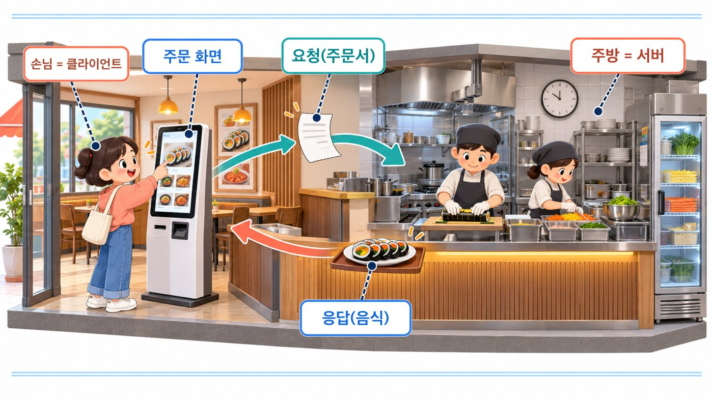
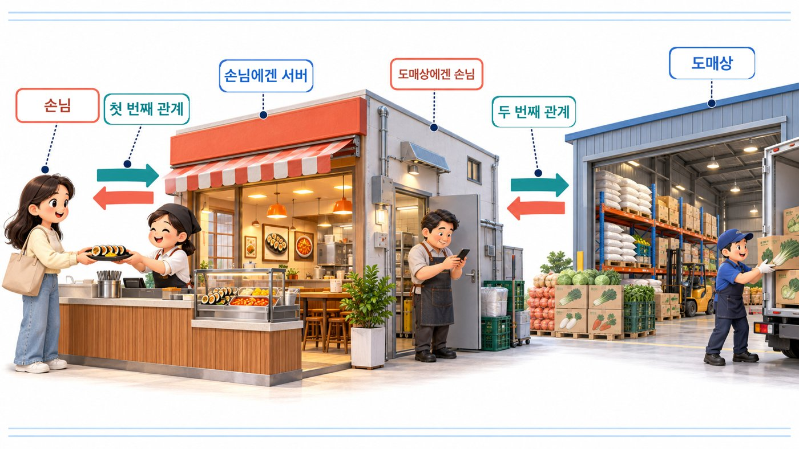
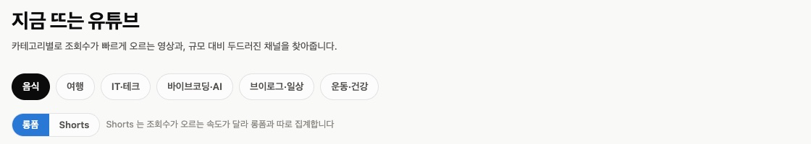
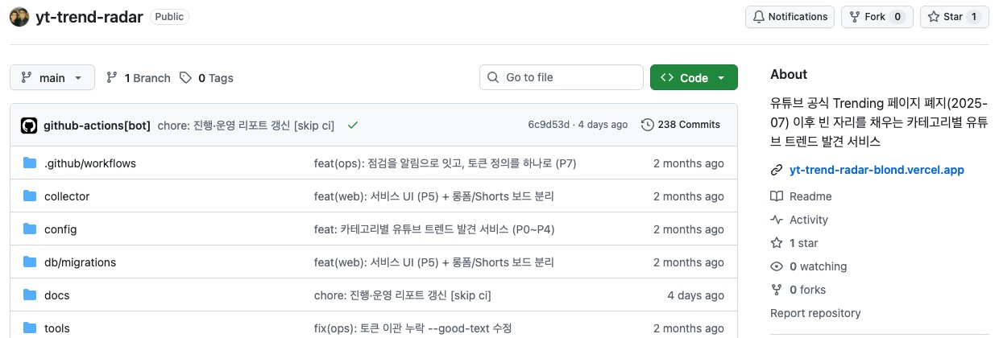
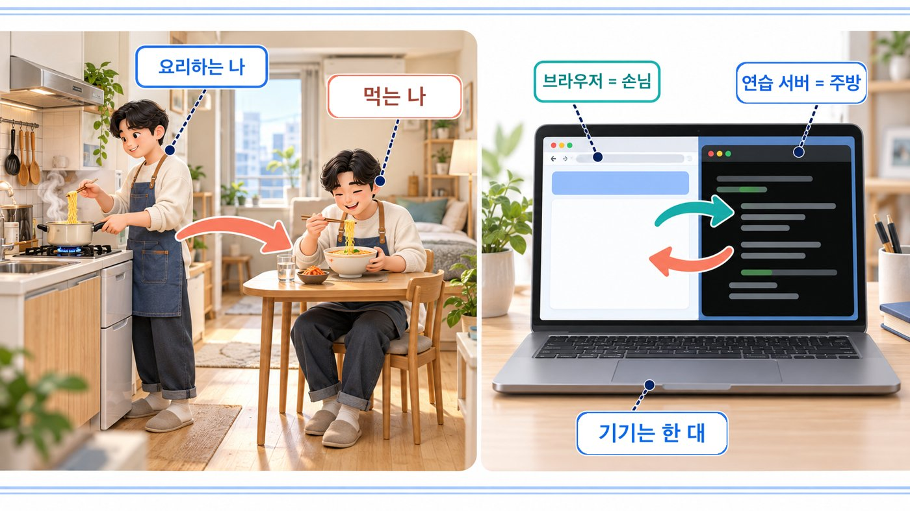
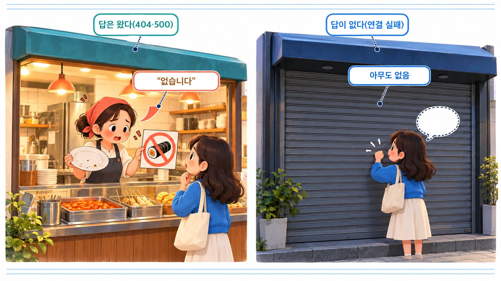
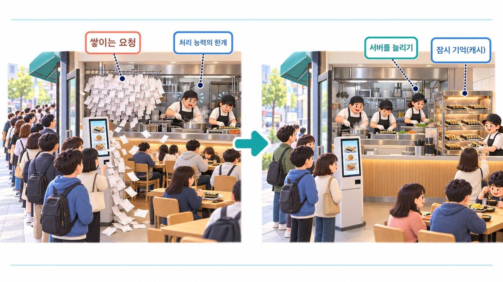
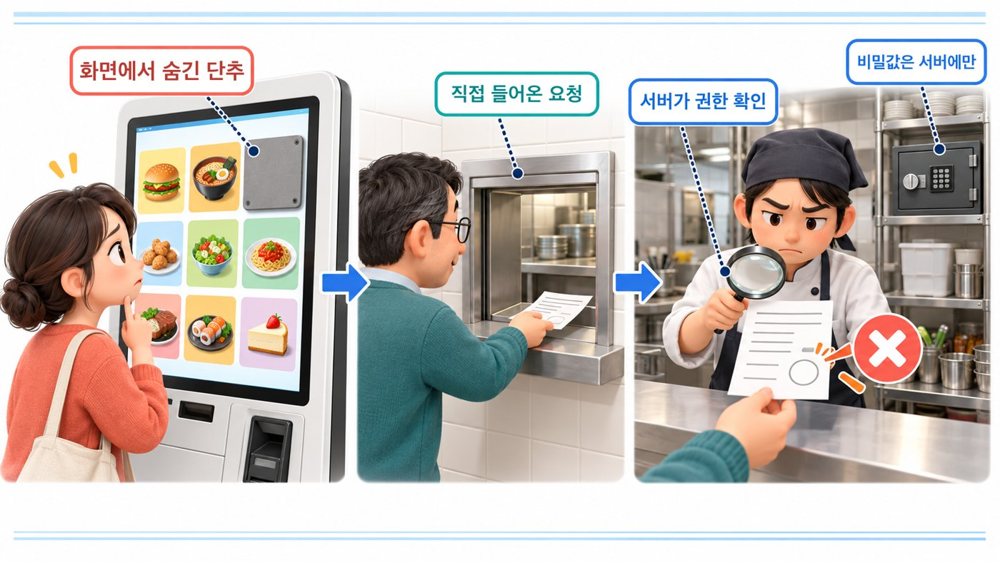
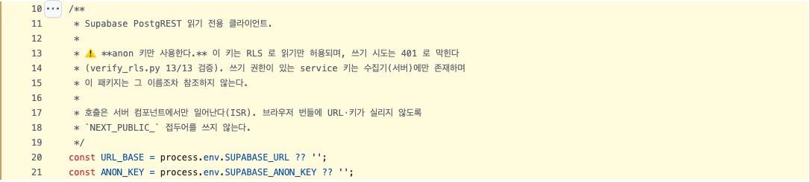
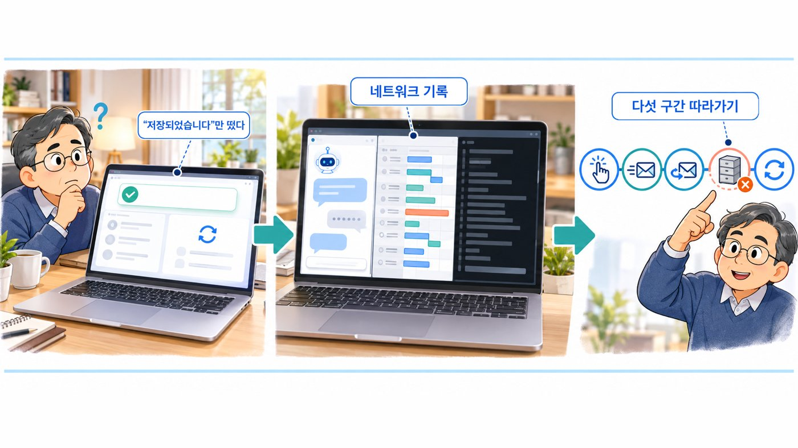

# IT 기본지식 Part1-6 강의 자료 — 서버 vs 클라이언트

> 바이브코딩 기초 : IT 기본지식 · Part 1 컴퓨터와 인터넷의 정체 · 6장

## 강의 소개

클라이언트는 서비스를 요청하는 역할이고, 서버는 그 요청을 받아 처리하고 응답하는 역할입니다. ‘내 컴퓨터’와 ‘남의 컴퓨터’를 나누는 말이 아니라, 한 요청 관계에서 누가 부탁하고 누가 처리하는지를 나누는 말입니다.

**핵심 질문** 앱에서 단추를 눌렀는데 목록이 안 뜹니다. 고칠 곳은 화면(요청하는 쪽)일까요, 서버(처리하는 쪽)일까요? 그리고 서버도 누군가에게 요청을 보낼 때가 있을까요?

| 항목 | 주소 |
| --- | --- |
| 강의 영상 | 바이브코딩 기초 : IT 기본지식 Part1-6 (유튜브 공개 후 추가) |
| 예제 저장소 | [github.com/daehyub71/yt-trend-radar](https://github.com/daehyub71/yt-trend-radar) — 유튜브 트렌드 레이더(화면 이름 「지금 뜨는 유튜브」) |
| 예제 앱 | [yt-trend-radar-blond.vercel.app](https://yt-trend-radar-blond.vercel.app) |
| 움직이는 개념 노트 | [움직이는 그림 4개](https://daehyub71.github.io/vibecoding-it-basics/notes/part1-6.html) — 단계 넘기기 · 재생 · 직접 해 보기 |
| 강의 목차 | [39편 전체 목차](https://daehyub71.github.io/vibecoding-it-basics/) |
| 앞 영상 | Part1-5 (유튜브 공개 후 추가) |

**예제 저장소를 고른 이유** 분야별로 지금 조회수가 빠르게 오르는 유튜브 영상과 유튜버를 보여 주는 웹 앱입니다. 화면은 Next.js로 만들어 Vercel에서 돌고, 데이터는 Supabase(데이터베이스)에 있으며, 데이터를 모으는 수집기는 GitHub Actions에서 예약 실행됩니다. 한 앱 안에서 **기능마다 요청하는 쪽과 처리하는 쪽이 다르고**, 같은 프로그램이 앞에서는 서버, 뒤에서는 클라이언트가 되는 모습을 코드로 확인할 수 있어 이 장의 예제로 알맞습니다. 확인 기준은 커밋 `6c9d53d`(2026-10-23 확인)입니다.

**공부하는 순서** 분식집 키오스크와 주방으로 두 역할을 나누고 → 단추 한 번의 여행을 움직이는 그림으로 따라간 뒤 → 예제 앱의 기능들이 각각 누구에게 요청하는지 코드에서 확인하고 → 연습 서버의 기록으로 요청과 응답을 직접 읽습니다. 마지막에는 Part 1의 여섯 장을 한 장의 지도로 잇습니다.

## 1부. 분식집 키오스크와 주방

점심시간 분식집입니다. 입구에는 키오스크, 뒤쪽에는 주방이 있습니다. 손님이 김밥 한 줄을 고르고 결제 단추를 누르면, 주방은 주문을 받아 재료를 확인하고 김밥을 만듭니다. 잠시 뒤 호출 번호가 불리고 김밥이 나옵니다. 손님은 주문을 정해 전달하고, 주방은 만들어 내줍니다.



컴퓨터 세계에도 이 분업이 있습니다.

- **클라이언트(client)** — 서비스를 요청하는 쪽. 대표는 웹 브라우저
- **서버(server)** — 요청을 받아 처리하고 응답하는 쪽. 켜져 있는 동안 내내 요청을 기다린다

손님이 주방 창고를 직접 뒤지지 않듯, 브라우저도 서버의 데이터베이스를 직접 열지 않고 **정해진 창구로 결과만** 요청합니다. 이 분업 덕분에 한 서비스를 여러 사람이 함께 쓸 수 있습니다.

## 2부. 하는 일이 다르다

| | 클라이언트 | 서버 |
| --- | --- | --- |
| 하는 말 | “보여 주세요” “저장해 주세요” | “여기 있습니다” “저장했습니다” “그건 없습니다” |
| 언제 움직이나 | 사용자의 행동에 따라 먼저 말을 건다 | 기다렸다가 요청이 오면 처리한다 |
| 대표 프로그램 | 브라우저, 모바일 앱, API를 부르는 스크립트 | 웹 서버, API 서버, 데이터베이스 서버 |
| 문제의 모습 | 주소 오타 · 화면 오류 | 처리 오류 · 과부하 |

그런데 “브라우저는 언제나 클라이언트, 데이터센터 컴퓨터는 언제나 서버”라고 외우면 절반만 이해한 것입니다. **서버는 장비 이름이 아니라 한 요청 관계에서 맡는 역할**입니다.

손님에게 김밥을 파는 분식집은 손님 앞에서는 주방입니다. 그런데 식자재 도매상에 재료를 주문할 때는 분식집이 손님이 됩니다. 서버 프로그램도 다른 서버에 요청을 보내면 그 관계에서는 클라이언트가 됩니다.



## 3부. 요청 한 통 — 주문 내용이 주소에 실린다

요청에는 무엇을 원하는지가, 응답에는 결과와 상태가 담깁니다. 예제 앱에서 「음식」 분야의 「Shorts」를 고르면 브라우저는 이런 요청을 보냅니다.

```text
GET https://yt-trend-radar-blond.vercel.app/?category=food&format=short
```

| 조각 | 뜻 |
| --- | --- |
| `GET` | ‘보여 주세요’라는 요청 방식(메서드). 자세히는 8장 |
| `yt-trend-radar-blond.vercel.app` | 요청을 받을 서버(4장의 도메인) |
| `category=food` | 어느 분야 — 주문 내용 ① |
| `format=short` | 어떤 형식 — 주문 내용 ② |

그러면 서버가 데이터베이스에서 그 분야 · 형식의 순위를 찾아, **화면을 완성해서** 돌려줍니다.

### 단추 한 번의 여행 (움직이는 그림 6-A)

사용자가 분야와 형식 단추를 누르면, 브라우저(클라이언트)가 서버에 급상승 목록을 요청합니다. 서버는 먼저 최근에 찾아 둔 답이 있는지 보고, 없으면 데이터베이스에 순위를 물어 받아 옵니다. **이때 서버는 데이터베이스의 손님, 곧 클라이언트**입니다. 찾은 결과는 서버가 잠시 기억해 두고(이 앱은 2시간), 응답이 돌아오면 화면에 영상 카드가 그려집니다. 같은 요청이 다시 오면 기억해 둔 답으로 더 빨리 끝나고, 서버가 꺼져 있으면 요청은 받아 줄 곳이 없어 실패합니다. → [움직이는 개념 노트에서 단계별로 보기](https://daehyub71.github.io/vibecoding-it-basics/notes/part1-6.html)

### 모든 앱이 이렇지는 않다

이 길은 이 앱의 구성일 뿐입니다. 파일에서 목록을 읽는 앱도 있고, 브라우저가 외부 서비스에 직접 묻는 앱도 있으며, 이 앱처럼 서버가 화면까지 만들어 보내는 앱도 있습니다. **요청과 처리의 책임을 어떻게 나눌지는 설계에 따라 다릅니다.**

## 4부. 실제 저장소 읽기 — 기능마다 누가 누구에게?

[유튜브 트렌드 레이더](https://github.com/daehyub71/yt-trend-radar)의 화면 이름은 「지금 뜨는 유튜브」입니다. 위에 분야 단추(음식 · 여행 · IT·테크 …)가, 그 아래에 롱폼 · Shorts 단추가 있습니다.





기능 넷을 골라 요청하는 쪽과 처리하는 쪽을 나눠 봅니다.

| 기능 | 요청하는 쪽 | 처리하는 쪽 | 근거 |
| --- | --- | --- | --- |
| 급상승 목록 | 브라우저 | Next 서버 → Supabase(데이터베이스) | `web/src/app/page.tsx` 20행 · 54~61행, `web/src/lib/db.ts` 51~54행 |
| 영상 썸네일 | 브라우저 | 유튜브 이미지 서버(직접) | `web/src/components/VideoCard.tsx` 31~33행 |
| 분야 · 형식 선택 | 브라우저 | (서버 저장 없음) 주소 `?category=&format=`에만 담김 | `page.tsx` 63~66행 · 77행 |
| 데이터 모으기 | 수집기(GitHub Actions 예약) | YouTube API | `.github/workflows/collect.yml`, `collector/sources/yt_client.py` 20행 |

- **급상승 목록** — `page.tsx`는 페이지를 만들면서 `fetchCategories()`와 `fetchBoard(...)`를 부르고, 그 함수들은 `db.ts`에서 Supabase의 `/rest/v1/...` 주소로 요청합니다. 이 코드는 브라우저가 아니라 서버에서 돕니다.
- **영상 썸네일** — 서버를 거치지 않습니다. `VideoCard.tsx`의 주석이 “유튜브 CDN 원본을 그대로 참조한다”고 밝히고, ``의 주소를 브라우저가 유튜브 이미지 서버에 직접 받으러 갑니다.
- **분야 · 형식 선택** — 서버에 저장하지 않고 주소 뒤의 값에만 담아 둡니다. 그래서 주소를 그대로 보내면 다른 기기에서도 같은 화면이 열립니다.
- **데이터 모으기** — 사용자가 누를 때가 아니라, GitHub Actions에 예약해 둔 수집기가 YouTube API(`https://www.googleapis.com/youtube/v3`)를 불러 미리 데이터베이스에 모아 둡니다.

### 눈여겨볼 세 가지

1. **서버는 브라우저 앞에서는 서버, 데이터베이스 앞에서는 클라이언트입니다.** 한 프로그램이 두 역할을 합니다.
2. **YouTube API는 누를 때마다 불리지 않습니다.** 그래서 방문자가 아무리 많아도 유튜브 사용량이 늘지 않습니다. README의 구조 그림에도 “방문자가 몇 명이든 쿼터 소모 0”이라고 적혀 있습니다.
3. **브라우저의 네트워크 기록에 Supabase로 가는 요청이 하나도 없습니다.** 서버가 대신 묻기 때문입니다. 보이지 않는 것이 정답입니다(직접 확인하기 실습 D).

### 확인한 것을 세 칸으로 나누기

| GitHub에서 확인한 사실 | 배우기 위해 단순화한 설명 | 아직 확인하지 못한 가정 |
| --- | --- | --- |
| 썸네일은 유튜브 원본 주소를 그대로 쓴다(`VideoCard.tsx` 31~33행) | 서버는 먼저 기억해 둔 답을 보고, 없으면 데이터베이스에 묻는다 | 지금 내 브라우저에서도 썸네일 요청이 유튜브 이미지 서버로 간다 |

오른쪽 칸은 실습 D의 개발자 도구 네트워크 탭으로 직접 확인할 수 있습니다.

### AI에게 이렇게 물어 보세요

“이 앱 구조 설명해 줘”라고 하면 AI는 README의 그림만 풀어 쓰기 쉽습니다. **기능마다 누가 누구에게 요청하는지 코드에서 찾아 달라**고 합니다.

```text
아래 저장소의 web/src/lib/db.ts, web/src/app/page.tsx,
web/src/components/VideoCard.tsx, .github/workflows/collect.yml 를 근거로 답해 줘.
https://github.com/daehyub71/yt-trend-radar

급상승 목록 · 썸네일 · 분야 선택 세 기능에 대해
1) 요청하는 쪽과 처리하는 쪽을 표로 정리해 줘.
2) 각 칸의 근거가 된 파일과 줄을 적어 줘. 코드에서 찾지 못한 내용은 "추측"이라고 표시해 줘.
```

AI의 표를 받으면 맞춰 봅니다.

| AI가 쓰기 쉬운 답 | 바로잡기 |
| --- | --- |
| “브라우저가 Supabase를 부른다” | 틀렸다. 서버가 부른다(`db.ts`) |
| “분야 선택을 서버에 저장한다” | 틀렸다. 주소에만 있다(`page.tsx` 63~66행) |
| 그럴듯한 함수 이름 | 지어내지 않았는지 저장소에서 검색해 본다 |

## 5부. 「서버」라는 말 — 장비이기도, 프로그램이기도

“서버가 세 대 있습니다”는 컴퓨터나 실행 환경을 세는 말일 수 있고, “웹 서버를 실행했습니다”는 요청을 처리하는 프로그램을 시작했다는 뜻입니다. 서버라는 말은 문맥에 따라 장비도, 프로그램도 가리킵니다.

집에서 라면을 끓여 먹는 사람은 요리사이면서 손님입니다. 5장에서 노트북에 연습 서버를 켜고 같은 노트북의 브라우저로 열었을 때도 그랬습니다. 기기는 한 대, 역할은 둘입니다. 연습 서버 프로그램은 서버, 브라우저는 클라이언트였습니다.



### 클라이언트 = 프론트엔드? 늘 같지는 않다

다음 파트에서 만날 **프론트엔드와 백엔드**가 여기서 살짝 보입니다. 클라이언트는 프론트엔드, 서버는 백엔드라고 같은 말처럼 쓰기 쉽지만 언제나 같지는 않습니다. 이 앱이 좋은 예입니다. `page.tsx`는 화면을 그리는 코드인데도 브라우저가 아니라 서버에서 돌아 완성된 화면을 보냅니다. 이 장에서는 **누가 요청하고 누가 받는가**만 봅니다.

## 6부. 서버는 왜 「안 된다」고 답할까 — 상태 코드

주문한 김밥이 품절이면 주방은 사라지지 않고 “품절됐습니다”라고 알려 줍니다. 웹 서버도 결과를 숫자로 알려 줍니다. 이것이 **HTTP 상태 코드**입니다.

| 상태 코드 | 뜻 |
| --- | --- |
| 2xx(200번대) | 대개 성공 |
| 404 | 찾는 것이 없음 |
| 500 | 서버 안에서 오류가 남 |

예제 앱에서 없는 채널 주소를 열면 서버가 404로 답합니다. `web/src/app/channel/[id]/page.tsx` 54행이 채널을 찾지 못하면 `notFound()`를 부르기 때문입니다.

```text
GET /channel/없는채널ID   →  404   # 서버가 「없다」고 답함
```

품절이라고 답해 주는 가게와 셔터가 내려진 가게는 다릅니다. 앞의 것은 서버가 **답을 보낸** 것이고, 뒤의 것은 **답 자체를 받지 못한** 것입니다. 서버가 꺼져 있으면 상태 코드도 없이 ‘연결할 수 없음’ 화면만 나옵니다.



| 사용자가 보는 모습 | 가능한 원인 |
| --- | --- |
| 연결 자체가 안 됨(상태 코드 없음) | 서버 꺼짐 · 포트 · 네트워크 |
| 404 | 경로 · 자원 없음 |
| 500 | 서버 처리 중 오류 |
| 429 | 너무 많은 요청 |
| 화면은 뜨는데 목록만 빔 | 실제 데이터 없음 · API 오류 · 화면 처리 문제 |

상태 코드의 자세한 종류는 8장과 9장에서 배웁니다.

## 7부. 주문이 쌓이면 — 과부하와 캐시

분식집에 갑자기 손님 100명이 몰렸습니다. 키오스크는 주문을 계속 받지만 주방은 같은 속도로 만들 수 없어 주문서가 쌓입니다. 처리 능력을 넘는 이런 상태를 서버에서도 **과부하**라고 부릅니다. 꺼지지는 않아도 응답이 느려지거나 실패할 수 있습니다.



많이 쓰는 대책은 **한 번 찾은 결과를 잠시 기억해 두는 것(캐시)**입니다. 이 앱은 데이터베이스에서 찾은 결과를 2시간 기억합니다.

```text
# web/src/lib/db.ts (24행 · 51~54행을 줄여 옮김)
REVALIDATE_SECONDS = 60 * 60 * 2
fetch(`${URL_BASE}/rest/v1/${path}`, { ..., next: { revalidate: REVALIDATE_SECONDS } })
# DB에서 찾은 「데이터」를 2시간 기억 (화면 페이지가 아니라)
```

기억하는 것이 **화면 페이지가 아니라 데이터**라는 점을 구분하세요.

### 서버도 요청 제한을 받는다

이 앱의 수집기는 유튜브 앞에서 손님입니다. YouTube API는 하루 사용량을 10,000단위로 제한하고(`collector/core/quota.py` 4행), 수집기는 그보다 조금 적은 9,500에 스스로 선을 그어 두었습니다(`collect.yml`의 `YT_DAILY_QUOTA_LIMIT: '9500'`). **요청 제한은 서버가 클라이언트로서 받기도 합니다.** 429 같은 응답을 받는 쪽이 사용자의 브라우저만은 아닙니다.

## 8부. 클라이언트에서 온 값은 확인해야 할 입력

화면에서 관리자 메뉴를 숨기는 것만으로 보안이 되지는 않습니다. 화면을 거치지 않고 요청을 직접 보낼 수 있기 때문입니다. 키오스크에서 직원 전용 단추를 숨겨도, 누군가 주방 창구에 주문서를 직접 밀어 넣을 수 있습니다. 그래서 주방이 주문서를 받을 때 권한을 확인해야 합니다. **클라이언트에서 온 값은 서버가 사실 여부와 권한을 확인해야 할 입력입니다.** 구체적인 권한 확인은 28장에서 배웁니다.



### 비밀값은 브라우저로 보내지 않는다

브라우저로 간 것은 누구나 열어 볼 수 있습니다. 이 앱은 데이터베이스 주소와 키를 `db.ts`에서 서버만 읽게 해 두었습니다.



- 주석(17~18행) “브라우저 번들에 URL · 키가 실리지 않도록 `NEXT_PUBLIC_` 접두어를 쓰지 않는다.” Next.js는 `NEXT_PUBLIC_`으로 시작하는 이름만 브라우저 코드에 실어 보냅니다
- 실제로 브라우저가 받은 화면과 코드 조각(2026-10-23, 7개)을 뒤져도 `supabase`라는 글자가 한 번도 나오지 않았습니다
- 데이터를 **쓸 수 있는** 키와 YouTube 키는 아예 GitHub Actions의 비밀값에만 있습니다(`collect.yml` 40~42행 `secrets.YT_API_KEY` · `secrets.SUPABASE_SERVICE_KEY`)

AI에게 앱을 맡길 때도 “비밀값은 서버에서만 읽고, 브라우저에는 공개해도 되는 정보만 보내 줘”라고 요구합니다.

## 9부. 요청의 사슬

실제 서비스는 손님과 주방 둘로 끝나지 않습니다. 이 앱에도 여러 프로그램이 사슬처럼 이어져 있습니다.

```text
브라우저 → Vercel(Next 서버) → Supabase
브라우저 → 유튜브 이미지 서버
수집기(GitHub Actions) → YouTube API,  수집기 → Supabase
```

### 요청의 사슬, 바뀌는 역할 (움직이는 그림 6-B)

급상승 목록을 볼 때 브라우저는 클라이언트, Vercel에서 도는 서버는 서버입니다. 같은 서버가 데이터베이스 앞에서는 클라이언트입니다. 썸네일은 서버를 거치지 않고 브라우저가 유튜브 이미지 서버에 직접 받으러 가고, 분야 선택은 서버로 가지 않고 주소 뒤에만 담깁니다. 데이터는 수집기가 미리 불러 모아 둡니다. **서버와 클라이언트는 기계가 아니라, 화살표 하나하나에서 정해지는 역할입니다.** 개념 노트에서 기능을 고르면 그 기능이 쓰는 길만 빛납니다.

이 사슬을 알면 AI에게 할 부탁도 달라집니다.

> “썸네일을 못 불러와도 목록 글자는 그대로 보여 주게 해 줘.”

한 고리가 실패해도 나머지가 함께 멈추지 않게 해 달라는 부탁입니다. **서비스 사이의 의존 관계**를 이해한 사람이 할 수 있는 말입니다. 실제로 `page.tsx`는 데이터베이스가 응답하지 않으면 페이지 전체가 죽는 대신 “지금은 데이터를 불러올 수 없습니다”와 원인 한 줄을 보여 주도록 짜여 있습니다(21~48행).

## 10부. 「저장이 안 돼요」를 다섯 단계로

저장 단추를 눌렀더니 “저장되었습니다”가 떴는데, 새로고침하면 사라집니다. “저장이 안 돼요” 한마디로는 고칠 수 없습니다. 길을 다섯 단계로 나눠 묻습니다.

| 단계 | 확인할 것 | 어디서 보나 |
| --- | --- | --- |
| ① 클릭 | 단추가 실제로 눌려 화면 코드가 움직였나 | 화면 코드 · 콘솔 |
| ② 요청 | 요청이 서버로 나갔나 | 개발자 도구 네트워크 탭 |
| ③ 응답 | 서버가 어떤 상태 코드로 답했나 | 네트워크 탭 · 서버 로그 |
| ④ 저장 | 데이터가 실제로 서버의 저장소에 들어갔나 | 데이터베이스 · 파일 |
| ⑤ 새로고침 | 다시 불러오는 요청이 있고, 저장한 것이 돌아오나 | 네트워크 탭 |

### ‘저장이 안 돼요’를 다섯 단계로 (움직이는 그림 6-C)

다섯 정거장을 모두 통과해야 정말로 저장된 것입니다. 개념 노트에서 고장 난 정거장을 고르면 그 자리에서 멈추고 어디를 봐야 하는지 보여 줍니다. 이 앱의 분야 선택처럼 서버로 가지 않고 주소나 브라우저 안에만 남는 경우도 있는데, 그러면 저장소 정거장은 건너뜁니다.

어디서 끊겼는지 모를 때는 네트워크 기록을 AI와 함께 봅니다. 요청의 주소 · 메서드 · 상태 코드를 붙여 넣으면 AI는 추측 대신 끊긴 정거장부터 좁혀 갑니다.



### AI에게 이렇게 부탁하기

```text
'저장' 단추를 누르면 "저장되었습니다"가 뜨는데, 새로고침하면 사라져.
화면 코드부터 고치지 말고, 다섯 단계 가운데 어디서 끊겼는지 먼저 같이 찾자.
1) 단추 함수
2) Network 탭의 요청(주소 · 메서드 · 상태) — 내가 붙여 넣을게
3) 서버 로그
4) 실제 저장 위치
5) 새로고침 때 다시 부르는 요청
단계마다 내가 확인할 방법을 알려 주고, 원인을 찾기 전에는 코드를 바꾸지 마.
```

‘화면을 고쳐 줘’보다 강한 이유는 원인을 추측으로 정하지 않고 **요청부터 저장까지의 길을 따라 추적하게 만들기** 때문입니다.

## 11부. Part 1을 한 장의 지도로

4장에서 본 상권 사이트 주소를 입력하고 엔터를 누르는 한 순간에, Part 1의 여섯 장이 모두 들어 있습니다.

```text
https://daehyub71.github.io/seoul-trade-insight/
```

### Part 1의 모든 개념을 잇는 지도 (움직이는 그림 6-D)

1. **1장** — 키보드와 칩이라는 본체 위에서 브라우저라는 소프트웨어가 움직입니다.
2. **3장** — 요청은 집 네트워크를 지나 인터넷으로 나가고, 우리가 쓰는 것은 그 위의 웹입니다.
3. **4장** — 먼저 DNS에 이 이름의 IP 주소를 묻습니다.
4. **5장** — 주소에 숫자가 없으니 `https`의 기본 문, 443번을 두드립니다.
5. **6장** — 브라우저가 요청하고 서버가 응답합니다.
6. **2장** — 서버는 정해진 경로의 파일을 찾아 보냅니다.

내 노트북의 `localhost`로 열면 인터넷도 DNS도 거치지 않습니다. 그래도 문과 요청, 응답은 그대로입니다. 개념 노트에서 「공개 사이트」와 「내 노트북」 두 길을 바꿔 가며 어느 정거장이 생기고 사라지는지 비교할 수 있습니다.

이 지도는 일부를 단순화했습니다. 모든 요청이 DNS를 새로 묻지 않고(캐시), 서버가 매번 파일이나 데이터베이스를 읽지도 않습니다. 그래도 길을 잃지 않는 질문 하나는 남습니다.

> **누가 · 어디에 · 어떤 주소로 · 무엇을 요청하고 · 어디서 응답하는가.**

## 직접 확인하기

5장에서 만든 **빈 연습 폴더**(`port-practice`)를 다시 씁니다. 개인 문서나 비밀 키가 있는 폴더에서는 하지 않습니다.

| 실습 | 시간 | 할 일 |
| --- | --- | --- |
| A. 연습 서버의 기록 읽기 | 5분 | `index.html`을 만들고 서버를 켠 뒤, `localhost:8000`과 없는 주소 `notice.html`을 차례로 열기 |
| B. 답한 경우 vs 답을 받지 못한 경우 | 3분 | Ctrl+C로 서버를 끄고 새로고침 |
| C. 같은 요청을 양쪽에서 보기 | 5분 | 서버를 다시 켜고 개발자 도구 네트워크 탭으로 요청 목록 보기 |
| D. 예제 앱의 요청 보기 | 5분 | 예제 앱에서 같은 탭을 열고, 상태 코드를 명령으로 확인 |

### 실습 A 명령

아래 출력은 예이며, 시각 자리(`[…]`)는 실행한 때에 따라 다릅니다.

**윈도우 · PowerShell**

```text
> cd ~\port-practice
> Set-Content index.html '<meta charset="utf-8"><h1>안녕</h1>'
> python -m http.server 8000 --bind 127.0.0.1
Serving HTTP on 127.0.0.1 port 8000 (http://127.0.0.1:8000/) ...
127.0.0.1 - - […] "GET / HTTP/1.1" 200 -
127.0.0.1 - - […] code 404, message File not found
127.0.0.1 - - […] "GET /notice.html HTTP/1.1" 404 -
```

**맥 · 터미널**

```text
$ cd ~/port-practice
$ printf '<meta charset="utf-8"><h1>안녕</h1>' > index.html
$ python3 -m http.server 8000 --bind 127.0.0.1
Serving HTTP on 127.0.0.1 port 8000 (http://127.0.0.1:8000/) ...
127.0.0.1 - - […] "GET / HTTP/1.1" 200 -
127.0.0.1 - - […] code 404, message File not found
127.0.0.1 - - […] "GET /notice.html HTTP/1.1" 404 -
```

- 서버를 켠 뒤 브라우저에서 `localhost:8000`, 이어서 `localhost:8000/notice.html`을 엽니다
- `<meta charset="utf-8">`은 한글이 깨지지 않게 하는 표시입니다. 윈도우에서 ‘안녕’이 깨져 보이면 `Set-Content index.html '…' -Encoding utf8`처럼 끝에 `-Encoding utf8`을 붙여 다시 만듭니다
- 윈도우에서 `python`이 안 되면 `py -m http.server 8000 --bind 127.0.0.1`
- 줄 읽는 법: **맨 앞** `127.0.0.1`은 요청한 쪽(같은 컴퓨터의 브라우저), **따옴표 안**은 요청 내용, **끝의 숫자**는 서버의 대답입니다. `GET /`은 200, `/notice.html`은 404
- 탭 아이콘을 찾는 `/favicon.ico` 404 줄이 더 보여도 괜찮습니다
- 기기는 하나, 역할은 둘입니다. 브라우저가 클라이언트, 터미널의 프로그램이 서버입니다

### 실습 B — 끄고 새로고침

서버 터미널에서 Ctrl+C로 서버를 끄고(`Keyboard interrupt received, exiting.`) 브라우저를 새로고침합니다. 이번에는 서버 터미널에 아무 줄도 찍히지 않고, 브라우저는 연결할 수 없다고 말합니다.

| | 404 | 서버를 끈 뒤 |
| --- | --- | --- |
| 무슨 일인가 | 서버가 “없다”고 **답했다** | 서버에게서 **답을 받지 못했다** |
| 서버 기록 | 남는다 | 없다 |
| 상태 코드 | 있다(404) | 없다 |

### 실습 C — 같은 요청을 양쪽에서 보기

서버를 다시 켜고 브라우저의 개발자 도구를 엽니다.

| 윈도우 | 맥(크롬) |
| --- | --- |
| F12 | Option+Command+I |

「Network(네트워크)」 탭을 연 채로 새로고침하면 요청 목록이 생깁니다. 줄을 하나 눌러 요청 주소, 메서드(GET), 상태 코드(200 또는 404)를 찾고, 실습 A의 서버 기록과 짝을 맞춰 봅니다. **같은 요청을 클라이언트 쪽에서 본 기록과 서버 쪽에서 본 기록**입니다.

### 실습 D — 예제 앱의 요청 보기

예제 앱 [yt-trend-radar-blond.vercel.app](https://yt-trend-radar-blond.vercel.app)을 열고 같은 탭을 봅니다. 앱 주소로 가는 요청과 유튜브 이미지 서버(`i.ytimg.com`)로 가는 썸네일 요청은 보이지만, **데이터베이스로 가는 요청은 없습니다.** 서버가 대신 묻기 때문입니다. 주소에 `-blond`가 꼭 붙어야 합니다. 붙이지 않은 기본 주소(`yt-trend-radar.vercel.app`)는 402를 돌려줍니다.

명령으로도 서버의 대답을 받아 봅니다(출력은 2026-10-23에 받은 예).

**윈도우 · PowerShell**

```text
> curl.exe -s -o NUL -w "%{http_code}" https://yt-trend-radar-blond.vercel.app/channel/no-such-channel
404
> curl.exe -s https://yt-trend-radar-blond.vercel.app/api/health
{"ok":true,"config":{"hasUrl":true,"hasAnonKey":true},"checkedAt":"2026-10-23T01:05:04.994Z","categories":6}
```

**맥 · 터미널**

```text
$ curl -s -o /dev/null -w '%{http_code}\n' https://yt-trend-radar-blond.vercel.app/channel/no-such-channel
404
$ curl -s https://yt-trend-radar-blond.vercel.app/api/health
{"ok":true,"config":{"hasUrl":true,"hasAnonKey":true},"checkedAt":"2026-10-23T01:05:04.994Z","categories":6}
```

- 윈도우에서는 `curl`이 아니라 `curl.exe`로 씁니다(PowerShell에서 `curl`은 다른 명령의 별명일 수 있습니다)
- `/api/health`는 앱의 건강 확인 창구입니다. `config`에는 설정이 **있는지 없는지**만 담기고, 키 값은 담기지 않습니다(`route.ts` 주석 “키 값을 절대 반환하지 않는다”)
- 그런데 `ok: true`가 곧 “데이터가 최신”이라는 뜻은 아닙니다. 아래 오해 바로잡기 셋째 줄을 보세요

실습이 끝나면 연습 서버는 Ctrl+C로 끕니다.

## 오해 바로잡기

| 오해 | 바로잡기 |
| --- | --- |
| 서버는 무조건 큰 컴퓨터다 | 장비를 가리키기도 하지만 본질은 요청에 응답하는 역할이다 |
| 클라이언트는 사용자의 휴대전화만 말한다 | 이 앱의 서버도 데이터베이스 앞에서는 클라이언트다 |
| 화면이 보이면 서버도 정상이다 | 이 앱의 `/api/health`는 `ok`라고 답하지만, 그건 데이터베이스에 연결되는지만 본 결과다. 2026-10-23에 확인해 보니 예약 수집이 꺼져 있어 마지막 수집이 2026-10-19였고, 화면 아래에도 「마지막 수집 4일 전」이 떠 있었다. README와 워크플로 파일이 말하는 것(문서)과 지금 돌고 있는 것(현실)은 다를 수 있다 |
| 500이라고 답하는 것과 서버가 꺼진 것은 같다 | 앞의 것은 오류 응답을 받은 것이고, 뒤의 것은 응답 자체를 받지 못한 것이다 |
| 화면에서 검사했으니 서버는 믿어도 된다 | 서버에서 입력과 권한을 다시 확인해야 한다 |

## 한 장 요약

| 기억할 질문 | 한 문장 답 |
| --- | --- |
| 클라이언트 · 서버는? | 요청하는 역할 · 기다렸다가 처리하고 응답하는 역할 |
| 요청 · 응답에 담기는 것은? | 주소와 조건 / 결과와 상태 코드(200 · 404 · 500) |
| 역할 전환은? | 서버도 다른 서버에 요청하면 그 관계에서는 클라이언트 |
| 캐시는? | 찾은 결과를 잠시 기억해 빨리 답하기(이 앱은 DB에서 찾은 데이터를 2시간) |
| 서버 측 확인은? | 입력 · 권한은 서버에서 다시, 비밀값은 서버에만 |
| 길을 잃지 않는 질문은? | 누가 · 어디에 · 어떤 주소로 · 무엇을 요청하고 · 어디서 응답하는가 |

## 확인 문제

1. 한 노트북에서 브라우저와 로컬 웹 서버가 동시에 실행될 수 있나?
2. 예제 앱의 서버가 Supabase에 순위를 물을 때, 서버는 어떤 역할인가?
3. 「저장되었습니다」 후 새로고침하면 사라진다. 확인할 단계는?
4. 서버의 404와 아무 응답도 못 받은 상황은 어떻게 다른가?
5. 휴대전화에서 고른 「Shorts · 여행」이 노트북 첫 주소에선 안 보인다. 고장일까?

<details>
<summary>풀이 보기</summary>

1. 있다. 기기 하나에서 클라이언트(브라우저)와 서버(연습 서버) 역할의 프로그램이 함께 실행될 수 있다. 실습 A가 그 예다.
2. 그 관계에서는 클라이언트다. Supabase에 요청을 보내기 때문이다. 브라우저 앞에서는 여전히 서버다. 한 프로그램이 두 역할을 한다.
3. 클릭 → 요청 → 응답(상태 코드) → 실제 저장 → 새로고침 때 다시 부르는 요청, 다섯 단계를 차례로 확인한다. 화면에 메시지가 떴다는 것만으로는 ④ 저장을 통과했는지 알 수 없다.
4. 404는 서버가 “그런 것은 없다”고 응답을 보낸 경우라 상태 코드와 서버 기록이 남는다. 무응답은 서버가 꺼졌거나 주소 · 포트 · 네트워크가 틀려 연결 단계에서 막힌 경우라 상태 코드도 서버 기록도 없다.
5. 고장이 아니라 설계다. 분야 · 형식 선택은 서버에 저장되지 않고 주소 뒤의 `?category=travel&format=short`에만 담긴다. 값이 없는 첫 주소는 첫 번째 분야와 롱폼을 보여 준다(`page.tsx` 16행 · 52행). 휴대전화의 주소를 그대로 보내면 노트북에서도 같은 화면이 열린다.

</details>

## 다음 시간

Part2-1 프론트엔드 vs 백엔드. 오늘 살짝 본 대로 클라이언트와 프론트엔드, 서버와 백엔드는 늘 같은 말이 아닙니다. 화면을 그리는 코드가 서버에서 도는 이 앱처럼, 무엇을 어디서 만드는지 나눠 봅니다. Part 1을 마치며 한마디. AI는 코드를 만들어 줄 수 있지만, 어떤 컴퓨터에서 무슨 역할을 하는지, 어디서 실패했는지를 가르는 눈까지 대신해 주지는 않습니다.

## 출처

- [daehyub71/yt-trend-radar](https://github.com/daehyub71/yt-trend-radar) 커밋 `6c9d53d`(2026-10-23 확인) — `README.md`(쿼터 전략 · 구조 그림), `web/src/app/page.tsx`(16 · 20 · 21~48 · 52 · 54~61 · 63~66 · 77행), `web/src/lib/db.ts`(10~21 · 24 · 51~54행), `web/src/components/VideoCard.tsx`(31~33행), `web/src/app/channel/[id]/page.tsx`(54행 `notFound()`), `web/src/app/api/health/route.ts`, `.github/workflows/collect.yml`(40~43행), `collector/sources/yt_client.py`(20행), `collector/core/quota.py`(4 · 29행)
- 운영 상태(2026-10-23 확인): GitHub Actions의 `collect` · `health` 워크플로는 수동으로 꺼진 상태이고, 마지막 예약 수집은 2026-10-19에 실행되었습니다. 예제 앱의 첫 화면 · `/api/health` · 없는 채널 주소의 응답(200 · 200 · 404), `-blond`가 없는 기본 주소의 402, 브라우저가 받은 HTML과 코드 조각 7개의 `supabase` 0회는 같은 날 맥에서 확인했습니다.
- 도구 동작: 연습 서버(`python -m http.server`)의 윈도우 출력은 형식을 보여 주는 예이며, 기록 형식은 맥에서 실행한 예입니다. Next.js가 `NEXT_PUBLIC_` 이름만 브라우저 코드에 싣는 동작, YouTube Data API의 하루 10,000단위 제한은 각 도구 · 서비스의 기본 규칙 기준입니다.
- 학습용 단순화: 움직이는 그림 6-A의 ‘먼저 기억해 둔 답을 본다’는 Next.js의 데이터 캐시 동작을 줄인 것이고, 6-D의 지도는 DNS 캐시 · 보안 연결(TLS) 단계를 생략했습니다.
