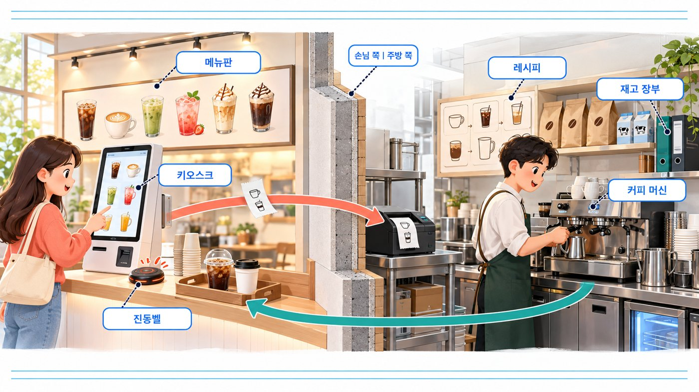
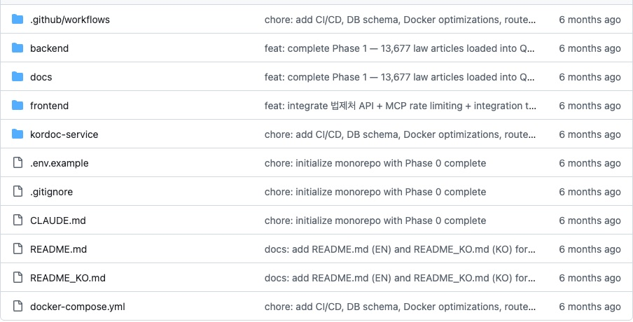
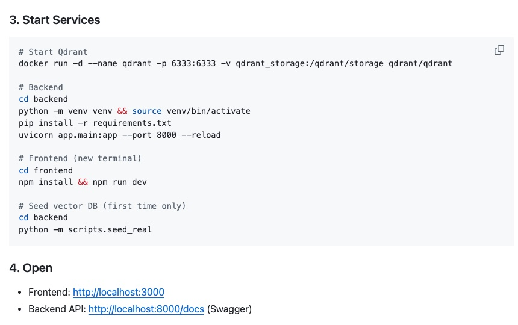
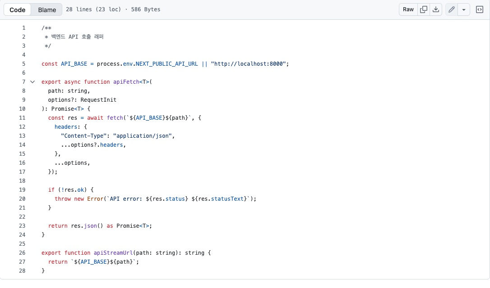
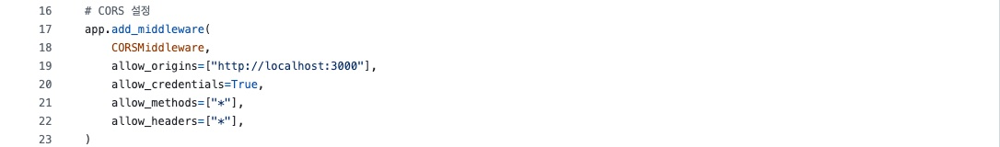
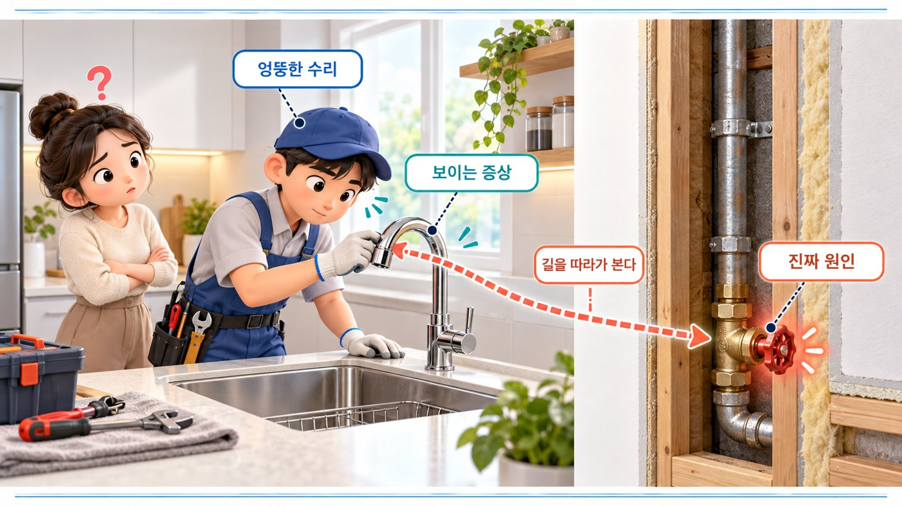
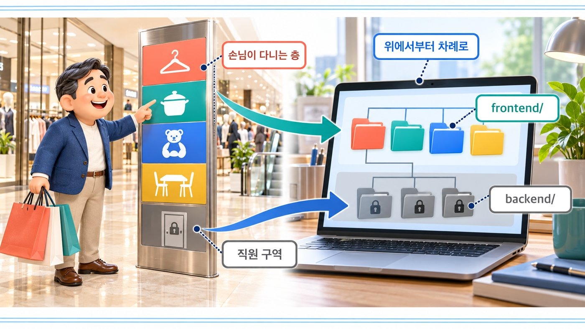
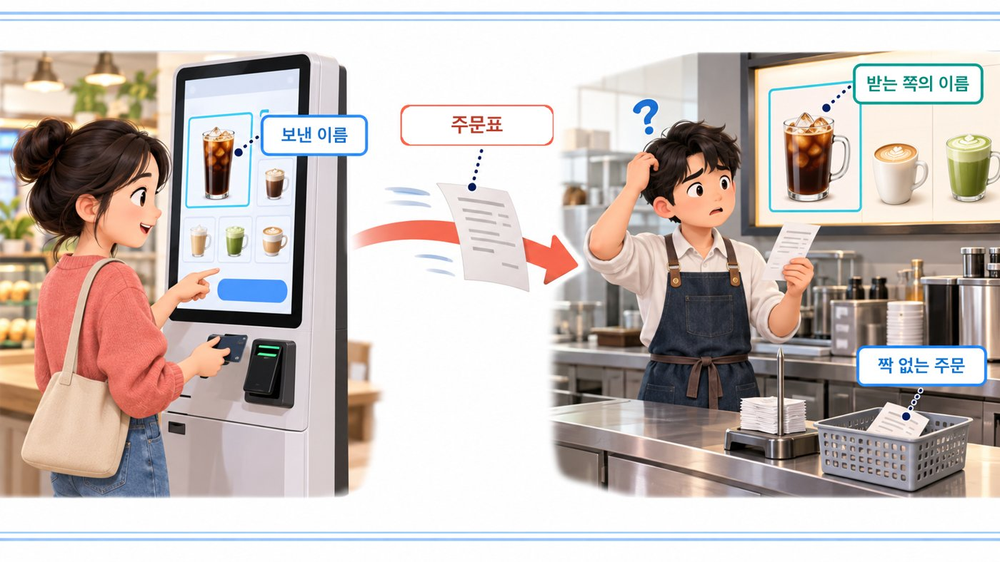
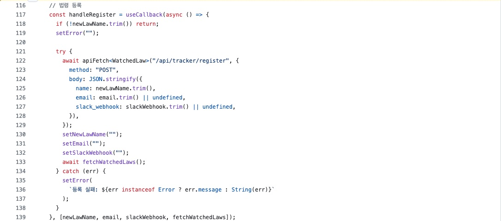
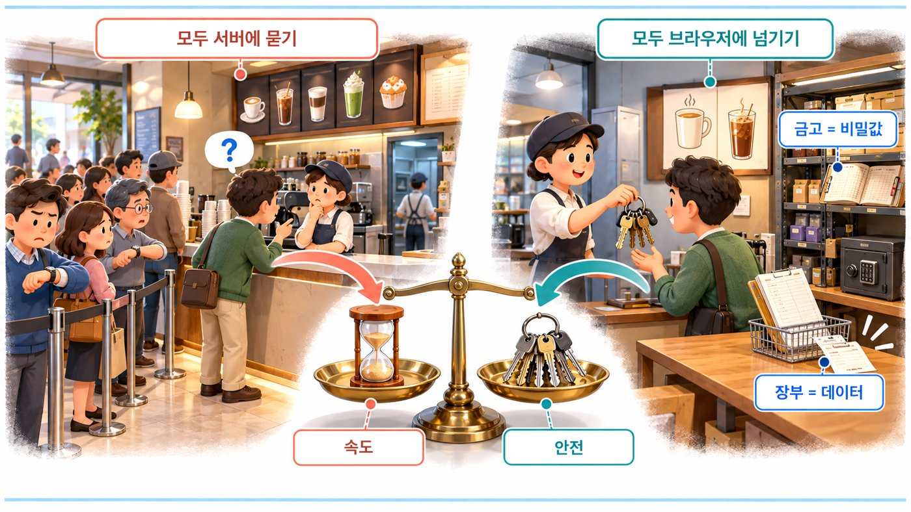

# IT 기본지식 Part2-1 강의 자료 — 프론트엔드 vs 백엔드

> 바이브코딩 기초 : IT 기본지식 · Part 2 웹사이트는 어떻게 움직일까 · 7장

## 강의 소개

프론트엔드는 사용자가 보고 만지는 화면 쪽이고, 백엔드는 보이지 않는 곳에서 데이터와 규칙을 처리하는 쪽입니다. 둘은 우열을 다투는 사이가 아니라, 책임을 나눠 맡은 동료입니다.

**핵심 질문** 앱의 색이 마음에 들지 않을 때와, 저장한 목록이 다음 날 사라질 때. 둘 다 “앱이 이상하다”고 말하게 되지만 고칠 곳은 전혀 다릅니다. AI에게 각각 어느 쪽 파일을 고쳐 달라고 해야 할까요?

| 항목 | 주소 |
| --- | --- |
| 강의 영상 | 바이브코딩 기초 : IT 기본지식 Part2-1 (유튜브 공개 후 추가) |
| 예제 저장소 | [github.com/daehyub71/smart-korean-legal-platform](https://github.com/daehyub71/smart-korean-legal-platform) — 스마트 법령 플랫폼 |
| 움직이는 개념 노트 | [움직이는 그림 4개](https://daehyub71.github.io/vibecoding-it-basics/notes/part2-1.html) — 단계 넘기기 · 재생 · 직접 해 보기 |
| 강의 목차 | [39편 전체 목차](https://daehyub71.github.io/vibecoding-it-basics/) |
| 앞 영상 | Part1-6 서버와 클라이언트 (유튜브 공개 후 추가) |

**예제 저장소를 고른 이유** 법령 상담 · 판례 분석 · 문서 작성 · 법령 변경 추적 · 개발자 법률 체크를 돕는 웹 앱입니다. 화면 쪽 `frontend/`(Next.js · TypeScript)와 서버 쪽 `backend/`(FastAPI · Python)가 폴더로 나뉘어 있고, 문서를 처리하는 세 번째 서버 `kordoc-service/`(Node.js)까지 있습니다. **같은 기능의 화면 코드와 서버 코드를 나란히 펼쳐 볼 수 있고**, 문서와 실제가 어긋난 자리도 있어 “누가 무엇을 맡았나”를 따지기에 알맞습니다. 확인 기준은 커밋 `f8a02d7`(2026-10-23 확인)입니다.

**공부하는 순서** 카페의 손님 쪽과 주방 쪽을 나눠 보고 → 저장 요청이 저장소까지 가는 길을 움직이는 그림으로 따라간 뒤 → 예제 저장소에서 누가 무엇을 맡았는지 찾고 → AI에게 고칠 곳을 정확히 말하는 연습을 합니다.

## 1부. 카페의 손님 쪽과 주방 쪽

카페에 들어서면 손님은 메뉴판과 키오스크, 진동벨과 픽업대를 만납니다. 버튼이 큼직한지, 사진이 먹음직스러운지는 이쪽에서 정해집니다. 계산대 뒤 주방에는 레시피와 재고 장부가 있습니다. 손님은 볼 수 없지만, 이쪽이 틀리면 메뉴판이 아무리 예뻐도 음료가 나오지 않습니다.



웹 서비스에도 이 두 쪽이 있습니다.

- **프론트엔드(frontend)** — 사용자가 보고 만지는 쪽. 화면 배치, 버튼 반응, 입력 상자
- **백엔드(backend)** — 보이지 않는 쪽에서 데이터와 규칙을 처리하는 쪽. 조회, 저장, 권한 확인, 계산

이 구분이 필요한 것은 **고칠 곳이 달라지기 때문**입니다. 색 문제는 화면 쪽 한 줄로 끝날 수 있지만, 저장 문제는 화면을 아무리 고쳐도 풀리지 않습니다. 그래서 “앱 오류”라고 뭉뚱그리지 말고, **화면 → 요청 → 처리 → 데이터** 가운데 어디까지 정상인지부터 봅니다.

## 2부. 차이는 우열이 아니라 책임의 위치

둘 중 무엇이 더 중요할까요? 주방 없는 주문 화면도, 주문 창구 없는 주방도 쓸 수 없습니다.

| 같은 질문 | 프론트엔드 | 백엔드 |
| --- | --- | --- |
| 가까운 것 | 사람의 눈과 손 | 데이터 · 규칙 · 다른 시스템 |
| 대표적인 일 | 화면 표시 · 버튼 반응 · 입력 편의 | 조회 · 저장 · 권한 확인 · 계산 |
| 웹에서 주로 도는 곳 | 브라우저 | 서버 |
| 비밀 키 | **두면 안 된다.** 브라우저로 내려간 코드는 누구나 열어 본다 | 서버의 환경 설정(`.env`)에 둔다 |

표의 **「주로」**에 주목하세요. 모든 서비스가 `frontend/`와 `backend/` 두 폴더로 나뉘는 것은 아닙니다. 한 도구 안에 화면 코드와 서버 코드를 함께 두기도 하고, 서버가 화면(HTML)을 완성해 보내기도 합니다. 그래도 **사용자에게 보여 주는 책임**과 **데이터를 믿을 수 있게 처리하는 책임**은 구별해야 합니다.

## 3부. 클라이언트 · 서버와 무엇이 다른가

6장의 클라이언트와 서버는 **누가 요청하고 누가 응답하는가**의 구분이었습니다. 오늘의 프론트엔드와 백엔드는 **무엇을 맡는가**의 구분입니다. 두 구분은 자주 겹치지만 같은 말은 아닙니다.

| 프로그램 조각(예제 앱) | 누가 요청하나 | 무엇을 맡나 |
| --- | --- | --- |
| 브라우저 속 상담 화면 | 요청을 보내는 쪽(클라이언트) | 화면(프론트엔드) |
| FastAPI 서버 | 요청에 응답하는 쪽(서버) | 규칙과 데이터(백엔드) |
| 서버 안의 법령 조회 코드(`core/mcp_client.py`) | 원격 법령 서버에 요청을 보내는 쪽(클라이언트) | 여전히 백엔드 |

### 두 가지 질문, 두 가지 분류 (움직이는 그림 7-A)

같은 프로그램 조각을 「누가 요청하는가」와 「무엇을 맡는가」라는 두 질문으로 따로 분류해 봅니다. 앞의 두 줄만 보면 두 구분이 같은 말 같지만, 법령 조회 코드처럼 **클라이언트이면서 백엔드**인 조각이 나오고, 서버가 화면을 만들어 보내는 방식에서는 서버에서 도는 코드가 화면을 맡기도 합니다. → [움직이는 개념 노트에서 단계별로 보기](https://daehyub71.github.io/vibecoding-it-basics/notes/part2-1.html)

이 차이는 AI에게 말할 때 드러납니다.

| AI에게 한 말 | AI가 먼저 점검하는 곳 |
| --- | --- |
| “서버 쪽이 문제 같아” | 연결 · 실행 상태 |
| “백엔드 저장 로직이 문제 같아” | 데이터베이스 기록 · 업무 규칙 |

표현 하나가 조사의 출발점을 바꿉니다. 문제를 말할 때는 **누가 요청했는지**와 **무엇을 맡았는지**를 따로 말합니다.

## 4부. 실제 저장소 읽기 — 스마트 법령 플랫폼

[스마트 법령 플랫폼](https://github.com/daehyub71/smart-korean-legal-platform)의 맨 위 폴더를 열면 역할별 폴더가 보입니다.



| 폴더 | 기술 | 맡은 일 |
| --- | --- | --- |
| `frontend/` | Next.js · React · TypeScript | 화면 6개 — 홈 · 상담 · 판례 · 문서 · 추적 · 개발자 체크(`src/app/` 아래 `page.tsx` 여섯 개) |
| `backend/` | FastAPI · Python | 기능 모듈 5개(`app/modules/` 아래 상담 · 판례 분석 · 문서 작성 · 법령 추적 · 개발자 체크)와 법령 · AI · DB 연결(`app/core/`) |
| `kordoc-service/` | Node.js(Express) | 문서(HWP · PDF)를 처리하는 **세 번째 서버**. 기본 포트 4000(`src/index.ts` 7행) |

두 폴더라고만 기억하면 세 번째 서버를 빠뜨립니다.

### 화면과 서버는 서로를 주소로 찾는다

README대로라면 서버는 `localhost:8000`에, 화면은 `localhost:3000`에 켜집니다.



```text
# frontend/src/lib/api.ts 5행 — 화면이 서버를 찾아가는 주소
const API_BASE = process.env.NEXT_PUBLIC_API_URL || "http://localhost:8000";

# backend/app/main.py 19행 — 서버가 받아 주는 화면 주소(CORS 허용 목록)
allow_origins=["http://localhost:3000"],
```





- **화면 → 서버** 설정값 `NEXT_PUBLIC_API_URL`이 없으면 `localhost:8000`으로 요청합니다.
- **서버 → 화면** 서버는 `localhost:3000`에서 열린 화면이 보낸 요청만 받아 줍니다(5장의 CORS).

### 색은 화면, 판정은 서버

이 앱에서 색 하나를 바꾸고 싶다고 해 봅시다. 개발자 체크 화면의 **관련도 배지**는 높음(`high`)은 빨강, 보통(`medium`)은 노랑, 낮음(`low`)은 초록입니다.

```text
# frontend/src/app/dev-check/page.tsx 35~52행 — 배지를 어떤 색으로 칠할지
case "high":   className: "bg-red-500/15 text-red-700 ..."
case "medium": className: "bg-yellow-500/15 text-yellow-700 ..."
case "low":    className: "bg-green-500/15 text-green-700 ..."

# backend/app/modules/dev_checker/schemas.py 18~20행 — 관련도는 셋 가운데 하나만
relevance: str = Field(..., pattern="^(high|medium|low)$", ...)
```

**어떤 색으로 칠할지는 화면이, 이 항목이 「높음」인지 정하는 것은 서버가** 맡습니다. 법령 자료도 화면에는 없습니다. 법령 정보를 담은 저장소와, 원격 법령 서버에 묻는 일은 모두 `backend/`에 있습니다.

### README의 설계 ≠ 소스의 구현

README에 적힌 설계와 소스 파일의 구현은 서로 다른 증거입니다. 이 저장소에도 둘이 어긋난 곳이 있습니다.

| README가 말하는 것 | 실제로 확인한 것 |
| --- | --- |
| 화면은 **Next.js 15** (「Tech Stack」 표) | `frontend/package.json`의 `"next": "16.2.2"` — 실제로는 16 |
| 화면은 Vercel, 서버는 Cloud Run에 **배포** (「Deployment」 표) | 저장소에 배포 주소가 없다 — 지금은 배포된 서비스가 아니다 |
| — | 서버가 받는 화면 주소는 `localhost:3000` 하나 → 이대로 인터넷에 올리면 화면의 요청이 막힌다 |

**무엇을 근거로 말하는지 구분하는 습관**이 먼저입니다.

### 확인한 것을 세 칸으로 나누기

| GitHub에서 확인한 사실 | 배우기 위해 단순화한 설명 | 아직 확인하지 못한 가정 |
| --- | --- | --- |
| 관련도 배지 색은 `dev-check/page.tsx`에, 관련도 판정 규칙은 `dev_checker/schemas.py`에 있다 | 프론트엔드는 보여 주고, 백엔드는 정한다 | 앱을 실제로 켜면 배지가 지금 이 색으로 보일 것이다(실행해 보지 않았다) |

### AI에게 이렇게 물어 보세요 — 고치기 전에 지도부터

“하나씩 고쳐 줘”라고 던지면 AI는 그럴듯한 파일을 골라 바로 고치기 시작합니다. **고치기 전에 고칠 곳의 지도를 먼저 그려 달라**고 해 보세요.

```text
아래 저장소를 기준으로 답해 줘. 코드는 아직 고치지 마.
https://github.com/daehyub71/smart-korean-legal-platform

바꾸고 싶은 것
① 개발자 체크 화면의 관련도 「높음」 배지를 주황색으로
② 법령 감시 목록이 서버를 다시 켜도 남게
③ 개발자 체크 기능이 제대로 동작하게

각각에 대해
- 프론트엔드 · 백엔드 · 양쪽 가운데 어디를 고칠지
- 저장소에 실제로 있는 파일 경로(없는 파일은 지어내지 말 것)
- 고친 뒤 무엇을 확인할지
를 표로 정리해 줘.
```

AI의 표를 이렇게 맞춰 봅니다.

| 바꾸고 싶은 것 | 고칠 곳 | 근거 |
| --- | --- | --- |
| ① 배지 색 | 화면 — `frontend/src/app/dev-check/page.tsx`의 `high` 줄 한 줄 | 색은 화면이 정한다 |
| ② 감시 목록 유지 | 서버 — `backend/app/modules/reg_tracker/service.py` | 목록이 서버의 메모리에만 있다(5부). 데이터베이스에 기록하게 바꿔야 한다 |
| ③ 개발자 체크 | **양쪽** | 화면은 `description`이라는 이름으로 보내는데(`page.tsx` 73행), 서버는 `service_description`을 기다린다(`schemas.py` 9행). 이름이 맞지 않아 서버가 요청을 받아들이지 않는다 |

③이 핵심입니다. **AI가 `description`과 `service_description` 두 이름을 모두 짚었는지**가 채점 기준입니다. 한쪽만 고치겠다고 하면 다시 물어봅니다.

## 5부. 저장은 저장소에 닿아야 끝난다

카페에서 “적립해 주세요” 했더니 “적립했습니다”라고 대답했는데, 장부에 적지 않았다면 다음에 왔을 때 적립금은 없습니다. **대답과 기록은 다른 일**입니다.

### 데이터는 저장소까지 도착해야 한다 (움직이는 그림 7-B)

저장 단추를 누르면 화면 코드가 입력을 모아 요청을 만들고, 요청은 네트워크를 건너 백엔드에 닿습니다. 백엔드는 입력이 올바른지, 이 사용자가 해도 되는 일인지 확인한 뒤 데이터베이스에 기록하고, **기록을 마쳤다는 신호를 받은 뒤에야** 성공을 알립니다. 화면은 그때 「완료」라고 말합니다. 서버에 기록된 것은 다른 기기에서도 보이지만, 화면 안에서만 들고 있던 것은 새로고침하거나 다른 휴대전화에서 열면 보이지 않습니다. → [움직이는 개념 노트에서 단계별로 보기](https://daehyub71.github.io/vibecoding-it-basics/notes/part2-1.html)

### 이 앱의 실제 사례 — 법령 감시 목록

법령 추적 화면에서 감시할 법령을 등록하면, 서버는 등록을 받아 성공이라고 답하도록 만들어져 있습니다. 그런데 처리 파일을 열어 보면 목록을 담는 곳이 다릅니다.

```text
# backend/app/modules/reg_tracker/service.py 28~29행
        # 인메모리 저장소 (프로덕션에서는 DB로 대체)
        self._watched: dict[str, WatchedLaw] = {}
```

- 목록을 **데이터베이스가 아니라 서버의 메모리(사전 `dict`)**에 담습니다. 주석도 “프로덕션에서는 DB로 대체”라고 스스로 밝힙니다.
- 그래서 **서버를 다시 켜면 목록이 사라집니다.** 메모리는 프로그램이 끝나면 비워지기 때문입니다(1장).
- `backend/app/core/database.py` 39행에는 감시 목록 표 `watched_laws`가 **정의만** 돼 있습니다. 앱의 처리 코드는 이 표에 적지 않습니다. 장부는 만들어 놓고 적지는 않는 셈입니다.

### 화면 안에만 있는 기록

상담 화면에서 나눈 대화도 비슷합니다. 대화는 화면의 상태(`counsel/page.tsx`의 `useState`)에만 들고 있어서, 새로고침하거나 다른 휴대전화로 열면 보이지 않습니다.


그림의 상담 대화처럼, 한 기기의 화면 안에만 들고 있는 것은 무엇이든 다른 기기로 따라가지 않습니다. 이것은 고장이 아니라 **설계의 선택**입니다. 어느 기기에서나 보이게 하려면 백엔드의 저장 창구, 데이터베이스 표, 그리고 그 기록이 누구의 것인지 확인할 로그인이 필요합니다.

## 6부. 화면 일 · 서버 일을 나누는 세 질문

| 질문 | 「예」라면 |
| --- | --- |
| ① 다른 사용자도 믿고 봐야 하는 결과인가? | 백엔드의 책임이 크다 |
| ② 비밀이나 권한이 필요한가? | 백엔드의 책임이 크다 |
| ③ 사용자에게 즉시 반응하는 표현의 일인가? | 프론트엔드가 잘하는 일이다 |

이 앱에서 찾은 사례입니다. 상담 질문이 비어 있으면 **화면이 전송 단추를 막고**(`counsel/page.tsx` 215행 `!input.trim()`), **서버도 한 글자 이상만 받도록 다시 막습니다**(`counsel/schemas.py` 9행 `min_length=1`). 화면에서 막아도 누군가 화면을 거치지 않고 서버에 직접 요청을 보낼 수 있으니, **마지막 판정은 서버가** 합니다.

### 고칠 곳은 어느 쪽인가 (움직이는 그림 7-C)

카드 세 장을 세 질문에 차례로 통과시켜 봅니다.

| 카드 | 세 질문을 지나면 | 고칠 곳 |
| --- | --- | --- |
| 관련도 높음 배지 색 바꾸기 | 믿고 볼 결과도, 비밀도 아님 · 표현의 일 | 프론트엔드 — 개발자 체크 페이지 파일의 색 한 줄 |
| AI 서비스 키 바꾸기 | 비밀 열쇠가 걸림 | 백엔드 — 서버의 설정(`.env`, `core/config.py`) |
| 감시 목록 영구 저장 | 다른 사용자도 믿고 봐야 하는 결과 | 백엔드 — `service.py`가 데이터베이스 표에 적도록 |

같은 “앱 고치기”라도 고칠 곳은 이렇게 갈립니다.

## 7부. 증상이 보이는 곳과 원인이 있는 곳

물이 안 나오는 수도꼭지를 새것으로 바꿨는데 그래도 물이 안 나옵니다. 벽 속의 밸브가 잠겨 있었기 때문입니다.



저장이 안 되는데 버튼부터 고치면, 원인과 상관없는 곳까지 바뀝니다. 증상을 네 가지로 나눠 봅니다.

| 사례 | 증상 | 먼저 볼 곳 |
| --- | --- | --- |
| A | 내용은 맞는데 글자가 겹친다 | 화면 배치 |
| B | 버튼은 눌리는데 요청이 안 나간다 | 브라우저 개발자 도구의 **Network 탭**에 요청이 나타나는지 |
| C | 요청은 갔는데 오류 코드가 돌아왔다 | 서버 로그 · 주소 · 보낸 값. 404는 경로, 400번대는 요청 내용이나 권한, 500번대는 서버 처리의 단서 |
| D | 성공이라는데 새로고침하면 사라진다 | 실제 저장소에 기록했는지 — **이 앱의 감시 목록이 바로 이 사례** |

상태 코드의 뜻은 다음 시간(8장)과 9장에서 자세히 봅니다.

## 8부. 폴더를 층별 안내도처럼 읽기

AI가 만든 폴더가 낯설 때는 백화점 층별 안내도를 보듯 읽습니다. 화면 부품이 있는 층, 서버에 요청을 보내는 층, 요청을 받는 층과 저장하는 층을 차례로 찾습니다.



```text
smart-korean-legal-platform/
├── frontend/src/
│   ├── app/              페이지 (tracker/page.tsx, dev-check/page.tsx …)
│   ├── components/       화면 부품
│   └── lib/              서버에 요청 (api.ts · stream.ts)
└── backend/app/
    ├── modules/*/router.py    요청 받기
    ├── modules/*/service.py   처리
    └── core/                  MCP · AI · 벡터 DB · DB 연결
```

모든 코드를 다 열 필요는 없습니다. **요청 하나가 지나가는 길만** 따라가면 됩니다. 법령 추적 기능이라면 `app/tracker/page.tsx` → `lib/api.ts` → `reg_tracker/router.py` → `service.py` 순서입니다. 요청이 실제로 지나가는 길과 같은 순서라, 어디서 끊겼는지 찾기도 쉽습니다.

## 9부. API는 두 영역의 계약서

화면과 서버는 정보를 주고받는 방식을 약속해야 합니다. 키오스크와 주방이 「아이스 라테」를 서로 다르게 적으면 주문이 누락됩니다. 웹에서는 **어느 창구(경로)에 어떤 이름(필드)으로 값을 보낼지**를 약속하고, 이것을 **API 계약**이라고 부릅니다.



### 이 앱의 계약 — 서버는 문서를 따랐고 화면이 어긋났다

| | 설계 문서 · 서버 | 화면 코드 |
| --- | --- | --- |
| 감시 등록 창구 | `POST /api/tracker/watch` (`docs/PLAN.md` 297행 · `reg_tracker/router.py` 35행) | `POST /api/tracker/register` (`tracker/page.tsx` 122행) |
| 법령 이름 | `law_name` (`docs/SPEC.md` · `reg_tracker/schemas.py` 15행) | `name` (`tracker/page.tsx` 125행) |



- 서버에는 `/register`라는 등록 창구가 없으니 **요청은 거절되고, 감시 등록은 실패합니다.** 화면은 「등록 실패」 오류를 띄웁니다(`page.tsx` 136행).
- 더 고약한 것은 **조용한 불일치**입니다. 목록을 받아 올 때 서버는 `law_name` · `last_checked_at`으로 보내는데, 화면은 `name` · `last_checked`를 기다립니다(`page.tsx` 19~23행). 오류 없이 이름 칸만 빈칸으로 나옵니다.

### 이름이 어긋난 계약 (움직이는 그림 7-D)

설계 문서의 계약대로 서버가 `/watch` 창구에서 `law_name`을 받는 모습, 화면이 `/register`에 `name`을 보내 거절되는 모습, 목록의 이름 칸이 오류 없이 비는 모습을 차례로 봅니다. 개념 노트의 ‘직접 해 보기’에서 이름 칸을 직접 고쳐 보낼 수 있습니다. → [움직이는 개념 노트](https://daehyub71.github.io/vibecoding-it-basics/notes/part2-1.html)

이 사례에서 서버는 설계 문서를 따랐고, 화면이 어긋났습니다. AI에게 “서버의 응답 이름만 바꿔 줘”라고 하면 화면은 옛 이름을 계속 기다릴 수 있고, 설계 문서와도 멀어집니다. **계약을 바꿀 때는 화면과 서버를 함께 보고, 실제 응답으로 확인합니다.**

## 10부. 속도 · 비용 · 안전 사이의 균형

손님이 무엇을 할 때마다 주방에 물어보면 주방이 바빠지고 손님도 기다립니다. 그렇다고 창고 열쇠를 손님에게 건네면 위험합니다.



어떤 일을 어디에서 하는 게 유리한지는 속도와 비용과 안전 사이에서 고르는 일입니다. 이 앱의 안전 쪽을 봅니다.

| 값 | 읽는 쪽 | 브라우저에 보이나 |
| --- | --- | --- |
| `ANTHROPIC_API_KEY` · `LAW_API_KEY` 등 서비스 키 | 백엔드 `backend/app/core/config.py` | 보이지 않는다. **화면 코드에는 키가 하나도 없다** |
| `NEXT_PUBLIC_API_URL` | 화면 `frontend/src/lib/api.ts` 5행 | 보인다 — 서버 주소일 뿐이라 비밀이 아니다 |

**`NEXT_PUBLIC_`으로 시작하는 값은 브라우저 코드에 그대로 들어가 누구나 볼 수 있습니다.** 이 앱에서는 서버 주소 하나뿐이라 괜찮습니다(열쇠 다루는 법은 28장).

### 문서와 실제가 어긋나는 또 하나의 자리

견본 설정 파일 `.env.example`은 **저장소 루트**에 있고, 맨 아래에 `NEXT_PUBLIC_API_URL=http://localhost:8000`이 적혀 있습니다.

- 서버의 `config.py`는 `env_file: ("../.env", ".env")`라서, `backend/` 안에서 켜면 루트의 `.env`를 읽습니다.
- 그런데 화면 도구(Next.js)는 **`frontend/` 폴더 안의 설정 파일**을 읽습니다. 루트에 적은 서버 주소는 화면에 반영되지 않고, `api.ts`의 기본값 `localhost:8000`으로 동작합니다.

지금은 우연히 기본값과 같아 티가 나지 않지만, 서버 주소를 바꾸려 할 때 “적었는데 왜 안 바뀌지?”가 됩니다. 실제 키 값은 AI와의 대화에 붙여 넣지 않습니다.

## 11부. 「저장이 안 돼요」를 AI에게 번역하기

“저장이 안 돼요”는 증상이지 진단이 아닙니다. AI에게 넘길 때는 **어느 쪽에서 무엇을 보았는지**로 번역합니다.

```text
법령 감시를 등록했고 성공 응답도 받았는데, 서버를 다시 켜니 목록이 비었어.
내가 확인한 것:
- backend/app/modules/reg_tracker/service.py 에 「인메모리 저장소」 주석이 있다.
- backend/app/core/database.py 에 watched_laws 표 정의가 있다.

1) 이것이 고장인지, 아직 연결 안 된 기능인지부터 판단해 줘.
2) 프론트엔드 · 백엔드 · 데이터베이스에 각각 무엇이 필요한지 나눠 줘.
3) 코드는 아직 쓰지 마. 바꿀 파일 목록만 먼저 보여 줘.
```


증상을 구간별로 알려 주면, AI는 버튼 색이나 엉뚱한 로그를 뒤지는 대신 곧장 원인 쪽으로 갑니다. “화면 파일 → API 호출 파일 → 서버 라우트 → 저장소 접근 파일을 흐름 순서대로 표로 만들어 줘”라는 요청도 좋습니다. AI가 코드를 제대로 읽었는지 확인하는 작은 시험이 됩니다.

## 직접 확인하기

예제 앱은 서비스 키(`.env`)와 벡터 DB가 있어야 돌아가므로, **연습용 메모 페이지**로 「화면에만 있는 기록」과 「브라우저에 남는 기록」을 비교하고, 계약 불일치는 파일을 읽어 확인합니다.

| 실습 | 시간 | 할 일 |
| --- | --- | --- |
| A. 화면에만 있는 메모 | 5분 | 메모 두 개를 추가하고 새로고침 → 사라짐 |
| B. 브라우저에 남기기 | 5분 | 「브라우저에 저장」 후 새로고침 → 남음 · 다른 브라우저 → 빔 |
| C. 저장된 값 들여다보기 | 3분 | 개발자 도구 Application 탭에서 값을 직접 고쳐 보기 |
| D. 계약 불일치 찾기 | 5분 | PowerShell(맥은 터미널)에서 예제 저장소의 화면 · 서버 파일을 한 줄씩 대조 |

### 실습 A — 화면에만 있는 메모

연습용 폴더를 만들고, 메모장이나 코드 편집기로 아래 내용을 `memo.html`로 저장합니다.

```html
<!doctype html>
<meta charset="utf-8"><title>메모 연습</title>
<input id="text" placeholder="메모를 입력하세요">
<button id="add">추가</button>
<button id="save">브라우저에 저장</button>
<ul id="list"></ul>
<script>
  const KEY = 'memo-practice';
  let memos = [];
  try { memos = JSON.parse(localStorage.getItem(KEY) || '[]'); } catch (e) {}

  function draw() {
    const list = document.getElementById('list');
    list.innerHTML = '';
    for (const memo of memos) {
      const li = document.createElement('li');
      li.textContent = memo;
      list.appendChild(li);
    }
  }
  document.getElementById('add').onclick = () => {
    const box = document.getElementById('text');
    if (box.value.trim() === '') return;
    memos.push(box.value.trim());
    box.value = '';
    draw();
  };
  document.getElementById('save').onclick = () => {
    localStorage.setItem(KEY, JSON.stringify(memos));
  };
  draw();
</script>
```

**윈도우 · PowerShell**

```text
> mkdir ~\memo-practice
> cd ~\memo-practice
(편집기로 memo.html 저장)
> start memo.html
```

**맥 · 터미널**

```text
$ mkdir ~/memo-practice
$ cd ~/memo-practice
(편집기로 memo.html 저장)
$ open memo.html
```

메모 두 개를 「추가」한 뒤 새로고침하면 메모가 사라집니다. 메모가 그 탭의 자바스크립트 변수, 곧 **탭의 메모리에만** 있었기 때문입니다. 감시 목록이 서버의 메모리에만 있다가 재시작에 사라지는 것과 같은 모양입니다.

### 실습 B — 브라우저에 남기기

이번에는 메모를 추가한 뒤 「브라우저에 저장」을 누르고 새로고침합니다. 메모가 남아 있습니다. 그런데 같은 파일을 **다른 브라우저나 시크릿 창**으로 열면 목록이 비어 있습니다. 저장한 곳이 그 브라우저의 **localStorage**(브라우저 안의 작은 보관함)이기 때문입니다. 서버까지 가지 않았으니 다른 기기에서도 보이지 않습니다. 파일로 연 페이지에서 저장이 막히는 브라우저라면 5장의 연습 서버(`python -m http.server 8000 --bind 127.0.0.1`, 맥은 `python3`)로 열어 `localhost:8000/memo.html`에서 합니다.

### 실습 C — 저장된 값 들여다보기

개발자 도구를 엽니다. 윈도우는 **F12**, 맥은 **Option+Command+I**입니다. 크롬의 **Application**(애플리케이션) 탭 → 왼쪽 Local Storage에서 페이지 주소를 고르면 `memo-practice`와 저장된 값이 보입니다. 값을 두 번 눌러 `["개발자 도구에서 고친 메모"]`로 바꾸고 새로고침하면 화면에 고친 메모가 나옵니다.

브라우저에 있는 값은 **사용자가 보고 바꿀 수 있습니다.** 중요한 검사를 서버에서 다시 하는 이유입니다(6부).

### 실습 D — 계약 불일치 찾기

예제 저장소의 확인 기준 커밋에서 화면 쪽 등록 요청과 서버 쪽 창구 · 이름을 한 줄씩 꺼내 봅니다. 앱을 켜지 않고 파일만 읽습니다. 아래 출력은 예입니다.

**윈도우 · PowerShell**

```text
> $B = "https://raw.githubusercontent.com/daehyub71/smart-korean-legal-platform/f8a02d7"
> curl.exe -s "$B/frontend/src/app/tracker/page.tsx" | findstr /n /c:"tracker/register" /c:"name: newLawName"
122:      await apiFetch<WatchedLaw>("/api/tracker/register", {
125:          name: newLawName.trim(),
> curl.exe -s "$B/backend/app/modules/reg_tracker/router.py" | findstr /n /c:"@router.post"
35:@router.post("/watch", response_model=WatchResponse)
```

**맥 · 터미널**

```text
$ B=https://raw.githubusercontent.com/daehyub71/smart-korean-legal-platform/f8a02d7
$ curl -s $B/frontend/src/app/tracker/page.tsx | grep -n -e 'tracker/register' -e 'name: newLawName'
122:      await apiFetch<WatchedLaw>("/api/tracker/register", {
125:          name: newLawName.trim(),
$ curl -s $B/backend/app/modules/reg_tracker/router.py | grep -n '@router.post'
35:@router.post("/watch", response_model=WatchResponse)
```

- 윈도우에서는 `curl`이 아니라 `curl.exe`로 씁니다(PowerShell에서 `curl`은 다른 명령의 별명일 수 있습니다)
- 화면은 `/register`로 보내는데 서버의 등록 창구는 `/watch`입니다. 같은 방법으로 `reg_tracker/schemas.py`의 `law_name`, `dev_checker/schemas.py`의 `service_description`도 찾아 화면 쪽 이름과 대조해 보세요

**주의.** 실습에 실제 개인정보는 넣지 않습니다. 사람 이름 대신 「사용자 A」, 이메일 대신 가상의 값을 씁니다.

## 오해 바로잡기

| 오해 | 바로잡기 |
| --- | --- |
| 프론트엔드는 디자인만 한다 | 입력 · 상호작용 · 상태 관리까지 맡는다 |
| 백엔드는 반드시 Python이다 | 언어는 다양하다. 이 앱만 해도 세 번째 서버(`kordoc-service`)는 Node.js로 돈다 |
| 클라이언트와 프론트엔드는 같은 말이다 | 하나는 요청 관계, 하나는 기능 분담이다 |
| 성공 문구가 뜨면 저장 완료다 | 실제 저장소까지 갔는지 따져야 한다. 이 앱의 감시 목록은 메모리에만 있다 |
| 화면에서 막았으니 안전하다 | 화면을 거치지 않는 요청도 있다. 검사는 서버에 있어야 한다 |

## 한 장 요약

| 기억할 질문 | 한 문장 답 |
| --- | --- |
| 프론트엔드는? | 사용자가 보는 화면과 반응을 맡는 쪽 |
| 백엔드는? | 규칙 · 데이터 · 권한을 처리하는 쪽 |
| 클라이언트 · 서버와 차이는? | 누가 요청하나(관계) vs 무엇을 맡나(기능) |
| API는? | 두 영역의 계약서 — 바꿀 때는 양쪽을 함께 |
| 저장은 언제 끝나나? | 저장소에 닿아 기록이 확인된 뒤 |
| 마지막 판정은? | 서버가 한다. 화면은 같은 규칙으로 선택지를 보여 준다 |

## 확인 문제

1. 프론트엔드와 클라이언트가 항상 같은 개념이 아닌 이유는?
2. 카드가 보였는데 새로고침하니 목록이 비었다. 네 단계 점검 순서는?
3. 마지막 한 자리를 두 사람이 동시에 신청했다. 각자 화면에서 계산해 확정하면?
4. 화면은 `/register`에 `name`을, 서버는 `/watch`에서 `law_name`을 받는다. 어떻게 맞출까?
5. 감시를 등록했는데 서버를 다시 켜니 목록이 비었다. 이유와 필요한 것은?

<details>
<summary>풀이 보기</summary>

1. 프론트엔드 · 백엔드는 무엇을 맡는가(기능 분담)의 구분이고, 클라이언트 · 서버는 누가 요청하고 누가 응답하는가(관계)의 구분이기 때문이다. 예제 앱에서 원격 법령 서버에 묻는 백엔드 코드(`core/mcp_client.py`)는 그 순간 클라이언트이면서 여전히 백엔드다.
2. ① 화면: 버튼 클릭이 처리되고 다시 불러오기가 일어나는지 → ② 요청: 개발자 도구 Network 탭에 목록 요청이 나가는지 → ③ 서버: 응답 코드와 서버 로그, 응답 내용 → ④ 저장소: 데이터가 실제로 기록돼 있는지(새로고침 뒤 다시 조회). 화면에서 저장소 쪽으로 차례로 내려가며 어디까지 정상인지 찾는다.
3. 두 화면 모두 상대의 최신 신청을 모른 채 ‘남은 자리 1’을 보고 성공이라고 판단할 수 있다. 그러면 한 자리에 두 사람이 확정된다. 남은 자리는 공유 저장소를 가진 서버가 한 번에 하나씩 확정해야 하고, 화면은 그 결과를 보여 준다. 마지막 판정은 서버가 한다.
4. 설계 문서(`docs/PLAN.md` · `SPEC.md`)와 서버가 `/watch` · `law_name`을 쓰므로, 화면 쪽 `tracker/page.tsx`의 등록 요청을 `/api/tracker/watch`와 `law_name`으로 고친다. 목록을 받는 쪽의 `name` · `last_checked`도 서버의 `law_name` · `last_checked_at`에 맞춘다. 한쪽만 고치지 말고 양쪽을 함께 보고, 고친 뒤 실제 응답으로 등록과 목록 표시를 확인한다.
5. `reg_tracker/service.py`가 감시 목록을 데이터베이스가 아니라 서버의 메모리(`self._watched`)에 담기 때문이다. 서버가 다시 켜지면 메모리가 비어 목록도 사라진다. 서버를 다시 켜도 남게 하려면 백엔드 처리 코드가 데이터베이스 표(`core/database.py`에 정의만 된 `watched_laws`)에 기록하고 읽도록 바꿔야 한다. 누구의 목록인지 구분하려면 사용자 확인도 필요하다.

</details>

## 다음 시간

Part2-2 요청 vs 응답. 프론트엔드와 백엔드 사이를 오가는 것은 언제나 메시지 한 통입니다. 화면이 보낸 등록 요청 한 통에는 무엇이 적혀 있고, 서버는 정확히 어떤 답장을 보낼까요? 그 왕복, 요청과 응답을 한 줄씩 열어 봅니다.

## 출처

- [daehyub71/smart-korean-legal-platform](https://github.com/daehyub71/smart-korean-legal-platform) 커밋 `f8a02d7`(2026-10-23 확인) — `README.md`의 「Tech Stack」 · 「Start Services」 · 「Open」 · 「Deployment」, 루트 `.env.example`, `frontend/package.json`(`next` 16.2.2) · `src/lib/api.ts`(5행) · `src/app/dev-check/page.tsx`(35~52 · 73행) · `src/app/tracker/page.tsx`(19~23 · 122~127 · 136행) · `src/app/counsel/page.tsx`(215행), `backend/app/main.py`(17~23행 CORS) · `app/core/config.py`(`env_file`) · `app/core/database.py`(39행 `watched_laws`) · `app/modules/reg_tracker/router.py`(35행) · `schemas.py`(15행) · `service.py`(28~29행) · `app/modules/dev_checker/schemas.py`(9 · 18~20행) · `app/modules/counsel/schemas.py`(9행), `kordoc-service/src/index.ts`(7행), `docs/PLAN.md`(297행) · `docs/SPEC.md`(WatchedLaw)
- 배포 여부: 저장소 설정과 README 어디에도 배포 주소가 없어 “배포되지 않음”으로 보았습니다.
- 앱 전체를 실행하지는 않았습니다. `/register` 요청이 거절되는 것과 목록 이름 칸이 비는 것은 화면 · 서버 코드를 대조해 판단했으며, 거절될 때의 정확한 상태 코드는 다루지 않았습니다. 실습 D의 윈도우 출력은 형식을 보여 주는 예이고, 맥 출력은 맥에서 실행한 결과입니다. 메모 실습은 크롬 기준입니다.
- 학습용 단순화: 움직이는 그림의 저장 흐름은 인증 · 트랜잭션 · 캐시를 생략했고, Next.js가 화면 일부를 서버에서 만드는 방식은 「주로」로만 짚었습니다.
