# IT 기본지식 Part2-2 강의 자료 — 요청 vs 응답

> 바이브코딩 기초 : IT 기본지식 · Part 2 웹사이트는 어떻게 움직일까 · 8장

## 강의 소개

웹에서는 한쪽이 필요한 것을 **요청(request)**하고, 다른 쪽이 처리 결과를 **응답(response)**합니다. 둘은 서로 반대되는 행동이 아니라, 대화 한 번을 끝내는 왕복입니다.

**핵심 질문** 앱에 숫자가 이상하게 나올 때, 브라우저가 무엇을 보냈고 서버가 무엇이라고 답했는지는 어디서 확인할까요?

| 항목 | 주소 |
| --- | --- |
| 강의 영상 | 바이브코딩 기초 : IT 기본지식 Part2-2 (유튜브 공개 후 추가) |
| 예제 저장소 | [github.com/daehyub71/seoul-subway-insight](https://github.com/daehyub71/seoul-subway-insight) — 서울 지하철 인사이트 |
| 예제 사이트 | [seoul-subway-insight.vercel.app](https://seoul-subway-insight.vercel.app) — 실습에서 요청을 보낼 곳 |
| 움직이는 개념 노트 | [움직이는 그림 4개](https://daehyub71.github.io/vibecoding-it-basics/notes/part2-2.html) — 단계 넘기기 · 재생 · 직접 해 보기 |
| 강의 목차 | [39편 전체 목차](https://daehyub71.github.io/vibecoding-it-basics/) |
| 앞 영상 | Part2-1 (유튜브 공개 후 추가) |

**예제 저장소를 고른 이유** 서울 지하철역 528곳의 승하차 데이터로 역의 성격(업무중심형 · 평일우위형 등)과 11.5년 동안의 변화를 보여 주는 웹 앱입니다. 무거운 분석은 내 컴퓨터의 파이썬이 미리 끝내고, 결과를 JSON 파일 두 개로 만들어 둡니다. 사이트는 Next.js로 만든 **정적 사이트**라서, 서버가 그때그때 계산해 답하지 않고 미리 만들어 둔 파일을 내줍니다. 구조가 단순한 만큼 요청 한 통과 응답 한 통이 깨끗하게 보이고, 누구나 공개 사이트에 직접 요청을 보내 볼 수 있어 이 장의 예제로 알맞습니다. 확인 기준은 커밋 `9cc758a`(2026-10-23 확인)입니다.

**공부하는 순서** 카페 주문서와 영수증으로 왕복을 익히고 → 두 메시지의 안쪽을 움직이는 그림으로 열어 본 뒤 → 예제 앱의 실제 요청 · 응답을 코드와 실측으로 확인하고 → 개발자 도구와 `curl`로 통화 기록을 직접 읽습니다.

## 1부. 주문서는 가고, 영수증은 돌아온다

카페에서 아이스 아메리카노를 주문합니다. 무엇을, 어떤 조건으로 원하는지 말하는 것이 **요청**입니다. 카페는 주문 번호가 찍힌 영수증을 건넵니다. 주문이 접수됐다는 **응답**입니다. 음료가 준비되면 호출 번호가 뜹니다.

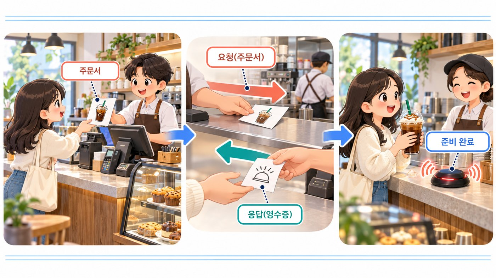

웹에서도 같습니다. 브라우저가 “이 주소의 정보를 줘”라고 요청하면 서버가 결과를 응답합니다. 이 메시지의 형식을 정해 둔 약속이 **HTTP(Hypertext Transfer Protocol)**입니다. 앞 시간에 ‘누가 요청하고 누가 응답하나’를 보았다면, 오늘은 **메시지 한 통의 안쪽**까지 열어 봅니다.

## 2부. 한 쌍이지만 담긴 정보가 다르다

| | 요청(Request) | 응답(Response) |
| --- | --- | --- |
| 보내는 쪽 | 이 관계에서 클라이언트(브라우저 · 앱) | 요청을 받은 서버 |
| 들어가는 것 | 메서드 · URL · 헤더 · (본문) | 상태 코드 · 헤더 · (본문) |
| 첫 줄 | 어떤 메서드로 어느 대상에? | 결과가 어떤 상태인가? |
| 헤더의 역할 | 보내는 쪽의 조건 · 형식 · 인증 | 내용물의 형식 · 캐시 규칙 |
| 본문 | 신청서 · 입력 데이터(없을 때도 많다) | 데이터 · 오류 설명(없을 때도 있다) |
| 먼저 볼 것 | 주소 · 메서드 · 보낸 값 | 상태 코드 · 돌아온 값 |

- **메서드** — 어떤 성격의 부탁인지(가져다 달라 · 등록해 달라 …)
- **URL** — 무엇을 대상으로 하는지
- **헤더(header)** — 본문보다 앞에 붙는 부가 설명
- **상태 코드** — 결과를 짧게 알리는 세 자리 숫자
- **본문(body)** — 실제 데이터나 오류 설명. 조회 요청에는 보통 본문이 없습니다

### 두 메시지의 안쪽 (움직이는 그림 8-A)

예제 앱을 열면 브라우저가 요청 한 통을 씁니다. 첫 줄에 `GET /data/snapshot.json`, 아래에 헤더가 붙고 본문은 없습니다. 서버는 미리 만들어 둔 파일을 찾아 `200` 상태 줄, “내용물은 JSON”이라는 헤더, 역 데이터가 담긴 본문으로 답하고, 화면은 그 본문을 읽어 지도와 순위를 그립니다. → [움직이는 개념 노트에서 단계별로 보기](https://daehyub71.github.io/vibecoding-it-basics/notes/part2-2.html)

### URL은 대상, 메서드는 부탁의 성격

같은 가게에 가격을 묻는 것과 주문을 등록하는 것은 다른 부탁입니다. HTTP에서도 주소는 **대상**, 메서드는 그 대상에 원하는 **일의 성격**입니다. 예제 사이트에 실제로 보내 본 결과입니다(2026-10-23 실측).

```text
GET  /data/snapshot.json  → 200   # 개요 데이터 주세요 → 여기 있습니다
POST /data/snapshot.json  → 405   # 같은 주소에 다른 부탁 → 그 방법으로는 받지 않습니다
```

`405 Method Not Allowed`는 **주소는 맞는데 메서드가 틀렸다**는 뜻입니다. 이 사이트는 이때 설명 본문도 붙이지 않습니다(본문 0바이트). 같은 주소라도 메서드가 다르면 다른 부탁이라는 것만 기억하고, GET과 POST의 차이는 다음 시간(Part2-3)에 봅니다.

## 3부. 실제 저장소 읽기 — 서울 지하철 인사이트의 요청과 응답

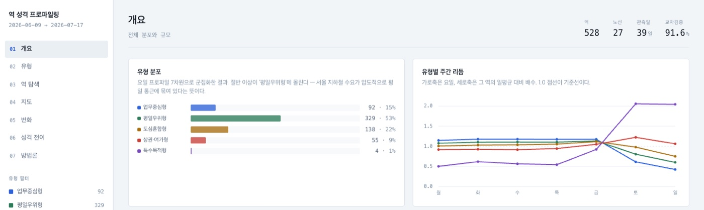

### 화면이 보내는 요청 두 가지

요청을 보내는 코드는 `web/lib/useData.ts` 한 파일에 모여 있습니다.

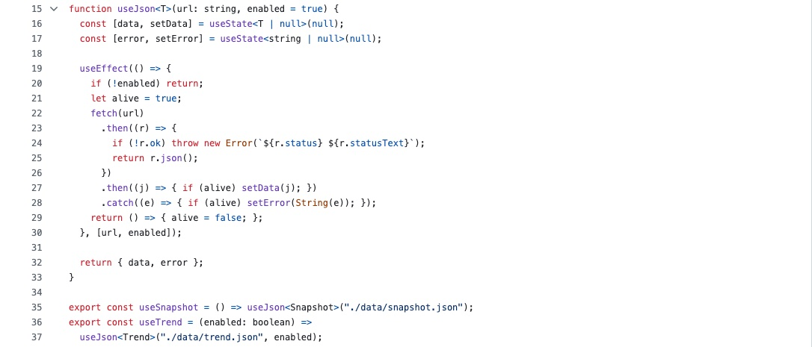

```ts
// web/lib/useData.ts 22~25행 (옮겨 적음)
fetch(url)
  .then((r) => {
    if (!r.ok) throw new Error(`${r.status} ${r.statusText}`);
    return r.json();
  })

// 35~37행 — 요청하는 파일 두 개
export const useSnapshot = () => useJson<Snapshot>("./data/snapshot.json");
export const useTrend = (enabled: boolean) =>
  useJson<Trend>("./data/trend.json", enabled);
```

| 요청 | 언제 보내나 | 근거 |
| --- | --- | --- |
| `GET /data/snapshot.json` | 화면을 열 때 바로 | `useData.ts` 35행 · `page.tsx` 29행 |
| `GET /data/trend.json` | 왼쪽 메뉴 [변화](또는 [성격 전이])를 누를 때만 | `useData.ts` 36~37행 · `page.tsx` 21 · 30~32행 |

`trend.json`을 따로 떼어 둔 이유는 README에 적혀 있습니다. 스냅숏만 보는 사용자가 389KB짜리 추세 데이터까지 받을 이유가 없으니, **필요할 때만 더 받는** 것입니다.

응답을 받으면 먼저 `r.ok`로 성공(2xx)인지 봅니다. 실패면 `404 Not Found`처럼 상태 코드를 넣어 오류를 만들고, 화면에 안내를 띄웁니다.

```text
# web/app/page.tsx 129 · 132행 — 실패했을 때와 기다리는 동안 보이는 문구
데이터를 불러오지 못했습니다: {오류}
데이터를 불러오는 중…
```

README는 이 사이트를 “정적 export, 서버 없음”이라고 설명합니다(25행). 여기서 ‘서버 없음’은 **계산하는 프로그램을 따로 두지 않았다**는 뜻이지, 응답하는 쪽이 없다는 뜻은 아닙니다. 호스팅 업체(Vercel)의 서버가 미리 만든 파일을 내주고, 요청과 응답은 똑같이 오갑니다.

### 본문의 이름 — 한 글자 축약

`snapshot.json`의 역 하나는 이렇게 생겼습니다(2026-10-23 실제 응답에서 한 곳만 옮겨 적음).

```json
{"s": "4.19민주묘지", "l": "우이신설선", "t": "평일우위형", "a": 6591, "w": 0.686, ...}
```

| 이름 | 뜻 | 근거 |
| --- | --- | --- |
| `s` · `l` · `t` | 역 이름 · 호선 · 유형 | `web/lib/types.ts` 25~32행(`Station`), 값으로 확인 |
| `a` | 일평균 이용량 | `web/components/SnapshotViews.tsx` 77 · 86행(표의 「일평균」 칸) |
| `w` | 주말/평일 이용 비율 | 같은 파일 77 · 87행(「주말/평일」 칸) |

긴 이름 대신 한 글자를 쓴 것은 파일 크기를 줄이려는 선택입니다(역 · 호선 조합 620개). 사람이 읽기에는 불편하니, 이름의 뜻은 **화면 코드가 그 값을 어디에 쓰는지**를 보고 확정합니다.

### README와 실제가 다른 곳 — 문서와 현실은 다를 수 있다

README의 「GitHub Pages」 절은 `main`에 올릴 때마다 GitHub Pages로 **자동 배포**된다고 안내하고, 마지막 커밋 메시지도 “서브경로 호스팅 지원 + GitHub Pages 자동 배포”입니다.

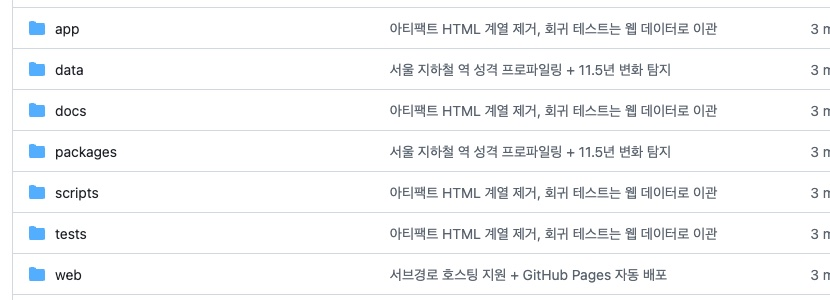

그런데 실제로 확인해 보면 다릅니다.

| 확인한 것 | 결과(2026-10-23) |
| --- | --- |
| Actions의 「Deploy to GitHub Pages」 실행 기록 | 두 번(2026-07-22) 모두 실패 |
| 저장소의 Pages 사이트 설정 | 없음 |
| README가 안내하는 GitHub Pages 주소 | `404` |
| 실제로 돌아가는 사이트 | Vercel(`seoul-subway-insight.vercel.app`) |

README는 **계획**을, 실제 응답은 **현재**를 보여 줍니다. AI에게 저장소를 맡길 때도 문서의 주소를 그대로 믿지 말고, 그 주소에 요청을 보내 응답을 받아 보는 것이 확인입니다.

### AI에게 이렇게 물어 보세요 — 요청 한 통을 끝까지 따라가 달라

AI에게 “이 데이터 형식 알려 줘”라고만 하면 흔히 쓰는 이름을 그럴듯하게 지어 줄 수 있습니다. **요청 한 통을 코드에서 끝까지 따라가 대조표를 만들어 달라**고 합니다.

```text
아래 저장소에서 화면이 요청하는 데이터 하나만 따라가 줘.
https://github.com/daehyub71/seoul-subway-insight

1) 화면이 요청하는 주소와, 그 요청을 보내는 때
2) 응답이 실패했을 때 화면이 하는 일
3) 응답 JSON의 최상위 이름
를 표 하나로 정리해 줘. 칸마다 근거 파일 이름과 줄 번호를 붙이고,
코드에서 확인하지 못한 값은 "확인 못 함"이라고 적어 줘.
```

AI의 표를 받으면 세 가지를 맞춰 봅니다.

1. **이름이 긴가.** `name` · `station`처럼 긴 이름을 적었다면 코드를 읽지 않은 것입니다. 실제는 `s` · `l` · `t` 같은 한 글자 축약이고, 최상위 이름은 `meta` · `clusters` · `stations` · `shares` · `confusion` · `series`입니다.
2. **‘API 서버’라고 부르는가.** 이 앱은 계산하는 서버를 두지 않고 **정적 파일**을 받습니다.
3. **타임아웃 · 재시도가 있다고 하는가.** 이 앱의 코드에는 **기다리는 시간을 정하는 줄도, 실패하면 다시 묻는 줄도 없습니다.** `fetch`를 한 번 보내고, 실패하면 안내를 띄우는 것이 전부입니다.

## 4부. 응답에는 숫자 세 자리 — 상태 코드

카페 직원은 “주문받았습니다”, “품절입니다”, “계산대에 문제가 있습니다”처럼 상태를 알려 줍니다. 서버도 결과에 세 자리 숫자를 붙입니다. 이것이 **HTTP 상태 코드**이고, 앞자리 숫자로 다섯 가족이 나뉩니다.

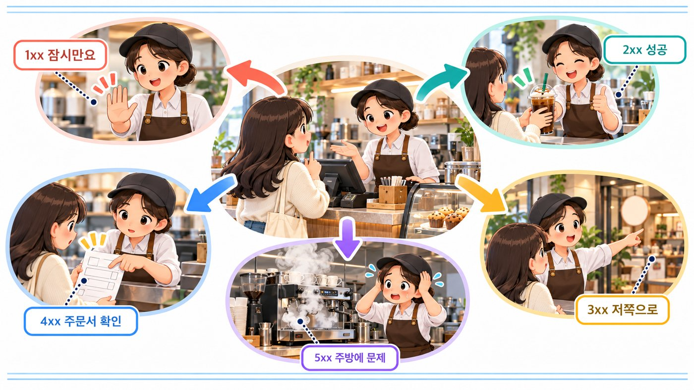

| 앞자리 | 가족 | 카페 직원이라면 |
| --- | --- | --- |
| 1xx | 정보 · 중간 안내 | “잠깐만요” |
| 2xx | 성공 | “여기 있습니다” |
| 3xx | 다른 곳으로 | “저쪽 창구로 가세요” |
| 4xx | 요청 쪽 문제 | “주문을 잘못하셨어요” |
| 5xx | 서버 쪽 문제 | “주방에 문제가 생겼어요” |

자주 만나는 코드는 이 정도입니다.

| 코드 | 뜻 | 코드 | 뜻 |
| --- | --- | --- | --- |
| 200 | 성공 | 404 | 찾지 못함 |
| 201 | 새로 만들어짐 | 409 | 현재 상태와 충돌 |
| 204 | 성공 · 보낼 내용 없음 | 422 | 값이 규칙에 안 맞음 |
| 400 | 요청이 잘못됨 | 429 | 요청이 너무 많음 |
| 401 · 403 | 인증 필요 · 권한 없음 | 500 · 503 | 서버 내부 오류 · 잠시 어려움 |

### 상태 코드 고르기 (움직이는 그림 8-B)

예제 사이트에 여러 요청을 보내 돌아오는 숫자를 봅니다. 개요 데이터를 정상으로 받으면 `200`, 같은 주소에 POST를 보내면 `405`, 없는 파일을 달라고 하면 `404`, 아예 없는 배포 주소도 `404`지만 모양이 다른 `404`, `http://`로 들어가면 `308`입니다. 서버가 꺼져 있으면 숫자 없이 연결 자체가 실패합니다. 개념 노트에서 상황을 골라 보며 숫자와 본문을 함께 확인할 수 있습니다.

### 같은 404, 다른 사정

예제 사이트에서 실제로 받은 두 가지 `404`입니다(2026-10-23 실측).

| 요청 | 상태 | 본문 | 뜻 |
| --- | --- | --- | --- |
| 사이트 안의 없는 파일(`/data/nothing.json`) | 404 | 사람에게 보여 줄 안내 페이지(`text/html`) | 사이트는 있는데 그 파일이 없다 |
| 아예 없는 Vercel 배포 주소 | 404 | `x-vercel-error: DEPLOYMENT_NOT_FOUND` 헤더와 짧은 글 | 그 이름의 사이트 자체가 없다 |

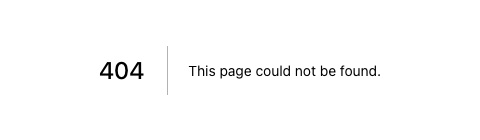

같은 숫자라도 **어디서 왔는지**와 **본문이 무엇인지**를 함께 봐야 사정이 보입니다.

### 외우지 말고 이 순서로

숫자를 다 외울 필요는 없습니다.

1. 요청을 보냈나?
2. 상태 코드가 왔나? (숫자가 없으면 연결 자체가 실패한 것)
3. 어느 가족인가? (2 · 3 · 4 · 5)
4. 본문에 설명이 있나?

## 5부. JSON — 편지 내용의 한 가지 양식

응답 본문은 대개 **JSON**이라는 양식으로 옵니다. 이름과 값을 짝지어 적고, 목록은 대괄호 `[ ]`로 묶습니다. 예제 앱의 `snapshot.json`은 데이터 기간을 담은 `meta`로 시작하고, 이어서 역 목록이 나옵니다.

```text
# /data/snapshot.json 앞부분 (실제 응답, 줄임)
{"meta": {"start": "2026-06-09", "end": "2026-07-17", "days": 39,
          "nStation": 528, "nLine": 27, "nPair": 620, ...},
 "clusters": [...], "stations": [...], ...}
```

개요 화면 위쪽의 「역 528 · 노선 27 · 관측일 39일」은 이 `meta`의 `nStation` · `nLine` · `days`를 그대로 보여 준 것입니다(`page.tsx` 113~115행). JSON 문법 자체는 12장에서 자세히 봅니다.

### 200이 왔다 ≠ 내가 예상한 모양

여기서 흔한 오해 하나. `200`이 왔다고 데이터가 내가 예상한 모양이라는 보장은 없습니다. 이 앱의 코드도 `r.ok`(성공 여부)만 보고 바로 읽습니다. 나중에 파이썬 쪽에서 `nStation`을 다른 이름으로 바꿔 파일을 만들면, 요청은 여전히 `200`이고 화면에는 오류 없이 **빈칸**이 생길 수 있습니다. **성공 여부와 데이터 모양의 검증은 별개**입니다.

## 6부. 기다리는 동안 · 타임아웃

요청은 네트워크를 건너가고, 서버가 처리하고, 결과가 다시 건너와야 합니다. 그동안 예제 앱은 「데이터를 불러오는 중…」을, 변화 화면에서는 「11.5년 시계열을 불러오는 중… (389KB)」를 보여 줍니다(`page.tsx` 132 · 143행).

정해진 시간 안에 답이 없으면 **타임아웃(timeout)**이 납니다. 타임아웃이 곧 서버가 죽었다는 뜻은 아닙니다. 연결이 느리거나, 중간 네트워크에 문제가 있거나, 서버가 처리를 끝내지 못했을 수 있습니다. 그리고 **이 앱은 기다리는 시간을 따로 정하지 않았습니다.** 코드에 타임아웃 값도, 재시도도 없으니, 얼마나 기다릴지는 브라우저와 네트워크 사정에 맡겨져 있습니다.


주문을 넣었는데 영수증이 나오지 않았습니다. 그런데 주방은 이미 주문을 받아 만들기 시작했습니다. **응답을 못 받았다고 서버가 아무 일도 안 한 것은 아닙니다.** 그래서 신청 · 결제 같은 요청은 무작정 다시 보내면 두 번 처리될 수 있습니다. 반대로 예제 앱 같은 조회는 다시 물어도 서버의 상태가 바뀌지 않으니 괜찮습니다. 어떤 요청을 다시 보내도 되는지는 다음 시간에 ‘멱등성’이라는 이름으로 다시 봅니다.

## 7부. 헤더 — 내용보다 앞에 붙는 부가 설명

택배 상자에 받는 사람과 ‘취급 주의’가 붙듯, 메시지에도 헤더가 붙습니다. `content-type`은 내용물의 형식을, `cache-control`은 얼마나 오래 다시 써도 되는지를 알립니다. 예제 앱의 데이터 파일을 실제로 받아 본 응답의 머리입니다(출력은 예, 줄임).

```text
> curl.exe -i https://seoul-subway-insight.vercel.app/data/snapshot.json
HTTP/2 200
content-type: application/json; charset=utf-8
cache-control: public, max-age=0, s-maxage=86400, stale-while-revalidate=604800
etag: "df4f0142…"
x-vercel-cache: HIT
age: 33

{"meta":{"start":"2026-06-09", …
```

맥은 `curl -i …`로 같은 요청을 보냅니다(`curl.exe`를 쓰는 까닭은 직접 확인하기에서 다룹니다).

| 줄 | 읽는 법 |
| --- | --- |
| `HTTP/2 200` | 상태 줄. 성공 |
| `content-type` | 본문은 JSON |
| `cache-control` | 캐시 규칙(8부) |
| `etag` | 이 파일 내용의 꼬리표. 내용이 바뀌면 값도 바뀐다 |
| `x-vercel-cache` · `age` | 중간 서버의 캐시에서 꺼냈는지(`HIT` · `MISS`), 캐시에 머문 초 |
| 빈 줄 아래 | 본문 |

화면과 데이터가 **같은 사이트**에서 오기 때문에, 화면과 서버의 출처가 달라 생기는 허락 문제(CORS)도 이 앱에서는 일어나지 않습니다. 헤더 이름은 대소문자를 가리지 않고 줄 수도 많지만, 처음에는 **요청 방식 · 대상 · 부가 설명** 세 덩어리만 챙기면 됩니다.

### 리다이렉트 — “새 주소로 가세요”

가게가 이사하면 옛 매장 문에 “새 매장은 건너편입니다”라는 안내문을 붙입니다. 손님은 안내문을 읽고 새 매장으로 다시 찾아갑니다. 웹에서는 이런 안내를 **리다이렉트(redirect)**라고 하고, 응답 헤더의 `Location`에 새 주소가 적혀 옵니다.

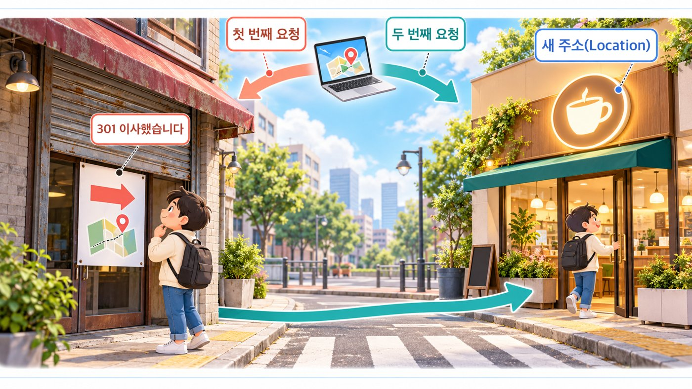

예제 사이트에 `http://`로 들어가 봅니다(출력은 예, 줄임).

```text
> curl.exe -I http://seoul-subway-insight.vercel.app/
HTTP/1.0 308 Permanent Redirect
Location: https://seoul-subway-insight.vercel.app/
```

맥은 `curl -I …`입니다. 서버는 페이지 대신 `308`(영구 이동)과 `https://` 주소가 적힌 `Location`을 돌려줍니다. 브라우저는 그 안내를 따라 두 번째 요청을 보냅니다. **한 번 들어갔지만 요청은 두 번**인 셈입니다. Network 탭에 생각보다 많은 줄이 보이는 이유 가운데 하나입니다.

## 8부. 캐시 — 미리 만든 답장

아침에 구워 둔 빵은 바로 나오고, 주문받고 굽는 빵은 기다려야 합니다. 웹에서도 전에 받은 답을 다시 쓰는 것을 **캐시(cache)**라고 합니다. 덕분에 페이지가 빨리 열리고 서버의 부담도 줄어듭니다.

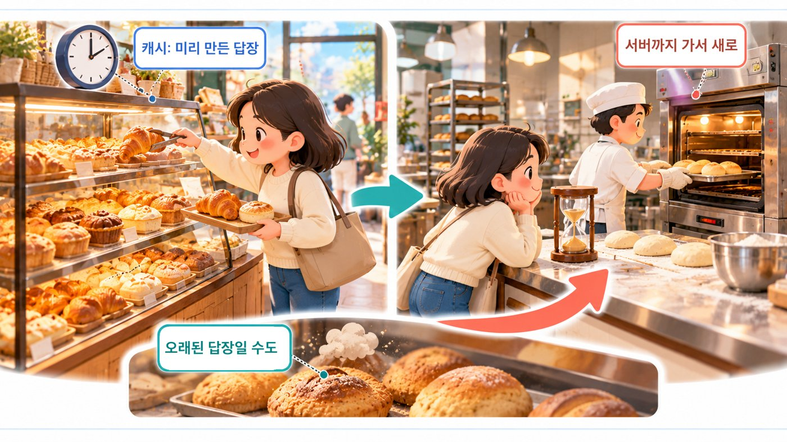

예제 앱은 캐시 규칙을 `vercel.json`에 적어 두었습니다.

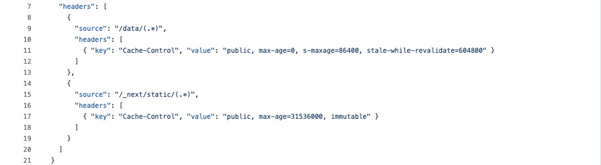

| 경로 | 붙는 `Cache-Control` | 뜻 |
| --- | --- | --- |
| `/data/…` (JSON 데이터) | `public, max-age=0, s-maxage=86400, stale-while-revalidate=604800` | 브라우저는 매번 확인(`max-age=0`), **중간 서버는 하루(86,400초) 기억** |
| `/_next/static/…` (화면 파일) | `public, max-age=31536000, immutable` | **1년 동안 그대로** 써도 된다 |

### 캐시는 미리 만든 답장 (움직이는 그림 8-C)

첫 요청은 서버까지 가고, 돌아오는 답장이 중간 서버에 한 부 보관됩니다. 같은 요청은 중간 서버에서 바로 돌아오고(`x-vercel-cache: HIT`, `age`), 데이터가 바뀌었는데 중간 서버가 옛 답장을 들고 있으면 잠시 옛 데이터가 보일 수 있습니다. 브라우저가 `etag` 꼬리표를 들고 “바뀌었나요?”라고 물으면, 그대로일 때 서버는 본문 없이 `304`(가진 것을 그대로 쓰라)로 답합니다. 화면 파일은 이름에 내용의 지문이 들어 있어서 1년 동안 다시 묻지 않습니다. 내용이 바뀌면 이름이 바뀌니까요.

### “고쳤다는데 화면이 그대로”일 때

캐시를 모르면, AI가 “수정 완료”라고 했는데 화면이 예전 그대로일 때 엉뚱한 곳을 다시 고치게 됩니다. 이 순서로 확인합니다.

1. 강력 새로고침 — 윈도우 `Ctrl+Shift+R` · 맥 `Command+Shift+R`
2. 개발자 도구 Network 탭의 **Disable cache**(캐시 사용 중지)를 켜고 새로고침
3. 응답 헤더의 `cache-control` · `x-vercel-cache` · `age` 확인

다만 무턱대고 캐시를 끄면 느려집니다. 끄기 전에 **어느 캐시인지부터** 찾습니다.

## 9부. Network 탭 = 통화 기록

통화 내역을 보면 언제 누구에게 전화했는지 알 수 있듯, 브라우저 개발자 도구의 **Network(네트워크) 탭**에서는 어떤 요청이 나갔고 어떤 응답이 돌아왔는지 볼 수 있습니다. 윈도우는 `F12`, 맥 크롬은 `Option+Command+I`로 엽니다.

1. 단추를 **누르기 전에** 탭을 연다
2. 단추를 **한 번만** 누른다
3. 새로 생긴 줄을 고른다
4. 주소 · 메서드 · 상태 · 응답을 읽는다
5. 예상과 다른 곳을 적는다

### Network 탭 읽기 (움직이는 그림 8-D)

예제 앱을 연 뒤 [변화]를 한 번 누르면 `trend.json` 줄이 하나 새로 생깁니다. Headers 칸에서 요청 주소 · 메서드 · 상태 코드를, Response 칸에서 한 글자 축약 이름이 담긴 본문을 봅니다. 이 요청은 주소 뒤에 조건(`?…`)이 없어 Payload 칸에 보낸 값이 없습니다. 탭 아이콘을 찾는 `favicon.ico` 줄은 `404`로 붉게 보이지만 화면에는 아무 문제가 없습니다. **붉은 줄이 모두 고장은 아닙니다.** 반대로 데이터 파일이 실패하면 이 앱은 「데이터를 불러오지 못했습니다」와 상태 코드를 화면에 그대로 보여 줍니다. 가짜 목록으로 덮지 않으니 실패가 바로 보입니다.

참고로, 캐시가 없는 새 브라우저로 예제 앱을 열고 10초 동안 기록한 요청은 이렇습니다(2026-10-23, 화면 파일 줄은 묶음).

| 시각 | 메서드 | 경로 | 상태 | 비고 |
| --- | --- | --- | --- | --- |
| 0.00초 | GET | `/` | 200 | 문서 |
| 0.07초 | GET | `/_next/static/…` 6줄 | 200 | 화면 파일(1년 캐시) |
| 0.43초 | GET | `/data/snapshot.json` | 200 | 데이터, `x-vercel-cache: HIT` |
| 0.43초 | GET | `/favicon.ico` | 404 | 탭 아이콘 없음 — 문제 아님 |
| 4.14초 | GET | `/data/trend.json` | 200 | [변화]를 누른 순간 |

**주의** 개발자 도구에는 접근 토큰 · 쿠키 · 개인 데이터가 들어 있을 수 있습니다. AI에게 화면이나 기록을 넘기기 전에 비밀값과 개인정보는 가립니다.

## 10부. 같은 버튼, 서로 다른 응답

공공 문화강좌의 마지막 한 자리를 두 사람이 거의 동시에 신청한다고 해 봅시다(학습용 예시, 예제 앱에는 신청 기능이 없습니다). 먼저 도착한 요청은 자리를 차지하고 `201`(새로 만들어짐)을 받습니다. 늦게 도착한 요청은 자리가 이미 없습니다.

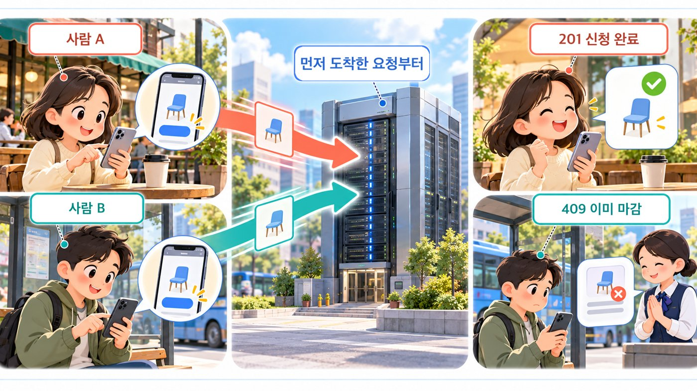

두 번째 사람의 응답은 프로그램 오류가 아니라 **업무상 거절**입니다. `409`(현재 상태와 충돌) 같은 코드와 함께, 사용자에게 보여 줄 설명을 본문에 담아 보냅니다. 그리고 실제 동시 신청은 데이터베이스에서 **한 번에 하나씩 확정**하도록(트랜잭션 · 제약 조건) 안전하게 처리해야 합니다. 화면의 분기만 만들어 놓았다면 중요한 부분이 빠진 것입니다.

### AI에게 — 요청에서 본 것과 응답에서 본 것을 나눠서

증상을 말할 때 **요청에서 본 것과 응답에서 본 것을 나눠** 적으면 AI가 추측 대신 기록에서 출발합니다.

```text
화면에 "데이터를 불러오지 못했습니다: 404"가 떴어.
Network 탭: GET …/data/trend.json → 404, 응답 본문은 HTML 안내 페이지.

1) 이 주소가 실제 배포에 있는 파일인지
2) 코드가 요청하는 경로와 배포된 경로가 같은지
3) 고치기 전에 내가 더 확인할 것을 순서대로 알려 줘.
```

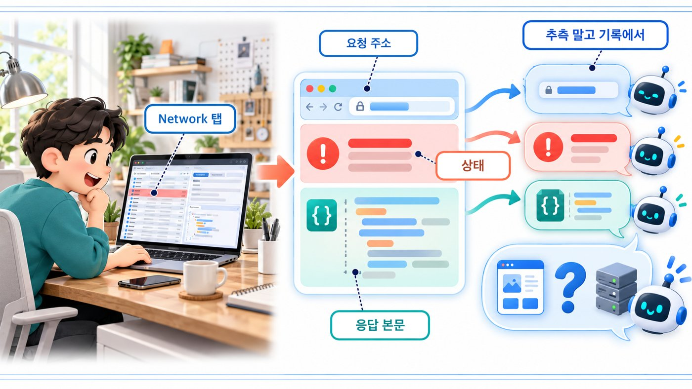

더 나아가 “성공했을 때의 약속뿐 아니라 **실패했을 때의 약속**까지 함께 설계해 줘”라고 요청하면, 실제 서비스를 만드는 질문이 됩니다.

## 직접 확인하기

예제 사이트는 공개되어 있어 내 컴퓨터에 아무것도 설치하지 않고 요청을 보낼 수 있습니다. 조회(GET) 요청만 보내고, 같은 명령을 짧은 간격으로 수십 번 반복하지 않습니다.

| 실습 | 시간 | 할 일 |
| --- | --- | --- |
| A. 응답의 세 부분 | 3분 | 데이터 파일에 `curl.exe -i`(맥은 `curl -i`) → 상태 줄 · 헤더 · 본문 찾기 |
| B. 리다이렉트 따라가기 | 3분 | `http://`로 `-I` → 308과 `Location` → `-L`로 두 번 |
| C. Network 탭 기록표 | 5분 | 요청 다섯 줄을 표로 적기 |
| D. 캐시 비교 | 3분 | Size 칸의 캐시 표시 → Disable cache로 비교 → 다시 끄기 |

### 실습 A · B 명령

아래 출력은 예시이며 때와 장소마다 다릅니다(`age` 값, `HIT` · `MISS` 등).

**윈도우 · PowerShell**

```text
> $U = "https://seoul-subway-insight.vercel.app"
> curl.exe -i "$U/data/snapshot.json"
HTTP/2 200
content-type: application/json; charset=utf-8
cache-control: public, max-age=0, s-maxage=86400, stale-while-revalidate=604800
x-vercel-cache: HIT
...
> curl.exe -I http://seoul-subway-insight.vercel.app/
HTTP/1.0 308 Permanent Redirect
Location: https://seoul-subway-insight.vercel.app/
> curl.exe -sIL http://seoul-subway-insight.vercel.app/
HTTP/1.0 308 Permanent Redirect
...
HTTP/2 200
```

**맥 · 터미널**

```text
$ U=https://seoul-subway-insight.vercel.app
$ curl -i $U/data/snapshot.json
HTTP/2 200
content-type: application/json; charset=utf-8
cache-control: public, max-age=0, s-maxage=86400, stale-while-revalidate=604800
x-vercel-cache: HIT
...
{"meta":{"start":"2026-06-09", …
$ curl -I http://seoul-subway-insight.vercel.app/
HTTP/1.0 308 Permanent Redirect
Location: https://seoul-subway-insight.vercel.app/
$ curl -sIL http://seoul-subway-insight.vercel.app/
HTTP/1.0 308 Permanent Redirect
...
HTTP/2 200
...
```

- 찾을 것: 첫 줄의 `200`, `content-type`의 `json`, `cache-control`, `x-vercel-cache`. 빈 줄 아래가 본문입니다
- `-i`는 응답 헤더까지 보여 달라는 옵션, `-I`는 머리만, `-L`은 안내(`Location`)를 따라가라는 옵션입니다. `-sIL`에서는 응답 머리가 **두 번**(308 → 200) 나옵니다
- 윈도우에서는 `curl`이 아니라 `curl.exe`로 씁니다(PowerShell에서 `curl`은 다른 명령의 별명일 수 있습니다)
- 확인 문제 2번의 `405`도 직접 볼 수 있습니다. 윈도우 `curl.exe -s -o NUL -w "%{http_code}" -X POST "$U/data/snapshot.json"`, 맥 `curl -s -o /dev/null -w '%{http_code}\n' -X POST $U/data/snapshot.json` → `405`(예). 이 정적 사이트는 POST로 무엇도 저장하지 않으니 안전한 확인입니다

### 실습 C — Network 탭 기록표

브라우저로 [예제 사이트](https://seoul-subway-insight.vercel.app)를 열고, Network 탭을 연 상태에서 새로고침합니다. 요청 다섯 줄을 골라 표로 적습니다(값은 예).

| 메서드 | 경로 | 상태 | 시간 |
| --- | --- | --- | --- |
| GET | `/` | 200 | … |
| GET | `/data/snapshot.json` | 200 | … |
| GET | `/favicon.ico` | 404 | … |

`200`이 아닌 줄이 있으면 무엇인지 찾아봅니다. 이어서 [변화]를 한 번 눌러 `trend.json` 줄이 새로 생기는지 봅니다.

### 실습 D — 캐시 비교

새로고침을 한 번 더 하고 **Size** 칸에 `(memory cache)`나 `(disk cache)`라고 적힌 줄을 찾습니다. 그다음 **Disable cache**를 켜고 새로고침해 무엇이 달라지는지 봅니다. 데이터 파일은 `max-age=0`이라 브라우저가 매번 확인하고, 화면 파일(`/_next/static/…`)은 1년 캐시라 캐시 표시가 자주 보입니다. **끝나면 Disable cache를 다시 끕니다.**

## 오해 바로잡기

| 오해 | 바로잡기 |
| --- | --- |
| 200이 왔으니 데이터도 맞다 | 성공과 데이터 모양은 별개다. 이름이 바뀌면 오류 없이 빈칸이 될 수 있다 |
| 응답을 못 받았으면 서버는 아무 일도 안 했다 | 처리는 끝났는데 응답만 못 돌아왔을 수 있다 |
| 404는 늘 주소를 잘못 친 것이다 | 없는 파일 · 없는 사이트처럼 같은 숫자에도 다른 사정이 있다. 본문과 출처를 함께 본다 |
| 화면에 데이터가 보이면 서버가 방금 보낸 것이다 | 캐시의 옛 답장일 수 있다. Network 탭이 판정한다 |
| 캐시는 꺼 두는 게 안전하다 | 캐시는 속도와 서버 부담 때문에 있다. 끄기 전에 어느 캐시인지부터 찾는다 |

## 한 장 요약

| 기억할 질문 | 한 문장 답 |
| --- | --- |
| 요청은? | 메서드 · URL · 헤더 · (본문) — 무엇을 어떤 조건으로 원하나 |
| 응답은? | 상태 코드 · 헤더 · (본문) — 결과가 어떻고 무엇이 왔나 |
| 상태 코드는? | 2xx 성공 · 3xx 다른 곳으로 · 4xx 요청 쪽 · 5xx 서버 쪽 |
| 리다이렉트 · 캐시는? | 새 주소(`Location`)로 다시 가라는 안내 · 전에 받은 답장의 재사용(`304` · `HIT`) |
| 타임아웃은? | 정해진 시간 안에 답이 없음. 서버가 처리했는지는 따로 확인 |
| Network 탭은? | 요청과 응답의 통화 기록 |
| 예제 앱의 요청은? | 열 때 `snapshot.json`, [변화]에서 `trend.json`. 정적 파일이고, 실패하면 상태 코드를 화면에 보여 준다. 타임아웃 · 재시도는 없다 |

## 확인 문제

1. 요청과 응답에 각각 들어가는 부분은? 요청에만 있는 것은?
2. `snapshot.json`에 POST를 보냈더니 `405`가 왔다. 무엇이 틀렸나?
3. 신청 버튼을 누른 뒤 타임아웃이 났다. 바로 다시 눌러도 될까?
4. 개요 화면의 「역 528」은 어느 요청에서 왔는지 어떻게 확인할까?
5. `cache-control`의 `s-maxage=86400`과 `x-vercel-cache: HIT`는 무엇을 말하나?

<details>
<summary>풀이 보기</summary>

1. 요청은 메서드 · URL · 헤더 · (본문), 응답은 상태 코드 · 헤더 · (본문)이다. 메서드와 URL은 요청에만 있고, 상태 코드는 응답에만 있다. 본문은 둘 다 없을 수 있다.
2. 주소가 아니라 **메서드**가 틀렸다. `405 Method Not Allowed`는 그 주소가 있지만 그 방법으로는 받지 않는다는 뜻이다. 정적 데이터 파일은 GET으로 가져온다. 이 사이트는 설명 본문도 붙이지 않으니 숫자의 뜻을 알고 있어야 한다.
3. 서버가 이미 처리했을 수 있으므로 바로 다시 누르면 두 번 신청될 수 있다. 먼저 신청 내역을 확인하거나, 서버가 중복을 막도록 설계되어 있는지 본다(다시 보내도 되는 요청은 Part2-3의 멱등성). 예제 앱의 데이터 조회처럼 상태를 바꾸지 않는 요청은 다시 보내도 괜찮다.
4. Network 탭에서 화면을 열 때 생긴 `GET /data/snapshot.json` 줄을 고르고, Response 칸에서 `meta`의 `"nStation":528`을 찾는다. 상태 코드(200)와 Size 칸 · `x-vercel-cache`를 보면 방금 받은 것인지 캐시에서 온 것인지도 알 수 있다. 화면 코드에서는 `page.tsx`가 `D.meta.nStation`을 「역」 칸에 보여 준다.
5. `s-maxage=86400`은 중간 서버(Vercel의 캐시)가 이 응답을 **하루(86,400초)** 동안 보관해 다시 써도 된다는 규칙이다(`max-age=0`이라 브라우저는 매번 확인한다). `x-vercel-cache: HIT`는 이번 응답이 실제로 그 **중간 서버의 캐시에서 나왔다**는 표시다. 그래서 데이터를 새로 올린 직후에는 잠시 옛 답장이 보일 수 있다.

</details>

## 다음 시간

Part2-3 GET vs POST. 요청의 첫 줄 맨 앞 단어, GET과 POST를 오늘은 지나쳐 왔습니다. 같은 주소에 POST를 보냈을 때 왜 `405`가 왔을까요? 다음 시간에는 두 메서드의 차이와, 주소창의 자물쇠(HTTPS)가 이 메시지의 무엇을 지켜 주는지를 나눠 봅니다.

## 출처

- [daehyub71/seoul-subway-insight](https://github.com/daehyub71/seoul-subway-insight) 커밋 `9cc758a`(2026-07-22 커밋 · 2026-10-23 `gh api`로 확인) — `README.md`(17 · 25행 정적 구조, 「GitHub Pages」 「Vercel」 절, `snapshot.json` · `trend.json` 표), `web/lib/useData.ts`(22~28 · 35~37행), `web/app/page.tsx`(21 · 29~32 · 113~115 · 129~132 · 143행), `web/lib/types.ts`(25~32행 `Station`), `web/components/SnapshotViews.tsx`(77 · 86 · 87행), `web/next.config.mjs`(`output: "export"`), `vercel.json`(9~17행), `.github/workflows/deploy-pages.yml`
- 배포 상태(2026-10-23 확인): GitHub Actions 「Deploy to GitHub Pages」 실행 2회(2026-07-22, 커밋 `7cf3f86` · `9cc758a`) 모두 실패, 저장소 Pages 설정 조회 결과 없음, README가 안내하는 GitHub Pages 주소 응답 404. 실제 사이트는 `seoul-subway-insight.vercel.app`
- 실측(2026-10-23, 맥에서 `curl`): `snapshot.json` GET 200 · 헤더 · 본문 앞부분, ETag 조건부 요청 304, POST 405(본문 없음), `http://` 308 · `Location`, 없는 파일 404(`text/html`), 없는 배포 404(`DEPLOYMENT_NOT_FOUND`), `favicon.ico` 404. `age` · `HIT`/`MISS` 값은 요청할 때마다 다르며, 윈도우 출력은 형식을 보여 주는 예입니다
- Network 기록: 2026-10-23 캐시 없는 새 브라우저(크롬, 1440×900)로 예제 사이트를 열고 10초 동안 기록한 요청 목록(4.14초에 [변화] 클릭)
- 학습용 예시: 카페 · 빵집 · 이사한 가게 비유, 10부의 동시 신청(예제 앱에는 신청 기능이 없음). 상태 코드 표는 자주 만나는 코드만 고른 것입니다
