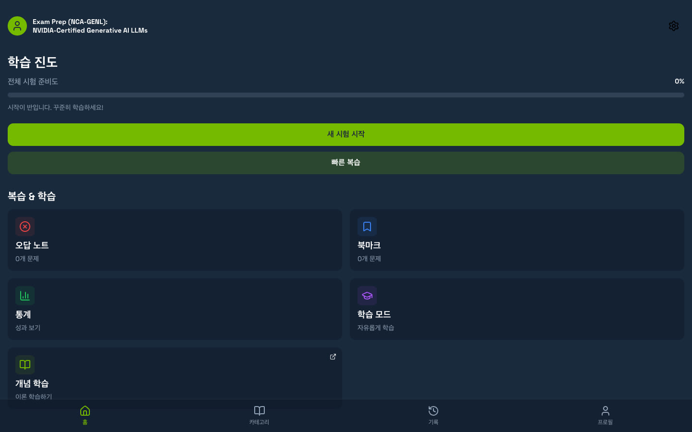
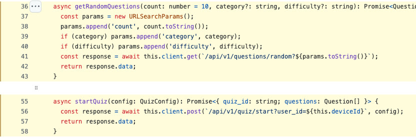

# IT 기본지식 Part2-3 강의 자료 — GET vs POST, 그리고 HTTP vs HTTPS

> 바이브코딩 기초 : IT 기본지식 · Part 2 웹사이트는 어떻게 움직일까 · 9장

## 강의 소개

**GET**은 서버에 있는 것을 보여 달라는 **조회** 요청에, **POST**는 내용을 보내 서버에 **처리를 맡기는** 요청에 주로 씁니다. 한편 **HTTP와 HTTPS**는 ‘무슨 일을 부탁하느냐’가 아니라 ‘그 부탁을 어떻게 보호해서 운반하느냐’의 차이입니다. 오늘은 서로 다른 두 질문을 차례로 나눠 봅니다.

**핵심 질문** 똑같이 ‘문제를 뽑아 오는’ 기능인데 왜 어떤 코드는 GET으로, 어떤 코드는 POST로 만들었을까요? 그리고 주소창의 자물쇠는 그 요청의 무엇을 지켜 주고, 무엇은 못 지켜 줄까요?

| 항목 | 주소 |
| --- | --- |
| 강의 영상 | 바이브코딩 기초 : IT 기본지식 Part2-3 (유튜브 공개 후 추가) |
| 예제 저장소 | [github.com/daehyub71/nvidia-cert-quiz](https://github.com/daehyub71/nvidia-cert-quiz) — NVIDIA 자격시험 문제 풀이 앱 |
| 예제 사이트 | [web-six-cyan-91.vercel.app](https://web-six-cyan-91.vercel.app) — 화면 주소. 실습에서는 GET(열어 보기 · 인증서 확인)만 보냅니다 |
| 움직이는 개념 노트 | [움직이는 그림 4개](https://daehyub71.github.io/vibecoding-it-basics/notes/part2-3.html) — 단계 넘기기 · 재생 · 직접 해 보기 |
| 강의 목차 | [39편 전체 목차](https://daehyub71.github.io/vibecoding-it-basics/) |
| 앞 영상 | Part2-2 요청 vs 응답 (유튜브 공개 후 추가) |

**예제 저장소를 고른 이유** NVIDIA 생성형 AI 자격시험(NCA-GENL)을 준비하는 문제 풀이 앱입니다. 시험 모드, 오답 노트, 북마크, AI 해설이 있고, 화면(React · Vercel)과 서버(FastAPI · Cloud Run)가 따로 떨어져 있습니다. 이 저장소에는 **같은 ‘문제 뽑기’가 GET과 POST 두 가지로 나란히** 만들어져 있고, 북마크 추가 · 빼기(POST · DELETE), 복습 표시(PATCH)까지 들어 있어 메서드를 비교하기에 알맞습니다. 게다가 **GET인데 서버에 기록이 생기는 요청**(AI 해설)이 있어서 “GET은 읽기, POST는 쓰기”라는 짧은 공식을 깨 보기에도 좋습니다. 확인 기준은 커밋 `fbe9974`(2026-10-27 확인)입니다.

**공부하는 순서** 도서관 창구의 두 부탁으로 GET과 POST를 나누고 → 조건이 주소에 실리는지 본문에 실리는지 움직이는 그림으로 본 뒤 → 예제 앱의 코드에서 두 방식을 비교하고 → 다시 보내도 되는 요청(멱등)을 따져 보고 → HTTPS가 지켜 주는 것과 못 지켜 주는 것을 나눈 다음 → 내 컴퓨터의 연습 서버와 `curl`로 직접 확인합니다.

**이 자료의 표시 규칙** 저장소 코드에서 읽은 것은 `파일:줄`로, 직접 실행해 받은 출력은 「실행 예」와 날짜로, 저장소의 엔드포인트 정의만 옮긴 연습용 서버에서 받은 결과는 「재현 서버 실행 예」로, 설명하려고 지어낸 예는 「학습용」으로 적습니다.

## 1부. 묻는 부탁, 맡기는 부탁

도서관 안내 창구를 떠올려 봅니다. “이 분야 문제집이 어디 있나요?”라고 묻는 것은 **조회**입니다. 있는 것을 보여 달라는 부탁이지요. 옆 창구에서는 원하는 조건을 신청서에 적어 내밀며 “이 조건으로 모의고사 한 회를 만들어 주세요”라고 맡깁니다. 이것은 **처리를 맡기는** 부탁입니다.


웹에서는 앞의 부탁을 GET으로, 뒤의 부탁을 POST로 보내는 경우가 많습니다. GET은 말로 묻듯 조건을 **주소 뒤에** 붙이고, POST는 서류를 내밀듯 내용을 **요청 본문에** 담습니다.

이번 예제 앱에도 두 부탁이 다 있습니다. 「문제를 몇 개 무작위로 보여 줘」는 `GET /api/v1/questions/random?count=10`으로, 「이 조건으로 시험을 시작해 줘」는 `POST /api/v1/quiz/start`에 본문(JSON)을 담아 보냅니다.

여기서 POST를 ‘새 데이터를 만드는 방법’이라고만 외우면 헷갈립니다. POST는 **내용을 보내 서버에 처리를 맡기는 요청**이라고 이해하는 편이 정확합니다. 처리 결과로 무엇이 저장될 수도 있고, 아무것도 저장되지 않을 수도 있습니다.

## 2부. 이름 말고 의미로 — GET과 POST 비교

둘 다 서버에 보내는 HTTP 요청입니다(요청의 생김새는 8장). 차이는 요청에 담긴 **의도**와 **조건이 실리는 자리**입니다.

| | GET | POST |
| --- | --- | --- |
| 이 앱의 예 | `GET /api/v1/questions/random` | `POST /api/v1/quiz/start` |
| 원하는 일 | 조회 — 서버의 상태를 바꾸지 않음 | 처리 맡기기 — 이 앱에서는 시험 기록을 만든다 |
| 조건이 실리는 곳 | 주소 뒤 쿼리(`?count=10&difficulty=easy`) | 요청 본문(JSON의 `question_count` · `difficulty`) |
| 주소만으로 다시 보내기 | 된다(주소창 · 즐겨찾기) | 안 된다 |
| 같은 요청 반복 | 멱등 — 서버 상태가 더 바뀌지 않음 | 보장 안 됨 — 일이 더 일어날 수 있음 |

**안전한(safe) 메서드**는 서버의 상태를 바꾸지 않겠다고 약속한 메서드(GET이 대표), **멱등(idempotent)**은 같은 요청을 여러 번 보내도 한 번 보낸 것과 서버에 남는 결과 상태가 같은 성질입니다.

### 주소에 싣는 조건, 본문에 싣는 내용 (움직이는 그림 9-A)

먼저 GET입니다. 문제 수와 난이도 같은 조건이 주소 뒤에 물음표와 함께 붙습니다. 이런 주소를 주소창에 넣어 열면 브라우저의 방문 기록에 그대로 남고, 요청의 첫 줄에 조건이 실리며 본문은 비어 있습니다. 서버의 접속 기록에도 조건이 그대로 찍힙니다. 이번에는 POST입니다. 시험 조건은 본문에 담겨 갑니다. 그런데 이 앱은 사용자를 구별하는 `user_id`를 **POST에도 주소 뒤에 붙여** 보냅니다(`web/src/services/api.ts:56`). 그래서 접속 기록 줄에 본문은 보이지 않지만 `user_id`는 남고, 서버가 본문의 시험 조건을 데이터베이스에 저장하면 본문 내용도 기록으로 남습니다. → [움직이는 개념 노트에서 단계별로 보기](https://daehyub71.github.io/vibecoding-it-basics/notes/part2-3.html)

### 멱등 ≠ 매번 같은 답

멱등은 ‘매번 같은 답이 온다’는 뜻이 아닙니다. 무작위 문제는 GET으로 받아도 부를 때마다 달라집니다. 멱등은 같은 요청을 다시 보내도 **서버에 남는 상태가 더 바뀌지 않는다**는 뜻입니다. 문제를 몇 번 뽑아 봐도 서버의 문제 은행은 그대로입니다.

## 3부. GET — 주소 뒤에 조건을 붙인다

GET 요청의 주소를 나눠 봅니다(학습용으로 서버 주소는 줄였습니다).

```text
https://  nvidia-cert-quiz-api-…run.app  /api/v1/questions/random  ?count=10&difficulty=easy
보호 방식  서버 주소                       경로                       조건
```

`https://`는 보호 방식(8부), 그다음은 서버 주소, 그 뒤가 경로, `?` 뒤가 조건입니다. 조건이 여럿이면 `&`로 잇습니다. 화면 코드(`web/src/services/api.ts:36~43`)도 `URLSearchParams`로 `count` · `category` · `difficulty`를 이어 붙여 이 모양을 그대로 만듭니다.

주소에 들어간 값은 **방문 기록과 서버 접속 기록**에 남기 쉽습니다. 서버(uvicorn)는 요청이 올 때마다 이런 줄을 남깁니다(재현 서버 실행 예, 2026-10-27).

```text
INFO:     127.0.0.1:61115 - "GET /api/v1/questions/random?count=10&difficulty=easy HTTP/1.1" 200 OK
```

그래서 비밀번호나 비밀 키는 **절대 주소에 넣지 않습니다.** HTTPS로 보내도 주소가 비밀 금고가 되지는 않습니다(9부).

## 4부. 실제 저장소 읽기 — 문제 풀이 앱의 GET과 POST



### 같은 ‘문제 뽑기’, 함수 두 개

화면 코드 `web/src/services/api.ts`를 열면 문제를 뽑는 함수가 두 개 나란히 있습니다.



| 함수 | 메서드 · 주소 | 조건이 실리는 곳 | 화면에서 부르는 곳 |
| --- | --- | --- | --- |
| `getRandomQuestions` | `GET /api/v1/questions/random` | 쿼리 `count` · `category` · `difficulty` | **없음**(화면 코드 전체를 찾아도 0건) |
| `startQuiz` | `POST /api/v1/quiz/start` | 본문 `QuizConfig` + 쿼리 `user_id` | `web/src/stores/quizStore.ts:78` |

실제 화면이 쓰는 쪽은 **POST**입니다. GET으로 뽑는 함수는 만들어 두었지만 부르는 곳이 없습니다.

### POST를 고른 이유 — 서버의 상태가 바뀐다

서버 쪽 `backend/app/api/quiz.py`의 시험 시작은 문제를 뽑는 데서 끝나지 않습니다.

| 줄 | 하는 일 |
| --- | --- |
| `quiz.py:29~30` | `@router.post("/start")` — POST로 정함 |
| `quiz.py:73~75` | 처음 보는 사용자면 사용자 표에 한 줄 추가 |
| `quiz.py:81~91` | 이번 시험 기록(`nq_quiz_history`)을 새로 만들어 저장 |

시험을 시작할 때마다 서버에 기록이 새로 생깁니다. **서버의 상태가 바뀌니 POST가 의미에 맞습니다.** 본문으로 받는 조건은 `QuizConfig`에 정해져 있습니다(`backend/app/schemas/question.py:63~70`, `question_count`는 1 이상 50 이하).

### 반대의 경우 — GET인데 기록이 생긴다

문제의 AI 해설은 GET으로 요청합니다(`api.ts:96~98`, 호출은 `ExamResult.tsx:93` · `History.tsx:57`). 그런데 서버 코드를 끝까지 읽으면 이야기가 달라집니다.

```python
# backend/app/api/explanations.py (옮겨 적음, 줄임)
@router.get("/{question_id}")                                          # 12행 — GET
cached = supabase.table("nq_explanations").select("*").eq(...)        # 21행 — 저장해 둔 해설이 있나
explanation_en, explanation_ko = await generate_explanation(question) # 43행 — 없으면 AI가 해설 생성
supabase.table("nq_explanations").insert(explanation_data).execute()  # 53행 — 결과를 저장
```

해설이 아직 없으면 서버가 AI에게 해설을 만들게 하고 그 결과를 데이터베이스에 **저장**해 둡니다. 다음에 같은 해설을 요청하면 저장해 둔 것을 바로 돌려줍니다. 재현 서버에 같은 GET을 두 번 보내 보면 첫 번째는 `"cached":false`, 두 번째는 `"cached":true`가 오고 저장된 줄은 1개 그대로입니다(재현 서버 실행 예, 2026-10-27 · AI 호출 없이 메모리에 저장).

GET인데도 서버에 기록이 하나 생기는 셈입니다. 다만 이 기록은 **같은 답을 다시 쓰려고 만든 사본(캐시)**이라, 두 번째부터는 줄이 더 늘지 않습니다. 사용자가 원한 것도 여전히 ‘해설을 보여 달라’는 조회입니다. **메서드는 무엇을 하겠다는 약속이고, 실제로 무슨 일이 일어나는지는 코드를 봐야 압니다.**

### README와 실제가 다른 곳 — 문서와 현실은 다를 수 있다

| 확인한 것 | README · 문서 | 실제(코드 · 실측) |
| --- | --- | --- |
| 문제 뽑기 | API 표 첫 줄이 `GET /api/v1/questions/random`(`README.md:169`) | 화면은 `POST /api/v1/quiz/start`를 쓴다 |
| 고를 수 있는 문제 수 | 「1/3/5/10문제 선택」(`README_KO.md:22`), 화면도 `[1, 3, 5, 10]`(`web/src/pages/ExamSetup.tsx:7`) | GET은 `count`가 5 이상 20 이하만(`questions.py:53~56`) · POST는 1부터 |
| 북마크 주소 | `/api/v1/bookmarks`(`README.md:172`) | 실제 경로는 끝에 빗금이 붙은 `/api/v1/bookmarks/`(`bookmarks.py:18 · 29`) |
| 서버 상태 | — | 2026-10-27 화면은 열림(200), 배포된 서버는 `/health` · `/` · 문제 목록 모두 **503** |

두 번째 줄을 재현 서버로 확인하면, `GET /api/v1/questions/random?count=3`처럼 문제 세 개만 달라고 할 때 메서드는 맞아도 값이 규칙에 맞지 않아 **422 Unprocessable Content**가 옵니다(재현 서버 실행 예).

지금은 화면이 POST를 쓰니 문제가 드러나지 않습니다. 하지만 누군가 README의 첫 줄을 믿고 GET으로 바꾸면 1문제 · 3문제 시험은 곧바로 실패합니다.

마지막 줄도 중요합니다. 확인한 날 배포된 서버는 응답하지 못했습니다(503은 서버 쪽 문제, 8장). 그래서 **이 자료에 나오는 405 · 422 · 400 · 404 · 307은 모두 저장소의 엔드포인트 정의를 그대로 옮긴 연습용 재현 서버에서 받은 결과**입니다. 데이터베이스와 AI 호출은 빼고 메모리로 대신했습니다.

### AI에게 이렇게 물어 보세요 — 「차이 알려 줘」 대신 「실제 선택을 판단해 줘」

AI에게 “GET과 POST 차이 알려 줘”라고만 하면 “GET은 읽기, POST는 쓰기” 같은 짧은 공식이 돌아오기 쉽습니다. 대신 **실제 코드의 선택을 판단**해 달라고 합니다.

```text
nvidia-cert-quiz 저장소에서 아래 셋이 각각 어떤 HTTP 메서드를 쓰는지 봐 줘.
https://github.com/daehyub71/nvidia-cert-quiz
web/src/services/api.ts 의 getRandomQuestions · startQuiz · getExplanation

1) 메서드와 주소, 근거 줄 번호를 표로
2) 각 요청이 서버의 상태를 바꾸는지 backend 코드를 근거로 판단
3) 화면 코드에서 실제로 부르는 함수는 어느 것인지
코드를 고치자는 제안은 하지 말고 판단만 해 줘.
```

AI의 표를 받으면 줄 번호를 직접 열어 보고, 두 가지를 맞춰 봅니다.

1. **「해설은 GET이라 아무것도 저장하지 않는다」고 하는가.** `explanations.py` 53행의 `insert`를 짚어 되묻습니다.
2. **「화면은 GET으로 문제를 뽑는다」고 하는가.** 화면이 부르는 것은 `startQuiz`(POST)뿐입니다. 함수가 있다는 것과 쓰인다는 것은 다릅니다.

## 5부. POST — 내용을 본문에 담는다

POST 요청을 `curl`로 직접 보내면 이런 모양입니다. `-X POST`는 메서드, `-H "Content-Type: application/json"`은 본문이 JSON이라는 안내, `--data-binary`(또는 `-d`)는 본문입니다(재현 서버 실행 예, 2026-10-27 · 포트 8009).

**윈도우 · PowerShell**

```text
PS> Set-Content body.json '{"question_count":3,"difficulty":"easy"}'
PS> curl.exe -X POST "http://127.0.0.1:8009/api/v1/quiz/start?user_id=web_demo" `
      -H "Content-Type: application/json" --data-binary "@body.json"
{"quiz_id":"a3a0946c-…","total_questions":3,"saved_sessions":1}
PS> # 같은 명령을 한 번 더
{"quiz_id":"350eed4a-…","total_questions":3,"saved_sessions":2}
```

맥은 `curl -X POST "…/quiz/start?user_id=web_demo" -H "Content-Type: application/json" -d '{"question_count":3,"difficulty":"easy"}'`처럼 본문을 바로 적어도 됩니다. 윈도우 PowerShell 5.1에서는 `-d '{"…":…}'`처럼 본문을 바로 적으면 큰따옴표가 빠진 채 전달될 수 있습니다. 그래서 본문을 파일(`body.json`)에 적고 `--data-binary "@body.json"`으로 보내는 방법을 먼저 적었습니다. 줄을 이을 때 PowerShell은 `` ` ``(백틱), 맥은 `\`입니다.

같은 요청을 한 번 더 보내니 시험 기록이 하나 더 생겼습니다(`saved_sessions` 1 → 2). **POST는 보낼 때마다 일이 일어날 수 있습니다.** 본문의 값이 규칙에 어긋나면(예: `"question_count":"many"`) 메서드가 맞아도 **422**가 옵니다(재현 서버 실행 예).

> 재현 서버(`127.0.0.1:8009`)는 강의 준비 때 엔드포인트 정의만 옮겨 띄운 것으로, 저장소에 들어 있지 않습니다. 직접 해 보는 POST는 직접 확인하기의 연습 서버(`127.0.0.1:8000`)로 보냅니다.

### 이름보다 실제로 하는 일


번역 사무소에 서류를 맡기면 번역본을 돌려받을 뿐, 사무소에 새로 저장되는 것은 없습니다(학습용 비유 — 계산 · 변환만 하고 결과를 돌려주는 POST를 빗댄 것). POST로 처리를 맡겨도 **아무것도 저장하지 않는 경우**가 있다는 뜻입니다. 반대로 사서에게 해설을 묻기만 했는데, 처음 묻는 것이면 사서가 해설을 써 주고 사본을 서가에 꽂아 둡니다(이 앱의 해설 GET을 빗댄 것). 그러니 메서드 이름만 보고 판단하지 말고, **서버에서 실제로 무엇이 바뀌는지**를 함께 봅니다.

### 상태 코드도 메서드가 정하지 않는다

새로 만들었다면 **201 Created**가 어울립니다. 그런데 이 앱의 시험 시작은 `@router.post("/start", response_model=dict)`(`quiz.py:29`)로 상태 코드를 따로 정하지 않아, 시험 기록을 만들고도 FastAPI의 기본값인 **200**을 돌려줍니다. POST라고 꼭 201이어야 하는 것은 아닙니다. 무엇을 돌려줄지는 설계자가 정합니다.

## 6부. PUT · PATCH · DELETE — 시작한 뒤에도 일이 있다

HTTP에는 GET과 POST 말고도 요청자의 뜻을 더 자세히 나타내는 메서드가 있습니다.

| 메서드 | 일반적인 뜻 | 안전한가 | 멱등인가 | 이 저장소에서 |
| --- | --- | --- | --- | --- |
| GET | 조회 | 예 | 예 | 문제 · 해설 · 북마크 목록 |
| POST | 내용을 보내 처리 맡기기 | 아니요 | 보장 안 됨 | 시험 시작 · 제출 · 북마크 추가 |
| PUT | 지정한 대상을 통째로 바꾸기 | 아니요 | 예 | 서버에는 없음 |
| PATCH | 일부 고치기 | 아니요 | 보장 안 됨 | 오답 노트 「복습함」 표시(`wrong_answers.py:89`) |
| DELETE | 지우기 | 아니요 | 예 | 북마크 빼기(`bookmarks.py:62`) |

DELETE는 두 번 보내도 ‘지워진 상태’는 같으니 멱등입니다. 하지만 데이터를 없애니 안전한 메서드는 아닙니다. 재현 서버에 같은 DELETE를 두 번 보내 보면 응답은 다릅니다(재현 서버 실행 예).

```text
DELETE /api/v1/bookmarks/q001?user_id=web_demo  → 200 {"message":"Bookmark deleted successfully"}
DELETE /api/v1/bookmarks/q001?user_id=web_demo  → 404 {"detail":"Bookmark not found"}
```

두 번째는 지울 것이 없어 404(`bookmarks.py:70~71`)지만, **서버에 남은 상태(북마크 없음)는 같습니다.** 멱등은 응답이 같다는 뜻이 아니라 결과 상태가 같다는 뜻입니다.

### 메서드가 어긋나면 — 모바일 PUT vs 서버 PATCH

이 저장소의 모바일 앱 코드는 복습 표시를 **PUT**으로 보내는데, 서버는 **PATCH**만 받습니다.

```text
# mobile/src/services/api.ts 128~130행
this.client.put(`/api/v1/wrong-answers/${wrongAnswerId}/review`)

# backend/app/api/wrong_answers.py 89행
@router.patch("/{wrong_answer_id}/review")

# 재현 서버에 PUT을 보내면 (재현 서버 실행 예)
HTTP/1.1 405 Method Not Allowed
allow: PATCH
```

코드끼리 맞춰 보는 것만으로 찾을 수 있는 버그입니다. 모바일 앱이 이 단추를 누르면(`mobile/src/stores/quizStore.ts:266`) 같은 405를 받을 것으로 보입니다. 다만 배포 서버는 503이라 실제 앱에서 확인하지는 못했습니다.

## 7부. 다시 보내도 되는 요청

카페에서 주문서를 냈는데 대답이 늦습니다. 답답해서 같은 주문서를 한 장 더 냅니다. 메뉴를 다시 묻는 거라면 문제없지만, 주문이라면 음료가 두 잔 나올 수 있습니다. **응답이 늦거나 사라졌다고 서버가 처리하지 않은 것은 아닙니다**(8장).


### 다시 보내도 되는 요청 (움직이는 그림 9-B)

요청 세 가지를 한 번씩 보냅니다. 문제 조회, 그리고 시험 제출 때 함께 저장되는 문제 통계와 오답 노트입니다. 그런데 응답이 중간에서 사라져, 사용자는 처리가 됐는지 알 수 없습니다. 같은 요청을 한 번 더 보내면 — 조회는 서버에 아무것도 늘지 않고, 문제 통계는 제출이 올 때마다 푼 횟수를 하나씩 더하니 **두 번 늘어나고**, 오답 노트는 같은 문제가 이미 있는지 먼저 보고 없을 때만 넣으니 **한 줄로 남습니다**. 개념 노트에서 [다시 보내기]를 여러 번 눌러 볼 수 있습니다.

| 시험 제출 안에서 하는 일 | 근거 | 같은 제출을 두 번 보내면 |
| --- | --- | --- |
| 문제 통계 `total_attempts`에 1 더하기 | `quiz.py:173~186` | 두 번 늘어난다(재현 서버: 통계 1 → 2) |
| 오답 노트에 넣기 | `quiz.py:191~194` — 이미 있으면 넣지 않음 | 한 줄만 남는다 |

### 두 번 눌러도 하나만 — 북마크

북마크 추가는 같은 문제가 이미 있으면 **400**으로 거절합니다(`bookmarks.py:44~47`).

```text
# 재현 서버 실행 예
POST /api/v1/bookmarks/?user_id=web_demo  {"question_id":"q001"}  → 200 {"question_id":"q001"}
POST /api/v1/bookmarks/?user_id=web_demo  {"question_id":"q001"}  → 400 {"detail":"Bookmark already exists"}
```

두 번 눌러도 하나만 남게 막아 둔 것입니다. 다만 이 확인은 코드에서 ‘먼저 찾아보고 없으면 넣는’ 두 단계라, 두 요청이 거의 동시에 오면 둘 다 통과할 틈이 있습니다. 기록을 새로 만드는 기능을 설계할 때는 **중복 방지 번호**(같은 요청에는 같은 번호를 붙여 서버가 두 번째 요청을 알아보게 함)나 **겹치지 않게 하는 규칙**(고유 제약 — 데이터베이스가 같은 사용자 · 같은 문제의 두 번째 줄을 아예 받지 않게 함)을 함께 정해 둡니다.

## 8부. HTTP vs HTTPS — 요청의 종류가 아니라 운반의 보호

이제 완전히 다른 비교입니다. 주문 내용을 엽서에 적어 보내면 가는 길에 누구든 읽을 수 있습니다. 같은 내용을 잠긴 운반함에 넣어 보내면, 중간에서는 겉에 붙은 행선지만 보이고 내용은 읽지도 바꾸지도 못합니다. 운반함은 도착한 가게에서 열립니다. 내용은 같고, 운반 방식만 다릅니다.


**HTTP**는 웹에서 메시지를 주고받는 약속이고, **HTTPS**는 그 메시지를 **TLS**라는 보안 기술로 감싸 보내는 방식입니다. 중간에서 엿보거나 바꾸기 어렵게 하고, 상대 서버가 진짜 그 주소의 주인인지도 **인증서**로 확인합니다.

| | HTTP | HTTPS |
| --- | --- | --- |
| 전송 보호 | 없음 | TLS — 암호화 · 변조 확인 · 서버 확인 |
| 주소 시작 | `http://` | `https://` |
| 대표 포트(5장) | 80 | 443 |
| GET · POST | 둘 다 가능 | 둘 다 가능 |
| 서버의 버그 · 잘못된 권한까지 막나 | 아니다 | 아니다 |

예제 앱의 화면 주소에 `curl -v`를 붙여 보면 연결이 만들어지는 과정이 보입니다(실행 예, 2026-10-27, 줄임).

```text
PS> curl.exe -v -o NUL https://web-six-cyan-91.vercel.app/
* Connected to web-six-cyan-91.vercel.app (…) port 443
* Server certificate:
*  subject: CN=*.vercel.app
*  subjectAltName: host "web-six-cyan-91.vercel.app" matched cert's "*.vercel.app"
*  issuer: C=US; O=Google Trust Services; CN=WR1
*  SSL certificate verify ok.
> GET / HTTP/2
> Host: web-six-cyan-91.vercel.app
< HTTP/2 200
< strict-transport-security: max-age=63072000; includeSubDomains; preload
```

맥은 `curl -v -o /dev/null https://web-six-cyan-91.vercel.app/`입니다. 443번 문(포트)으로 연결하고, 보호된 연결을 맺고, 서버가 내민 인증서의 이름(`*.vercel.app` — vercel.app 아래 모든 주소용)이 내가 접속한 주소와 맞는지 확인한 뒤(`verify ok`), 그 안에서 평범한 `GET` 요청이 오갑니다. **GET · POST는 그대로이고, 그것을 싸는 포장만 달라집니다.**

응답의 `strict-transport-security`(HSTS)는 “앞으로 이 사이트는 HTTPS로만 오라”는 안내입니다. 실제로 `http://`로 들어가면 **308**과 함께 `https://` 주소로 다시 가라는 안내가 옵니다(리다이렉트, 8장 · 2026-10-27 실측).

### 중간에서 보이는 것과 가려지는 것 (움직이는 그림 9-C)

HTTP로 보내면 길 중간에서 요청 내용이 그대로 보이고, 중간에서 조건을 몰래 바꿀 수도 있습니다. HTTPS로 바꾸면 어느 사이트로 가는지 정도만 보이고 내용은 가려지며, 중간에서 바꾸려 하면 받는 쪽이 알아채고 받지 않습니다. 브라우저는 서버가 내민 인증서를 보고 상대가 진짜 그 주소의 주인인지 확인합니다. 서버에 도착하면 운반함이 열리고, 서버는 HTTP일 때와 똑같은 내용을 봅니다.

### 비유의 한계

**잠금만이 아니다** — 실제 보호에는 암호화 말고도 서버 확인과 변조 확인이 함께 들어 있습니다. **겉은 보인다** — 어느 사이트에 접속하는지, 주고받은 양과 시간 같은 정보는 중간에서 보일 수 있습니다. **도착하면 열린다** — 웹사이트 운영자는 정상적인 처리 과정에서 요청 내용을 모두 봅니다.

## 9부. 자물쇠가 켜져 있어도 남는 위험

현관에 튼튼한 자물쇠를 달았습니다. HTTPS는 이 현관 자물쇠처럼 **오가는 길**을 지켜 줍니다. 그런데 옆 창문이 열려 있다면 어떨까요. 서버가 누가 보낸 요청인지 확인하지 않는 문제, 비밀 키를 어디에 두는지, 서버가 무엇을 기록하는지는 현관 자물쇠로 막을 수 없습니다.


이 앱에서 잘한 점과 아쉬운 점을 나눠 봅니다.

| 구분 | 내용 | 근거 |
| --- | --- | --- |
| 잘한 점 | 데이터베이스 키와 AI 키는 서버 설정에만 있다 | `backend/app/core/config.py:10~17` |
| 잘한 점 | 배포할 때는 클라우드의 비밀 보관함(Secret Manager)에서 넣어 준다 | `backend/cloudbuild.yaml`의 `--set-secrets` |
| 잘한 점 | 화면 코드에는 서버 주소(`VITE_API_URL`)만 들어 있다 | `web/src/services/api.ts:6` |
| 아쉬운 점 ① | 서버가 주소에 붙은 `user_id`를 그대로 믿는다. 로그인 확인이 따로 없어서, 그 값을 아는 사람이면 남의 북마크도 볼 수 있다 | `bookmarks.py:18~24` |
| 아쉬운 점 ② | 다른 사이트에서 오는 요청을 모두 허락(`allow_origins=["*"]`)하고, 주석에 「Update for production」(실제 서비스 전에 고칠 것)이라고 적혀 있다 | `backend/app/main.py:31~37` |

아쉬운 점 두 가지는 **HTTPS가 켜져 있어도 그대로 남습니다.** 자물쇠는 길을 지킬 뿐, 서버가 누구에게 무엇을 내줄지 정해 주지 않습니다. 또 이 앱의 서버는 데이터베이스의 접근 규칙을 건너뛰는 강한 키(service role)로 일하므로(`backend/app/core/database.py:9~12`), 누구의 요청인지 가리는 일은 서버 코드가 맡아야 합니다.

### URL은 비밀 보관 장소가 아니다

주소에 넣은 값은 **방문 기록, 서버 접속 기록, 화면 캡처와 공유**에 남기 쉽습니다. 로그인 정보나 키는 GET의 주소에 넣지 않습니다. HTTPS가 오가는 길을 지켜도, 주소를 비밀 보관 장소로 바꿔 주지는 않습니다. 비밀값을 어디에 두는지는 28장에서 다룹니다.

## 10부. Network 탭의 Method 칸

개발자 도구의 **Network 탭**(8장)에서 **Method** 칸을 보면 실제로 GET인지 POST인지 확인할 수 있습니다. 단추 이름이 ‘시작’이든 ‘검색’이든, 메서드는 **실제로 보낸 요청**이 정합니다.

가끔 `OPTIONS`라는 줄도 보입니다. 다른 사이트의 서버에 JSON 본문을 담은 POST처럼 ‘단순하지 않은’ 요청을 보내기 전에, 브라우저가 “이런 요청을 받아 주나요?”라고 먼저 묻는 **사전 확인(CORS preflight)**입니다. 버그가 아닙니다. 이 앱은 화면(`vercel.app`)과 서버(`run.app`)의 주소가 달라서, 시험을 시작하면 이런 두 줄이 생기는 구조입니다(아래 표는 학습용 — 배포 서버가 503이라 실제 기록은 받지 못했습니다).

| Method | 이름 | 상태 |
| --- | --- | --- |
| OPTIONS | `start?user_id=…` | 200 |
| POST | `start?user_id=…` | 200 |

주의할 점은 CORS가 **브라우저가 지키는 규칙**이라는 것입니다. `curl` 같은 프로그램은 사전 확인 없이 바로 보냅니다. 그래서 CORS 설정은 서버의 권한 확인을 대신하지 못합니다.

## 11부. 오류 문구로 메서드 문제 찾기

POST만 받는 주소에 GET을 보내면 **405 Method Not Allowed**가 돌아옵니다. 시험 시작 주소를 브라우저 주소창에 넣고 엔터를 치는 것이 바로 GET입니다(재현 서버 실행 예).

```text
PS> curl.exe -i "http://127.0.0.1:8009/api/v1/quiz/start?user_id=web_demo"
HTTP/1.1 405 Method Not Allowed
allow: POST
...
{"detail":"Method Not Allowed"}
```

응답의 `allow` 줄에 이 주소가 받는 메서드가 적혀 옵니다. 거꾸로 문제 뽑기 주소에 POST를 보내면 405와 `allow: GET`이 옵니다. 재현 서버에서 받은 숫자를 한 표로 모으면 이렇습니다.

| 보낸 요청 | 상태 | 뜻 |
| --- | --- | --- |
| `POST /quiz/start` + 올바른 본문 | 200 | 성공. 시험 기록이 생긴다 |
| `GET /quiz/start` | 405 · `allow: POST` | 주소는 맞고 메서드가 틀림 |
| `POST /questions/random` | 405 · `allow: GET` | 주소는 맞고 메서드가 틀림 |
| `GET /questions/random?count=3` | 422 | 메서드는 맞고 값이 규칙에 안 맞음(5 이상) |
| `POST /quiz/strat`(오타) | 404 | 그런 경로가 없음 |
| `POST /bookmarks`(끝 빗금 없음) | 307 | 빗금이 붙은 `/bookmarks/`로 다시 가라는 안내 |
| (배포 서버, 2026-10-27 실측) | 503 | 요청이 맞아도 서버가 응답하지 못함 — 서버 쪽 문제 |

### 메서드와 주소가 어긋날 때 (움직이는 그림 9-D)

위 표의 상황을 하나씩 골라 보내 보며 숫자와 `allow` 줄, 본문을 함께 봅니다. 실패하면 **주소 → 메서드 → 보낸 값 → 응답 상태**를 이 순서로 봅니다.

### AI에게 — 메서드마다 이유를 대게

북마크처럼 서버에 저장하는 기능을 AI에게 맡길 때는, **메서드마다 이유를 대게** 하면 조회와 저장이 섞이지 않습니다.

```text
문제 풀이 앱의 북마크를 서버에 저장하는 API를 설계해 줘(학습용, 코드는 아직 쓰지 마).
목록 보기 · 추가 · 빼기 세 가지가 필요해.
1) 각각의 메서드와 경로, 그리고 고른 이유를 「서버 상태를 바꾸나 / 다시 보내도 되나」로
2) 추가를 두 번 눌러도 한 번만 저장되는 방법
3) HTTPS로만 열어야 하는 이유와, HTTPS로도 막지 못하는 위험 하나씩
```


AI가 내놓은 표에서 추가를 두 번 눌러도 하나만 남는지 확인하고, 메서드마다 왜 그것을 골랐는지 되묻습니다. 답을 받으면 이 앱의 실제 북마크 코드와 맞춰 봅니다. 이 앱은 GET(목록) · POST(추가, 중복이면 400) · DELETE(빼기)를 씁니다. 3)에서 “누가 보낸 요청인지 확인하는 일”이 나오지 않으면, 9부의 아쉬운 점 ①을 들어 다시 물어봅니다.

## 직접 확인하기

POST는 **내 컴퓨터의 연습 서버에만** 보냅니다. 예제 앱의 화면 주소에는 조회(GET)만 보내고, 남의 서비스에 POST를 보내지 않습니다.

| 실습 | 시간 | 할 일 |
| --- | --- | --- |
| A. 같은 주소, 다른 메서드 | 5분 | 연습 서버에 GET · POST → 서버 창의 기록 비교 |
| B. JSON 본문 보내기 | 3분 | `body.json` 파일로 POST → 501 확인 |
| C. 자물쇠 눌러 보기 | 3분 | 브라우저 인증서 정보 ↔ `curl -v` 출력 맞춰 보기 |
| D. AI 설명 교정하기 | 5분 | “POST는 반드시 저장” · “HTTPS면 주소도 안전”을 이 장의 근거로 바로잡게 하기 |

### 실습 A — 같은 주소, 다른 메서드

비밀 파일이 없는 **빈 연습 폴더**에서 5장의 연습용 웹 서버를 켭니다. `--bind 127.0.0.1`은 내 컴퓨터 안에서만 접속을 받겠다는 뜻입니다.

**윈도우 · PowerShell**

```text
> mkdir $HOME\http-practice; cd $HOME\http-practice
> python -m http.server 8000 --bind 127.0.0.1

# 다른 PowerShell 창에서
> curl.exe "http://127.0.0.1:8000/?lat=37.5665&lon=126.978"
> curl.exe -X POST -d "address=practice" http://127.0.0.1:8000/
```

**맥 · 터미널** — 폴더는 `mkdir -p ~/http-practice && cd ~/http-practice`, 서버는 `python3 -m http.server 8000 --bind 127.0.0.1`, 다른 창의 요청은 `curl "http://127.0.0.1:8000/?lat=37.5665&lon=126.978"`과 `curl -X POST -d "address=practice" http://127.0.0.1:8000/`입니다.

서버를 켠 창에는 이런 줄이 남습니다(실행 예, 2026-10-27).

```text
127.0.0.1 - - [27/Oct/2026 14:54:16] "GET /?lat=37.5665&lon=126.978 HTTP/1.1" 200 -
127.0.0.1 - - [27/Oct/2026 14:54:16] code 501, message Unsupported method ('POST')
127.0.0.1 - - [27/Oct/2026 14:54:16] "POST / HTTP/1.1" 501 -
```

GET의 조건(`lat` · `lon`)은 기록 줄에 그대로 남지만, POST 본문(`address=practice`)은 보이지 않습니다. 이 연습 서버는 POST를 처리할 줄 몰라서 **501**(구현되지 않음)로 답합니다. FastAPI로 만든 서버였다면 받지 않는 메서드에 405로 답했을 것입니다. 윈도우에서는 `curl`이 아니라 `curl.exe`로 씁니다(PowerShell에서 `curl`은 다른 명령의 별명일 수 있습니다). 끝낼 때는 서버 창에서 `Ctrl+C`를 누릅니다.

### 실습 B — JSON 본문 보내기

같은 연습 서버에 JSON 본문을 담아 POST를 보내 봅니다. PowerShell 5.1에서는 본문의 큰따옴표가 빠질 수 있으니 **파일로 보내는 방법**을 씁니다(응답 첫 줄은 2026-10-27 맥에서 연습 서버에 POST를 보내 받은 것과 같은 모양).

**윈도우 · PowerShell**

```text
> Set-Content body.json '{"question_count":3,"difficulty":"easy"}'
> curl.exe -i -X POST -H "Content-Type: application/json" --data-binary "@body.json" http://127.0.0.1:8000/
HTTP/1.0 501 Unsupported method ('POST')
...
```

맥은 `curl -i -X POST -H "Content-Type: application/json" -d '{"question_count":3,"difficulty":"easy"}' http://127.0.0.1:8000/`로 보내고, 같은 501을 받습니다.

응답 첫 줄의 501과, 서버 창의 기록에 본문이 남지 않는 것을 확인합니다. `-v`를 붙여 다시 보내면 요청 쪽(`>`)에 `Content-Type: application/json`과 본문의 길이(`Content-Length`)가 따로 실리는 것도 볼 수 있습니다.

### 실습 C — 자물쇠 눌러 보기

브라우저로 [예제 사이트](https://web-six-cyan-91.vercel.app)를 열고, 주소창 왼쪽의 사이트 정보 아이콘 → 인증서 보기를 엽니다. **발급 대상 · 발급자 · 유효 기간**을 찾습니다(메뉴 이름은 브라우저마다 조금씩 다릅니다). 이어서 터미널에서 같은 주소를 엽니다. 윈도우 PowerShell은 `curl.exe -v -o NUL https://web-six-cyan-91.vercel.app/`, 맥 터미널은 `curl -v -o /dev/null https://web-six-cyan-91.vercel.app/`입니다.

출력의 `subject` · `issuer` · `expire date` 줄을 브라우저의 인증서 정보와 맞춰 봅니다. 8부의 출력처럼 `port 443`, `CN=*.vercel.app`, `SSL certificate verify ok`, `> GET / HTTP/2`가 보이면 됩니다(유효 기간 등은 때에 따라 다릅니다).

### 실습 D — AI 설명 교정하기

AI에게 “POST는 데이터를 반드시 저장한다”는 설명이 맞는지 묻고, 이 장의 해설 GET(`explanations.py` 53행 저장)과 번역 사무소 비유를 반례로 들어 교정하게 합니다. AI가 “HTTPS를 쓰면 주소에 넣은 값도 안전하다”고 말하는지도 함께 봅니다.

## 오해 바로잡기


택배 창구에 안내판이 두 개 있습니다. 하나는 **무엇을 부탁하는지**, 다른 하나는 **어떻게 운반하는지**를 고르는 판입니다. GET · POST는 앞의 질문, HTTP · HTTPS는 뒤의 질문입니다. 서로 다른 질문이라 따로 고릅니다.

| 오해 | 바로잡기 |
| --- | --- |
| POST는 저장, GET은 읽기 | GET은 조회의 약속, POST는 처리 맡기기. 이 앱의 해설 요청은 GET인데도 저장이 일어난다 |
| POST로 보내면 기록에 안 남는다 | 접속 기록 줄에 본문은 안 보여도, 주소에 붙인 값(`user_id`)은 남고 서버가 저장한 본문도 남는다 |
| HTTPS면 주소에 넣은 값도 안전하다 | 길 중간은 가려지지만 방문 기록 · 서버 기록에는 주소가 그대로 남는다 |
| 자물쇠가 보이면 믿을 수 있는 사이트다 | 그 주소와 안전하게 연결되었다는 뜻일 뿐, 운영자가 정직하다는 보증은 아니다 |
| OPTIONS 요청이 보이면 버그다 | 다른 사이트의 서버에 보내기 전 브라우저가 먼저 묻는 사전 확인일 수 있다 |

## 한 장 요약

| 기억할 질문 | 한 문장 답 |
| --- | --- |
| GET은? | 조회. 조건은 주소에 싣고, 다시 보내도 서버 상태가 바뀌지 않는다 |
| POST는? | 처리 맡기기. 내용은 본문에 싣고, 다시 보내도 되는지는 설계에 달렸다 |
| 안전 · 멱등은? | 상태를 안 바꾼다 · 여러 번 해도 결과 상태가 같다(응답까지 같을 필요는 없다) |
| 405는? | 그 주소가 이 메서드를 받지 않는다. `allow` 줄을 본다 |
| HTTPS는? | 오가는 길을 보호하고 상대 서버를 확인한다. 서버 기록 · 주소의 값 · 권한 확인은 별개 |
| 예제 앱은? | 화면은 POST로 시험을 시작해 기록을 만들고, 해설은 GET인데 처음이면 저장한다. 키는 서버에만 두었지만 `user_id`를 그대로 믿는다 |

## 확인 문제

1. 문제 뽑기를 GET과 POST로 만들 때, 문제 수 조건은 각각 어디에 실리나?
2. 시험 시작 주소를 주소창에 넣었더니 405가 왔다. 왜인가?
3. 해설 요청은 GET인데 데이터베이스에 줄이 생겼다. 무엇을 봐야 알 수 있나?
4. DELETE는 멱등인가? 안전한가? 두 번째 DELETE가 404면 멱등이 아닌가?
5. HTTPS로 보낸 POST의 `user_id`가 서버 기록에 남았다. HTTPS가 실패한 것인가?

<details>
<summary>풀이 보기</summary>

1. GET은 주소 뒤 쿼리에 실린다 — `getRandomQuestions`가 `count`를 `URLSearchParams`로 붙여 `/api/v1/questions/random?count=10`을 만든다(`api.ts:36~43`). POST는 요청 본문에 실린다 — `startQuiz`가 `config`를 본문으로 보내고(`api.ts:55~58`), 서버는 그것을 `QuizConfig`의 `question_count`로 받는다(`question.py:63~70`). 다만 이 앱은 POST에도 `user_id`는 주소에 붙인다.
2. 주소창에 넣고 엔터를 치면 **GET** 요청이 간다. 그런데 `/api/v1/quiz/start`는 `@router.post("/start")`(`quiz.py:29`)로 POST만 받도록 정해져 있다. 주소는 맞고 메서드가 틀린 것이다. 재현 서버의 응답에 붙은 `allow: POST`가 받는 메서드를 알려 준다.
3. 메서드 이름이 아니라 **서버 코드**를 끝까지 본다. `explanations.py`는 12행에서 GET으로 받고, 21행에서 저장된 해설이 있는지 찾고, 없으면 43행에서 AI로 만든 뒤 53행에서 `insert`로 저장한다. 같은 해설을 다시 요청하면 저장된 것을 돌려주므로(재현 서버에서 `cached` false → true) 줄은 더 늘지 않는다. Network 탭은 요청과 응답만 보여 주므로 서버 안에서 저장했는지는 코드(또는 데이터베이스)로 확인한다.
4. **멱등이다.** 두 번 지워도 ‘북마크가 없는 상태’는 같다. 그러나 데이터를 없애므로 **안전한 메서드는 아니다.** 두 번째 DELETE의 404(`bookmarks.py:70~71`)는 지울 것이 없다는 응답일 뿐, 남은 상태는 첫 번째 뒤와 같다. 멱등은 응답이 같다는 뜻이 아니라 결과 상태가 같다는 뜻이다.
5. **아니다.** HTTPS는 오가는 길을 보호했고, 서버에 도착한 뒤에는 운반함이 열린다. 이 앱의 화면은 POST에도 `user_id`를 주소 뒤에 붙이므로(`api.ts:56`), 서버의 접속 기록 줄(`"POST /api/v1/quiz/start?user_id=… HTTP/1.1"`)에 그대로 찍힌다. 무엇을 주소에 싣고 무엇을 기록할지는 HTTPS가 아니라 앱의 설계가 정한다.

</details>

## 다음 시간

Part2-4 UI vs API. 오늘 본 `/api/v1/quiz/start`나 `/api/v1/explanations/…`는 사람이 직접 누르는 단추가 아니라 **프로그램이 부르는 창구**였습니다. 사람은 「새 시험 시작」 단추로, 화면 코드는 이런 API로 같은 서비스를 씁니다. 다음 시간에는 사람의 창구인 화면(UI)과 프로그램의 창구인 API를 나눠 봅니다.

## 출처

- [daehyub71/nvidia-cert-quiz](https://github.com/daehyub71/nvidia-cert-quiz) 커밋 `fbe9974`(2025-11-30 커밋 · 2026-10-27 확인) — `web/src/services/api.ts`(6 · 36~43 · 55~58 · 60~66 · 74~88 · 96~98행), `web/src/stores/quizStore.ts`(78 · 136 · 177 · 204 · 213행), `web/src/pages/ExamSetup.tsx`(7행) · `ExamResult.tsx`(93행) · `History.tsx`(57행), `backend/app/main.py`(31~37 · 40~45행), `backend/app/api/questions.py`(53~57행), `quiz.py`(29~30 · 73~75 · 81~91 · 116 · 173~186 · 191~194행), `explanations.py`(12 · 21 · 43 · 53행), `bookmarks.py`(18~24 · 29~30 · 44~47 · 62 · 70~71행), `wrong_answers.py`(89행), `backend/app/schemas/question.py`(63~70행), `backend/app/core/config.py`(10~17행) · `database.py`(9~12행), `backend/cloudbuild.yaml`(`--set-secrets`), `mobile/src/services/api.ts`(128~130행) · `mobile/src/stores/quizStore.ts`(266행), `README.md`(169~175행 API 표), `README_KO.md`(22행)
- 실측(2026-10-27, 맥에서 `curl`): 화면 `https://web-six-cyan-91.vercel.app` 200 · HSTS 헤더 · `http://` 308 → `https://` · `curl -v` 결과(port 443, `CN=*.vercel.app`, `subjectAltName` 일치, 발급자 Google Trust Services WR1, `SSL certificate verify ok`, `> GET / HTTP/2`). 배포 서버(Cloud Run)의 `/health` · `/` · `/api/v1/questions/categories`는 모두 503(Google Frontend 503 페이지). 윈도우 출력은 형식을 보여 주는 예입니다
- 재현 서버 실행 예(2026-10-27): 저장소의 엔드포인트 정의만 옮긴 연습용 FastAPI 서버(`127.0.0.1:8009`, 데이터베이스 대신 메모리, AI 호출 없음)에서 받은 200 · 400 · 404 · 405(`allow`) · 422 · 307 응답과 uvicorn 접속 기록. 배포 서버에서 받은 결과가 아닙니다
- 연습 서버 실행 예(2026-10-27): `python3 -m http.server 8000 --bind 127.0.0.1`에 GET 200 · POST 501과 그 접속 기록
- 한계: 배포된 화면의 코드 묶음에는 공개 저장소에 없는 `/api/v1/questions-combined/…` 주소도 보여, 배포가 저장소보다 앞서 있습니다. 이 자료는 저장소 커밋 `fbe9974` 기준입니다. 모바일 PUT의 405와 Network 탭의 OPTIONS 줄은 배포 서버가 503이라 실제 앱에서는 확인하지 못했습니다
- 학습용 예시: 도서관 창구 · 번역 사무소 · 카페 주문서 · 엽서와 운반함 · 열린 창문 · 택배 창구 안내판 비유, 10부의 Network 탭 표, 11부의 북마크 API 설계 요청. 메서드 표의 PUT은 개념 설명입니다(이 저장소 서버에는 PUT이 없음)
