# IT 기본지식 Part2-4 강의 자료 — UI vs API, 사람의 창구와 프로그램의 창구

> 바이브코딩 기초 : IT 기본지식 · Part 2 웹사이트는 어떻게 움직일까 · 10장

## 강의 소개

**UI**는 사람이 보고 누르고 입력하는 창구이고, **API**는 프로그램이 다른 프로그램의 기능이나 데이터를 쓸 때 지키는 약속입니다. 두 창구는 생김새가 전혀 다르지만, 같은 데이터를 서로 다른 모양으로 내줍니다. 오늘은 한 번의 클릭이 두 창구를 어떻게 지나가는지 따라가 보고, 두 창구 사이에서 생기는 고장을 찾는 법을 익힙니다.

**핵심 질문** 같은 삼성전자 시세를 사람은 차트와 표로 보고, 프로그램은 숫자 목록으로 받습니다. 그런데 서버는 **200, 성공**이라고 답했는데 차트가 텅 비어 있다면, 고장 난 곳은 어디일까요?

| 항목 | 주소 |
| --- | --- |
| 강의 영상 | 바이브코딩 기초 : IT 기본지식 Part2-4 (유튜브 공개 후 추가) |
| 예제 저장소 | [github.com/daehyub71/krx-stock-charts](https://github.com/daehyub71/krx-stock-charts) — 코스피 · 코스닥 시세판 |
| 움직이는 개념 노트 | [움직이는 그림 4개](https://daehyub71.github.io/vibecoding-it-basics/notes/part2-4.html) — 단계 넘기기 · 재생 · 직접 해 보기 |
| 강의 목차 | [39편 전체 목차](https://daehyub71.github.io/vibecoding-it-basics/) |
| 앞 영상 | Part2-3 GET vs POST, 그리고 HTTP vs HTTPS (유튜브 공개 후 추가) |

**예제 저장소를 고른 이유** 코스피와 코스닥 종목의 일봉 · 주봉 · 월봉을 차트와 표로 보여 주는 웹 앱(이하 「시세판」)입니다. 화면은 Vercel에서, 데이터는 **Supabase**라는 데이터베이스 서비스에서 옵니다. 그래서 **사람의 창구와 프로그램의 창구가 주소부터 다릅니다.** 같은 시세 한 줄을 화면의 표와 API의 JSON으로 나란히 놓고 볼 수 있고, 화면 코드와 데이터 창고 사이에서 이름표가 바뀌는 자리(`daily` ↔ `D`), 손으로 쓴 명세서가 코드보다 늦은 자리, 서버가 1,000줄에서 조용히 자르는 자리, 보여 줘도 되는 키와 숨길 키, 사람이 누르지 않아도 도는 수집 프로그램까지 이 장의 이야기가 한 저장소에 다 들어 있습니다. 확인 기준은 커밋 `b604b35`(2026-10-28 확인)입니다.

**공부하는 순서** 은행 창구 이야기로 두 창구를 나누고 → 클릭 한 번이 두 창구를 지나는 길을 움직이는 그림으로 따라간 뒤 → 예제 시세판에서 같은 데이터를 두 창구로 받아 보고 → 명세 · 이름표 · 서버의 판정 · 키를 차례로 살핀 다음 → 「200인데 빈 화면」의 원인을 찾고 → GitHub 저장소의 두 창구로 직접 확인합니다.

**이 자료의 표시 규칙** 저장소 코드에서 읽은 것은 `파일:줄`로, 강의 준비 때 직접 요청해 받은 응답은 「실측」과 날짜로, 저장소의 글이 주장할 뿐 이번에 시험하지 않은 것은 「저장소에 적힌 주장」으로, 설명하려고 지어낸 예는 「학습용」으로 적습니다.

> **실습 안내** 시세판의 데이터 창고는 무료 사용 한도에 가까운 프로젝트입니다. 이 자료의 Supabase 응답은 모두 강의 준비 때 읽기(GET)로만 잰 실측값이고, 독자 실습은 **GitHub 저장소 페이지와 GitHub API**로만 합니다. 시세판의 데이터 주소를 직접 부르지 마세요.

## 1부. 은행의 두 창구

동네 은행을 떠올려 봅니다. 손님은 창구에서 “잔액을 알려 주세요”라고 말하고, 직원은 화면을 보고 대답합니다. 사람이 쓰는 창구입니다.

그런데 가계부 앱이 잔액을 알고 싶을 때마다 은행 화면을 눈으로 읽어 숫자를 베껴 적는다면 어떨까요? 그래서 은행은 **정해진 양식으로 묻고 답하는 프로그램용 창구**를 따로 둡니다. 두 창구는 생김새가 전혀 다르지만, 꺼내 오는 장부는 하나입니다.


웹서비스도 마찬가지입니다.

| 이름 | 뜻 | 예 |
| --- | --- | --- |
| **UI** (사용자 인터페이스) | 사람이 보고 · 누르고 · 입력하는 창구 | 단추 · 메뉴 · 입력창 · 알림 문구 |
| **API** | 프로그램이 다른 프로그램의 기능이나 데이터를 쓸 때 지키는 약속 | **어디로**, **무엇을** 보내면, **무엇이** 돌아오는지 |

API가 꼭 인터넷 주소만 뜻하는 것은 아닙니다. 파이썬 라이브러리의 함수를 부르는 규칙(함수 이름 · 넣을 값 · 돌려받는 값)도 API입니다. 예제 시세판의 수집 프로그램도 `pykrx`라는 파이썬 라이브러리의 함수로 거래소 자료를 받습니다(`pipeline/krx_client.py:1`). 다만 바이브코딩에서 가장 자주 만나는 것은 **웹 API**, 곧 HTTP 요청을 보내고 JSON 응답을 받는 창구입니다(요청과 응답은 8장).

### 비유의 한계

은행 비유와 달리 웹 API에는 사정을 헤아려 주는 창구 직원이 없습니다. 양식이 한 글자만 틀려도 그대로 거절되거나 엉뚱한 답이 옵니다(10부). 또 예제 시세판의 화면은 스스로 장부를 가진 것이 아니라, 뒤에서 API를 불러 받은 숫자로 그림을 그립니다(2부).

## 2부. 누구를 위한 창구인가 — UI와 API 비교

두 창구를 나란히 놓으면 이렇습니다.

| | UI | API |
| --- | --- | --- |
| 주 사용자 | 사람 | 다른 프로그램 · 개발자 |
| 중요한 것 | 읽기 쉬움 · 누르기 편함 | 이름표 · 값의 형식 · 오류를 알리는 방식이 정확함 |
| 웹에서 흔한 모양 | HTML · CSS · JavaScript로 만든 화면 | HTTP 요청 + JSON 응답 |
| 흔한 고장 | 단추가 가려짐 · 글자가 겹침 | 이름표가 바뀜 · 키가 틀림 · 값이 거절됨 |

사람에게는 보기 좋은 카드가 좋습니다. 큰 글씨의 가격, 오르면 빨강, 내리면 파랑, 한눈에 들어오는 차트. 프로그램에게는 칸이 반듯하게 나뉜 상자가 좋습니다. 같은 이름표의 칸에서 늘 같은 종류의 값을 꺼낼 수 있어야 하니까요. **색과 글씨 크기는 프로그램에게 아무 뜻이 없습니다.**

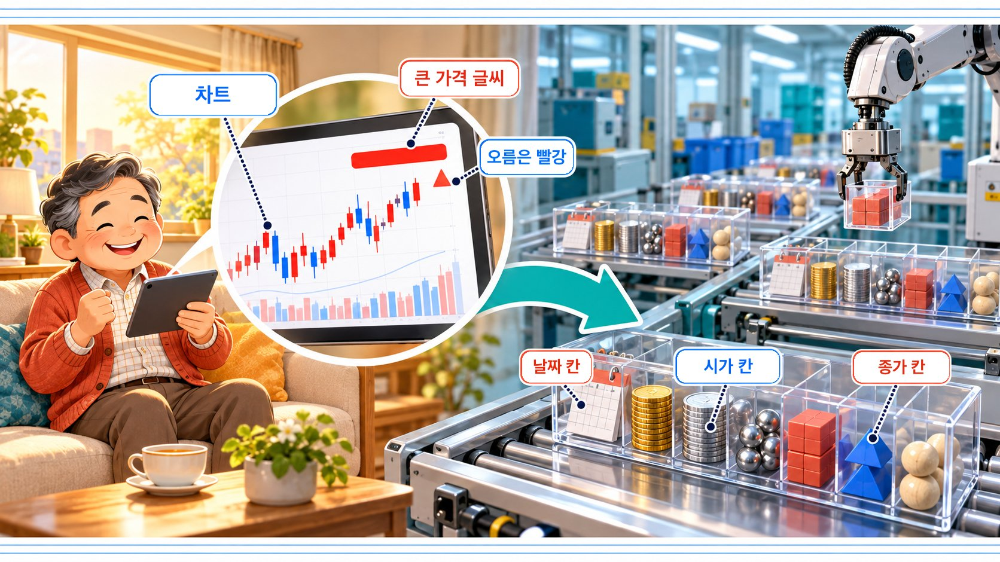

### 클릭 한 번이 지나가는 두 창구 (움직이는 그림 10-A)

사용자가 종목 목록에서 삼성전자를 누릅니다. 여기까지가 사람의 창구, UI입니다. 화면 프로그램이 이 클릭을 요청으로 바꿉니다. 「삼성전자(`005930`)의 일봉을 최근 날짜부터 달라」는 요청이고, 이 요청은 데이터 창고인 Supabase의 API 주소로 갑니다. 여기부터가 프로그램의 창구입니다. 창고는 날짜와 시가 · 고가 · 저가 · 종가가 이름표로 붙은 JSON 목록을 돌려줍니다. 색도 글씨 크기도 없습니다. 화면 프로그램이 이 목록으로 차트를 그리고, 가격을 큰 빨간 글씨로 씁니다. 이제 차트를 표로 바꿔 봅니다. **이번에는 창고에 다시 묻지 않습니다.** 이미 받은 목록을 다른 모양으로 그릴 뿐입니다. 사람은 요청 줄을 보지 않고, 창고는 차트의 색을 모릅니다. 두 창구의 경계가 여기입니다. → [움직이는 개념 노트에서 단계별로 보기](https://daehyub71.github.io/vibecoding-it-basics/notes/part2-4.html)

「표로 바꿔도 다시 묻지 않는다」는 코드에서 확인할 수 있습니다. 화면은 받은 시세를 `종목|주기|기간`이라는 열쇠로 보관하고(`web/app/page.tsx:53`), 이 열쇠가 바뀔 때만 다시 불러옵니다(`page.tsx:72~84`). 차트 · 표 선택(`view`)은 열쇠에 들어 있지 않아서, 같은 목록을 차트(`page.tsx:223`) 또는 표(`page.tsx:245`)로 그리기만 합니다.

## 3부. 화면만 보고 데이터를 가져오면

친구가 보내 준 시세 화면 캡처에서 프로그램이 숫자를 읽어 내야 한다면 어떨까요? 화면 배치가 조금만 바뀌어도 엉뚱한 숫자를 읽습니다. 같은 값을 이름표가 붙은 데이터(`"c": 217000`)로 받으면, 배치가 바뀌어도 같은 칸에서 같은 값을 꺼낼 수 있어 훨씬 단단합니다.

다만 모든 서비스가 API를 열어 주지는 않고, 열어 줘도 **이용 약관 · 부를 수 있는 횟수 제한 · 비용**이 따라옵니다. 기능만큼 이용 조건도 함께 읽습니다. 이 장의 직접 확인하기에서 쓰는 GitHub API도 부를 수 있는 횟수에 한도가 있습니다.

## 4부. 실제 저장소 읽기 — 시세판의 두 창구

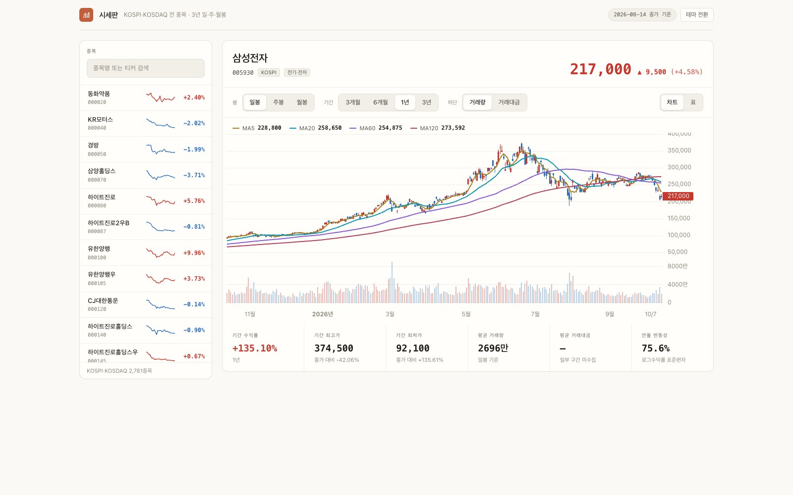

| 창구 | 주소 | 하는 일 |
| --- | --- | --- |
| 사람의 창구 | `krx-stock-charts.vercel.app` (Vercel) | 차트 · 표 · 단추가 있는 화면 |
| 프로그램의 창구 | Supabase의 REST 주소 `…/rest/v1/ksc_bars` 등 | 이름표가 붙은 JSON 목록 |

> 시세판 화면 주소는 구경만 하는 용도로 적었습니다. 이 자료의 실습은 시세판과 그 데이터 창고를 부르지 않습니다.

### 처음 받는 HTML에는 시세가 없다

재미있는 점이 있습니다. 화면 주소를 열었을 때 처음 받는 HTML(14,389바이트)에는 「삼성전자」라는 글자가 **0번** 나옵니다. 「불러오는 중…」이라는 문구만 있습니다(실측, 2026-10-28). 시세는 화면이 열린 뒤 브라우저가 API로 따로 받아 옵니다. 화면의 뼈대와 데이터가 서로 다른 창구에서 온다는 증거입니다.

### 같은 데이터, 두 창구

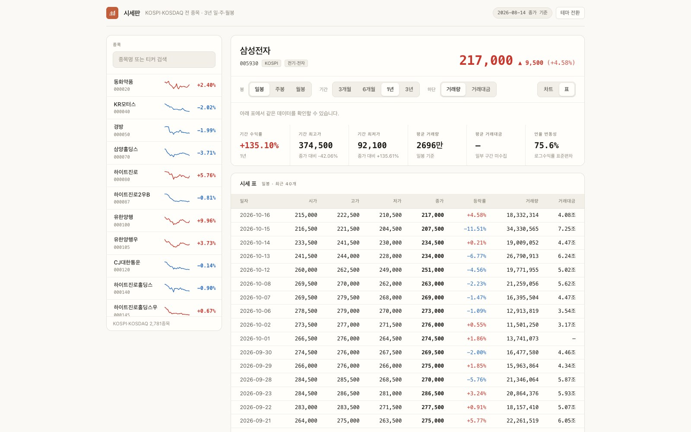

표 보기의 맨 위 줄은 2026년 10월 16일, 시가 215,000원, 종가 217,000원입니다. 같은 줄을 프로그램의 창구로 받으면 이렇게 생겼습니다(실측, 2026-10-28 · 데이터 주소는 줄임).

```text
GET …/rest/v1/ksc_bars?select=d,o,h,l,c,v,a&ticker=eq.005930&timeframe=eq.D&order=d.desc&limit=1

200
[{"d":"2026-10-16","o":215000,"h":222500,"l":210500,"c":217000,"v":18332314,"a":4084933131254}]
```

| 이름표 | 화면 표의 머리글 | 화면에 보이는 모양 |
| --- | --- | --- |
| `d` | 일자 | 2026-10-16 |
| `o` · `h` · `l` | 시가 · 고가 · 저가 | 215,000 · 222,500 · 210,500 |
| `c` | 종가 | **217,000**(굵게) |
| `v` · `a` | 거래량 · 거래대금 | 18,332,314 · 4.08조 |

화면이 받는 이름표는 `web/lib/load.ts:19`의 `BAR_COLUMNS = "d,o,h,l,c,v,a"`에 정해져 있고, 표의 머리글 「일자 · 시가 · 고가 · 저가 · 종가 · 등락률 · 거래량 · 거래대금」은 `web/components/DataTable.tsx:33`에, 숫자에 쉼표를 붙이는 일은 `DataTable.tsx:55~58`의 `won(b.o)` … `won(b.c)`에 있습니다. 등락률(+4.58%)은 JSON에 없습니다. 화면 코드가 바로 전 거래일(표에서 한 줄 아래)의 종가와 비교해 계산하고(`DataTable.tsx:48~49`), 오르면 빨강 · 내리면 파랑으로 칠합니다(`DataTable.tsx:59`).

**JSON에는 의미만 있고, 쉼표와 「원」, 빨간색 같은 표현은 화면 쪽 코드가 붙입니다. 데이터에는 의미만, 화면에는 표현만 담습니다.**

### 화면이 열리면 지나가는 요청들

강의 준비 때 개발자 도구의 **Network 탭**(8장)을 열고 시세판을 새로 고쳐 보니, 종목 목록과 시세를 받는 요청이 여러 줄 지나갔습니다(실측, 2026-10-28 · 주소는 줄임).

```text
200  ksc_tickers?select=ticker,name,market,sector&order=ticker.asc&offset=0&limit=1000
200  ksc_tickers?…&offset=1000&limit=1000
200  ksc_tickers?…&offset=2000&limit=1000
200  ksc_meta?select=value&key=eq.backfill
200  ksc_bars?select=d,o,h,l,c,v,a&ticker=eq.005930&timeframe=eq.D&order=d.desc&…
200  ksc_bars?select=ticker,d,c&timeframe=eq.W&ticker=in.(000020,000040,…)   × 여러 덩어리
```

종목 목록을 **1,000개씩 세 번** 나눠 받고 있습니다. 왜 나눠 받을까요? 이 창고는 한 번에 1,000줄까지만 돌려주기 때문입니다. 이 이야기는 7부에서 다시 봅니다.

### 같은 화면, 다른 날짜

화면 오른쪽 위의 배지는 「2026-08-14 종가 기준」이라고 말하는데, 표의 맨 위 줄은 2026-10-16입니다. 어느 쪽이 맞을까요?

| 확인한 것 | 내용 | 근거 |
| --- | --- | --- |
| 배지가 읽는 이름표 | 창고의 실행 기록(`ksc_meta`)에서 **`backfill`** — 과거 자료를 한꺼번에 채운 날 | `web/app/page.tsx:67~68` `loadMeta("backfill")` |
| 매일 갱신한 날 | 같은 실행 기록의 다른 이름표 **`update`** | `ksc_meta?key=eq.update` → `"updated": "2026-10-16"`(실측, 2026-10-28) |
| 표의 맨 위 줄 | 실제로 받은 시세의 가장 최근 날짜 | 2026-10-16 |

화면이 어느 이름표를 읽느냐에 따라 다른 날짜가 뜹니다. 그리고 `update` 기록을 보면, 이 자료를 만든 2026-10-28 기준으로 마지막 갱신은 10월 16일입니다. **평일 저녁마다 돌던 자동 갱신을 지금은 멈춰 두어서, 10-16 이후 기록이 없습니다.** 화면만 봐서는 이걸 알 수 없습니다. 화면은 살아 있어도 데이터는 멈춰 있을 수 있습니다. 이 앱처럼 실행 기록을 창고에 남겨 두면, 데이터가 언제까지 들어왔는지 API로 확인할 수 있습니다.

### AI에게 이렇게 물어 보세요 — 「API 설명해 줘」 대신 「화면 조작과 짝지어 줘」

AI에게 “이 앱의 API를 설명해 줘”라고만 하면, README의 목록을 옮긴 답이 돌아오기 쉽습니다. 대신 **화면의 조작 하나하나를 API 요청과 짝지어** 달라고 부탁합니다.

```text
아래 저장소의 코드를 기준으로 답해 줘. README와 코드가 다르면 코드를 따르고 다르다고 표시해 줘.
https://github.com/daehyub71/krx-stock-charts

1) 화면 조작(종목 누르기 · 일봉/주봉/월봉 · 기간 · 차트/표 전환)마다
   데이터 창고에 새로 묻는지, 묻는다면 어떤 이름표와 값으로 묻는지 표로 정리해 줘.
2) 줄마다 근거 파일 경로와 줄 번호를 적어 줘.
```

AI의 표를 받으면 줄 번호를 직접 열어 보고, 두 가지를 맞춰 봅니다.

1. **「차트 · 표 전환에도 요청이 나간다」고 하는가.** 틀린 답입니다. 보관 열쇠(`page.tsx:53`)에 보기 선택이 없으니 다시 묻지 않습니다(2부).
2. **「주기를 `daily`로 묻는다」고 하는가.** 창고에 물을 때는 `D`로 바꿉니다(`load.ts:79`, 10부).

그리고 키나 환경 설정 파일(`.env`)의 내용은 대화에 붙여 넣지 않습니다. 저장소 주소만 주면 됩니다.

## 5부. API는 메뉴판보다 주문 규칙 — API 명세

API를 식당 메뉴판에 빗대곤 합니다. 하지만 메뉴판은 무엇을 시킬 수 있는지만 알려 줍니다. API는 **주문서 양식과 접수 규칙**까지 정합니다. 어디로, 어떤 칸에, 어떤 값을 써서 보내면, 어떤 모양의 답이 오는지, 규칙에 안 맞으면 어떻게 반려되는지까지요.

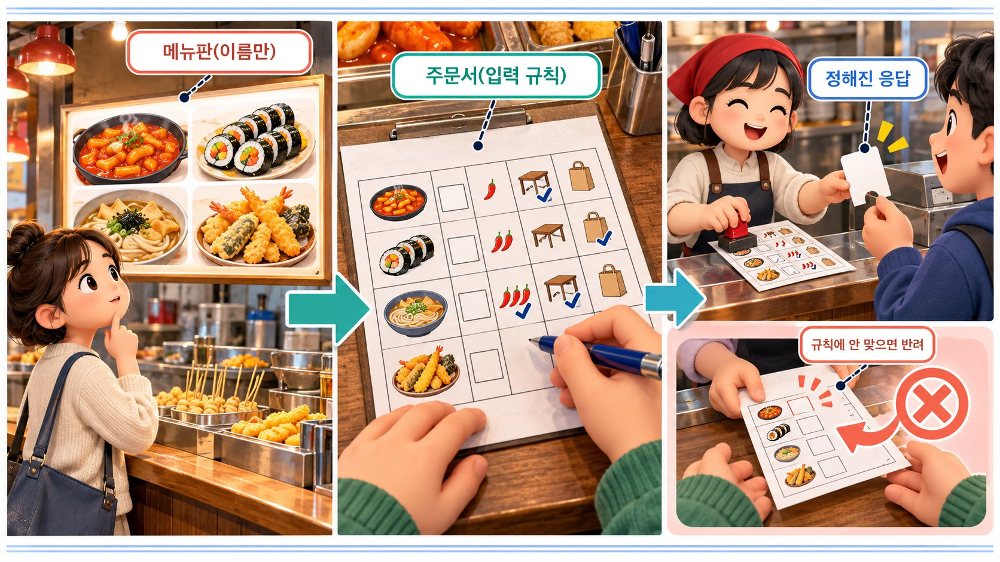

이 약속을 적어 둔 문서를 **API 명세**라고 합니다. 바이브코딩에서는 나와 AI가 같은 서비스를 같은 뜻으로 이해하는지 확인하는 기준 문서입니다.

| 명세의 종류 | 특징 | 시세판에서 |
| --- | --- | --- |
| 자동 문서 | 서버가 코드에서 명세를 자동으로 만들어 문서 화면으로 보여 준다 | 창고에도 자동 문서(`/rest/v1/`)가 있지만, 공개 키로 열면 **401** `Only the service_role API key can be used for this endpoint` — 관리자 키로만 열린다(실측, 2026-10-28) |
| 손으로 쓴 문서 | 사람이 직접 쓴다. 코드가 바뀌면 **사람이 따라 고쳐야** 한다 | `docs/SPEC.md`의 `ksc_bars` 절(70~89행) |

그래서 이 저장소에서 독자가 읽을 수 있는 명세는 손으로 쓴 `SPEC.md`입니다. 손으로 쓴 문서는 코드가 바뀌면 사람이 따라 고쳐야 한다는 점을 기억해 두세요. 10부에서 다시 나옵니다.

## 6부. 이름표는 계속 바뀐다

이 앱에서는 같은 값의 이름표가 세 번 바뀝니다.

```text
거래소 자료(KRX)        →   창고(ksc_bars)    →   화면 표 머리글
row["시가"]                 o                      시가
pipeline/krx_client.py:330  supabase/schema.sql:40  web/components/DataTable.tsx:33
```

창고는 저장 공간을 아끼려고 **짧은 이름**을, 화면은 사람이 읽기 좋은 **긴 이름**을 씁니다. 이름표를 바꾸는 자리마다 **약속이 하나씩** 생깁니다. 거래소가 「시가」라는 열 이름을 바꾸면 수집 프로그램이, 창고가 `o`를 바꾸면 화면 코드가 함께 고쳐져야 합니다.

### 같은 데이터, 여러 화면 (움직이는 그림 10-B)

왼쪽은 창고에서 받은 JSON 목록, 오른쪽은 이 목록을 쓰는 화면들입니다. 날짜와 시가 · 고가 · 저가 · 종가는 차트의 **촛대** 하나가 됩니다. 같은 목록이 표 보기에서는 **한 줄**이 되고, 전 거래일 종가와 비교해 등락률도 계산합니다. 왼쪽 종목 목록의 **작은 꺾은선**은 주봉의 종가만 씁니다(`load.ts:98` 기본 주기 `weekly`, `load.ts:117` `select("ticker,d,c")`). 이제 종가(`c`) 이름표를 지워 봅니다. 촛대와 표, 작은 꺾은선이 모두 망가집니다. 고가(`h`) 이름표를 지우면 촛대와 표만 다치고, 꺾은선은 멀쩡합니다. 이름표 하나에 어느 화면이 기대고 있는지 알면, 고칠 때 어디를 확인할지도 보입니다. → [움직이는 개념 노트에서 직접 지워 보기](https://daehyub71.github.io/vibecoding-it-basics/notes/part2-4.html)

## 7부. 요청은 화면이, 판정은 서버가

### UI의 품질, API의 품질

| | 품질 | 확인할 것 |
| --- | --- | --- |
| UI | 읽기 쉬움 · 누르기 편함 | 글자 대비가 충분한가, 키보드만으로도 조작할 수 있는가 |
| API | 정확함 · 한결같음 | 같은 값이 어떤 때는 숫자 `217000`, 어떤 때는 글자 `"217000"`으로 오면 받는 쪽이 매번 예외를 처리해야 한다(학습용 예) |

### 얼마나 줄지는 서버가 정한다

요청은 내가 해도, 얼마나 줄지는 서버가 정합니다. 이 앱의 창고는 2,000줄을 달라고 해도 **1,000줄만** 돌려줍니다. **오류도 없이 조용히요**(실측, 2026-10-28 · `limit=2000` 요청에 1,000줄).

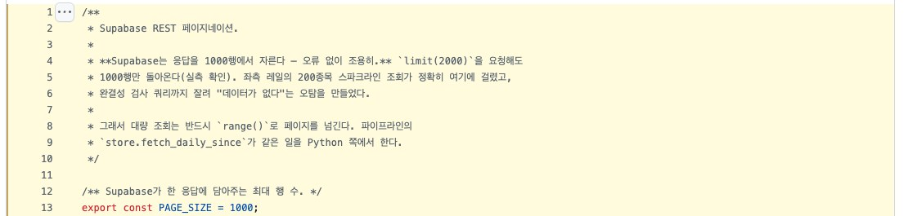

코드의 주석(`web/lib/paginate.ts:4~6`)에 그 실측이 적혀 있습니다. 이걸 몰랐을 때 왼쪽 목록의 작은 차트가 조용히 사라지고, 「데이터가 없다」는 엉뚱한 판단까지 나왔다고 합니다. 그래서 화면 코드는 두 가지로 대응합니다.

| 대응 | 하는 일 | 근거 |
| --- | --- | --- |
| 쪽 넘겨 받기 | 1,000줄씩 `range()`로 다음 쪽을 다시 요청하고, 받은 줄이 요청한 수보다 적으면 끝 | `paginate.ts:13` `PAGE_SIZE = 1000` · `:36~49` |
| 나눠 묻기 | 종목 2,700여 개를 한 주소에 다 넣으면 주소가 너무 길어 거절된다고 보고 **300개씩** 나눠 묻는다 | `load.ts:22~28` `SPARKLINE_TICKER_CHUNK = 300` |

두 번째 줄의 「거절된다」는 코드 주석의 판단입니다. 강의 준비 때 비슷한 길이의 주소를 `curl`로 보냈을 때는 200이 왔습니다(실측, 2026-10-28). **주석에 적힌 실측도 조건이 바뀌면 다시 재 봐야 합니다.**

### 요청은 화면이, 판정은 서버가 (움직이는 그림 10-C)

화면이 창고에 2,000줄을 달라고 요청합니다. 창고의 규칙은 한 번에 1,000줄입니다. 오류 없이 1,000줄만 돌아옵니다. 화면이 이것만 믿으면 뒤쪽 자료가 조용히 빠집니다. 그래서 화면 코드는 다음 쪽(`range(1000, 1999)`)을 다시 요청해 나머지를 받고, 받은 줄 수가 1,000줄보다 적으면 끝냅니다. 이번에는 누군가 공개 키로 시세를 고쳐 쓰려고 합니다. 창고의 규칙은 공개 키에는 **읽기만** 허락합니다. 자동 수집이 고가가 저가보다 낮은 이상한 줄을 저장하려 하면, 창고에 걸어 둔 **검사**가 마지막에 거절합니다. 화면에서 무엇을 허락하든, 마지막 판정은 서버가 합니다.

| 서버의 규칙 | 근거 | 확인 방법 |
| --- | --- | --- |
| 한 번에 1,000줄 | `paginate.ts:4~5` | 실측(2026-10-28) |
| 공개 키는 읽기만 | `supabase/schema.sql:154~155 · 178` 접근 규칙(RLS) 켬, `:190~196` 공개 키에는 `for select`(읽기)만 허락 | 저장소에 적힌 주장 — 「실제 DB에 쓰기를 시도해 차단을 확인했다」(`README_KO.md:46~47`, `web/lib/supabase.ts:4~5`). 쓰기 요청이라 이번에 시험하지 않음 |
| 가격은 0보다 크고, 고가 ≥ 시가 · 종가 ≥ 저가 | `schema.sql:53~55` 검사 규칙(CHECK) | 코드 읽기 |

검사는 두 겹입니다. 수집 프로그램의 `pipeline/validate.py`가 먼저 잘못된 줄을 진단해 기록하고, 창고의 검사 규칙이 최후의 방어선입니다(`validate.py:3~4`).

### 그래서 고칠 곳은

- **화면**은 서버의 규칙에 맞춰 요청합니다(1,000줄씩 쪽 넘기기).
- **서버**는 화면을 믿지 않고 계속 검사합니다(읽기만 허락, 검사 규칙).
- 실패나 잘림은 조용히 덮지 말고 **알립니다.** 화면이 채워져 있다고 API가 다 성공한 것은 아닙니다.

## 8부. UI 없이 API만 쓰는 프로그램

사람이 눌러야만 프로그램이 일하는 것은 아닙니다. 모두 퇴근한 저녁에도, 정해진 시각이 되면 수집 프로그램이 스스로 깨어납니다. 이 프로그램에게는 화면이 없습니다. 거래소 자료를 받아 창고에 쌓는 일만 합니다. **UI 없이 API만 쓰는 프로그램**입니다.

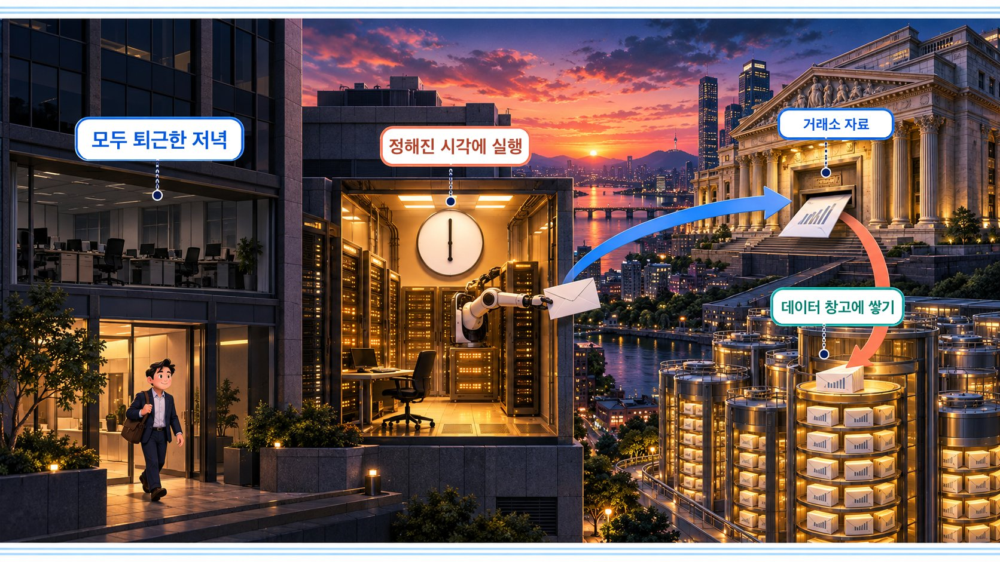

이 저장소에서는 **GitHub Actions**(GitHub이 정해진 시각에 프로그램을 대신 돌려 주는 기능)가 수집 프로그램을 돌리도록 적혀 있습니다.

```yaml
# .github/workflows/daily.yml (옮겨 적음)
on:
  schedule:
    - cron: "0 9 * * 1-5"    # 6행 — 평일 18:00 (한국 시간, 세계 표준시 09:00)
    - cron: "0 10 * * 6"     # 8행 — 토요일 19:00, 지난 자료가 바뀌었는지 검사
```

README에는 「두 층은 서로를 호출하지 않는다 — 만나는 곳은 DB 스키마뿐이다」라고 적혀 있습니다(`README_KO.md:7~8`). 화면과 수집 프로그램은 서로를 부르지 않고 창고의 표에서만 만납니다. **둘 사이의 약속은 표의 이름표뿐입니다.**

자동 프로그램이 정말 돌고 있는지는 저장소 글만 보고 알 수 없습니다. README에는 「GitHub Actions (평일 18:00 KST)」(`README_KO.md:62`)라고 적혀 있지만, 실제 마지막 실행일은 4부에서 본 것처럼 창고의 실행 기록(`update` → 2026-10-16)으로 확인합니다. **글은 계획을, 기록은 사실을 말합니다.**

## 9부. API 키 — 보여 줘도 되는 키, 숨길 키

API를 쓰다 보면 키를 발급받으라는 안내를 만납니다. 키는 **누가 부르는지 알아보고, 사용량을 세고, 할 수 있는 일을 정하는** 값입니다.

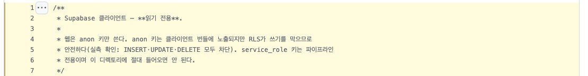

| 구분 | 공개 키 (anon) | 숨길 키 |
| --- | --- | --- |
| 무엇 | 화면이 창고를 읽을 때 쓰는 키 | 거래소 비밀번호(`KRX_PW`), 창고의 관리자 키(`SUPABASE_SERVICE_KEY`) |
| 누가 쓰나 | 브라우저의 화면 코드 | 수집 프로그램만(`pipeline/store.py:57~58`) |
| 어디에 두나 | 화면 코드에 들어가 브라우저로 간다 — 누구나 볼 수 있다 | GitHub의 비밀 저장소(Secrets)에서 넣어 준다(`daily.yml:73~76 · 90~93`) |
| 할 수 있는 일 | 읽기만(창고의 접근 규칙이 좁혀 둠) | 접근 규칙을 건너뛰고 쓰기까지 — 「브라우저에 절대 넣지 않는다」(`README_KO.md:82`, `docs/SPEC.md:114`) |


배포된 화면의 코드 묶음(번들)을 열어 보면 실제로 공개 키가 보입니다(실측, 2026-10-28 · 값은 적지 않습니다). 관리자 키의 흔적은 없었고, 저장소에도 비밀값이 평문으로 들어 있지 않습니다(설정 견본 `.env.example`은 값이 비어 있음). 공개 키가 「괜찮은」 이유는 키가 숨어서가 아니라, **그 키로 할 수 있는 일을 서버가 읽기만으로 좁혀 두었기 때문**입니다.

공개 키는 놀이공원 손목 팔찌와 비슷합니다. 보여 줘도 되지만, 들어갈 수 있는 곳이 정해져 있습니다. 비밀 키는 금고 비밀번호입니다. 몸으로 가리고 누르고, 화면 코드나 AI와의 대화에 붙여 넣지 않습니다. **이미 드러났다면 지우는 것으로 끝나지 않고, 발급한 곳에서 폐기하고 새로 받습니다.**

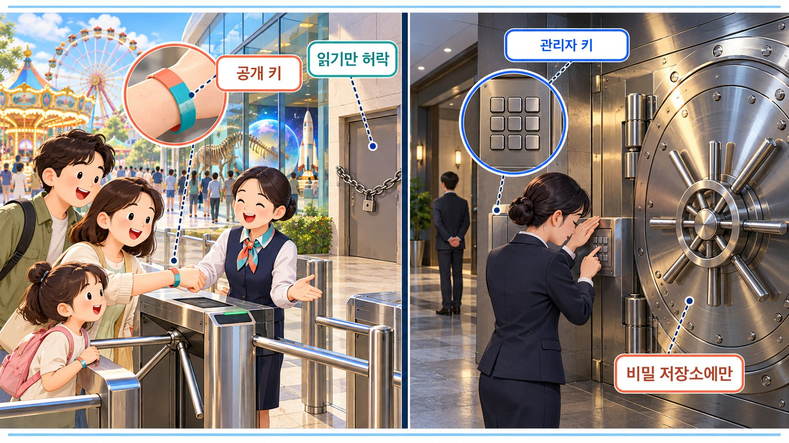

### 키 없이 부르면

키 없이 창고에 물으면 **401**과 함께 키를 찾을 수 없다는 답이 옵니다(실측, 2026-10-28).

```text
GET …/rest/v1/ksc_tickers   (apikey 머리글 없음)
401  {"message":"No API key found in request"}
```

이 앱의 화면은 그럴 때 「데이터를 불러오지 못했습니다」라는 제목과 함께, 설정 파일(`web/.env.local`)에 공개 키 설정 이름(`NEXT_PUBLIC_SUPABASE_ANON_KEY`)이 있는지 확인하라고 알려 줍니다(`web/app/page.tsx:116~125`). 화면이 실패를 숨기지 않고, 사람에게 **다음 할 일**을 알려 주는 좋은 예입니다.

## 10부. 200인데 빈 화면

이제 오늘의 질문으로 돌아갑니다. 서버는 200, 성공이라고 답했는데 차트가 비어 있습니다.

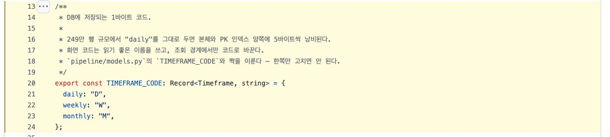

이 앱의 화면 코드는 사람이 읽기 좋은 `daily` · `weekly` · `monthly`를 쓰다가, 창고에 물을 때만 대문자 `D` · `W` · `M`으로 바꿉니다(`web/lib/types.ts:20~24`, 바꾸는 자리는 `load.ts:79`). 저장 공간을 아끼려고 창고에는 한 글자로 저장하기 때문입니다(`supabase/schema.sql:38` · `:51` `check (timeframe in ('D', 'W', 'M'))`). 주석에는 수집 프로그램의 같은 표(`pipeline/models.py:19`)와 짝을 이루니 **「한쪽만 고치면 안 된다」**고 적혀 있습니다(`types.ts:18`). 이름표를 바꾸는 자리마다 약속이 생긴다는 게 이런 뜻입니다.

### 명세서의 표는 아직 옛 이름

그런데 손으로 쓴 명세서 `docs/SPEC.md`의 표를 보면, 주기(`timeframe`) 칸에 아직 `daily` / `weekly` / `monthly`라고 적혀 있습니다.

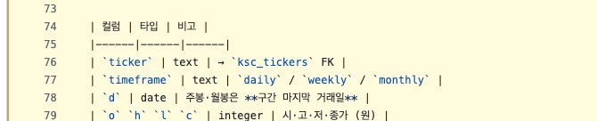

아래쪽 변경 기록에는 `D` / `W` / `M`으로 바꿨다고 따로 적혀 있지만, 위의 표는 고쳐지지 않았습니다.

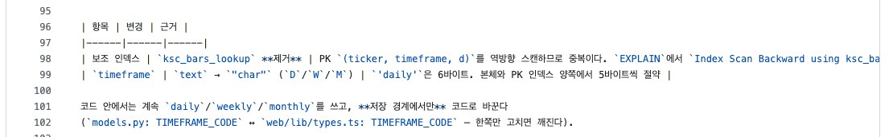

다른 프로그램이 이 표만 믿고 `daily`로 물으면 어떻게 될까요? 직접 물어보면 답은 **200, 성공**입니다. 그런데 본문은 **빈 목록 `[]`**입니다(실측, 2026-10-28). 오류가 아니라, `daily`라는 값을 가진 줄이 없을 뿐이라서요. 이 앱의 화면이 빈 목록을 받으면 차트 자리에 「표시할 봉이 없습니다」를 띄웁니다(`page.tsx:224~226`). 오류 문구가 아니라 차분한 안내라서, 보는 사람은 고장인 줄도 모르기 쉽습니다.

무인 택배 보관함에 빗대 봅시다. 기사님은 별 표시 칸에 상자를 넣었는데, 받는 사람은 안내문에 적힌 나뭇잎 칸을 엽니다. 칸은 비어 있습니다. 택배는 도착했습니다. 다른 이름의 칸을 열었을 뿐입니다.

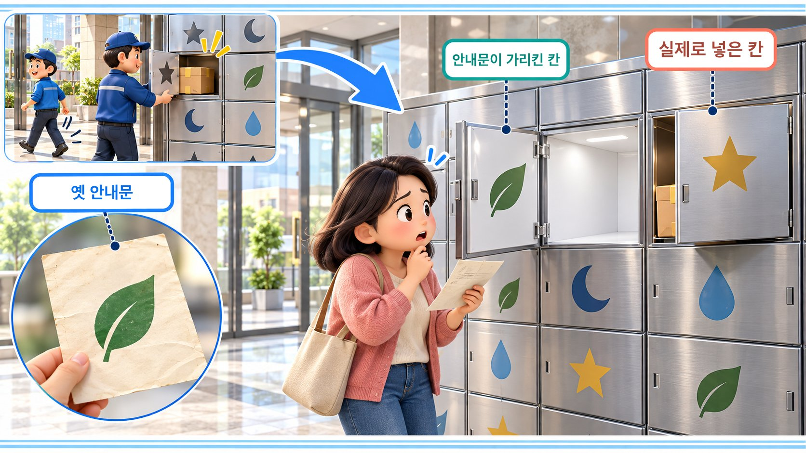

### 값이 틀리면 조용히, 이름이 틀리면 시끄럽게 (움직이는 그림 10-D)

같은 창고에 값만 바꿔 물어봅니다. 먼저 주기를 대문자 `D`로 물으면, 200과 함께 시세 목록이 옵니다. 차트가 그려집니다. 명세서의 표대로 `daily`로 물으면, 역시 200이 옵니다. 하지만 본문은 빈 목록이고 차트는 텅 빕니다. 상태 코드만 보면 둘 다 성공이라 차이가 안 보입니다. **응답 본문을 열어야 보입니다.** 이번엔 이름표를 틀려 봅니다. 종가를 `c` 대신 `close`라고 부르면, 400과 함께 그런 열은 없다는 오류가 옵니다. → [움직이는 개념 노트에서 세 요청 비교하기](https://daehyub71.github.io/vibecoding-it-basics/notes/part2-4.html)

| 보낸 요청(바꾼 곳만) | 상태 | 본문 | 화면 |
| --- | --- | --- | --- |
| `timeframe=eq.D` | 200 | 시세 목록 | 차트가 그려진다 |
| `timeframe=eq.daily` (명세서의 표대로) | **200** | **`[]`** | 텅 빈다 — 조용한 실패 |
| `select=d,close` (이름표 틀림) | **400** | `{"code":"42703","message":"column ksc_bars.close does not exist"}` | 오류 — 시끄러운 실패 |

(모두 실측, 2026-10-28)

값이 틀리면 조용히 비고, 이름이 틀리면 시끄럽게 실패합니다. **조용한 실패가 더 찾기 어렵습니다.** 그래서 200인데 화면이 비면, Network 탭에서 응답 본문을 열고, 화면 코드가 **보낸 값**과 **받은 이름표**를 나란히 놓아 봅니다.

### 어떻게 고치나

| | 하는 일 |
| --- | --- |
| 가장 나쁜 고침 | 실제 약속을 확인하지 않고 화면 코드만 계속 바꾸기 |
| 오래가는 고침 | 약속을 하나로 정하고 명세에 적기 — 이 경우라면 `SPEC.md`의 표를 `D` · `W` · `M`으로 고치고, 화면 쪽 이름(`daily` …)과의 짝을 함께 적어 둔다 |

## 11부. API 문서에서 다섯 곳만

API 문서가 길어도 다 읽을 필요는 없습니다. 다섯 곳만 먼저 찾습니다. 시세 조회(`ksc_bars`)로 채우면 이렇습니다.

| 찾을 곳 | 시세판의 시세 조회 | 근거 |
| --- | --- | --- |
| ① 주소 · 메서드 | `GET …/rest/v1/ksc_bars` | `web/lib/supabase.ts:12` |
| ② 보낼 값 | `select=d,o,h,l,c,v,a` · `ticker=eq.005930` · `timeframe=eq.D` · `order=d.desc` | `load.ts:73~82` |
| ③ 정상 응답 | `[{d, o, h, l, c, v, a}]` 목록 · `a`(거래대금)는 비어 있을(null) 수 있음 | `types.ts:42~47`, `SPEC.md:81` |
| ④ 오류 | 키 없음 **401** · 없는 이름표 **400** · 값이 틀리면 **오류 없이 `[]`** | 실측(2026-10-28) |
| ⑤ 키 · 사용량 | 공개 키로 **읽기만** · 한 번에 **1,000줄**까지 | `schema.sql:190~196`, `paginate.ts:13` |

④의 「오류 없이 빈 목록」까지 적어 두면, **이 표가 곧 계약서입니다.**

## 12부. AI에게 — 코드보다 계약서 먼저

새 기능을 AI에게 맡길 때도 코드보다 계약서를 먼저 받습니다. 예를 들어 관심 종목을 서버에 저장하는 기능을 새로 만든다고 해 봅시다(학습용 가정 — 이 저장소에는 없는 기능입니다).

```text
관심 종목을 서버에 저장하는 기능을 새로 만들고 싶어. 코드를 쓰기 전에 API 계약서부터 같이 정하자.

1) 필요한 창구마다 주소 · 메서드 · 보낼 값 · 정상 응답 예(JSON) · 오류 응답 예를 정리해 줘.
2) 화면이 읽을 이름표를 정확히 적고, 기존 시세 조회(ksc_bars)의 이름표 규칙과 맞춰 줘.
3) 화면에서 막을 입력과 서버에서 다시 검사할 입력을 나눠 적어 줘.

계약서를 내가 확인하기 전에는 코드를 만들지 마.
```

마지막 줄이 중요합니다. `daily`와 `D` 같은 어긋남은 **계약서 단계에서 잡을 때 가장 쌉니다.**

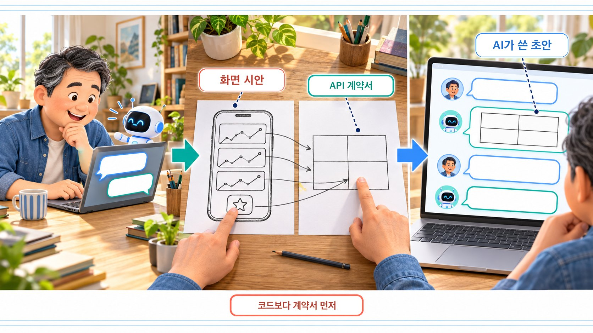

계약서를 받으면 화면 시안과 나란히 놓고, 단추 하나와 이름표 하나를 손가락으로 짚어 가며 맞춰 봅니다. AI가 쓴 계약서는 초안입니다. 이름표 하나하나가 화면의 어디에 쓰이는지 사람이 확인합니다. 3)의 「서버에서 다시 검사할 입력」이 비어 있으면, 7부의 「판정은 서버가」를 들어 다시 물어봅니다.

## 직접 확인하기

시세판과 그 데이터 창고는 부르지 않습니다. **GitHub 저장소 하나를 두 창구로** 열어 비교합니다.

| 실습 | 시간 | 할 일 |
| --- | --- | --- |
| A. 같은 저장소, 두 창구 | 5분 | 저장소 페이지(사람의 창구)와 `api.github.com`(프로그램의 창구)을 나란히 열기 |
| B. 이름표 ↔ 화면 짝짓기 | 5분 | JSON 이름표 다섯 개가 페이지의 어디에 보이는지 찾고, 설명과 실제를 맞춰 보기 |
| C. 이름이 틀리면 | 3분 | 저장소 이름에 오타를 내 404와 본문 보기 · 부를 수 있는 횟수 머리글 보기 |
| D. AI 설명 교정하기 | 5분 | “200이면 정상” · “키는 모두 숨겨야 한다”를 이 장의 근거로 바로잡게 하기 |

> GitHub API는 키 없이 부르면 부를 수 있는 횟수에 한도가 있습니다. 2026-10-28 응답 머리글은 `x-ratelimit-limit: 60`이었습니다(GitHub 문서 기준 한 시간에 60번). 새로 고침이나 같은 명령을 반복하지 마세요.

### 실습 A — 같은 저장소, 두 창구

1. 브라우저에서 [github.com/daehyub71/krx-stock-charts](https://github.com/daehyub71/krx-stock-charts)를 엽니다. 사람의 창구입니다.
2. 새 탭에서 [api.github.com/repos/daehyub71/krx-stock-charts](https://api.github.com/repos/daehyub71/krx-stock-charts)를 엽니다. GitHub의 프로그램 창구입니다. 디자인 없이 이름표와 값이 수십 줄 나옵니다(2026-10-28 응답은 108줄, 이름표 84개).

터미널로 같은 주소를 불러도 됩니다.

**윈도우 · PowerShell**

```text
> curl.exe https://api.github.com/repos/daehyub71/krx-stock-charts
```

**맥 · 터미널** — `curl https://api.github.com/repos/daehyub71/krx-stock-charts`

윈도우에서는 `curl`이 아니라 `curl.exe`로 씁니다(PowerShell에서 `curl`은 다른 명령의 별명일 수 있습니다). 응답에서 몇 줄만 옮기면 이렇습니다(실행 예, 2026-10-28, 줄임).

```text
{
  "name": "krx-stock-charts",
  "full_name": "daehyub71/krx-stock-charts",
  "html_url": "https://github.com/daehyub71/krx-stock-charts",
  "description": "KOSPI200 3-year daily/weekly/monthly candlestick charts — KRX collection pipeline (pykrx + Supabase) and Next.js dashboard",
  "language": "Python",
  "visibility": "public",
  "default_branch": "main",
  ...
}
```

같은 저장소를 사람은 파일 목록과 README가 있는 페이지로, 프로그램은 이름표가 붙은 JSON으로 받습니다. 시세판의 표와 JSON(4부)과 같은 관계입니다.

### 실습 B — 이름표 ↔ 화면 짝짓기

JSON의 이름표가 첫 탭의 어디에 보이는지 찾아 표를 채웁니다.

| JSON 이름표 | 값(2026-10-28) | 첫 탭에서 보이는 곳 |
| --- | --- | --- |
| `name` | `krx-stock-charts` | (직접 찾기) |
| `description` | `KOSPI200 3-year …` | (직접 찾기) |
| `default_branch` | `main` | (직접 찾기) |
| `language` | `Python` | (직접 찾기) |

`description`을 찾았다면 내용을 읽어 봅니다. 설명에는 **KOSPI200**이라고 적혀 있는데, 저장소 README 첫 줄은 「KOSPI · KOSDAQ **전 종목**」이라고 말하고(`README_KO.md:5`), 화면도 전 종목을 보여 줍니다. 저장소 설명이 앱이 커진 뒤에도 고쳐지지 않은 것입니다. 10부의 명세서 표와 같은 모양의 어긋남입니다. **글로 쓴 설명은 늦을 수 있으니, 실제와 맞춰 봅니다.**

### 실습 C — 이름이 틀리면

저장소 이름 끝 글자에 오타를 내서 불러 봅니다. `-i`는 응답의 머리글까지 보여 달라는 뜻입니다.

**윈도우 · PowerShell**

```text
> curl.exe -i https://api.github.com/repos/daehyub71/krx-stock-chartz
HTTP/2 404
...
{
  "message": "Not Found",
  "documentation_url": "https://docs.github.com/rest/repos/repos#get-a-repository",
  "status": "404"
}
```

**맥 · 터미널** — `curl -i https://api.github.com/repos/daehyub71/krx-stock-chartz`

(실행 예, 2026-10-28, 머리글은 줄임) 주소의 이름이 틀리면 GitHub API는 **404와 함께 이유를 본문에 담아** 시끄럽게 알려 줍니다. 본문의 `documentation_url`은 이 창구의 명세가 있는 곳입니다. 올바른 주소에 `-i`를 붙이면 머리글의 `x-ratelimit-limit`(부를 수 있는 횟수) · `x-ratelimit-remaining`(남은 횟수)도 보입니다. 3부의 「이용 조건」을 응답에서 직접 보는 셈입니다.

### 실습 D — AI 설명 교정하기

AI에게 “API 응답이 200이면 화면도 정상인 거지?”와 “API 키는 모두 숨겨야 하지?”를 물어봅니다. 답이 「그렇다」 쪽이면, 이 장의 근거로 교정하게 합니다. 앞의 것은 `timeframe=eq.daily` → 200 + `[]`(10부), 뒤의 것은 `web/lib/supabase.ts:4~6`의 공개 키와 `schema.sql:190~196`의 읽기 전용 규칙(9부)을 들어 되묻습니다.

## 오해 바로잡기

| 오해 | 바로잡기 |
| --- | --- |
| API는 예쁜 화면이 없는 덜 만든 웹사이트다 | 프로그램을 위한 창구라는 따로 된 목적이 있다. 이름표와 형식이 정확한 것이 API의 품질이다 |
| 200이 오면 화면도 정상이어야 한다 | 값이 어긋나면 200인데도 화면이 빈다(`timeframe=eq.daily` → 200 + `[]`) |
| 화면이 채워져 있으면 API도 성공했다 | 1,000줄에서 잘린 목록도 화면은 그럴듯하게 그린다. 데이터가 멈춰 있어도 화면은 멀쩡하다 |
| 키는 모두 숨겨야 한다 | 브라우저용 공개 키처럼 보여도 되게 만든 키가 있다. 대신 그 키로 할 수 있는 일을 서버가 좁혀 둔다 |
| 명세서에 적힌 대로 부르면 된다 | 손으로 쓴 명세는 코드보다 늦을 수 있다(`SPEC.md:77`). 응답으로 확인한다 |

## 한 장 요약

| 기억할 질문 | 한 문장 답 |
| --- | --- |
| UI는? | 사람의 창구 — 보고 · 누르고 · 입력한다. 품질은 읽기 쉬움과 누르기 편함 |
| API는? | 프로그램의 창구 — 어디로 · 무엇을 보내면 · 무엇이 오는지의 약속. 품질은 정확함과 한결같음 |
| JSON 이름표는? | 데이터에는 의미만, 화면에는 표현만. 이름표를 바꾸는 자리마다 약속이 생긴다 |
| API 명세는? | 이름표 · 값 · 오류 · 키를 적은 계약서. 손으로 쓰면 사람이 따라 고쳐야 한다 |
| 200인데 빈 화면이면? | 응답 본문의 이름표와 값을 본다. 값이 틀리면 조용히 비고, 이름이 틀리면 시끄럽게 실패한다 |
| 누가 판정하나? | 얼마나 줄지, 무엇을 허락할지는 언제나 서버가 정한다 |
| 예제 시세판은? | 화면(Vercel)과 데이터(Supabase)가 다른 창구. `daily` ↔ `D`가 갈리고, 명세서 표는 옛 이름, 창고는 1,000줄에서 자르고, 공개 키는 읽기만 |

## 확인 문제

1. UI와 API가 둘 다 「인터페이스」라고 불리는 이유는?
2. 차트를 표로 바꿀 때 데이터 창고에 다시 묻지 않는 이유는?
3. 주기를 `daily`로 물었더니 200인데 차트가 비었다. 무엇을 봐야 하나?
4. 화면 코드에 든 공개 키가 괜찮다고 하려면 어떤 조건이 필요한가?
5. 2,000줄을 요청했는데 1,000줄이 왔다. 오류가 없으니 정상인가?

<details>
<summary>풀이 보기</summary>

1. **인터페이스는 서로 다른 두 쪽이 만나 주고받는 경계(접점)**이기 때문이다. UI는 사람과 프로그램이 만나는 접점(단추 · 메뉴 · 입력창)이고, API는 프로그램과 프로그램이 만나는 접점(주소 · 보낼 값 · 돌아오는 응답의 약속)이다. 만나는 상대가 다를 뿐, 둘 다 정해진 방식으로 주고받는 자리다.
2. 표는 **이미 받은 같은 목록을 다른 모양으로 그린 것**일 뿐이기 때문이다. 화면은 받은 시세를 `종목|주기|기간` 열쇠로 보관하고(`page.tsx:53`), 이 셋이 바뀔 때만 다시 불러온다(`page.tsx:72~84`). 차트 · 표 선택은 열쇠에 없어서, 같은 목록을 차트(`page.tsx:223`)나 표(`page.tsx:245`)로 그리기만 한다. 데이터에는 의미만, 화면에는 표현만 담는다는 원칙이 그대로 드러나는 장면이다.
3. 상태 코드가 아니라 **응답 본문**을 본다. 본문이 빈 목록 `[]`이면 오류가 아니라 그 값을 가진 줄이 없다는 뜻이다. 다음으로 **보낸 값**(`timeframe=eq.daily`)과 **창고에 저장된 값**(`D` · `W` · `M`, `schema.sql:51`)을 나란히 놓는다. 화면 코드는 `daily`를 `D`로 바꿔 묻는데(`types.ts:20~24`, `load.ts:79`), 손으로 쓴 명세서의 표(`SPEC.md:77`)는 아직 `daily`라서 이 표를 믿고 부른 프로그램은 빈 목록을 받는다. 고칠 곳은 화면 코드가 아니라 약속 — 명세서의 표다.
4. **그 키로 할 수 있는 일을 서버가 좁혀 두어야 한다.** 시세판은 창고의 접근 규칙(RLS)을 켜고(`schema.sql:154~155 · 178`) 공개 키에는 읽기(`for select`)만 허락한다(`schema.sql:190~196`). 그리고 쓰기가 실제로 막히는지 확인해 두어야 한다 — 저장소는 「실제 DB에 쓰기를 시도해 차단을 확인했다」고 적어 두었다(`README_KO.md:46~47`). 쓰기까지 할 수 있는 관리자 키는 화면 코드에 넣지 않고 GitHub의 비밀 저장소에만 둔다(`daily.yml:73~76`).
5. **아니다.** 이 창고는 한 번에 1,000줄까지만 돌려주고, 더 달라고 해도 오류 없이 잘라서 준다(`paginate.ts:4~5`, 실측 2026-10-28). 오류가 없다고 다 받은 것이 아니다. 받은 줄 수가 요청한 수와 같으면 뒤에 더 있을 수 있으니, `range()`로 다음 쪽을 다시 요청하고 받은 줄이 요청한 수보다 적을 때 멈춘다(`paginate.ts:36~49`).

</details>

## 다음 시간

Part2-5 HTML · CSS · JavaScript — 화면을 만드는 세 가지 재료. 오늘은 사람의 창구와 프로그램의 창구를 나눴습니다. 시세판의 화면도 처음 받는 HTML에는 「불러오는 중…」뿐이었고, 그 뒤 JavaScript가 API로 시세를 받아 차트와 표를 그렸습니다. 다음 시간에는 사람의 창구인 화면이 무엇으로 만들어지는지, HTML과 CSS, JavaScript의 역할을 나눠 봅니다.

## 출처

- [daehyub71/krx-stock-charts](https://github.com/daehyub71/krx-stock-charts) 커밋 `b604b35`(2026-09-23 커밋 · 2026-10-28 확인) — `web/lib/load.ts`(19 · 22~28 · 73~82 · 79 · 93~94 · 98 · 117 · 120 · 143~152행), `web/lib/types.ts`(13~24 · 34~36 · 42~47행), `web/lib/paginate.ts`(1~13 · 36~49행), `web/lib/supabase.ts`(1~7 · 12행), `web/app/page.tsx`(53 · 67~68 · 72~84 · 116~125 · 223~226 · 245행), `web/components/DataTable.tsx`(33 · 48~49 · 55~59행), `docs/SPEC.md`(70~89 · 96~102 · 111~115행), `supabase/schema.sql`(38 · 40 · 51 · 53~55 · 154~155 · 178 · 190~196행), `pipeline/models.py`(19행), `pipeline/krx_client.py`(1 · 330~331행), `pipeline/validate.py`(1~5행), `pipeline/store.py`(57~58행), `.github/workflows/daily.yml`(6 · 8 · 73~76 · 90~93행), `README_KO.md`(5 · 7~8 · 46~47 · 62 · 82행)
- 실측(2026-10-28, 맥에서 `curl` · 모두 읽기 GET): 화면 주소 200 · HTML 14,389바이트 · 「삼성전자」 0건. Supabase REST — `ksc_bars` `timeframe=eq.D` → 200 시세 목록(첫 줄 2026-10-16 · 215,000 / 222,500 / 210,500 / 217,000 / 18,332,314) · `timeframe=eq.daily` → 200 `[]` · `select=d,close` → 400(42703) · `limit=2000` → 1,000줄 · 키 없음 → 401 · `/rest/v1/` 자동 문서 → 401(service_role만) · `ksc_meta` `update` → 2026-10-16 · 약 19.5KB 길이의 종목 목록 주소 → 200. Network 탭의 요청 목록은 같은 날 브라우저에서 본 것입니다. 공개 키와 데이터 주소의 값은 적지 않았습니다
- 실측(2026-10-28, 맥에서 `curl`): `api.github.com/repos/daehyub71/krx-stock-charts` → 200 · 108줄 · `x-ratelimit-limit: 60` · `description` 「KOSPI200 3-year …」. 오타 주소(`krx-stock-chartz`) → 404 `"message": "Not Found"`. 윈도우 출력은 형식을 보여 주는 예입니다
- 상태: 자동 갱신은 저장소 주인이 일부러 멈춰 둔 상태입니다(2026-10-28 확인). 그래서 2026-10-16 이후 시세가 없습니다. 배지(`backfill` 날짜)와 표(최근 시세)의 날짜 차이는 관찰로만 다뤘습니다
- 한계: 공개 키의 쓰기 차단은 저장소에 적힌 주장(`README_KO.md:46~47`, `supabase.ts:4~5`)으로, 쓰기 요청이라 시험하지 않았습니다. 「긴 주소는 400」(`load.ts:24~25`)은 주석의 주장이고 `curl`로는 200이었습니다(원인 미확인). GitHub Actions 실행 기록은 보지 않았습니다. 화면 제목(`web/app/layout.tsx:16`)과 저장소 설명의 「KOSPI200」, `SPEC.md:113`의 「세 테이블」(실제 여섯)은 문서가 늦은 예입니다
- 학습용 예시: 은행 창구 · 식당 메뉴판과 주문 규칙 · 놀이공원 팔찌와 금고 비밀번호 · 무인 택배 보관함 비유, 7부의 `217000` / `"217000"` 예, 12부의 관심 종목 저장 기능(이 저장소에 없음)
