# 바이브코딩 실전 T1 강의 자료 — GitHub 스타로 AI 트렌드 읽기

> 바이브코딩 실전 · T1 · AI와 함께한 닷새(2026-10-26 ~ 30)

## 강의 소개

이번 강의는 개념 설명이 아니라 **제작기**입니다. GitHub에서 한 주 동안 별(스타)을 많이 받은 AI 저장소를 매주 모아 순위와 해설 카드, 블로그 초안까지 만들어 주는 서비스를 AI와 함께 닷새 동안 만들었습니다. 만든 순서 그대로 따라가며, AI에게 일을 맡길 때 **사람이 무엇을 정하고, 무엇을 재고, 무엇을 코드에 지키게 했는지**를 봅니다. 실수한 장면도 빼지 않았습니다.

**핵심 질문** AI와 닷새 만에 만든 서비스를 어떻게 믿을 수 있을까요? 에러 메시지가 하나도 없었는데 저장소 641개가 조용히 사라졌다면, 무엇으로 알아챌 수 있을까요?

| 항목 | 주소 |
| --- | --- |
| 강의 영상 | [바이브코딩 실전 T1 | GitHub 스타로 AI 트렌드 읽기 — 힘센 AI에 마구를 채우는 하네스 엔지니어링](https://youtu.be/gu_lmreCIOE) · [블로그 글](https://blog.naver.com/dayhyub/224459441505) |
| 완성 사이트 | [github-ai-star-trend.vercel.app](https://github-ai-star-trend.vercel.app/) — 매주 월요일 아침 갱신 |
| 예제 저장소 | [github.com/daehyub71/github-ai-star-trend](https://github.com/daehyub71/github-ai-star-trend) — GitHub AI 스타 트렌드 |
| 움직이는 개념 노트 | [움직이는 그림 4개](https://daehyub71.github.io/vibecoding-it-basics/notes/t1.html) — 단계 넘기기 · 재생 |
| 강의 목차 | [강의 목차](https://daehyub71.github.io/vibecoding-it-basics/) — 39편 + 실전편 |

**예제 저장소를 고른 이유** 작은 프로젝트인데 **실제 데이터**(저장소 6만 6천 개), **실제 돈**(Claude API 사용료), **실제 버그**(에러 없이 사라진 641개)가 다 들어 있고, 정한 것 · 잰 것 · 진도가 `docs/`에 날짜와 함께 남아 있어 숫자를 직접 맞춰 볼 수 있습니다. 확인 기준은 커밋 `2134a00`(2026-10-30)입니다.

**공부하는 순서** 왜 만들었는지와 완성품을 보고 → 정하기 · 하네스 · 재기 · 테스트 → 첫 실행의 버그와 멈춘 소급 → 급등 표시와 분류 채점 · JEV → 근거 · 카드 · 화면 · 자동 실행 → 돈과 열쇠 순으로 가고, 마지막에 자기 프로젝트에서 직접 해 봅니다.

**이 자료의 표시 규칙** 저장소 문서와 코드에서 읽은 것은 `파일 §절` 또는 `파일:줄`로, 만든 사람이 재서 `MEASURE.md`에 남긴 값은 「실측」과 날짜로, 영상과 제작 원고에만 있는 만든 사람의 생각은 「제작 의도」로, 설명하려고 지어낸 예는 「학습용」으로 적습니다.

> **실습 안내** 예제 저장소의 명령은 여러 서비스의 키가 있어야 하고 일부는 돈이 듭니다. 이 자료의 숫자는 모두 만든 사람이 잰 값이고, 독자 실습은 **자기 프로젝트에서, 비용 0으로** 합니다. 남의 서비스에 무엇을 쓰거나 고치는 요청은 보내지 않습니다.

## 0부. 왜 만들었나

### 스타는 관심의 흔적

요즘 AI 쪽은 일주일만 지나도 새 이름이 쏟아집니다. 새 개념은 X(옛 트위터)의 글에서 먼저 돌고, 그 개념을 구현한 결과물은 GitHub에 올라와 사람들이 별을 눌러 줍니다(제작 의도). 그래서 오픈소스의 본고장인 GitHub에서 **별을 많이 받은 저장소를 매주 모아 흐름을 보고**, MCP나 라이브러리처럼 업무에 쓸 만한 것은 먼저 가져다 써 보기로 했습니다.


별은 「이 저장소를 눈여겨본다」는 표시입니다. 수만 명이 누르면 관심이 어디로 쏠리는지 보입니다. 이것을 매주 아침 신문처럼 받아 보고, 좋은 자료면 블로그에 같이 공유하자는 것이 출발점이었습니다. 다만 **스타는 관심의 신호이지 사용량이 아니라서**, 실제로 쓰이는지는 활용 사례와 다운로드 수로 따로 봅니다(`docs/SPEC.md §1-2`).

### 라이브를 멈추고 방식을 바꿨다

그동안은 라이브로 코딩하고 그 영상을 편집해 올렸습니다. 그러다 보니 한두 시간 안에 끝나는 주제만 고르게 됐고, 길어지면 지치고 마음이 급해져 AI가 쓴 내용을 제대로 읽지 않고 넘어가곤 했습니다(제작 의도).

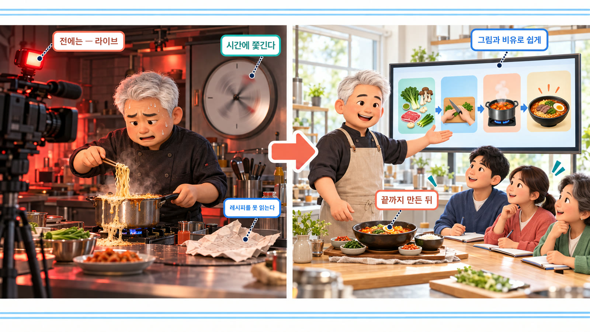

그래서 이번에는 **서비스를 먼저 끝까지 만들고**, 그 제작 과정을 그림과 생활 비유로 쉽게 풀었습니다. 손님 앞에서 급히 라면을 끓이던 방식에서, 요리를 다 해 두고 요리 교실처럼 보여 주는 방식으로 바꾼 셈입니다.

### 먼저 완성품부터

매주 월요일 아침, 지난 한 주 동안 별을 많이 받은 AI 저장소 순위가 사이트에 올라옵니다. 저장소마다 「무엇인가 · 왜 지금 떴나 · 어디에 쓰나」를 정리한 카드가 붙고, 네이버 블로그에 올릴 글의 초안이 Notion에 쌓입니다.

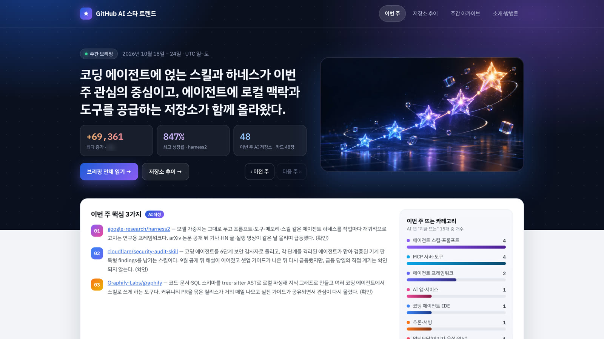

사이트([github-ai-star-trend.vercel.app](https://github-ai-star-trend.vercel.app))는 주소를 아는 사람은 누구나 볼 수 있지만 검색엔진에는 뜨지 않게 해 두었습니다(`docs/SPEC.md:112` 결정 56).

| 날 | 한 일 |
| --- | --- |
| 10-26 | 기획 토론 · 설계 문서 · 하네스 검토 · 실측 · 첫 발굴(641개 누락) · 4주 시험 · 52주 소급 시작 |
| 10-27 | 소급 멈춤과 수리 · 블라인드 30 · 근거 출처 조사 · 저장소 공개 · 52주 소급 끝 |
| 10-28 | 정답 세트 200 · 분류 보정 · JEV 빼기 · 52주 전수 분류 · 카드 · 브리핑 시범 |
| 10-29 | 카드 48장 · 사이트 · 비공개 저장소 · GitHub Actions · 사이트 공개 · Notion |
| 10-30 | 블로그 초안 → 11-02(월) 첫 자동 실행 대기 |

닷새 동안 커밋은 94개입니다(`git log`).

## 1부. 아이디어를 산출물로

처음 생각은 「별 많이 받은 저장소를 보고 싶다」였습니다. 그런데 **보고 싶다는 건 아직 만들 물건이 아닙니다.** 무엇이 나와야 끝난 것인지가 없으니까요. AI와 이야기하면서 만들 것을 **주간 AI 트렌드 브리핑**과 그 근거가 되는 **저장소 카드**(주장마다 출처 링크) 두 가지로 다시 정했습니다(`docs/SPEC.md §1`). 순위도 네 갈래(4축)로 나눴습니다(`docs/SPEC.md` 결정 2).

| 축 | 무엇을 보나 |
| --- | --- |
| 기간 증가량 | 이번 주에 별을 가장 많이 받은 곳 |
| 신규 저장소 | 새로 태어나 뜨는 곳(생성 30일 이내) |
| 규모 대비 성장률 | 덩치에 비해 빨리 크는 곳 |
| 누적 | 오래 쌓인 별 순위 |

「보고 싶다」를 「무엇을 받으면 끝인가」로 바꾸면 완성 기준이 생깁니다.

## 2부. 토론으로 정하고, 문서로 남기기

이 프로젝트에는 처음부터 규칙이 하나 있었습니다. **AI가 혼자 정하지 않는다.** 갈림길마다 AI는 선택지와 장단점을 내놓고, 고르는 건 사람이 합니다. 바로 정할 수 없는 것은 `D-번호`를 붙여 미뤄 두고 무엇을 막고 있는지 적어 둡니다(`docs/SPEC.md §9`). 정한 것은 날짜와 이유를 붙여 남기는데, 닷새 동안 결정 번호가 **63번**까지 쌓였습니다(`docs/SPEC.md §2`). 코드와 문서가 서로 다른 말을 하면 문서가 기준입니다.


| 문서 | 담는 것 |
| --- | --- |
| 명세서 `SPEC.md` | 무엇을 만들지 · 정한 것과 이유 · 하지 않을 것 |
| 계획서 `PLAN.md` | 어떤 순서로 만들지(Phase 0 ~ 5) |
| 체크리스트 `TASK.md` | 오늘 할 일과 진도 — 맨 위 진도율 대시보드 |

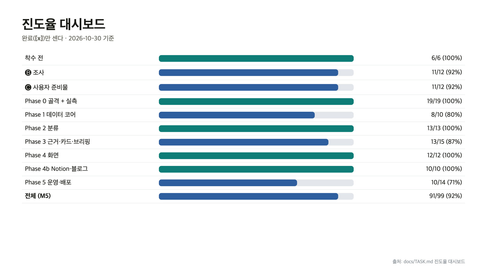

결정 기록에는 **버린 선택지**도 함께 적혀 있습니다(예: 결정 49, `docs/SPEC.md:101`). 나중에 「왜 이렇게 했지?」 하고 다시 열었을 때, 고른 것만큼 버린 것이 중요합니다.

### AI에게 이렇게 물어 보세요 — 「만들어 줘」 대신 「골라 줄 수 있게 펼쳐 줘」

“이거 만들어 줘”라고만 하면 AI가 갈림길을 말없이 지나가 버립니다. 갈림길을 먼저 펼쳐 달라고 합니다.

```text
아래 아이디어로 작은 서비스를 만들려고 해. 아직 코드는 쓰지 마.

아이디어: (한두 줄)

1) 만들기 전에 정해야 할 갈림길을 모두 찾아서, 갈림길마다 선택지 2~3개와 장단점을 표로 정리해 줘.
2) 각 갈림길에 "지금 정해야 함 / 재 보고 정해야 함 / 미뤄도 됨"을 붙여 줘.
3) 재 보고 정해야 하는 것은 돈이 들지 않는 측정 방법을 같이 적어 줘.

결정은 내가 할게. 내가 고른 것은 날짜·이유·버린 선택지와 함께 SPEC.md에 적어 줘.
```

받은 표에서 **장단점이 한쪽으로만 기울지 않았는지**, 규모나 비용 같은 갈림길에 **「재 보고 정해야 함」이 붙었는지** 봅니다.

## 3부. 하네스 엔지니어링 — AI에 마구를 채운다

이번에 꼭 넣고 싶었던 방법이 **하네스 엔지니어링**입니다(제작 의도). 하네스(harness)는 말에 채우는 마구입니다. 힘센 말도 마구가 없으면 엉뚱한 데로 달려가듯, AI도 힘이 좋은 만큼 방향을 잡아 줄 장치가 필요합니다.


이 저장소는 첫날 하네스 검토 뒤 세 가지를 넣기로 정했습니다(`docs/SPEC.md:118` 결정 25).

| 마구 | 하는 일 | 근거 |
| --- | --- | --- |
| 규칙은 코드가 지킨다 | 사람이 기억하는 대신 테스트와 커밋 전 검사가 강제 | NFR-14(`docs/SPEC.md:476`) |
| 평가 하네스(채점판) | 정답 세트로 AI의 판정을 숫자로 채점 | FR-14(`docs/SPEC.md:268~280`) |
| 바깥 서비스 약속 점검 | 매주 실행 첫 단계에서 GitHub 응답 모양이 가정과 맞는지 확인, 다르면 **아무것도 쓰지 않고** 멈춤 | FR-11.6(`docs/SPEC.md:250`) |

여기에 돈이 나가는 곳마다 **예산 계량기**를 달았습니다(14부). 고삐는 문서, 눈가리개는 테스트, 마차 앞 계량기는 예산입니다. 같은 결정 25에 「세션 하네스는 채택하지 않았다」도 적혀 있듯, 프로젝트에 맞는 부분만 골라 씁니다.

## 4부. 짐작 대신 줄자

둘째 규칙은 **재 보기 전에 설계를 굳히지 않는 것**입니다. 처음에는 살펴볼 저장소가 2만 개쯤일 거라고 짐작했습니다.

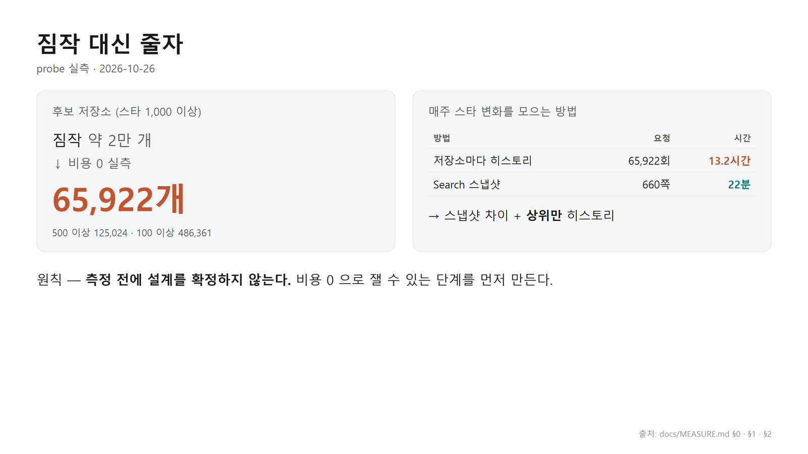

| 짐작 | 실측(2026-10-26) | 근거 |
| --- | --- | --- |
| 후보 저장소 약 2만 개 | 스타 1,000개 이상 **65,922개** | `docs/MEASURE.md §1` |
| 저장소마다 별 기록을 부르면 된다 | 전부 부르면 **13.2시간** — GitHub은 시간당 5,000번까지라 매주는 불가 | `docs/MEASURE.md §2` |

이 실측은 요청 498번, 비용 0이었습니다(`docs/MEASURE.md:4`). 짐작대로 만들었다면 처음부터 돌아가지 않는 도구가 될 뻔했습니다.

### 매주 사진 두 장을 빼면 (움직이는 그림 T1-A)

그래서 방법을 바꿨습니다. 매주 한 번, 별 1,000개 이상인 저장소 전부의 별 수를 사진 찍듯 한꺼번에 받습니다. 검색 한 번에 100개씩, 약 22분이면 됩니다. 지난주 사진과 이번 주 사진을 겹쳐 빼면 누가 얼마나 늘었는지 후보가 바로 나옵니다. 요일별 자세한 기록은 그 후보 가운데 위쪽 몇천 개만 따로 불러옵니다. 13시간짜리 요청이 한 시간 안팎으로 줄었습니다. → [움직이는 개념 노트에서 단계별로 보기](https://daehyub71.github.io/vibecoding-it-basics/notes/t1.html)

이것이 결정 27입니다(`docs/SPEC.md:80`). 주간 작업 전체 예상은 첫 실행을 본 뒤 1.5시간 안팎으로 다시 잡았습니다(`docs/MEASURE.md:192`). **추정도 실측이 나오면 고칩니다.**

## 5부. 테스트가 지키는 규칙

셋째 규칙은 **테스트를 먼저 쓰는 것**입니다. 기능을 만들기 전에, 그 기능이 지켜야 할 약속을 테스트로 먼저 적습니다.

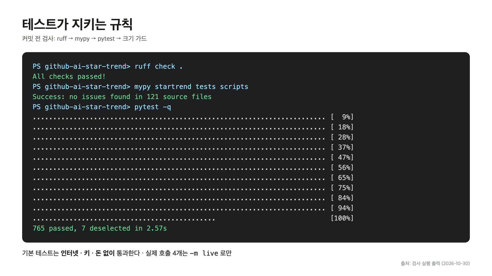

| 장치 | 하는 일 | 근거 |
| --- | --- | --- |
| 인터넷 0 테스트 | 기본 테스트는 인터넷 · 열쇠 · 돈 없이 통과. 테스트 중에는 네트워크 연결을 막는다 | `tests/conftest.py:21~27` |
| 대역(mock) | GitHub이나 Claude 대신 대역 배우를 세운다 | `startrend/clients/github_mock.py` |
| 통제군 | 검사기에 **일부러 규칙을 어긴 코드**를 넣어 정말 잡는지부터 확인 | `tests/test_architecture.py:1 · 6` |
| 커밋 전 검사 | 커밋할 때마다 ruff → mypy → pytest → 크기 가드 | `scripts/hooks/pre-commit:2 · 11~14` |

통제군(control group)은 비교 기준으로 두는 묶음, 여기서는 「위반이 있는 줄 아는 입력」입니다. **아무것도 못 잡는 검사기는 늘 「통과」라고 말하기** 때문에 필요합니다. 위반을 넣었는데도 통과하면, 고장 난 건 코드가 아니라 검사기입니다.

테스트는 10-27의 293개에서 10-30에 **765개**까지 늘었습니다(제작 원고 §9 · 화면 T1-4).

## 6부. 첫 실행에서 사라진 641개

처음으로 진짜 데이터를 모았습니다(검색 1,167번 · 57분). 그런데 기대한 숫자와 맞춰 보니 **641개가 비어 있었습니다. 에러 메시지는 하나도 없었습니다.**

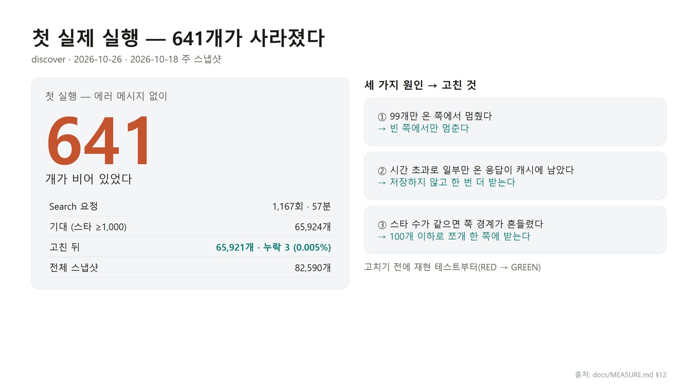

어떻게 알았을까요? 발굴 프로그램은 별 수 구간마다 검색 결과가 알려 준 총계(기대값)와 실제로 받은 개수를 나란히 남깁니다(`docs/MEASURE.md:182`). **기대값이 있었기 때문에 빈칸이 보였습니다.**

### 641개가 사라진 이유 (움직이는 그림 T1-B)

원인은 셋이었습니다. 첫째, 검색 결과는 한 쪽에 100개씩 오는데, 마지막 쪽이 아닌데도 99개만 오는 쪽이 있었습니다. 코드는 「덜 찼으니 끝났다」고 보고 거기서 멈췄습니다. 둘째, 시간이 모자라 일부만 온 응답이 그대로 저장돼서, 다시 돌려도 같은 빈칸이 나왔습니다. 셋째, 별 수가 같은 저장소끼리는 부를 때마다 순서가 바뀌어, 쪽과 쪽 사이에서 빠지거나 겹쳤습니다. 버그를 그대로 재현하는 테스트를 먼저 쓰고, 실패하는 걸 본 다음에 고쳤습니다. 다시 돌리자 빈칸은 641개에서 3개로 줄었습니다. → [움직이는 개념 노트에서 단계별로 보기](https://daehyub71.github.io/vibecoding-it-basics/notes/t1.html)

| 원인 | 고친 것 | 근거 |
| --- | --- | --- |
| ① 99개만 온 쪽에서 멈춤 | 빈 쪽에서만 멈춘다 | `docs/MEASURE.md:188` |
| ② 일부만 온 응답(`incomplete_results=true`)이 저장됨 | 저장하지 않고 한 번 더 받는다 | `docs/MEASURE.md:189`, `github_live.py:237~241` |
| ③ 같은 별 수끼리 순서가 흔들림 | 100개 이하로 쪼개 한 쪽에 받는다 | `docs/MEASURE.md:190` |

고친 뒤 기대 65,924개 중 65,921개, 누락 3개(0.005%)였고, 회귀 테스트(한 번 고친 버그가 다시 생기지 않는지 지키는 테스트) 3개가 함께 들어갔습니다(`docs/MEASURE.md:182 · 186`).

버그를 AI에게 맡길 때도 “고쳐 줘” 대신 이렇게 부탁합니다. 고친 뒤 정말 고쳐졌는지 알려면 **고치기 전에 실패하는 모습**을 먼저 봐야 하니까요.

```text
아직 코드를 고치지 마. 이 버그를 그대로 재현하는 테스트를 먼저 써 줘.
지금 코드에서 그 테스트가 실패하는 것을 내가 본 다음에 고치자.
```

## 7부. 한 번 쓰면 못 고치는 파일

### 4주만 먼저 · 이상한 숫자

1년치, 52주를 한 번에 돌리기 전에 최근 4주만 먼저 돌려 봤습니다. 저장소 3,495개에 21분, 비용 0이었습니다(`docs/MEASURE.md §13`). 처음으로 진짜 순위가 나왔는데, 셋째 줄에 이상한 숫자가 있었습니다.

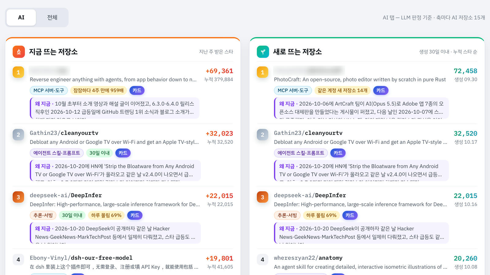

### 주 시작 스타가 음수가 된 이유 (움직이는 그림 T1-C)

DeepInfer는 한 주 동안 별을 2만 2천 개 받았는데, 주 끝 별 수는 그보다 적었습니다. 그렇다면 주 시작 별 수는 마이너스가 됩니다. 이유는 시간 차이였습니다. 사진을 찍은 뒤 기록을 받기까지 그사이 별이 더 늘었고, 위에서부터 빼 내려가다 너무 많이 뺀 겁니다. 아래에서부터 쌓아 올리는 방법도 있습니다. 두 방법 모두 실제보다 조금 작게 나오니, 둘 가운데 큰 쪽을 쓰면 더 정확하고 마이너스가 될 수 없습니다. 이런 줄이 한 저장소가 아니라 주마다 마흔 개에서 예순 개씩 있었습니다. → [움직이는 개념 노트에서 단계별로 보기](https://daehyub71.github.io/vibecoding-it-basics/notes/t1.html)

실제 값은 증가 22,015 · 주 끝 21,988(주 시작 −27)이었고, 이런 줄이 주마다 44~61행에서 고친 뒤 0행이 됐습니다(`docs/MEASURE.md:209`, 고친 코드 `startrend/core/history.py:15~18`).

### 왜 4주 시험에서 찾은 게 다행이었나

주마다 남기는 별 파일은 **한 번 쓰면 다시 쓰지 않게** 만들었습니다. 지난 기록이 슬그머니 바뀌면 추이 그래프를 믿을 수 없기 때문입니다(`docs/SPEC.md:141` FR-2.2, 코드 `startrend/core/io.py:44~51`). 음수 버그를 52주 소급 뒤에 찾았다면 고칠 수 없는 파일 52개에 틀린 숫자가 박힐 뻔했습니다. 그래서 오래 걸리는 작업은 **임시 폴더에 먼저** 씁니다(`README_KO.md:53`).

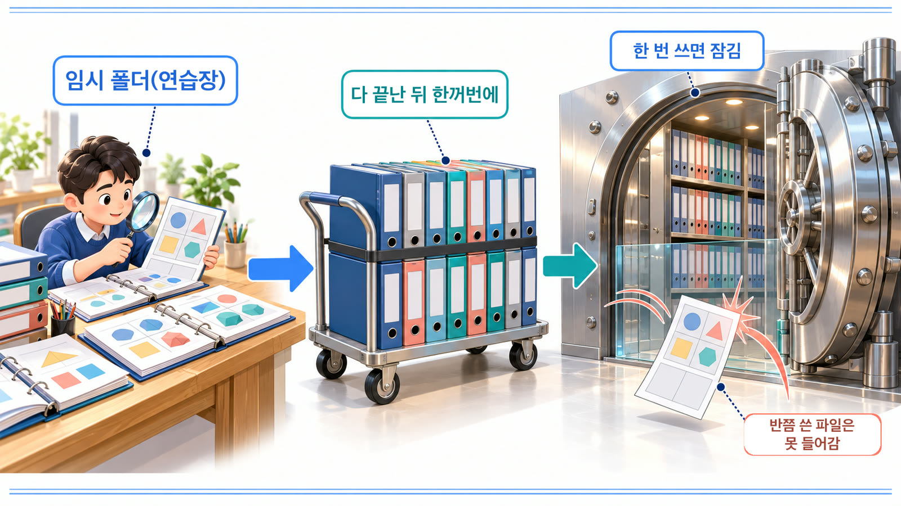

연습장에서 다 맞춰 본 서류만 금고에 들어갑니다. 반쯤 쓴 서류는 금고 문 앞에서 막힙니다.

### 14시간째 멈춤

52주 소급은 저장소 82,590개에 요청을 15만 번쯤 보내야 해서 하루가 넘게 걸립니다. 그런데 14시간째, 상대 서버가 응답 없이 연결을 끊어 프로그램이 멈췄습니다(`docs/MEASURE.md:221~222`).

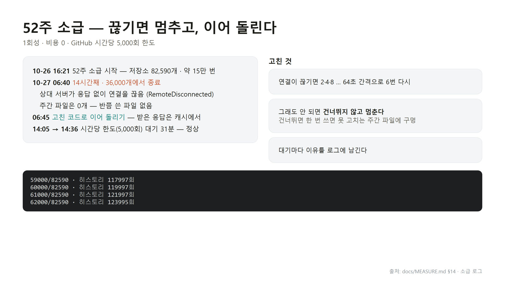

다행히 주간 파일은 모든 저장소를 끝낸 뒤 한꺼번에 쓰게 되어 있어 반쯤 쓴 파일은 없었습니다. 그래서 연결이 끊기면 2 · 4 · … · 64초 간격으로 6번 다시 시도하고, **그래도 안 되면 건너뛰지 않고 멈추게** 고쳤습니다(`startrend/clients/github_live.py:7~9`). 건너뛰면 고칠 수 없는 파일에 구멍이 나기 때문입니다(`docs/SPEC.md:472` NFR-10). 멈춘 뒤에는 받아 둔 응답으로 이어 돌려 10-27 20:47에 끝났습니다(`docs/MEASURE.md:224`).

## 8부. 급등 패턴은 판정하지 않고 표시만

순위를 보면 유난히 빨리 크는 저장소가 섞여 있습니다. 화면 T1-6의 노란 표시가 그것입니다. 한 계정이 새 저장소를 14개 만들어 새로 뜨는 순위 여러 자리를 차지하기도 했고(`docs/MEASURE.md:213`), 조용하던 어떤 저장소가 4주 만에 959배로 커지기도 했습니다(`docs/MEASURE.md:268`).

그렇다고 프로그램이 수상하다고 판정해서 빼지는 않습니다. **진짜 화제가 된 저장소도 똑같은 모양으로 크기 때문입니다.** 3위 DeepInfer는 공식 조직의 저장소인데, 공개 다음 날 하루에 주간 증가의 69%가 몰렸습니다. 「하루 몰림 = 의심」 규칙이었다면 잘못 잡았을 사례입니다(`docs/MEASURE.md:101 · 106`). 그래서 순위에서 빼지 않고 **근거 숫자를 붙인 노란 표시만 달아, 판단은 읽는 사람에게** 맡깁니다(`docs/SPEC.md:81` 결정 28). 표시가 너무 흔해도 뜻이 옅어져서, 52주로 다시 재 본 뒤 표시가 붙는 비율을 19.8%에서 7.4%로 줄였습니다(`docs/SPEC.md:101` 결정 49).

## 9부. 채점표부터 — 정답 세트

이제 AI가 저장소를 분류할 차례입니다. AI 저장소인지 아닌지, AI라면 어떤 종류(카테고리)인지를 가르는 일입니다. 그 전에 **채점표부터** 만들었습니다.

| 항목 | 값 | 근거 |
| --- | --- | --- |
| 정답 세트 | 저장소 200개 — 순위 60 · AI 신호 강 60 · 약 40 · 없음 40 | 제작 원고 §9, `docs/MEASURE.md §18` |
| 블라인드 30 | Claude 초안을 **가린 채** 정함 — 다른 AI의 분류를 사람이 검토해 옮긴 라벨 | `docs/SPEC.md:274` FR-14.1 |
| 초안 검수 170 | Claude 초안을 보고 사람이 검수 — **고친 것 0개** | `docs/MEASURE.md:312` |

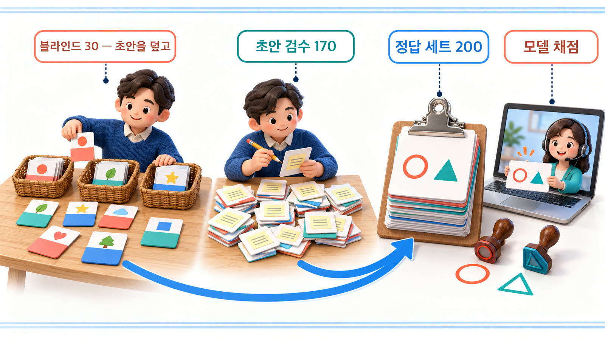

초안을 보고 고르면 초안 쪽으로 기울기 쉽습니다. 그 기울기를 재려면 초안을 보지 않고 정한 묶음이 필요합니다(`docs/SPEC.md:93` 결정 41). 시험 문제를 내는 선생님이 답안지를 덮고 먼저 풀어 보는 것과 같습니다.

결과가 그 걱정을 보여 줬습니다. 초안 없이 정한 블라인드 30에서는 카테고리 일치가 63.2%였는데, 초안을 보고 검수한 170에서는 고친 것이 하나도 없었습니다. 그래서 **점수는 블라인드 쪽으로 매기기로** 했습니다(`docs/MEASURE.md:313~315`).

## 10부. 분류 — 틀린 것에서 규칙을 배운다

첫 채점에서 Claude는 AI인지 아닌지는 잘 맞혔지만, 종류는 자주 갈렸습니다. 틀린 7개를 하나씩 열어 보니 **AI가 모자란 게 아니라, 경계를 정해 준 적이 없었습니다**(`docs/MEASURE.md §19`). 예를 들어 AI 기능을 넣은 일반 앱을 넣을 칸이 없었습니다. 그래서 「AI 앱·서비스」 칸을 새로 만들고, 헷갈리는 경계를 규칙으로 적었습니다(`docs/SPEC.md:102` 결정 50).

| 경계 규칙 | 뜻 |
| --- | --- |
| 에이전트가 부르는 도구 · 플러그인 | MCP 서버 · 도구 |
| 에이전트 프레임워크 | 에이전트를 **만드는** 것만 |
| AI를 내세우거나 사용자에게 스킬 · MCP를 주면 | AI 저장소 |
| 특정 모델 API 사용 가이드 | 그 모델의 분야 |

규칙을 만들 때 쓴 30개만 다시 채점하면, 정답을 외웠는지 기준을 배웠는지 알 수 없습니다. 그래서 **규칙을 만들 때 보지 않은 30개**를 더해 블라인드 60으로 다시 채점했습니다(실측, 2026-10-28).

| 채점 묶음 | AI 여부 | 카테고리 | 근거 |
| --- | ---: | ---: | --- |
| 처음 30 · 예전 프롬프트 | 93.3% | 47.4% | `docs/MEASURE.md:341` |
| 블라인드 60 · 최종 프롬프트 | 96.7% | **86.8%** | `docs/MEASURE.md:354` |
| 처음 보는 30 · 최종 프롬프트 | 93.3% | **89.5%** | `docs/MEASURE.md:356` |

처음 보는 쪽 점수도 똑같이 올랐습니다. 정답을 외운 게 아니라 기준을 배운 겁니다.

### 52주를 한 번에 분류

이렇게 다듬은 기준으로 52주치를 한꺼번에 분류했습니다. 저장소 1,947개를 54분 만에 모두 판정했고(미분류 0), 비용은 **$18.68**이었습니다(`docs/MEASURE.md:368~373`).

첫 13주와 끝 13주를 비교하면 AI에게 일을 시키는 요령을 담은 **에이전트 스킬 · 프롬프트**가 17.3% → 27.2%, AI에게 도구를 이어 주는 **MCP 서버 · 도구**가 6.3% → 16.4%로 늘었고, AI 앱 · 서비스는 18.9% → 12.3%로 줄었습니다(`docs/MEASURE.md §21`). 처음에 말한 「실무에 쓸 만한 도구」가 바로 이쪽에 몰려 있었습니다. 다만 이건 **순위 후보 쪽 AI 저장소의 구성**이지 GitHub 전체가 아니라서, 화면에 그 범위를 함께 적습니다(`docs/MEASURE.md:408`).

## 11부. JEV를 뺀 이유

원래는 요즘 화제인 **JEV**도 써 보려고 했습니다. JEV는 글을 쓰지 않고, 정해진 보기 가운데 하나를 확률과 함께 골라 주는 판정 전용 모델입니다. 같은 채점표로 Claude와 JEV, 그리고 둘을 섞어 쓰는 방법을 겨뤄 보고 고를 생각이었습니다(`docs/SPEC.md:78` 결정 24).

| 항목 | 내용 | 근거 |
| --- | --- | --- |
| JEV | TypeSafe AI의 판정형 모델, 2026-09-15 출시 · 영어 우선 | `docs/SPEC.md §부록 B` |
| 결정 | **결정 51 (2026-10-28) — JEV를 쓰지 않는다. 판정은 Claude 단독** | `docs/SPEC.md:103` |
| 사용자 이유 | **유료 API 키 부담** — 키를 따로 마련해야 해서 개인 프로젝트에는 부담 | 제작 의도 |
| 문서의 근거 | 블라인드 60에서 Claude가 AI 여부 96.7% · 카테고리 86.8%로 쓸 만함 | `docs/SPEC.md:103` |
| 남겨 둔 것 | 판정을 맡는 자리(`DecisionClient`)는 따로 떼어 두어, 나중에 다른 판정기로 바꿔 끼울 수 있다 | `docs/SPEC.md:103` |

**채점표를 먼저 만들었기 때문에** 「Claude만으로 충분한가」를 숫자로 답할 수 있었고, 바꿔 끼울 자리를 남겨 문도 닫지 않았습니다.

## 12부. 근거는 어디서 찾나 — 누가 검색하나

저장소 카드에는 「이 저장소를 실제로 써 본 사람들의 이야기」가 근거로 들어갑니다. 어디서 가져올 수 있는지 AI에게 조사를 나눠 맡기고 모든 결론에 출처와 날짜를 붙이게 했더니(`docs/SPEC.md §부록 C`), **Reddit은 2025-10부터 API에 사전 승인이 필요하고**(`docs/SPEC.md:606`), **X는 유료**였습니다(`docs/SPEC.md:111` 결정 57). 트렌드가 시작되는 곳이라고 했던 X도, 개인 프로젝트에서는 직접 가져오지 않기로 했습니다.

### 누가 검색하나 (움직이는 그림 T1-D)

웹 검색은 두 가지 방법을 실제로 돈을 내고 재 봤습니다. 첫 번째는 Claude에게 검색까지 맡기는 방법입니다. 저장소 다섯 개에 75센트를 썼는데, 찾아온 글은 다섯 곳 모두 0개였습니다. 들여다보니 같은 검색어를 되풀이하다 횟수 제한에 걸려 빈손으로 돌아온 겁니다. 두 번째는 우리 코드가 검색해서 주소 목록을 파일로 남기고, Claude는 그 목록 안에서만 판단하는 방법입니다. 같은 저장소 하나를 검색 한 번으로 찾아보니 리뷰와 사용기가 여섯 건 나왔습니다. 무엇을 봤는지 우리 쪽에 남는 두 번째 방법을 골랐습니다. → [움직이는 개념 노트에서 단계별로 보기](https://daehyub71.github.io/vibecoding-it-basics/notes/t1.html)

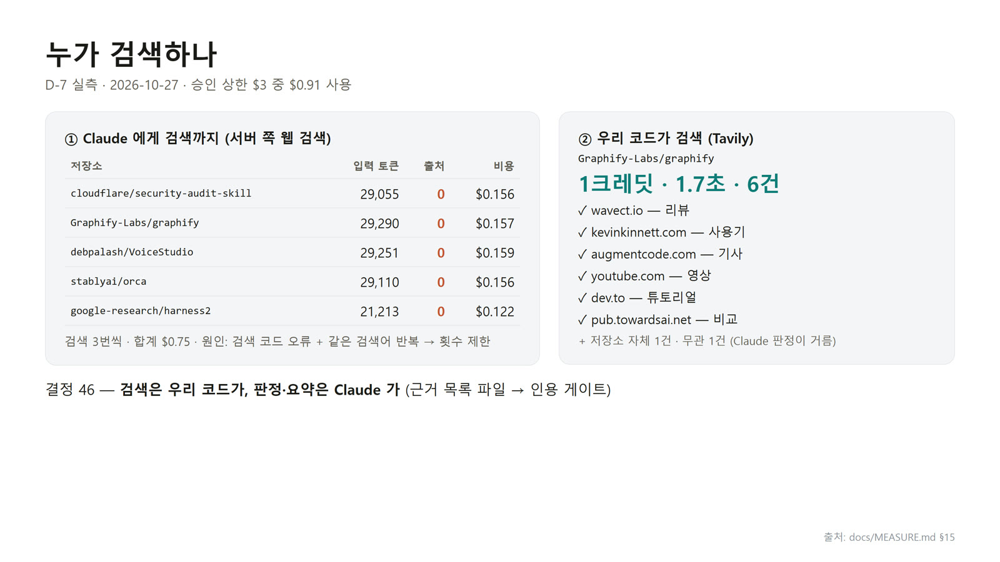

받은 결과 안에 제3자 글이 있었는데도 최종 답은 빈 목록이었습니다(`docs/MEASURE.md:248`). 그래서 결정 46은 **검색은 우리 코드, 판정 · 요약은 Claude**로 나눴고(`docs/SPEC.md:98`), 같은 다섯 개를 이 방식으로 모으니 저장소당 웹 근거 12~21건, 비용 0이었습니다(`docs/MEASURE.md:424`).

## 13부. 카드 · 화면 · 자동 실행

### 저장소 카드 — 링크는 코드가 만든다

근거가 모이면 Claude가 저장소마다 카드를 씁니다. 이때 중요한 약속이 있습니다. **Claude는 출처 주소를 직접 쓰지 않고 근거 목록의 번호(E1, E2 …)만 적습니다**(`startrend/prompts/card.md:16`). 주소는 코드가 그 번호로 붙이니까, AI가 지어낸 링크가 들어갈 틈이 없습니다(`startrend/stages/analyze.py:4`). 그래도 남은 링크는 인용 게이트가 근거 목록과 대조해 막습니다(`startrend/gate.py:1~5`).

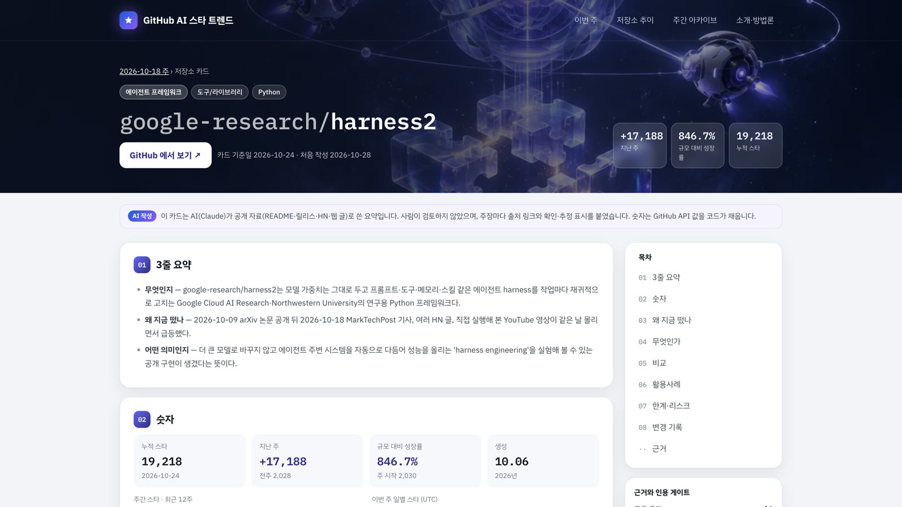

한 주치 카드 48장(장당 약 $0.13)을 만들다가 28장째에서 크레딧이 떨어져 멈춘 일도 있었습니다. 이미 쓴 카드는 남아 있어서, 충전한 뒤 **남은 15장만** 이어서 만들었습니다(`docs/MEASURE.md:474~477`).

### 화면 — 시안 합의 뒤 공개까지

화면은 코드를 쓰기 전에 시안부터 만들어 합의했습니다(결정 33). 5년 뒤를 가정한 가짜 데이터로 미리 돌려 보니 화면 하나에 60초가 넘게 걸려, 주마다 카드를 전부 읽던 것을 그 주 카드만 읽게 고쳤습니다(`docs/MEASURE.md §26`).

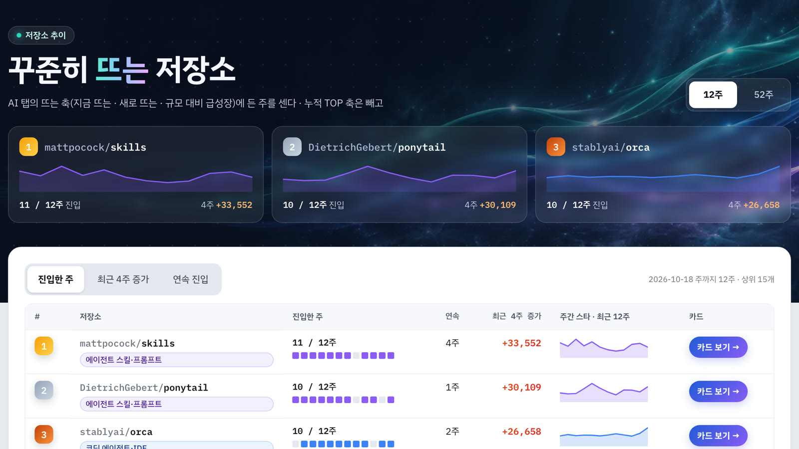

그리고 사이트를 공개했습니다. 사람이 검토하지 않은 AI 글이 함께 나가니까, 화면마다 **AI가 쓴 글이라는 안내**를 붙였습니다(`docs/SPEC.md:112` 결정 56).

### Notion에 쌓고, 사람이 게시한다

결과는 Notion에도 쌓이고, 네이버 블로그에 올릴 글도 매주 **초안이 자동으로** 만들어집니다(`docs/SPEC.md:86` 결정 34). 하지만 **초안을 검토하고 게시하는 것은 사람**입니다(`docs/SPEC.md:88` 결정 36). 프로그램은 상태가 「초안」인 페이지만 고치고, 사람이 손댄 페이지는 덮어쓰지 않습니다(`docs/SPEC.md:477` NFR-16).

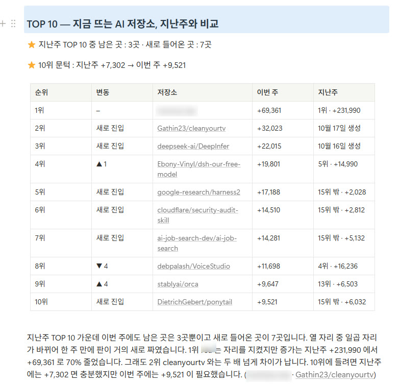

지난주와 비교한 순위 변동 표와 사람이 만든 그림도 초안에 자동으로 들어갑니다(`docs/MEASURE.md:514`, 결정 61 · 62).

### 매주 월요일 아침 9시


이제 이 모든 과정이 매주 월요일 09:00(한국 시각)에 GitHub이 빌려주는 컴퓨터에서 저절로 돕니다(`.github/workflows/weekly.yml:15`). 첫 자동 실행은 **2026-11-02(월)**입니다(`docs/TASK.md` P5-7).

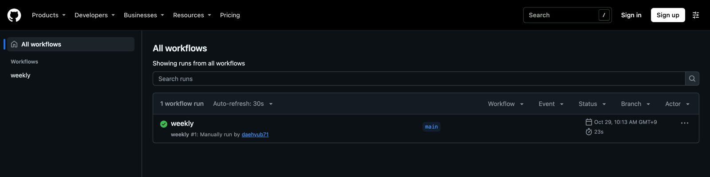

| 어디에 | 무엇을 | 근거 |
| --- | --- | --- |
| **공개 저장소** | 코드 · 주간 별 파일 · 순위 · 분류 결과 | `docs/SPEC.md:104` 결정 53 |
| **비공개 저장소** | AI가 쓴 카드 · 브리핑 · 블로그 초안 | `docs/SPEC.md:104 · 109 · 113` 결정 53 · 59 · 55 |

코드는 공개하지만, 사람이 검토하지 않은 AI 글은 공개 저장소에 쌓지 않습니다.

## 14부. 돈과 열쇠

### 돈이 나가는 일은 계산이 먼저

돈이 나가는 일에는 규칙이 하나 더 있습니다. **dry-run이 먼저**입니다. dry-run은 한 번도 부르지 않고 몇 번 부르고 얼마가 드는지만 계산해 보여 주는 실행이고, 사람이 그 금액을 승인한 뒤에야 실제로 실행합니다(`docs/SPEC.md:247` FR-11.3, `README_KO.md:54`).

| 겹 | 하는 일 | 근거 |
| --- | --- | --- |
| ① dry-run | 부르지 않고 규모와 금액 계산 → 승인 → 실행 | FR-11.3 |
| ② 예산 계량기 | 부르기 **전에** 최악의 비용을 잡아, 상한(주 $10)을 넘을 수 있으면 아예 부르지 않는다 | `startrend/budget.py:1~6 · 65`, 결정 31 |
| ③ Console 월 한도 | Claude API 전용 작업 공간에 월 지출 한도 $50 — 코드에 실수가 있어도 한 번 더 막는다 | `docs/SPEC.md:470` NFR-8 |

52주 분류는 미리 계산한 $18.2와 실제 $18.68이 거의 맞았고(`docs/MEASURE.md:373`), 정답 세트 초안 첫 시도는 최악 비용 $3.04가 승인 상한 $3.00을 넘어 **제출 전에 멈췄고 지출은 $0**이었습니다(`docs/MEASURE.md:290`). 계량기가 제 일을 한 장면입니다.

### 키와 토큰 다루기

이 프로젝트에는 GitHub, Claude, Notion, 검색 서비스의 열쇠가 필요했습니다.

| | 하는 일 |
| --- | --- |
| ✓ | 키는 컴퓨터의 **사용자 환경변수**에, 자동 실행용은 **GitHub Secrets**(비밀 보관함)에(`docs/SPEC.md:470`) |
| ✓ | 키 이름은 **프로젝트 전용**으로 — 흔한 이름이면 다른 프로그램이 집어 써서 요금이 나갈 수 있다 |
| ✓ | 잘 들어갔는지 볼 때도 **값을 띄우지 않고** 앞 글자와 길이만(실습 D) |
| ✗ | 채팅에 붙여 넣기 · 키가 든 줄을 선택한 채 AI에게 질문하기 |
| ! | 키가 대화나 화면에 드러났다면 **망설이지 말고 새 키로 교체** |

## 직접 확인하기

**자기 프로젝트 하나**(작아도 됩니다)를 열고, 네 가지 습관을 비용 0으로 해 봅니다.

| 실습 | 시간 | 할 일 |
| --- | --- | --- |
| A. 짐작 vs 실측 | 5분 | 「아마 이럴 것」 하나를 적고, 돈 안 드는 방법으로 재서 나란히 놓기 |
| B. 통제군 | 5분 | 작은 검사기에 일부러 틀린 입력을 넣어 정말 잡는지 보기 |
| C. dry-run 물어보기 | 5분 | AI에게 「실행하지 말고 몇 번 부르고 얼마 드는지만」 계산하게 하기 |
| D. 열쇠 점검 | 5분 | 키를 환경변수에 두고, 값을 출력하지 않고 앞 글자와 길이만 확인하기 |

### 실습 A — 짐작 vs 실측

1. 짐작 하나를 먼저 적습니다. 예: 「내 프로젝트의 파이썬 파일은 20개쯤, 줄 수는 2천 줄쯤」(학습용).
2. 프로젝트 폴더에서 잽니다.

**윈도우 · PowerShell**

```text
> (Get-ChildItem -Recurse -File -Filter *.py | Measure-Object).Count
> (Get-ChildItem -Recurse -File -Filter *.py | Get-Content | Measure-Object -Line).Lines
```

**맥 · 터미널** — `find . -name '*.py' | wc -l` · `find . -name '*.py' -exec cat {} + | wc -l`

3. 「짐작 · 잰 값 · 잰 방법 · 날짜 · 설계에 주는 뜻」을 한 줄씩 적어 나란히 놓습니다.

숫자가 짐작보다 훨씬 크다면 가상환경 폴더(`.venv`)처럼 내 코드가 아닌 것이 섞였는지 보세요. **재는 방법도 확인 대상입니다.** 웹 앱이라면 Network 탭으로 「화면을 한 번 열 때 요청이 몇 번 나가나」를 재 봐도 좋습니다.

### 실습 B — 통제군: 검사기가 정말 잡는가

「코드에 키 값을 직접 써 넣은 줄」을 찾는 작은 검사기를 만들고, 일부러 위반을 넣어 봅니다.

1. 프로젝트 폴더에 통제군 파일 `control_bad.py`를 만들고 `API_KEY = "test-not-a-real-key"` 한 줄만 적습니다. 진짜 키가 아닌 학습용 값입니다.
2. 검사기를 돌립니다.

**윈도우 · PowerShell**

```text
> Select-String -Path .\*.py -Pattern 'API_KEY\s*=\s*["'']'
control_bad.py:1:API_KEY = "test-not-a-real-key"
```

**맥 · 터미널** — `grep -nE "API_KEY[[:space:]]*=[[:space:]]*['\"]" *.py`

3. `control_bad.py`가 잡히면 검사기가 살아 있는 겁니다. 이번엔 패턴에 일부러 오타를 내 봅니다(`API_KEY` → `APIKEY`). 아무것도 안 나옵니다. **검사기는 「위반 없음」이라고 말하지만, 사실은 고장 난 것입니다.**
4. 확인이 끝나면 `control_bad.py`를 지웁니다.

### 실습 C — dry-run 물어보기

돈이 드는 API(AI 모델, 유료 검색 등)를 쓰는 기능, 또는 앞으로 만들 기능을 하나 골라 AI에게 계산만 부탁합니다.

```text
이 기능을 실제로 실행하지 마. 외부 API를 한 번도 부르지 말고 계산만 해 줘.

1) 한 번 돌릴 때 API를 몇 번 부르는지, 무엇을 근거로 셌는지
2) 한 번 부를 때 단가(공식 가격표 주소와 확인 날짜를 같이)
3) 보통 경우와 최악의 경우 금액을 나눠서
4) 최악의 경우가 내가 정한 상한(예: 한 번에 1달러)을 넘으면 어디서 멈추게 할지

내가 금액을 승인하기 전에는 실행 코드를 돌리지 마.
```

답을 받으면 **단가에 출처와 날짜가 있는지**, **최악의 경우가 따로 있는지**, **「부르지 마」를 지켰는지** 봅니다.

### 실습 D — 열쇠 점검

키를 채팅이나 코드가 아니라 환경변수에 두고, **값을 출력하지 않고** 확인합니다. `MYAPP_API_KEY`는 학습용 이름입니다. 실제로는 프로젝트 이름을 붙인 전용 이름을 씁니다.

1. 키 넣기 — 윈도우는 시작 메뉴에서 「계정의 환경 변수 편집」을 열어 **사용자 변수**에 만듭니다(명령 줄에 키 값을 치면 명령 기록에 남을 수 있습니다). 맥은 편집기로 `~/.zshrc`를 열어 `export MYAPP_API_KEY='…'` 한 줄을 더합니다. 화면을 공유하는 중에는 하지 않습니다.
2. 새 터미널을 열고 확인합니다.

**윈도우 · PowerShell**

```text
> $k = [Environment]::GetEnvironmentVariable("MYAPP_API_KEY", "User")
> if ($k) { "앞 4글자: " + $k.Substring(0, [Math]::Min(4, $k.Length)) + " · 길이: " + $k.Length } else { "없음" }
```

**맥 · 터미널** — `printf '앞 4글자: %s · 길이: %d\n' "${MYAPP_API_KEY:0:4}" "${#MYAPP_API_KEY}"`

3. 앞 글자와 길이가 발급받은 키와 맞으면 잘 들어간 것입니다. 혹시 키를 대화나 화면에 노출했다면, 지우는 것으로 끝내지 말고 **발급한 곳에서 폐기하고 새로 받습니다.**

## 오해 바로잡기

| 오해 | 바로잡기 |
| --- | --- |
| AI에게 맡기면 알아서 정해 준다 | 갈림길마다 AI는 선택지와 장단점을 내고, 정하는 건 끝까지 사람이었다. 결정 63개가 날짜와 이유와 함께 문서에 남아 있다 |
| 테스트는 다 만든 뒤에 쓴다 | 약속을 테스트로 먼저 적고, 버그는 재현 테스트가 실패하는 걸 본 뒤 고친다(641개 → 3개) |
| 에러가 없으면 잘 된 것이다 | 641개는 에러 없이 사라졌다. 기대값과 맞춰 봐야 보인다 |
| AI가 틀리면 AI 탓이다 | 틀린 7개를 열어 보니 경계를 정해 준 적이 없었다. 규칙을 적자 카테고리 47.4% → 86.8%, 처음 보는 30개에서도 89.5% |
| 수상한 급등은 프로그램이 걸러야 한다 | 진짜 화제(공식 조직의 출시)도 같은 모양으로 큰다. 근거 숫자를 붙여 표시만 하고 판단은 사람이 |

## 한 장 요약

| 기억할 질문 | 한 문장 답 |
| --- | --- |
| 누가 정하나? | **사람이 정한다** — AI는 선택지와 장단점, 결정은 사람, 정한 것은 문서가 기준 |
| 설계는 언제 굳히나? | **잰 뒤에** — 짐작 2만 개가 실측 6.6만 개였다. 돈 안 드는 실측부터 |
| 규칙은 누가 지키나? | **테스트가 지킨다** — 하네스: 테스트 먼저 · 통제군 · 커밋 전 검사 · 채점판 · 약속 점검 |
| 이상하면? | **멈춘다** — 끊기면 건너뛰지 않고 멈추고 이어 돌린다. 한 번 쓴 파일은 고치지 않는다 |
| 돈이 나가기 전에? | **계산한다** — dry-run · 예산 계량기(주 $10) · 월 한도 |
| AI가 쓴 글은? | 링크는 코드가 붙이고, 초안은 자동이지만 검토 · 게시는 사람이, 파일은 비공개 저장소에 |
| 예제 저장소는? | 닷새 · 커밋 94개 · 테스트 765개 · 52주 분류 $18.68 · 매주 월요일 09:00 자동 실행 |

## 확인 문제

1. 후보 저장소가 2만 개쯤이라는 짐작이 맞았다면 어떤 방법으로 만들었을까? 실측이 6만 6천 개로 나왔을 때 무엇을 바꿨나?
2. 641개는 왜 에러 메시지 없이 사라졌을까? 세 원인 가운데 「다시 돌려도 고쳐지지 않는」 것은 무엇이었나?
3. 주간 별 파일을 「한 번 쓰면 다시 쓰지 않게」 만든 이유는? 그 규칙 때문에 14시간째 연결이 끊겼을 때 어떻게 고쳤나?
4. Claude에게 검색까지 맡긴 방법이 출처를 0개 가져온 까닭은? 결정 46은 무엇을 우리 코드 쪽에 남겼나?
5. 정답 세트 200개 가운데 30개는 왜 초안을 가리고 정했을까? 규칙을 고친 뒤 「처음 보는 30개」를 따로 채점한 이유는?

<details>
<summary>풀이 보기</summary>

1. 2만 개였다면 **저장소마다 별 기록(히스토리)을 하나씩 부르는 방법**으로 만들었을 것이다. 실측해 보니 스타 1,000개 이상이 65,922개였고, 전부 부르면 시간당 5,000번 한도로 **매주 13.2시간**이 걸렸다(`docs/MEASURE.md §1 · §2`). 그래서 매주 전체 별 수를 검색으로 한꺼번에 받아(약 22분) 지난주와 빼서 후보를 고르고, **위쪽 후보 몇천 개만** 요일별 기록을 부르는 방법으로 바꿨다(결정 27, `docs/SPEC.md:80`).
2. 코드가 **오류가 아니라 「끝났다」고 판단해서** 멈췄기 때문이다. 한 쪽에 99개만 오자 마지막 쪽이라 보고 정상 종료처럼 멈췄고, 기대값(65,924)과 맞춰 보고서야 드러났다(`docs/MEASURE.md:182`). 다시 돌려도 고쳐지지 않은 것은 **② 시간 초과로 일부만 온 응답이 저장되어** 재실행 때도 그 응답을 꺼내 쓴 것이다. 그런 응답은 저장하지 않고 한 번 더 받게 고쳤다(`docs/MEASURE.md:189`).
3. 지난 기록이 슬그머니 바뀌면 **추이 그래프를 믿을 수 없기** 때문이다(`docs/SPEC.md:141` FR-2.2). 주간 파일은 모든 저장소를 끝낸 뒤 한꺼번에 쓰므로 14시간째 끊겼을 때도 반쯤 쓴 파일은 없었다(`docs/MEASURE.md:222`). 고친 것은 연결 오류를 6번 다시 시도하고, **그래도 안 되면 건너뛰지 않고 멈추는 것**이다. 건너뛰면 고칠 수 없는 파일에 구멍이 나기 때문이다. 멈춘 뒤에는 받아 둔 응답으로 이어 돌렸다(`docs/MEASURE.md:223~224`).
4. 모델이 쓴 검색 코드가 오류로 죽고 **같은 검색어를 되풀이해 횟수 제한에 걸려**, 받은 결과 안에 제3자 글이 있었는데도 빈 목록을 돌려줬다(`docs/MEASURE.md:248`). 결정 46은 **검색과 근거 목록 파일을 우리 코드 쪽에** 남겼다 — 코드가 검색해 주소 목록을 파일로 남기고, Claude는 그 목록 안에서만 판정 · 요약한다(`docs/SPEC.md:98`). 그래서 무엇을 봤는지가 남고, 카드의 링크도 코드가 근거 번호로 붙인다(`prompts/card.md:16`).
5. 초안을 보고 고르면 **초안 쪽으로 기울기 쉬운데, 그 기울기를 재려고** 초안을 덮고 정한 묶음을 따로 두었다(결정 41). 실제로 블라인드 30의 카테고리 일치는 63.2%였는데 초안을 보고 검수한 170은 고친 것이 0개였다(`docs/MEASURE.md:313~315`). 처음 보는 30개를 따로 채점한 것은 **정답을 외웠는지, 기준을 배웠는지** 가리기 위해서다. 처음 보는 30개에서도 카테고리 89.5%가 나와 외운 게 아니라는 근거가 됐다(`docs/MEASURE.md:356`).

</details>

## 출처

- [daehyub71/github-ai-star-trend](https://github.com/daehyub71/github-ai-star-trend) 커밋 `2134a00`(2026-10-30 확인) — `docs/SPEC.md`(§1 · §2 결정 · §9 · FR · NFR · 부록 B · C-2), `docs/MEASURE.md`(§1 ~ §27), `docs/TASK.md`, `README_KO.md`, `startrend/`(core/history.py · core/io.py · clients/github_live.py · budget.py · gate.py · prompts/card.md · stages/analyze.py), `tests/`(conftest.py · test_architecture.py), `scripts/hooks/pre-commit`, `.github/workflows/weekly.yml`. 줄 번호는 본문에 적었습니다. 커밋 수 94는 `git log`(2026-10-26 ~ 30)
- 실측: 숫자는 모두 만든 사람이 2026-10-26 ~ 30에 재서 `docs/MEASURE.md`에 남긴 값입니다. 테스트 수 293개 · 765개와 정답 세트 구성은 강의 제작 원고의 사실 확인표에서 옮겼습니다(765개는 화면 T1-4의 출력과 같음)
- 화면 캡처(2026-10-29 ~ 30): 공개 사이트 · Notion 블로그 초안 · 공개 저장소 Actions 화면, 나머지는 저장소 문서의 값으로 만든 화면입니다. 급등 표시가 붙은 개인 계정의 이름은 흐렸고 이 자료에서도 적지 않았습니다. 키 값 · 토큰 · 개인 폴더 경로는 어느 화면에도 없습니다
- 제작 의도: 0부의 기획 의도, 3부의 하네스를 넣은 이유, 11부의 「사용자 이유: 유료 API 키 부담」은 영상 대본과 제작 원고에서 옮겼습니다
- 상태 · 한계: 2026-10-30 기준(첫 매주 자동 실행 전). 웹 검색 비교는 「이 설정에서의 결과」이고, 블라인드 정답은 순수한 사람 기준선이 아니며(`docs/SPEC.md:274`), 카테고리 비중 변화는 순위 후보 쪽 AI 저장소 기준입니다
- 학습용 예시: 비유 그림 일곱 장의 장면, 실습 A의 짐작 값, 실습 B의 `control_bad.py`와 가짜 키 값, 실습 D의 `MYAPP_API_KEY` 이름
